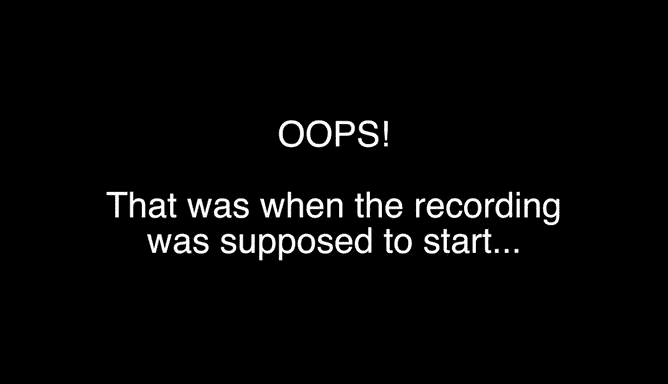

# 密歇根大学《给所有人的Python课》课程4：《使用数据库进行Python编程》｜python-databases｜ - P26：26_03_03_附加办公时间：巴塞罗那.zh_en - GPT中英字幕课程资源 - BV1PP411W7H1

Okay， hello everybody。 This is the second office hours in Barcelona。

 given that I lost the video for the first office hours， but thankfully I was here another day。

 and so we had another office hour。 A few people came to both of them。

 and then we have a bunch of new people。 So I'd like you to meet the people。

 your fellow students from the class。 okay and you can say hi。

 even though you're not in the class yet。 hi I'm Ia and I'm planning on starting the Internet history Okay I'll give Internet history sticker。

 don't and Python is a lot cooler than。 part my name is and I'm taking the Python and I thestone Yes hi my name is Christina I'm a uist and I encourage lingist Python Great my name is。

 I'm lending Python。 Thank you Thank you Hi， my name is Marha。

 I'm taking the Python It's very interesting and I highly recommend to everybody。😊，えさ？Hi。

 I'm Sean and I had the privilege to meet dear Mr。 Chlk and I to meet you。And I think all of you。

 folks are envious about us because we had a very interesting companionship with our dear teacher。

 Well， thank you。🎼hello I am Teresa and I was enjoying the Python course and I think that you can learn a lot with it。

 Thank you， thank you Well， so there we go another successful office hours with Cavasa and wonderful wonderful students here in Barcelona so cheers see you next time。

😊，It is like a pigeon， it's exactly like a pigeon。

Okay。No pressure。 That's makeup。so here we go， so I'll put this close to your face。

 but it's a GoPro so it's got a real wide angle so it's not really taking a picture of your nose but it gets really good audio that way。

Okay。So I'll start。That's what gross think， it is。

