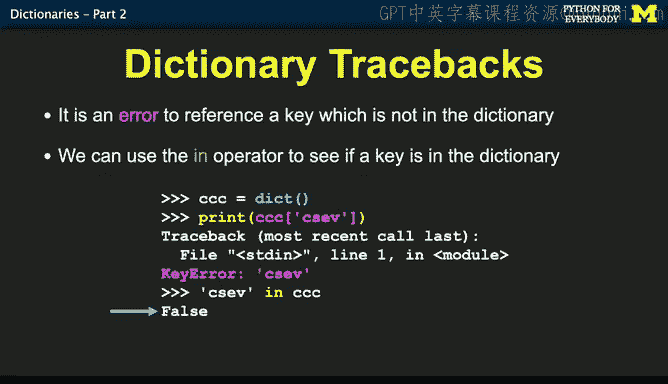

# 密歇根大学《给所有人的Python课》课程2：《Python数据结构课程（密歇根大学）》｜python-data｜ - P26：26_05_02_使用字典计数.zh_en - GPT中英字幕课程资源 - BV1yP411a7TZ

One of the applications of dictionaries that we've really been sort of talking about this whole course is the notion of kind of a histogram where you have a bunch of things and you want to look through all those things。

 and then you want to create counts。And so in this case。

 we're going to talk about the most common name。And so these are some of the names from the email data that we use in this course over and over from the email list that was from 2004 in an open source project that I ran called Sai and these are actual real people。

And I still am friends with all these folks， and I know them all。And so， but the problem is。

 is that you're going to， like when we're doing the maximum and the minimum。

 you you could look at these and you can kind of figure out， okay， looks like Mark War is is3。

 And then Gen 1，2 And so as a human。We look at this from our eyes。

 and we're just looking at different things。 And I think Gen is 5， and I am 3， Chen Wens。To。

 it looks like no， the problem there is， and we saw this in the most common word。

 we're terrible at humans。 We're pretty good at getting。 most of it right。

 but we're gonna make little mistakes。 So one of the things to do is to kind of go through and sort of just start a little。

 you know， making a little tick marks。 You know， hear a C step。 First time you see it， count it，1，2。

3。 So instead of just looking around at it。 you look through it sort of sequentially， one at a time。

 and then you start see a new name。 you make a little tick mark。

 and then you see the name another time。 you add a tick mark to that name。

 And so you end up with this。Dictionary， so that's like a dictionary where the count the three。

 in this case， the7 and the five and the three， those are in a dictionary。

 And the key for that dictionary is C Sev Gen， Chen and Stephen Markwart， right， So that's the idea。

 And this way we can not just look at， you know， what we've got've got。1012 here。

 you can do a million， and you can still do a histogram of a million things and find out the count of all the different things that you're going to see。

And so you can implement this and treat the key in your dictionary as that name。

Now you have to start your counter the first time that you see C7 and Chen。So set it to one。

 And then you can see it。 But then we can add one to it when we see another Gen when。

 we're going to add one， and then she'll be two。 and then I'll be one。 And then the idea of。

 we can have as many counters as we want。 We have kind of a bit of code that adds a new counter with an assignment statements。

 CC， some C7 equals one。 And then we add when we see the next one。

 So there's a little bit more to it。 But you can kind of see the idea of。

Noticing a new name and adding one to the current count of that name。

So one of the things about dictionaries is you can't just reference a dictionary key that doesn't exist。

Because Python wants to blow up on you， I mean it's not， I mean。

 it's not as scary as it once was to see a trace back。

We understand that traceceback is just a form of communication between you and Python。

 That's why I made em pink because they're not mean and not scary。 They're just communication。

And so in this particular case， we are printing CC as subC7。

 it's a brand new dictionary because we just created it one statement earlier。

 and it says you can't do that and you get a traceback and your code looks icky。

The good news is you can ask with the in operator and we've used in in for loops。

 but this is a logical operator that is going to say is C in the dictionary。

 is C7 one of the keys that in the dictionary CC and in this case。

 because we're just starting out it's false。So now what we can do is now that we can check without error whether something's in there or not。

 then we can write。

Un of that else， right？So now what you see is you see we are making a dictionary。

We're going to have some names normally we'd be reading this off of a file。

 but I'm keeping it simple。 you know， we got CA Chenwen。

 CA Genhen and Chenwen again and we're going to write a loop that's going to go through boop boop boop all those things and we're going to first check if the name we're looking at。

Is not in counts if it's not that key is not already present in counts。

 we're going to say counts sub name equals1。 it's the first time we've seen it。

 it's like adding a new name and putting a single tick mark on。Otherwise， if it's already in there。

 we can say counts sub name equals counts sub name plus one and we know we're not going to get a trace back because it's in there。

And then we store that back in count sub name and so now we got this loop in this case we're only going to run it five times and it's going to print out that we see CCSev twice。

 Chenwe twice and Genen once， right？But this could also go a million times。

 and so this is a generic way of using a dictionary。

To capture the moment that we first encounter a name。

And then capture the moment where we're adding one to it， we're encountering it the second， third。

 fourth， whatever， and when we're done， the dictionary is a histogram of the counts of the people。

Now， this notion of this， if then else。If it's in， do one thing， if it's not， do another thing。

 is so common。 And so what we have built into dictionaries， thankfully， is a method。

 Someday we'll talk about object or any programming。 It's a method called get。

 and every dictionary has this get method， and it takes two parameters。

And one is the key you're looking for。And the second one is what we call the default value。

 If the key is not present。 So x is either going to be 0 or whatever the old value is under the key name。

And so this is not going to get a trace back。And it collapses this little if then else。

 from four lines of code into one line of code。 So this is what we'd call an idiom。

 It's a pattern that we use over and over and over again。

Because we just don't want our code to be bigger for bigger sake。 And so this。

 because there's you know， four lines are four times more likely to have an error than one line。

 It's not always true。 Sometimes the one line is so ugly that it is hard to understand。

 But in in this one。All us Python programmers know what get is， and we use it all the time。

And so now we can rewrite that for loop right， and all we do in the we're going to loop again through through the five names。

And we're going to say count subname equals counts。ge。Name comma 0。 And that says if it's not there。

 that part of the right hand side expression is going to be 0。 and then we're going to add one to it。

 So this solves both the case of the first time we see a name and then later times that we see a name。

 and it takes that if then else。 a couple slides earlier and just turns it into a single line。

And again。Take a look at it， go back to those slides。Learn it。And then just like， oh。

 gets a thing and you use it。I mean， nobody who knows Python writes that if then else anymore。

 unless you have other logic that you've got to do。

 everybody knows how get works and so because histograms are such a common use case， you know。

 a away we go。And so counting is a beautiful thing。

 and I'll sort of wrap up this segment to talk about Sesame Street。

There is a wonderful little song that you can find online by searching for the for the string counting is marvelous by the count on Sesame Street。

 I can't give you the URL because。Every time somebody puts it up， they get told to take it down。

 but then someone else puts it up。 And so sooner or later。

 you'll be able to hear the hear the count sing counting is marvelous count。

 I I shouldn't probably sing， but you get the idea and the count。Cas about numbers。

 And the count likes to count things。Python cares about numbers。And Python likes to count things。

 two cheers。