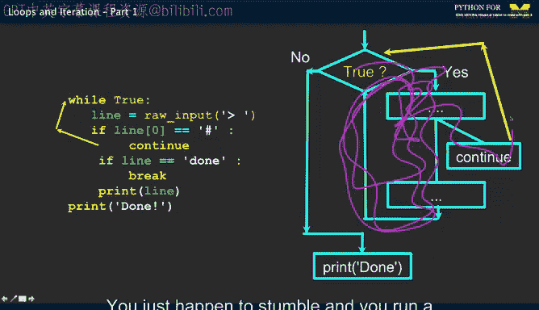

# 密歇根大学《给所有人的Python课》课程1：《编程入门指南（使用Python进行开发）》｜python｜ - P26：26_07_01_循环与迭代.zh_en - GPT中英字幕课程资源 - BV1214y117Mk

Welcome to loops in iteration。 Basically， this is where computers do repetitive tasks that we humans don't want to do。

 This is where the real power and and the real benefit of computers happen Each time through the loop。

 we have to do something smart。 but we can tell a computer to do it a million times really。

 really quite easily。And so the basic idea is， is that at some point in code。You go back up， right。

 the idea is that you've done something， let's go do that thing again。

 and the way we express that in Python。I with a couple of keywords。

 one of the keywords is the while keyword and are the four keywords we'll start talking about the while。

 and in a bit we'll talk about definite loops using four， these are called indefinite loops。

So while is a key word， and this is like an if statement。

 This is a question is n greater than 0 that leads to a true or a false answer。 and if it is true。

This code executes if it is not true， the code is skipped， and in that respect。

 it is exactly the same as an if， you could say。If n was greater than0， run this code。

 otherwise skip this code， but that's where things get a little bit different。

So if it's true in this case， N is5。 So it is true。 So it runs this， it prints out 5。

 which prints that out and then subtracts one， which from N， which it makes it for。

 But with the wild statement， it goes back up again。

And it rechecks the question that another way to say this is here。Rechecks the question。

 And as long as n greater than 0 remains true， it will dive in and do this again。

 So it dives in and prints out 4。 And then it subtracts to 3， goes up， checks again。

Checks again as long as it's there。 down， it goes again。 So prints 3 and then subtracts to 2。

 and then prints 2 and subtracts to 1， and then prints 1 and subtracts to 0。 So in this case。

 n right now is we printed that and now n is 0 and it comes up n is 0 and it comes up is n greater than 0。

 Well， it now switched from all the times。 Yes to now no。Okay，And so when it's no。

 it comes down here and it's done。 So when it comes up here。

 it skips down to the next line and then finishes， So it prints off blast off。

 And we see that at when we came out of the loop n was 0。

 So that was like the residual value of this little variable N after the last iteration through the loop。

 And that's because it was one。 And then we subtracted one from it。 And that got us to 0。

So an important part of any loop is what we call the iteration variable。

 and that is something that changes because if we don't change anything in the loop。

 then it's going to run forever。 That's what we call an infinite loop。

 So here we have n greater than 5。 and we say， while n is greater than 0， which is true， print this。

Come back up， check again is n is greater than0， yet print this， check again is n greater than0。

 print this。And this is when you read your shampoo， and it says lather， rinse and repeat。

 This is what a computer scientist thinks when they read that。 It's like。

 that would be an infinite loop。 You're going to run out of water。

 You're going to run out of shampoo。 You're going to run out of something， right？

 And but the technical problem is， is that ends not changing。And is not changing。

 And so what happens is there's no way for this true to become false。 There's no way for it。

 It just stays true。 And so that's an infinite loop。

 And that will literally run until your computer's battery runs out or you won't plug it or you hit some escape or whatever。

If your computer is spinning in a beach ball， that's got some little weird little thing。

 it's probably in a loop that is either infinite or nearly infinite。

 So this is a bad thing to do because it locks up computers。

 If you write code to do this and you run it on your computer。

 you will probably get some kind of a spinning beach ball or whatever that your computer。

 whatever your operating system does， because it's not good to put your computer in an infinite loop。

And so we need somehow to have an iteration variable that changes。 And in this previous one。

 I subtracted one from n。 And so this variable eventually went from true， true， true， true， true。

 false。 And so it became false。 This question became false。 which gets us out of the loop。

This variable that we use to control it is what we call an iteration variable because it controls how long the iterations run and when the iterations stop。

So this is an infinite loop because we're not affecting the iteration variable iteration variable still as n。

 And then we have another sort of version of this loop that shows that these loops are what are called zero trip loop。

And that is， when this one comes in， this one starts out falls。 And so it skips it。

 And so this basically functions like an if statement。 So it's O。 It comes in。

 falls Sip never runs either of these statements。Now we have some statements that we can use to get out of a loop。

 one of them is the brake statement。And it's an executable statement when it runs。

 it basically breaks out of the loop， moves to the line beyond the end of the loop。

 So this wherever we're at， when this code runs， it jumps out of the loop。

And so we're going to have a loop。 This， This is， this is an infinite loop。

 I just told you not to do infinite loops， but we're going to use brake to get out of this loop。

 So while true， remember， I said it starts out true， can it ever get to false。 Well， in this case。

 it's never going to get to false because it's always true。 While true。

 We've constructed an infinite loop， And what is this loop do。

 It asks for a line of input with little with little arrow sign and then we type something like hello there goes in。

 We check to see if the line we typed was D， O， N E， If so we break， That's not true。

 So then we print a line， and we go up， prompt again。Print it。Prompt again。 And this time。

 we type in done。 So done gets typed。 And so this becomes true。 So we execute here。

 and it immediately leaves。 So it doesn't print the word done here。

 it prints that string to indicate that we've left。 And it can this can be quite a long loop in here。

 This can be allowed of， and you could even say break a couple of different places。

 the mo and you usually put the break inside of if test。

 And as soon as the break executes the loop is done。 It's out of the loop。

 So that you can think of it as。Here's the block， here's the D indent。 so it's this much。

 this is a block。The brake escapes the block， right， It gets out of that loop block。

 the block of code that is the loop。You can think of it as like a transporter， right， you know。

 you just， you're coming in， you're doing a bunch of stuff。

 you're doing this and you're doing this and you're doing this， some other things。

 some other thing you' like， oh， bang， hit the brake key， leave， right， So whatever it is。

 how much ever much code is in this loop。 The brake says， get out of this loop。

 get to the next line beyond the end of the loop。 It's not to go to wood plate and do a different place in the loop。

 It's escape the loop directly and instantaneously。That's the break statement。

The other statement that does something like this is the continue。 And so continue basically says。

Quit on the current iteration and go to the next iteration。So it doesn't， it skips out of the loop。

But it doesn't skip to the line beyond it。 It skips back up to the top。 So continue says， oh。

 we're going to go up to the top。 Bak says get out and continue， says。

 don't do the rest of this iteration， but go up and do the next iteration。

So we have taken this exact same bit of code and the only bit we added right was right here。

 So we read a line。If the first character is a pound sign， we continue。 If the entire line is done。

 we break。 And so breaking is what gets us out at this point。 get out， and we say done。

And what we do is if we find a line like this one that has Pounson as the first character。

We skip back to the beginning of the， of the loop。We go back down and we do another input。

 so we don't print that， but we say something here。 and then and so it does not print the line。

 So it skips that。 So it's like skipping to the top of the loop， not skipping out of the loop。

 so break skips out of the loop and continue skips to the top of the loop。And again。

 same kind of thing， you're running through this loop， all kinds of ways you don't hit the continue。

 you just happen to stumble and you run a continuous statement and you go back up to the top of the loop。

 meaning there's nothing down here that you run。

The continue doesn't get you either of the loop， the continue goes to the next iteration， basically。

 abandons the current iteration and goes to the next iteration。

So these while loops are kind of indefinite。 You can construct them cleverly。

 They just go and go and go until some logical condition becomes false， hopefully。

You've constructed all the loops except one， I constructed it so that it would eventually either exit the loop or the condition would become false。

It's a little hard to sometimes verify that these things are perfect， you know。

 sometimes's a little tricky to make sure that the loop will terminate。Up next。

 we're going to we'll switch from using while to using4 and talk about definite loops。

