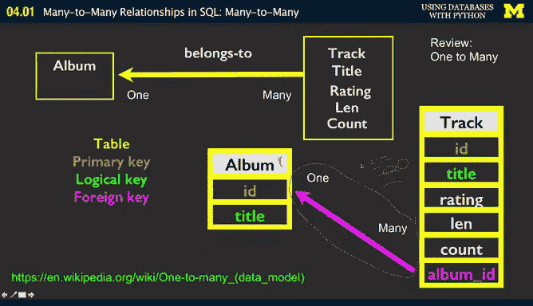
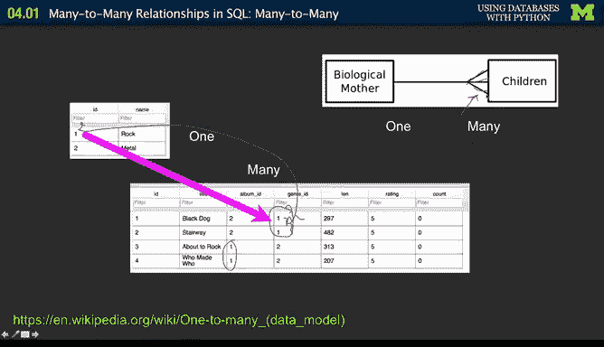
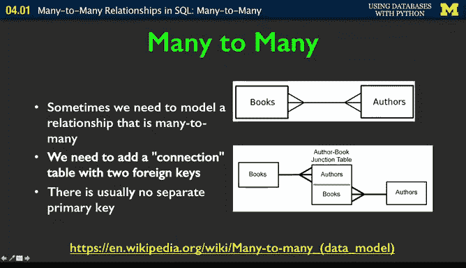
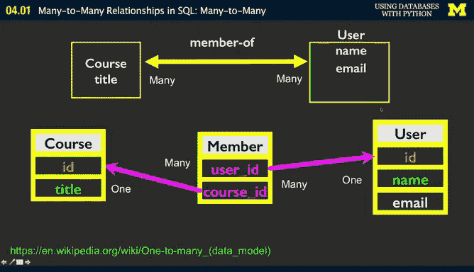
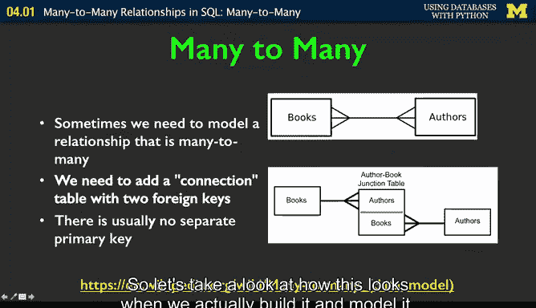
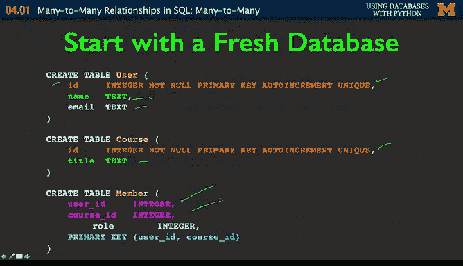
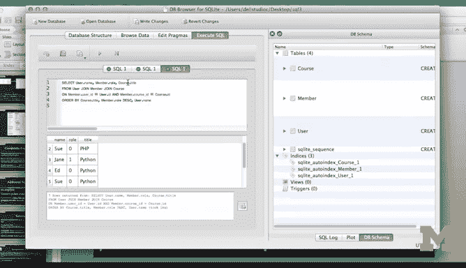

# 密歇根大学《给所有人的Python课》课程4：《使用数据库进行Python编程》｜python-databases｜ - P27：27_04_01_多对多关系.zh_en - GPT中英字幕课程资源 - BV1PP411W7H1

So we've learned about foreign keys， we've learned about join。

 we've learned about how to normalize data to remove duplicates。

 but there's still one more basic data modeling thing that we have to learn about。

 and that is many to many relationships。And so everything we've done so far is what we call one to many and that is an album has many tracks so in the end of these arrows and we see these on some of the crowsfoot data model diagrams。

 one end of like many and then there's one so one album and then many tracks and so this is the kind of thing that we've got and we've got a foreign key in the many side so that allows there to be many。

 many many tracks for one album and then another album would have many many many tracks right and so that's the idea there's a set of tracks that have the same I mean this is the duplication that we just got rid of and that's called a many to one or a one to many okay and so that is one form and's it's the most common form。

And you know we see this in our tables where we have you know genre ID or album ID and we have duplication in here。

 and this is the many side， so there's many of these things for one of those things and as an example of biological mother and children。

 biological single biological mother might have many children and this is also crowsfoot diagram and this little like crsfoot says many and then one shows right there。

So when we're drawing these data model diagrams， which we haven't spent too much time with。

 we always draw them in a way so that we capture the manysness or the cardinality of each end of the relationship now。

So that's one to many。But sometimes we have a relationship between data that's many to many。

 and frankly， in our music data that we've been playing with。I already told you that like well。

 there's actually many artists on an album but I said， don't worry about that。 Well。

 now we're going to worry about that。 So the example that I took from Wikipedia is books and authors。

 There are many authors and many books。 And so， you know， one author。

may talk to many books and one book may have different authors that they're connected to and so we can't say that either of these is a one relationship and so we call this a many to many on both ends there's a many to many。

 but in terms of，The table that we want to do， there is no way you can't put a single foreign key in this side oops come back we can't put a foreign key we can't put a foreign key in this table to point to books and we can't put a foreign key and books pointing to authors because that would be sort of a one on either side and so we build a table in the middle and in Wikipedia they call it a junction table。

 all kinds of names for this thing but what we do is we have a little table that we create。

 we still have a books table and a author's table but then we have a table that models nothing but the connection between them and so we decompose this many to many relationship into a many to one relationship and a many to one relationship and these two things then we can model properly using the exact same techniques that we've been using all along and so we end up with a table that has two foreign keys in it and no primary key so let's take a look at how this looks when we actually build it。

So here we're going to have something that I care a lot about courses and users。

 so this has to do with the fact that one user is a member of many courses and each course has a member of many users and so the relationship between courses and users the member of relationship is many on both ends and we just can't model that directly so we make a little mini table in the middle right so we have called this the membership table or table called member。

We still have a user table and a course table and we have a primary key in the course in the user table and what we do is we have this member table that has each row has two foreign keys and it is a connection so think of all the courses on one side and all the users on another side each connection these could be friends of people each connection has one row that connects a particular course with a particular user and that's how it works and so then that decomposes our many to many relationship into two halves of too many to ones that then models the many to many relationship between the two tables we don't put an ID we don't put that in there because we can make a composite key which is both these two things are the primary key for that table they're both numbers duplication is allowed and so this is all this is all perfectly great now sometimes we'll model something like put a role here。

So that you can say， okay， this is courses and users， we might indicate that。

This particular user course combination also is an instructor and this particular is a student right。

 and so we can sometimes put a little bit of extra data on the link itself and so we have a little bit of data that we add down there。

Okay。So we make this little table in the middle。And so here we're going to run some databases。

 I'm going to start with a fresh database， I'm going to make a user table。

 the main difference is I'm going to give the primary key for the users。

 I'm going to make a course table and this is our standard primary key stuff。

 I'm going to have a name and email for the users and a title for the courses and then those are just normal things that we're used to doing but now what we're going to do is create this little connector table that's going to have two it's going to have a role ID and a course ID I mean a user ID and a course ID and then we're going to model a little bit of data。

Right here in the middle and we're going to model roll。

And this is going to allow us to say whether someone's a teacher or a student。

And the other thing that we're doing that's effectively a substitute for this primary key is we're saying our primary key is actually two columns together and it's the combination。

 so this forces it to be unique。But it's really the combination of user ID and course ID must be unique。

 okay？So let's take a look at this。Let's actually go ahead and run some code。

And so what I'm going to suggest that you do is start with a brand new fresh database。

 just click new database。And we're going to call this， I'll call it SQL3。New database。

And I'm not going to do my table there， I'm going to go over to the execute SQL。

 which by now I hope is becoming somewhat comfortable to you， and then I am going to grab。Actually。

 I'm going to grab these two， first we'll grab those two create table statements。

I'll put a semie in at the end of this one so we can run them both。Let's see if they worked。Yep。

 I've got a course in user， primary key title ID name just exactly what we've got。

 and so now what we're going to do is we are going to execute the SQL to make the little connector table。

So I'll paste that in。And I will run that。See if it worked and it did work， so we're all good。

 primary key。And now we're going to put some data in， so let's take a look at some data。

When we're done， we've got that， which we've seen， and so we're going to insert some users in some courses。

 so let's take a look at that before we go doing it。So because。

These have auto increment primary keys we're just going to insert the name in the email， Jane。

 Jane@sugi。org， and we're going to insert three users and then we're going to get the user IDs。

 and then we're going to insert three courses， Python SQL and PhP。And so we'll just do those。

 those are nothing special， they're no different than the things we've been doing all along。

Well go over here in SQL。猪。They all have s cones at the end。So it all ran， so we'll browse the data。

 we see the course data， and we see the user data。And there's nothing in the membership data。

I mean the database doesn't know that we've done anything like this。

 we just inserted some stuff over here and what we're really doing is establishing the primary key in this ID column so Python is one SQl is2 and PhP is three and so now we're going to actually put some data into the member column and the user ID course ID role so we're connecting one user to one course and then assigning a role to that particular membership so this is a membership record who is a member of what and some aspect of it and there can be a few things that are often few more columns that you can do so let's take a look at the thing we've got to do to actually insert users into the courses right so heres here's the numbers that we've got and so now what we're going to do is insert。

Into there we go insert into the member table， the enrollment records as it were。

 so we've got to insert user ID course ID foreign keys and then the role and so this says we're going to do user one is going to be in course one and we'll make one be the instructor okay and then we're saying。

User two is in course one as a student， user three is in course one as a student。

User one is in course two as a student， user two is in course two as an instructor， et cetera。

 et cetera， et cetera， and so because we know what these numbers are，In actual code。

 we'll know what the numbers are， we know what the numbers are。

 and so we sort of put them right in the insert statements and that's how we make our connections。

So let's go ahead and run those。Go to SQL。And insert all those， click。Oh yikes。

 hope I didn't do that twice。Nope， I didn't do it twice。

 I'm glad let me just refresh to make sure I didn't do it twice okay。

 so that's just the numbers that came from those insert statements and you know， instructor。

 instructor， instructor， the courses and the students okay and so now what we have is we have in our database。

We have now connected these things together right so we've got them all connected together。

 we've got our user table， we've got our course table， and then we've got our connectors。

That go from here to here and here to here， and we are modeling a little tiny bit of data on the connection。

 so's what we call that on the connection okay？So let's get some data out of this table now。

 we are going to write a select statement， select username。Member role。And then course title。

We'm going to select those from the user joined with the member， joined with the course。

 so we're going to join all those together into one big long role， a one big long row。

 we use the on clauseuse and the member user ID is equal to the user's ID and members and the courses the membership course ID is equal to the courses ID。

 membership course ID equals the course's ID。Oh and then we're going to be do cool stuff we're going to order by the course title then the member role the way these and then member role descending and then the user name so what this means is the precedence is course title is the most important thing。

 the roles the next most important thing and we're going to do that descending and then the username is the third most important thing so this is going to give us sorted by course first。

And then within course it's role first and then for people that have the same role like this one has the same role so this allows us to see the teachers first and then the students in alphabetical order because the role is one for teachers and zero for students okay so that's what we get when we when we make this join and so we've kind of created an enrollment record if we add a where clause we could pick it for one particular course etc cea。

 et cea so let's go ahead and run that select it will be。Really boring if everything went well。

Execute SQL。Paste that SQL in and run that SQL， and so we see ordered by course。

Then ordered by role and then within the same role， it's ordered by student name okay。

 so that was an example of three things in the order by clause。

Okay， so you see this sort of working if you look at various data models。

 this happens to be a data model for your auto grader actually it uses a piece of software called Sui and the interaction between the learning system and Sugi has to model things like what course you're coming from the membership you are。

 whether you're a teacher or not and so if I look at this not that you really need to look at this in great detail。

 we got a this is a production software， a user table。

 a context which is the same as course and then the membership and the membership has a many many to one one。

 so we have a many to many relationship between users and courses。

 but we model it with this little table that's the connector table and。There's a role in there。

 as you might expect in any teaching and learning environment you're going to keep track of the role and I have a thing called the roll override and I I also have two little things that keep track of when things happen and so。

Let's see。So some of these things so that's a many to many relationship。

 most of these other things are many to one， this is a many to one relationship。

 and so this a modified crsfoot， this is a many to one relationship between the course link this happens to be the link that you click on blah blah。

 bla， blah， blah and this is actually your grade and results are grade and so there's many results for one link and that's because every student gets their own grade。

So this just happens to be the data model for this piece of software that you have now been using perhaps for several months。

 but you see one of these many to many relationships。Okay， so。Why did we do all this。

 why did we do all of these things， why did we make these little integers。

 why did we teach you about join， why did we teach about many to many。

 why did we make your data look so crazy？And that is all about speed， and you might say。

 I don't care about speed。And it turns out that there are plenty of programs for which you don't care about speed。

 you know the little program to calculate the US floor from the Europe floor Ki doesn't matter reading 10。

000 lines from a file doesn't matter but when you build say an online application or even a large data analysis application speed begins to matter and so what happens is you cross over this moment where it becomes too slow and then the only way to make it go fast is to really make it go fast and so when you use databases you can do things that seem amazingly fast and so all this normalization。

 the amount of data that you store the amount of data you scan is really taken out and it's not really a tradeoff either your thing is small enough that you don't have to do this or you cross over this point where your application will fail unless you don't do this and so that's why this is an important skill to have。

And so we've covered a lot of SQL in a short period of time there's much more to learn people always asking me is there an advanced SQL class and I'm like。

 well there's kind of a beginning SQL class and then the rest of your life because you can always learn more about structured query language and how databases work and what goes fast and what doesn't go fast a couple of things that you can look for as topics that we really didn't cover very well indexes this has to do with like logical keys and lookups really fast for strings。

 constraints we did have a thing not null there's other constraints that you can put on data in transactions。

 they're a way to group operations like if a read starts no more reads can happen until a write happens and so it's a way of blocking things and so these are all very。

 very important topics and so this is a relational databases could be a professional by itself just knowing how to do databases is impressive doing database design is impressive and I hope this has got you to the point where you can somewhat understand what's going。

On and then learn the rest of your life， okay？Zing。

