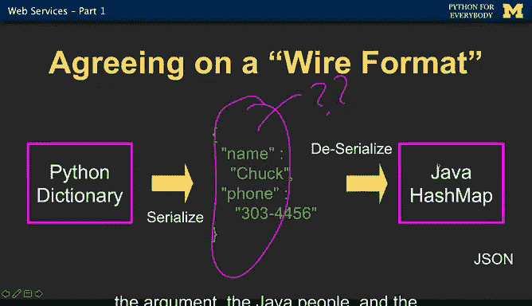

# 密歇根大学《给所有人的Python课》课程3：《使用Python访问Web数据》｜python-network-data｜ - P27：27_05_01_网络数据.zh_en - GPT中英字幕课程资源 - BV1Hu4y1e7WS

So welcome to chapter 13， we're going to talk about web services and we've been talking about moving data using the request response cycle and HTTP and URL Lib Web services is really adding a layer of formalism on top of that where we're just being a little more formal about how we do this and basically at some point we'll just switch from its moving data back and forth to these are APIs application program interfaces and so like we've said before this request response cycle that was originally for documents and images has been used for data and we have been coming up with ways to move data in a way that really have nothing to do with humans viewing them。

 but instead have programs producing and consuming this data and the basic idea is you have data in a program and so we got two programs here and they're going to communicate across the internet so we might have a Python program that's producing the data。

 maybe it's reading a database， maybe it's reading a file who knows what it is but inside it has a Python data structure like a dictionary。

And we want to send that across the network okay so the network is not Python。

 the network is not Java and the network is a data。

 I mean it it's data that's going to go across and so we have worked out over the years what we call the wire protocol or how the data is put on the wire or how the data leaves one system transits a network and then enters another system and in that destination system。

 it's not always Python it could be another program and so perhaps our Python dictionary in this other system needs to be a Java hashm and so we can't say that。

We're going to send Python data across the network。

 and we can't send we're going to send Java data across the network。

 We just have to send network on some format that we agree on。

 And so we like have to argue about what the format is to say， okay， we're going to do this。

 And this is Xml， which is one of the wire formats。 And it's like， okay。

 we're to take this data that's in a Python dictionary。 and we're going。

XM looks kind of like HTML and it has less thans and greater thans as tags and we're going to send a person across the network。

Person is going to have a name and a phone number。 That's the data we're going to send across。

 And we're going to say that's that's our wire format。 It's not how a Python thinks about it。

 It's not how Java thinks about it。 It is an agreed on intermediate protocol that is just text。

 right， It's not。It's not internal memory， and the act of going from an internal representation on one computer out to a sort of interchange interchange format is called serialization。

 And that has to with the fact that in the old days we had these wires and we sent the data serially across one character at time。

 So it was taking it from the internal memory of the computer。

A format that we can sort of send one character time， character， character， character， character。

 character， So we call this a serialization format。

 and so then the act of taking the data off of the wire。

And turning it into a new internal day structure in the new environment potentially in a very new language。

 is called decsialalization， So we take our internal structure， serialize it。

 send it across the network， then we receive it， we decsialize it。

 And when we use it in this other programming language in whatever structure makes sense in that particular programming language。

 the two top types of serialization formats that we're going to talk about is our XML。

And JsonN and so those are the two and Xml is kind of like the older of the two and JSON is the more modern of the two。

 Xml is the more complex and some would say more rigorous of the two and JSsonN is the lighter weight version of it。

 So you take your Python dictionary， you produce JON。

 you send JsonN across the network as a string or a document and then you receive the document and then you turn it into whatever it is it's going to be on that far side。

 And so that's the basic idea of agreeing on data format。

 and so you argue you argue here in the middle like you know we can argue the Python people can come to the argument。

 the Java people and the jascript people， they can all come and argue about what the best wire format is and that kind of engineering of an interchange that is not particularly suited to any language better than any other language is part of the argument of building these dataoriented documents versus sort of human readable oriented documents。

 So the first thing we're going to talk about is Xml。 and as the first of these two formats。

We're going to talk about。