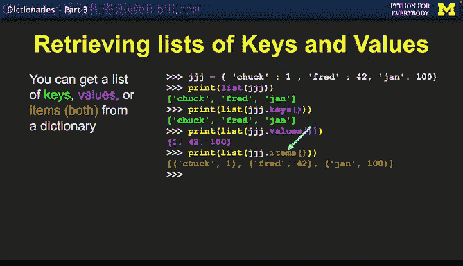

# 密歇根大学《给所有人的Python课》课程2：《Python数据结构课程（密歇根大学）》｜python-data｜ - P27：27_05_03_字典与文件.zh_en - GPT中英字幕课程资源 - BV1yP411a7TZ

So welcome back。 We're going to continue on our theme of counting and histograms。

 But just counting stuff that's in a list，5 items in a list。 that's too easy。

 I had those examples really simple。 So now what we're going to do is we're going to actually take some text from the text book。

 and we're going to do some counting。 Again。 This is the recurring thing。 We talked about the most。

 most common word， et cetera。 And so we're going to count text。

And once you figure out how to do this。It's pretty straightforward。

 and you can count a million words as easily as you can count forwards。

So here's a real simple program that we've got where we're going to just count one the words in one line of text。

So we create a dictionary。 We asked to the user to enterline a text。

 We read that with with no prompt， and then we split it on white space like， you know。

 we've done before。 And then we just the words variable is now a list of the words that were in that line with spaces。

And we just have a for loop that just loops through them。

 It's not that different than a previous example。 It's just we're reading a line of input and splitting it into words。

 and then we're looping through the words。And then we just do count sub word equals count dot get Word subcoma 0 plus1。

 which is the idiom of create a histogram entry and in the same line implicitly increment that histogram。

 and so now we've got a histogram I mean it's that simple。And so if we run this code， right。

 which is something we talked about before。 This is the one that's difficult。

 Count the most common word and how many times I mean， I got， I made him green so I can go like 1，2。

3，4，5，6，7。 I can do that。 But if they're not green， this is really hard。 But what's cool。

Is your Python， it's like really easy。So we get that line of text， we run split。

We get a list that is the words with all the white space removed。 and then we have a for loop。

 and then we make the counts。Right？Once you understand that idiom of the histogram idiom。

 it's pretty easy to construct these things。And so we enter a line of text， we split it。

We get the list of words， we loop through the list of where we make an empty histogram。

 and then we loop through the words in the list， and then we augment the histogram。

 creating entries and adding one to those entries。So we've been looping through lists。

But eventually we need to loop through dictionaries。

 so we put stuff into dictionaries all we've ever done so far in this chapter as we just print them all out。

So we have to think about looping through dictionaries。

 So we'll just start with a simple dictionary constant chuck Mas to 1。

 Fred Maps to 42 and Jan Maps to 100。So you can use the standard in for key and counts。

 And that's going to iterate。 But what it's going to do is it's going to iterate through the keys。

 because every entry， unlike in a list， is a key value pair。 So if you're going to just run a。A loop。

 you get the keys， but it's okay because inside the loop。

 you can go into the dictionary and pull out the value。By the key counts sub key。

And so if I print out key and count sub key， you see me the loop runs three times as a Chuck1。

 Fred 42， Jn 100。 So it's not like it's a problem that you only go through the keys。

If you think about it， you couldn't go through the values because you can't look up the key from the value。

 And the other thing about dictionaries is that the underlying。

Haash based implementation means that counts sub key is， in a sense， guaranteed to be efficient。

 even when there are millions of entries in a dictionary。 So count sub key is fast and count lists。

 if， if it were a list and you lists some lists sub 12， that's also fast。

 So part of what they did when they built lists and dictionaries is they built them in a way that if you just use them。

And use them in the right way in the normal way， those things are fast。

Because the implementations underneath lists and dictionaries are designed to make the common things that we do。

 look up by position and list and look up by key in dictionaries are fast。

 meaning they don't take a lot of compute time because。Again， this is not for three entries。

 this is for a million entries or 10 million entries when you're not doing data science or whatever。

One loop pattern is to just put the counts on the end of a four in pattern， by the way。

 and key is a variable。 It has no meaning， but it's a really good choice of a variable because I call these things key value pairs and we'll see coming up that I will use the variable name value sometimes。

Now there's other methods inside of the dictionary that can pull things out right， so if you。

 for example， take a dictionary in this case， J JJ with three key value pairs and you cast it to or convert it list sub J JJ is in a sense saying take what's in this dictionary and give me back in the form of a list。

Just like the for loop we just saw， that gives you back the keys。

 It gives you back a list of the keys。There is another syntax， which is the keys method。

 So you see J J J dot key's parenthees that is saying call the keys method。

 And that whole parenthesy thing means you're really calling code that lives inside the dictionary object。

 So we'd say keys is a method that dictionaries have J J J dot keys。

Is the exact same as converting to a list because Jjj。

keys is returning a list so we see the exact same thing。You can say J J J dot values open printn。

 closed printn， and that will give you a list of the values in basically the same order of the keys。

And in this case， by the way， keys and values is not something I chose as a programmer that's part of the documentation of dictionary that says there's a keys method and there's a values method and this is what they do。

Now， we saw how we could use the keys， you go through the keys and then you look up the value each time through the loop。

 but you can also say，Look， I want both of them。And so there's another method called items。

And that returns a list of what we call tuples。

And tuples are not key value pairs anymore more。Tups is the next chapter。

 but they're kind of like almost think of them as read only lists， you know。

 they're just lists that are two things in order， and that's what the parentheses。

 So the square bracket is a list syntax， the curly brace is a dictionary syntax and the parenthey when there's a list of things is a tuple。

And so this， once you have。Sort of a tuple。 So J J J dot items returns a tuple。

Which is a list of then the key value pairs。And this syntax。

Is not present in any other common programming language that I know， and I love this syntax。

And that is， we have two iteration variables， and in this case。

 the two iteration variables that I've got are AAA and BBB。And it means that A A A and B B。

 B together walk through the dictionary， walk through the successive items in the dictionary， right。

And so you get both of them。 So you don't have to look the value up in this case because B。

 B B is always the value。 And A A A is always the key as it goes through the list。

 And I'm kind of making probably too big a fuss about this because it just prints out Chuck1。

 Fred 42 and jam 100。Its kind of becomes an idiom just like the get， you just say。

And now I would not name these values， A A A and BBB， I'm doing it so that you don't get confused。

 I would name the key and value。 I would make the iteration variables key comma value in JJ J dot items。

 That's what I would do。 But I have a feeling that that would confuse you right now。

 And so we're not going to do that。But you will， when you write your code。

 feel free to use key and value。And the key thing is。

 is that this is something we'll see in the next chapter。Is what's called T assignment。

 and I think it's one of the prettier things that Python does。I don't like Java doesn't do it。

 PhP doesn't do it。 Javascript doesn't do it because they don't have a concept of tuples。

 and I think that， you know list dictionaries and tus like again。

 I'm kind of thinking about the next chapter， but tuples。

 I think is a really elegant addition that not a lot of other programming languages do so。

Look at how beautiful this is and know that it's probably the last time in your career that you'll see a forlo that's gorgeous like this。

You'll go into a Java and you're like， oh， oh， the four loops of Java are terrible。

 Why don't they do it like Python。 Okay， sorry， I'm just waxing eloquent。

 This is beautiful piece of code。 I actually sort of。There are moments when I see a piece of code。

 and I just think that is a beautiful piece of code because it's so expressive。😊，It's so beautiful。

There's some beautiful things in like the C++ length because there's lot of things I don't like about C++。

 there are some beautiful things about it。So now we're coming back。 We're coming back to Chaer 1。

 We're sitting here in Chapter 9。And I told you that you would understand this code。

That in chapter 1， I just said。Don't really try to understand this， but today， right now。

 I want you to understand every line， so let's go through it。We're asking for a file name。We open it。

We create an empty dictionary。And now we're going to loop through the file for line in handle。

 loops through the file。Then what we're going to do is we're going to split that line， many lines。

 split the line， right， many lines， split the line， and then we're going to。

 for each word on the line。 We're doing them one line at a time。 But then we go across the line。

 four word in words。Then we do the get idiom counts sub word equals counts。 get words comma 0 plus 1。

Now。We've got a dictionary。And it's a histogram at the end of that first loop。In counts。

 we've got all the words and their corresponding counts， but we want to find the biggest one。

So we're going to do a max loop。And so now we're going to the max loop is。Any max loop。

 you got to have a value that you start like at none and the big word。 And so for word come account。

 word is a string and count as an integer in count dot items。If the big count is none。

 which means we haven't， that's our little trick that we have in max loops。For the first one。

 so big count starts before the loop starts of none。

 so that's going to mean that the first one is the largest we've seen so far。

Or count is greater than big count。 So the current count is larger than a big count。

 That's in the second and later one。 So we're in that one if statement。

 we're doing the first iteration and the second and later iterations。And what do we do in a max。

 If we see something bigger or it's the first one， we remember it。

 So we say big word equals word and big count equals count。Then when that loop goes through。

Big count is going up and big word is remembering the last biggest word that we've got when it's all done。

 we'll have the biggest word。 and we just print it out。And we are done。

This is what I promised you would know back in Cha 1。 And now you should know it。

 And I'm going to give you an assignment。 That's pretty much this。 So you should know it。

And if you don't。Slowed down。 It wasn't that hard。Review whatever it is that you need to review until you understand this。

 so I would say don't go further until you really understand this。So in this chapter。

 we've talked about collections。We've talked about lists versus dictionaries。

We've talked about dictionary constants， curly bracy things with key value with a colon in the middle。

The most common word， histogram stuff， the idiom of the get。

And the different methods inside the dictionary object， which pull stuff out。 and we took a look。

 we're going to up next， we're going to talk about tuples。 and then you'll really get it right。

 And so you you need to kind of understand what we've got here and then go on to the next chapter and then we'll be reviewing this again in the next chapter。

After we have a really precise definition of what tuples are， and then we'll start sorting stuff。

So this is a wonderful chapter， I hope you really understood it and we'll see you in the next chapter。

