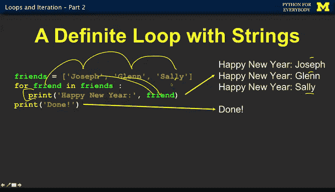
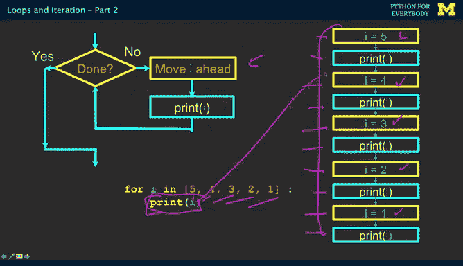

# 密歇根大学《给所有人的Python课》课程1：《编程入门指南（使用Python进行开发）》｜python｜ - P27：27_07_02_确定循环.zh_en - GPT中英字幕课程资源 - BV1214y117Mk

So up to now， we've been talking about indefinite loops。

 And that's the use of the wild keyword that just runs until some logical condition is false or you hit a break。

 Definite loops are。Finite they they are going over say all the lines in the file or all the items in a list or all the characters in a string or something。

 And for this， we use the for construct and its it's more predictable and it's easier even to validate them because we have a set of things that we're going to go through and it might be a lot。

 but we're going to go through all the things in the set。So here's a little loop， the four loop。

 so the four key four is the keyword。And so while was the keyword for indefinite loops and fours the keyword for definite loops。

 So the first thing we see in a for loop is we see the iteration variable is explicitly just part of the syntax I is。

 you can pick any variable you like， I happen to pick I and everyone picks I for inte ititeration variables。

In is another。Python reserved word and then we have various forms of collections and we'll find that files are collections。

 lists are collections， this happens to be a list of five integers， 5，4。

321 and what we're doing in this four statement is we're saying and again it's like it's got an indented block and you got a d indent so the block does this stuff I don't know one of these days I'll stop writing all those little pictures I can't help it but at some level what we're saying is execute this block five times。

And I want I to take on the successive values first time through 5， second time through four， next 3。

 then two then one。 So it executes this1，2，3，4，5 times。 and the first time I is 5。

 print the second time I is 4， print the third time I is 3 print2，1， and then we're all done。

 blast off。 And so we're just we constructed in a way that we just have directed Python to do all the work。

 We have an iteration variable。 We have a set of things we going to loop through。

 And it just guarantees that it's going to run this once， code once for each of these five variables。

 or that's another way to draw that would be。 you know， run it once for 5， run at once for4。

 run at once for3。 run it runs for2 and run at once for one。5ive， four， three， two， one， blast off。

Right so that's very definite Python takes care of everything for us。

 we don't have to have a logical condition to stop or anything like that， it's really quite nice。

This doesn't have to be a list of numbers， this is a list of strings。And so I put this in a variable。

 and this is where you got to be careful about because。I named it Friend and Friends。

 which makes perfect sense， but don't believe for a moment that Python understands what plurals are。

So friends is a list of three strings， and friend is an iteration variable。

 that's going to go through it。 So I stick this list into friends。 So square brackets。

 list of strings， Joseph Glenn and Sally。 And then I have this iteration variable friend that's going to go through each of the strings in friends。

 So that means that。Friend is going to go once， Joseph。

 the next time it's going to run the loop again with Glen and the third time it's going to run the loop with Sally。

And so it says happyapp New Year， Joseph， happyapp New Year， Glen， Happ New Year， Sally。

 So you know that this is going to run， this code is going to run three times and friend is going to take on Joseph。

 Glen and Sally in successive iterations through the loop。

So you can think of the force statement as sort of。

A complex thing。 It is dealing with the fact of when it's time to continue and when you're done。

 it knows about that。 And it also sets eye to the new value。 So it's like。Are we done yet， Nope。

 move eye ahead to the new value， print it。 Are we done yet， No， move I to the new value， then print。

On and on and on， oh， now we're done。It all this logic here。

 this yellow bit is constructed by you using the force statement。

 you you can tell it what to do and it just writes the code。

 You could do this with an I of increment or a subtracting and a while loop and while I greater than zero。

 you could do this。But for loop just does it for you。So four does a few things for you。

And I like the I like in， I think it's basically saying for for each of the values in 5，4，3，2，1。

 have I take on the successive values and run that loop one time。

 And that's the in that in is I think the in is a well thought through Python keyword because that's how I think of it。

 If you're a math person think of it， you know。The member of。Function， I think that's the member of。

By， it's been a while since I did set there， I think that's a member of。

So here's an interesting thing you can kind of。You certainly can think of this as an iteration。

 but at some level， it's really just a contract that says run this code five times with I taking on its on the value。

 So you hardly know the difference between it saying I equals 5 print I I equals 4。

 print I I equals 3， print I I equals 2， print I I equals 1 print I。 So， so in a sense。

 this is what happens。 meaning that the for loop is telling us how long we're going to run and it' managing the successive values of I to make sure that our happy little line of code gets executed five times。

With the right value of I that is the job of the force statement。

 the for statement takes care of all this for us， so that's one way to think about the for statement。

Even though this is a more common way to think about the force statement。

 this is sort of equivalent and think of those two things as equivalent。So like I said。

 definite loops are for lists or lines in a file or characters in a string。

 and you know they iterate through members of a set。

UpNext we're going to talk about sort of loop idioms and that's how we make use of loops and how we use loops to do things like find the largest or find the smallest or check to see if a value is present or something like that。

 so that's what's coming up next。