# 密歇根大学《给所有人的Python课》课程4：《使用数据库进行Python编程》｜python-databases｜ - P28：28_04_02_实战示例：roster.py程序.zh_en - GPT中英字幕课程资源 - BV1PP411W7H1

🎼Hello and welcome to our codewalk through on the roster code so the learning objective of this is to do a many to many table and so the idea is is that we're going to just like we talked about in lecture。

 we're going to have a set of users， we're going to have a set of courses and then we're going to have a connector table or a many to many table that basically has two foreign keys。

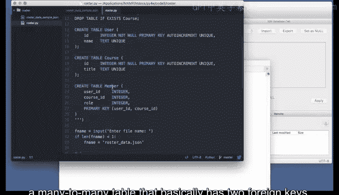

So we are going to use the integer Ntinnel primary key auto increment unique。

As the way to get auto assignment of the primary keys in the user table and the course table。

And then we're going to say that the name which is like a logical key and then the course title。

 we're going mark those as unique andre we're going to take advantage of that in a moment and so you'll see how we take advantage of that so what unique means is if you try to insert the same string into this column you know like chuck twice then it's going to fail the second time because it's going to refuse to create a new record and so if we just kind of like take a look we're going to get a roster data from this sample JSON which is just an array of arrays and this is the person's name。

 the class that they're in and whether they are a teacher or a student and so we're going to read that so we need the JSON library and the SQL library we make a database connection and we get a cursor the connection the cursor is kind of more like the file handle。

 you send SQL commands to the cursor and then you read the cursor to get the data back the connection can create more than one cursor to so you can add more than one set。

sBut the cursor is generally like the file handle to the database server。

And we are going to execute a big script and you'll notice this is a triple coded string that goes all the way down to here and so some people would just give this to you a text file and have you cut and paste this and then go run that in your SQLI browser to create them but that's okay because what we're going to do is we are going to set this up it will either reconnect to existing file named rosterdb。

sqL light and if I look where I'm at I do an LS we find that that file is not there so the first time I run it it's gonna to create it。

 but Im I want this to start fresh every time so I'm going to wipe out the tables if they exist that way you can run it over and over and over again in case you make a mistake here now I don't have a mistake or hopefully I don't have a mistake on this。

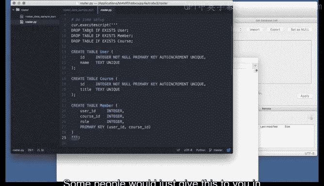

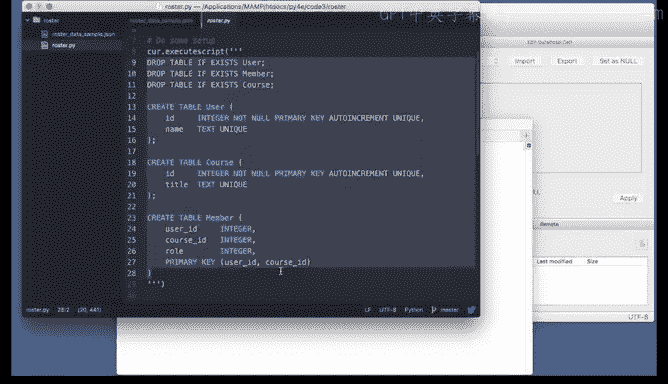

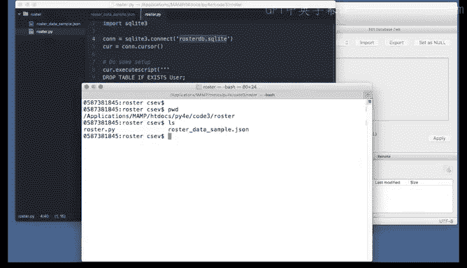

So going create we're going to drop three tables， and we're going to create three tables。And。

Here we're going to create a table that has two foreign keys。

 user ID course ID that are sort of going outwards from the member table and then we're going to model a little bit of the data at the role and I guess this and again this is straight from the lecture and the primary key is actually a composite primary key because we're going to look up and it's going to force this to be the combination of user ID and course ID to be unique but there can be many user IDs and many course IDs but only one particular combination of a value for user ID and course ID and so that's what we're basically saying you can be a member of a course。

 but you can only do that once you can't be like a member of the course a bunch of times。

So we're going to。Oh， that should be roster data sample， that's okay to oops fix a bug。

Save that roster data sample。And so that's just this file and it's really just an array and then each row is an array and it's a way for us to get this roster data in。

And so once we do load S on JSON， we're parsing it and then this is going to be an array of arrays and so for entry in JSON data。

So entry is going to be one of these things， so entry itself is a row。

 so an entry sub0 is the name and entry sub1 is the title name that's the sub0。

 and that's the sub1 of the particular entry that we're looking at。

And we're going to print it out just for yucks as a tuple。

 so we make that's what the two parentheses are， this inner thing is a two tuple。And。

We're then going to take the person and we're going to do an insert and this is new or ignore。

 So what the or ignore means is if this insert would cause an error， please don't blow up。

 Don't just ignore that I try to insert it。 And so this is our trick。 and it's a beautiful trick。

 It's like a gorgeously beautiful trick。Here， if we insert the name chuck twice or ignore will just mean that nothing happens。

 meaning it's already there。 Okay so if it's already there， if it's not there。

 it'll put it in and unique will guarantee that it only goes in once。 So we just an effect。

 always attempt to insert it and if it's a been there once。

 then it's all set and so this inserter ignore as a super powerful mechanism I use it all the time。

 and we have a placeholder in the form of a question mark and then we have one of these days will' have a two things that we're asking for as a matter of fact。

 here it is， there's a tuple down here， but this is kind of a tuple with one item in it name and that name is then going substitute in for there without while avoiding SQL injection。

So this runs， it may or may not insert a new record。

 but if the chuck or whomever the name is is not there。

 it will give us a new record and then we are going to get back the ID and so this is the logical key and this is the primary key and that primary key is going be auto constructed for us and so we need to know what it is so we say select ID from user where name equals and then that same name so that's Chuck and so that gives us one and then what we do。

Because we're going to fetch one record from the cursor because that's a select and it gives us back a cursor。

 There's only hopefully one record there because it's unique。 I could put a limit one in there。

 but that be kind of redundant because it is though name is a unique key and then the subzero just means if there were more than one thing that I was selecting。

 which we'll see in a bit the sub0ro is just the first thing。

 and so this is going to give us the integer user ID that was assigned or if we're coming through later for Chuck know Chuck later。

 Charlie later that will be the old one。 So this is inserted if it doesn't exist and this is get the newly created ID field or the original ID field。

 And so part of this works by having both a logical key and a primary key。

 the primary keys auto generated but the name is a logical key and it's unique and so that's our trick to get get that assigned thing before we just looked at it in the user interface of escalite browser and wrote it。

But this is how we do it in code so we need to know what that key is， whether it was new or not。

 and then we do the exact same pattern for the course except we're inserting the course title。

 so that's no big deal。🤧And。And and so we're going to get the user ID course ID and then what we're going to do is we are going to insert or replace so this is basically if there remember that this user ID course ID combination is the primary key for this member table if there is a duplicate if this combination is already there。

 this becomes effectively an update statement and we have these two number values now what's missing here is the role is not there and so user ID course ID this is the SQL but and now we have a tuple with two items in it and that's because we have two question marks and then we commit it and as I mentioned before sometimes you want to commit every time through the commit is it turns out that these things are less costly but that's because it's not always writing all the way to disk whereas when you enter the commit it's going to go and write everything to disk pause until it's complete。

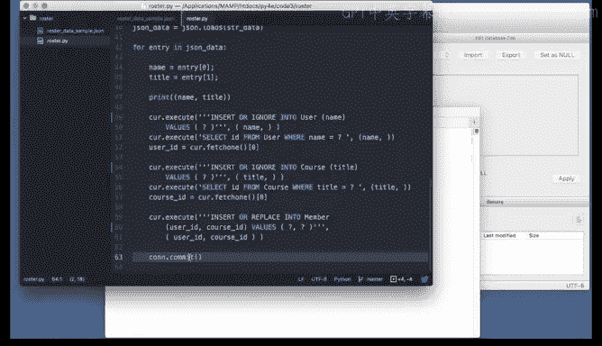

And then your program doesn't continue， so sometimes we don't run this every single time through。

Okay， so let's just go ahead and run this。 The only thing we're going to see is the output of the name and the title as it's running。

 So if I do Python。

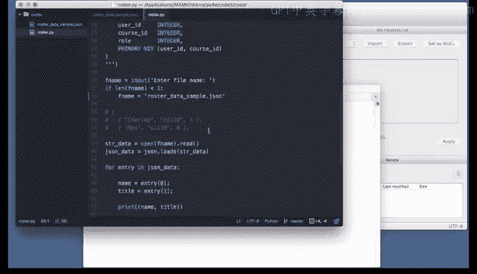

3， roster。 pi。Hopefully I can hit enter， so you'll notice， by the way。

 that this SQL light now exists right， and it has no data in it。

 So let me see if I can open this database and see it。

So you see that there's no data so we're the code we've run this code in effect up to this point。

 So we've done all the create tables and all that stuff。 and so the create tables are there。

 So all this data is here， it did it we haven't started putting any data into it yet because if we look at browse data we're not finding anything in here okay there's no data to browse now hopefully we won't have locked ourselves because we are sitting right here and when I hit enter over here。

 then it's going to go its just going to run really fast so I'll hit enter。

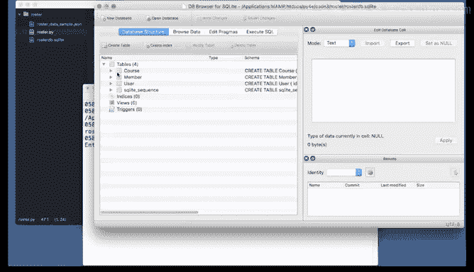

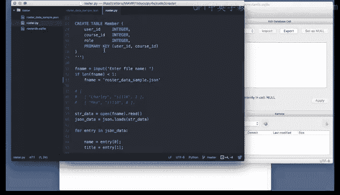

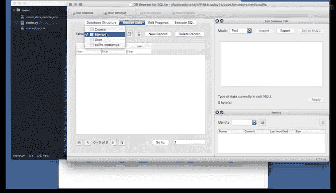

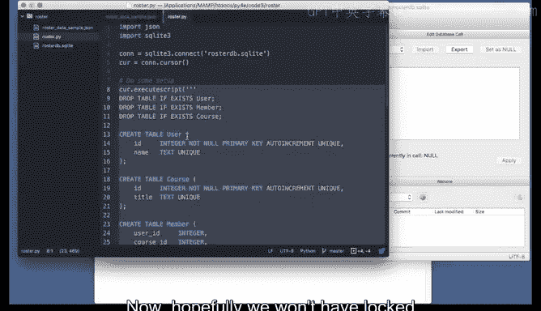

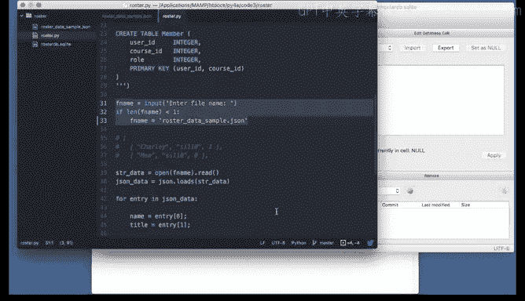

You'll read it， and so it inserted all of those things and now it's been changed and if I hit refresh over here。

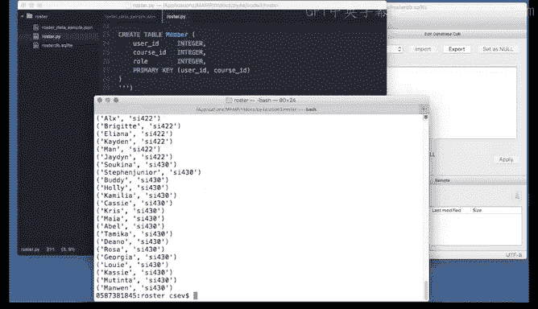

We will see in the user it just sort of assigned user IDs right columns auto assign。

 we will find in the course that those courses are all auto assign。

 there's the courses and there's no duplicates because this is unique right and so these are the newly created things but then membership。

Is user ID course ID and so again， the primary key， as it were， the unique constraints。

 such primary key is the combination of these things and I haven't put anything in roll and so if you scroll through these you see all of the users who are members of the courses that they're part of。

Okay。So there you go and I'll leave it up to you to come up with a join。

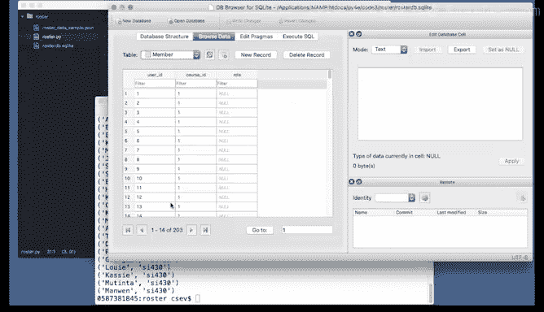

I'll leave it up to you to figure out how to put the role in。

 but I just wanted to kind of give you a bit of a walk through of this code base and in particular the tricks of。

The uniqueness keys， the auto increment keys， the logical key uniqueness。

 and then this kind of composite primary key， and then the trick of insert or ignore。

And then the C select that comes right afterwards to get the newly generated ID or to get the old ID。

 you can sort exct and then insert or replace， which is a combination of an insert in an update。

So I hope you found this example useful and can apply it and basically create many to many tables。

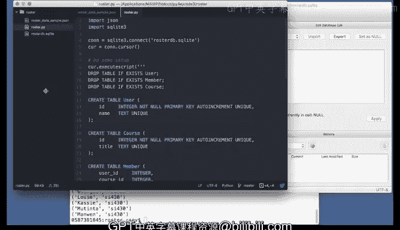