# 密歇根大学《给所有人的Python课》课程2：《Python数据结构课程（密歇根大学）》｜python-data｜ - P28：28_05_01_字典练习题讲解.zh_en - GPT中英字幕课程资源 - BV1yP411a7TZ

Hello and welcome to yet another walkthrough of Python for everybody so we're going to be walking through some of the code in Cha 9 of the book So what I've got here is a couple of terminal windows I'm not going to use my fancy editor you of course can use whichever editor that you like but I'm going to just use my terminal I'm using a Macintosh。

 but everything I'm doing would work the same on a Linux box and you'd have to adapt it a bit on a Windows box。

So I'm in a I'm in a command line where I can type commands like the first command I can type is like print working directory。

 and this shows that I am in the slash users folder slash C sblash desktop slash pi 4 E。

 And if I do Pw D in mother window， it's important that I have both these windows in the same place because I'm going to develop code in one window。

 and I'm going to run code in the other window。 So let's do。Exercise 09。01。Cd。Exercise， oh。

 and I hit the tab key and it did automatic completion there。 So I'm one folder lower。

And I'm going to go to CD exercise 09。

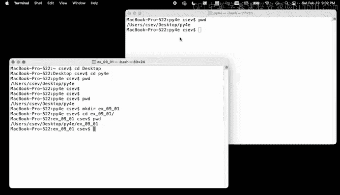

Os，9。Oh one。CD exercise。0，9， but one。 And PwD saw him here。Okay。

So the first thing I'm going to do is I am going to create a simple program and and you're going to think that。

You're going to think that somehow I write all this code instantly because it just magically comes out of my brain。

But。I always start doing exactly what I'm about to show you。 So I'm going to editor a file， E X 0，9。

0，1 dot P Y。 That's also the name of the folder， but。And I am going to put in this print， print。그。

E X 09。And then I'm going to save that file， and I'm going to come over of this window。

 and I'm going to do an L S。Minus L。And I'm going to see that I've got this file that has 15 characters I created on this date。

And then I'm going to say Python。EX 0901。pyy， so that's going to look at that and run it。

And it prints that out。 But it let's just for fun， let's make a mistake。Let's put X rent。

And there we go。 So what I do here is I really want to know that both of these windows are in the same place。

Okay。So next thing I'm going to do is I need some files to work with。

 and it's important that you get the files in the same folders that。

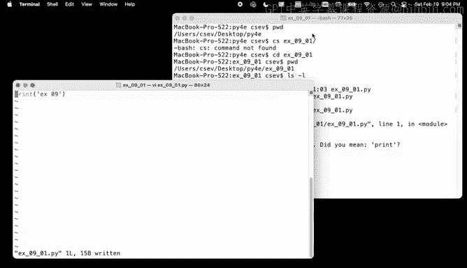

You're going to put them in。 So the first one we're going to do is to go to Pit4 do com slash code 3 slash intro dot T X T。

 And then I'm going to save this file。As a text file。And I'm in C7ev Use Cev desktop Py3。

 but I want to go into the EX09 and there's my Python file。

 and I'm just going to save this file as Intro。t Txt。And I'm also going to play with a clown data。

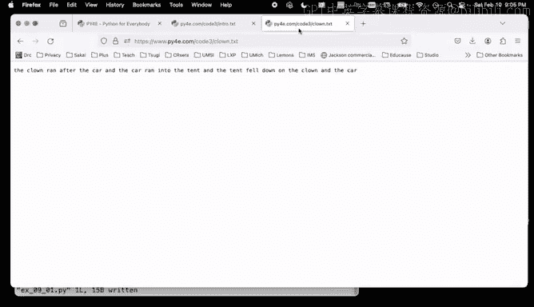

So I'll save that one as well。 And now my browser's already。

 my file browser's already put me in E X09。 So there's the file， there's Intro do Tx T。

 and then there's the Python code。 So now I've got in this file。

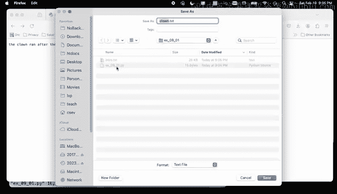

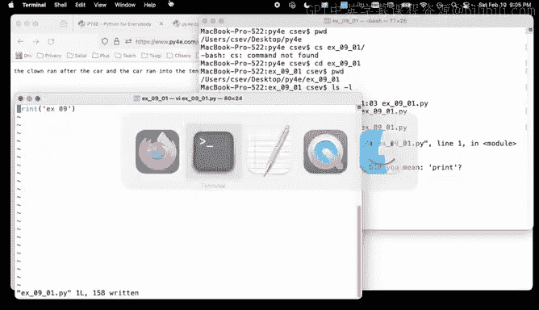

Let me go ahead and minimize that so in this file。In this folder。

 I do an LS minus L and now you see that I've got three files。

 I've got a Klon dot text on Intro dot text and a exercise 0901。 py okay。

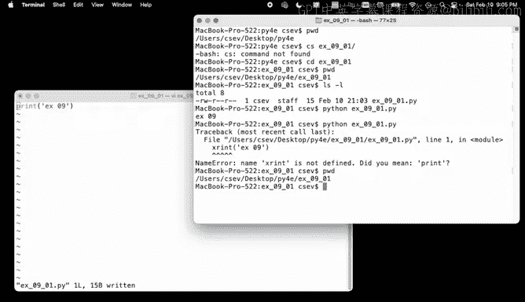

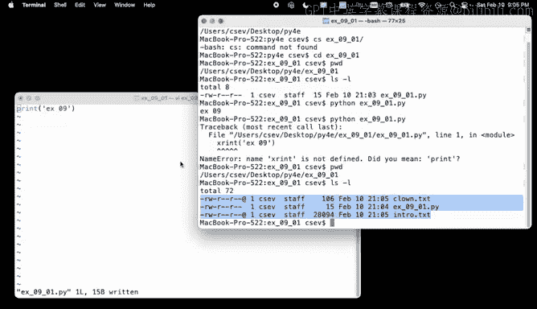

So。I am now going to get rid of that line。And prompt for file name， F name。Equals input。

I got to slow down。Enter file， Col in space。Now I'll just say print F name。 And again， I I could。

 I could type this really fast， but I just like。

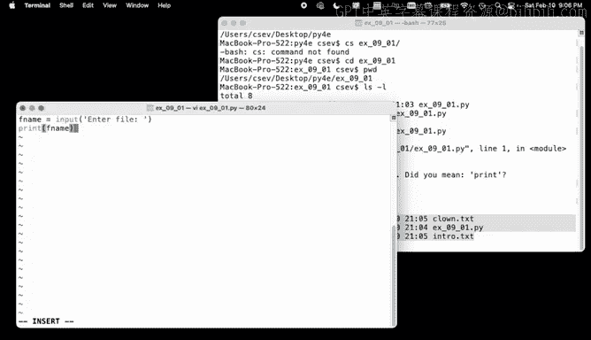

So I'm using the cursor up in my particular browser in my particular shell。

 I can run the old command again， so Python E X。

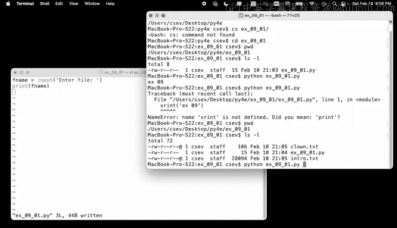

And so that was supposed to be hello。 And so that code is working。

 One thing you'll notice is at this input。

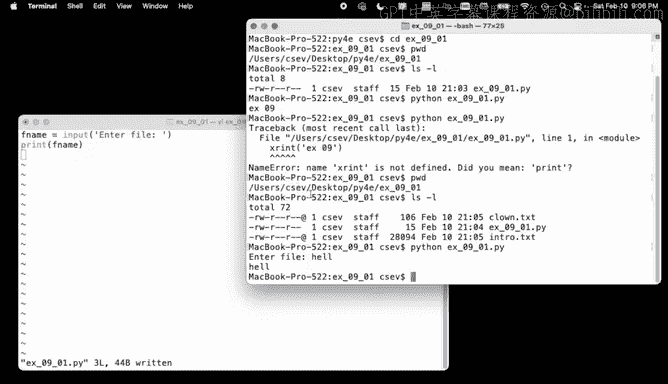

Let's go。 print F name。Len， F name。And if I run it again and I just hit enter。

The F name is kind of nothing， but the length is 0。 So I'm going to take advantage of this。

 and I'm going， in effect， add a default here。 If then of F name。Is less than one。

F name equals clown dot TXt。嗯。There we go， so if the length of the file name is less than one character。

 then I'm going to define it as clown do Txt。

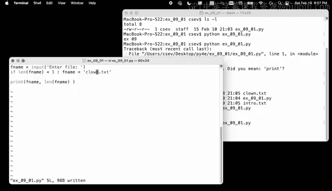

Doing a lot of typos this morning。And then I print it out。 So if I hit enter。

 then my file is C dot TXt。 But then if I put in another thing like Intro do TXt。Then it works。

And this I do this as a developer to save time if I'm going to be able to process different files。

 why not have a default file and you'll see as I go through this I'm going to use Clown dot text a lot。

 And so I just throw this one line in here and it saves me having type Intro do TX or Clownt Txt over and over again。

 So now I got a file name， So let's open this up。

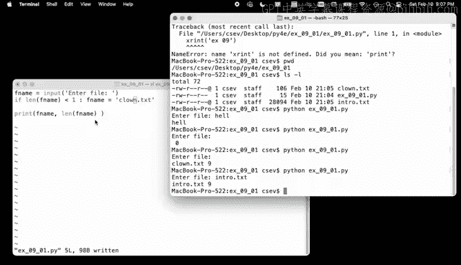

F hand。Equals open。F name。 So F name is a string， and F hand is going to be a file handle。

 What do we usually do as soon as we make a file handle， we say four line。hos。For line in。F hand。

Colon。Line equals line dots R strip。To take off。嗯。And I'm going to just print it。

Get rid of this little stuff down here， so I'm going to prompt for a file name on open that then I'm going to loop through it。

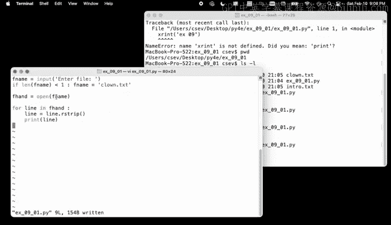

And let's do clown dot Txt so that red one line and if I then do it again and I type intro dot Txt。

 it reads lots of lines and they're all properly R stripped and so we're in great shape So the next thing we're going to do is we're going to throw we're going to break this。

Using split。Into a set of words， the spaces are going to go away because that's how it works。 Okay。

 so what we're going to do here is we're going to say words。Equals line， dot split。

And now I'm going to print words。And I'm just for now， Im going to comment out the print line。

 So now instead of seeing this line， we're going to see a list of the words on the line。

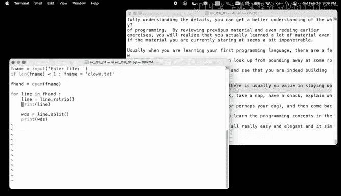

So I'll just do clown， so now we see that this is the words。In there， okay？And so that's pretty cool。

We now are opening our file up。And so what we want to do， Well。

 let's do intro intro dot Tx right here。So in Intro do TxT， we got lots of lines。

 and like some of the times the list is empty because that was a blank line by itself。

 sometimes there's a bunch of words。 So we want to go through every line。

 but then we also want to go horizontally through every word。

 So we're going to write another for loop。 Now this is a nested for loop for W in WDS。

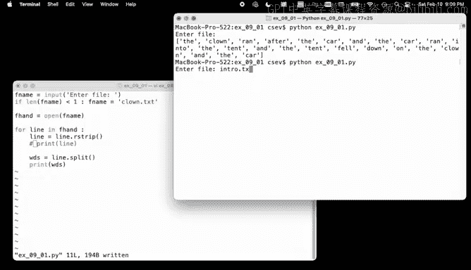

So that says iterate now we're in one line right so for all the words in the line we're in。

 let's go through that and you can probably guess what I'm going to do， I'm going to print W。Okay。

 and I'll leave that print of the words in the line in there。 and then we'll take that。

 You'll see me like adding a print and then taking out the previous print。

 And it has to do with keeping my confidence high that I'm doing the right thing。

 You might think that this takes a long time。

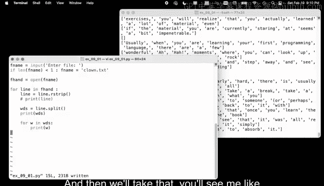

But itす。If you write a whole bunch of stuff， so this is the last line of Intro。

txt that saysT you a bit of time to absorb it。And then the inner loop。

That's one line is took you a bit of time to absorb it。

 Now if we were going to work a little harder we might be able to figure out the punctuation。

 but for this part， we're not going to fight over the punctuation。Okay？So now we have the words。

 let me。Let me comment this one out。And then I delete that one because I feel really good about the other part of this loop。

 oops， like spaces。So we'll do it again。 And so now what we're going to see is we're not going to see this。

 We are just going to see a linear。Long list of the words in the file。

 And it doesn't care now what line it's on。 So I'll just do the clown stuff。

 And you see that the clown just like Prince， the words in the file。

 even though it had to do two loops to do that。 One loop is the loop through the lines。

 and the other loop is the loop through the words in the line。 But when it's all said and done。

 we are now using a nested pair of loops to loop through all the words in the file。

 split into two spaces。 So that's pretty cool。😊，Okay， so now we are going to。

Make a dictionary and start counting things Okay， and of course we're going to use the same pattern we've been using that's from the from the lecture we're going to call。

Coun't， let's， let's call this。Many。嗯。D。So this is a constructor and we're making say give you a new and empty dictionary and put it in the variable menu。

Okay。And so what I'll do first。Is something silly？And I'm going to say many sub w equals。对。42。

And that's so now we're going to see all the words in the file and I'm just going to put that into the dictionary with a key of W which is the word itself and then 42 is the number and then what I'm going to do。

Is I'm going to print that dictionary。Just print many out。 Okay。

 because this is going to be a counting pattern， but we certainly aren't counting anything by setting them all to 42。

 Nothing wrong with setting them all to 42。And so now what we have is the dictionary， the Maps to 42。

 clown Maps to 42， ran Maps to 42。They all mapped to 42， why， because we mapped them all to 42。

And so now what we've got to do is we've got to basically add one to these things。

 so the easiest thing would be to say many。Sub w plus1。So however many we had in that word。

 let's just add one to it。So let's try that one。

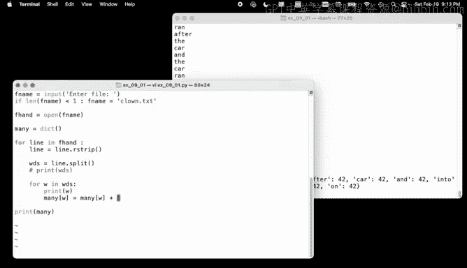

对。Whoops， what happened what happened well， it looks like you'll notice because we still have this print statement。

 it's right here okay？

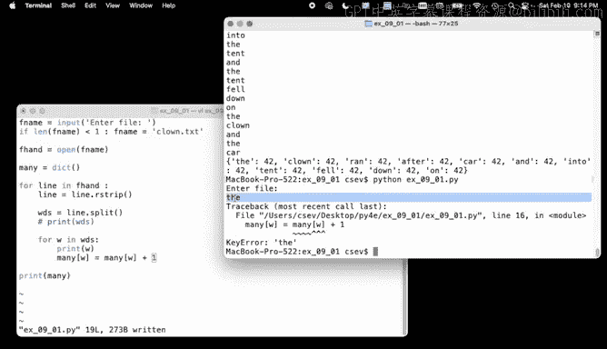

So it was the first one。 it blew up on the first one， so let's print。Each time through the loop。

 what's in many？Okay。So I'm going to run it again。嗯。And so the word we're looking at is the。

 and the many dictionary is empty。 Of course it is， it's a first line。

So we're what we're doing is we're getting a key air， right， a key air。

 the right there it's like you're not allowed to do that。So what we have to do is we have to check。

If the word we're looking at， the is in there。So that we get the old value。

 we want this many subW to be the old value， but it's not， so this is what we're going to say。

We're going to say old value。Equals 0。If。W is currently already in。The many。An old value。Equals。Many。

SW。So if it's the first time we're seeing it， it's not going to be in many。

But if it's already in there， then we know that many has the old count， like some have 42。Right。

And then instead of going and saying， oh， many subw， we can just grab this old value。Yeah。

The old value is going to either be 0 or the previous count that we had for whatever word we're doing。

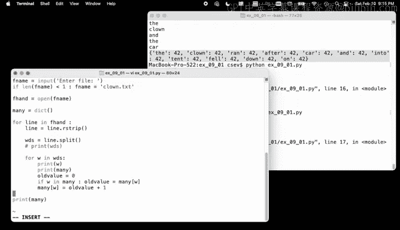

Okay。And so now what we'll see as we run this， clear my screen。啊。Yeah。

 that's because I forgot to save my file。 Yeah， you will make that mistake many times as well。

 I've been doing this for many years， many， many years， and。I still make that mistake。Luckily。

 I see it right away。Okay， so this is getting a little tricky。

 let's go up to the top right so we read the word let's do this Let's add a little bit of a。

Just make it。So we know which are the line the words we're processing， Okay， so I'll just。

 we'll redo that one。

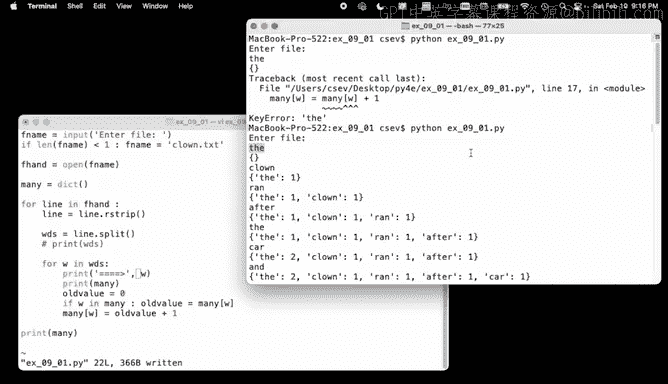

So。We see the word the。Then we print the old copy of the。Dictionary。And then。

Whatever we see clown and the dictionary contains the one， but it doesn't have clown。 Now。

 let's do another one。I'm going to say I'm going to do with this again。Before。

And then I'm going to copy this line down here。 and I'm going to say after。Yeah。ooops。After。

That's going to be super awesome。Okay， P dot text。So now we can see a lot of stuff in every single line。

 so we read the word the。Then before the dictionary has nothing in it。

 but after the dictionary has one in it。And the old value in this case was zero， Okay。

 let's do this hang， let's do this。Let's print。Holdd value。Com old value。

 I know I'm going crazy on this。And I know you probably already know how to do this。

 but I don't care。It's only computer time。So let's go in the beginning。So we read the wordva。

There's nothing in the dictionary， and because the is not in the dictionary， the old value is0。

And then afterwards， we basically say， let's set the to be the old value plus1。

 so old value is0 and that is how we get this one。Then we see the clown。 the is one。

 but the clown's not there。 So old value is 0。 Then after the is one and clown is1。

 And you kind of see what's going on here。 Let's get to one that's a little more interesting。

 Eventually， we run into the second the in the file。

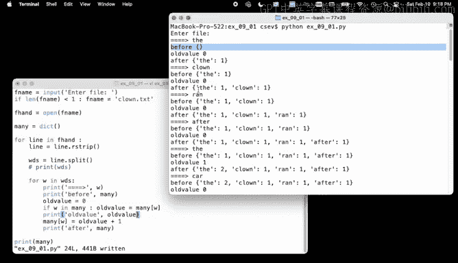

And before the maps to one， clown maps to one， et cetera。 But because the is in there。

 the old value is taken out of the dictionary。 That means that we add one to that and store it back in。

 And so then the goes from one to2。We can keep down going down here。Later in the file。

 we read another the at this point， the we've seen it four times。 So the old value is 4。

 and then the new value is 5。 And you just go and go and go and go。 And eventually， you know。

 we've done all accounting。 So this is this trick to get over the notion of you can't look an item up in a dictionary。

If it's not there， no。This little old value trick。We've done it in the lecture and if then else。

 but I wanted to do this old value because it's a little more explicit。This old value。Is basically。

Could be rewritten as。Let's just comment this out。 I this time， I'm going to say old value equals。

Many dot get。W comma 0。Yeah。Oh， I didn't call old value。And we talked about Gi。

 so let me just review it。Get basically says if this key is in there。

 get back the value that's under that key， Otherwise return a default value of 0。

 So when the keys not there， we get back a 0， which basically is exactly what we did in these two little lines。

 So now。We'll run it again And if I did it， right？It'll have exactly the same result。 Yeah。

 same result。 The difference is， I have come up with a much prettier way of calculating what the previous value is using the built in dictionary method called get。

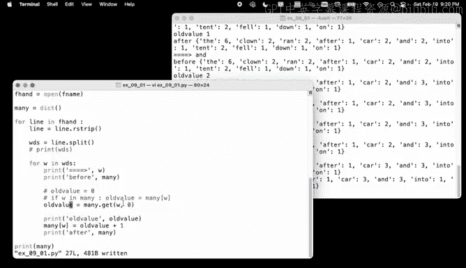

Now。Let me delete some more stuff here， I think I'll just。

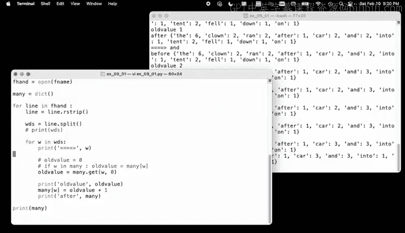

I think I've talked enough about this。So now。Yeah。We can just replace， Im copy this。

You don't even have to make a variable called old value。

We can say many sub w equals many dot get W comma 0 with a default of 0 plus 1。

So we just cld all those lines and when you can do this， your code is easier to read。

More understandable， probably a little faster， but most importantly。

 less error prone And this get thing is an idiom that everybody knows in Python。

 So it's not going to confuse anybody。 So now let's run it again and see that we get roughly the same results。

 There we go， right。

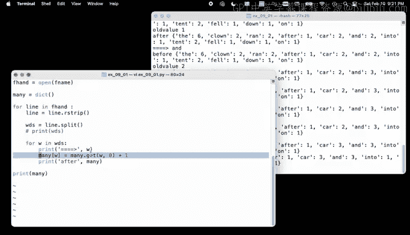

We see that that was last word。 and then this is the result of it running so now。

I'm feeling mighty good about this。 So I'm just going to delete this line in this line。

 And now you see how succinct this really is。 And why I'm doing this is sort of。

To build the concepts。Cause in the lecture， I just show you the answer， right。

 and I try to explain it all。 And frankly， I can get rid of that that line。Right。

 and I I might even get rid of that blank line because these two line are step and line split。

I know what those do because I'm really， really confident。

 but I'm not confident enough to not run it at least one more time to make sure I didn't screw it up in my edits。

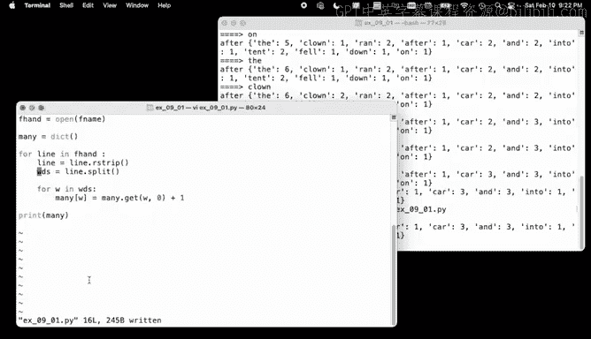

And there we are。 So it's good。 So now what we have to do is we have to find。Find the。Word。With the。

Largest count。So now we're going to loop through。The dictionary。

So we're going to just kind of we printed it out and you see it over there， we're going to say four。

And we need to say kind of key comma value。 and I will use French for key comma V A L E U value clre value in。

不是。Many dot items。So I chose the variable names for French speaking。That really means key value。

 And again， that's a tuple， which we'll talk more about later。

 So that will iterate through every time print。Clre camera value。You are。

 I'll make many typos when I'm in French。 But there we go。

 So that is going to iterate through the key value pairs， one at a time。

 But now we're going to be able to get our hands on each one。 So if we run it again。

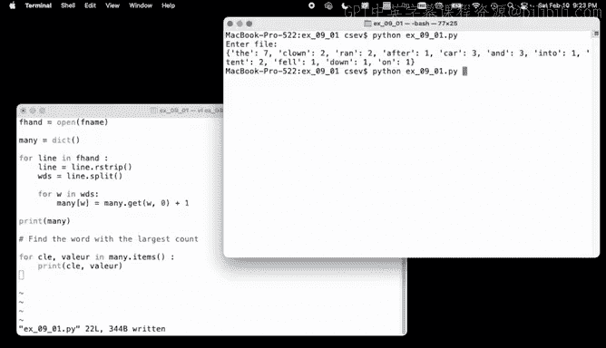

You see that this is the iteration going through this。Dictionary。

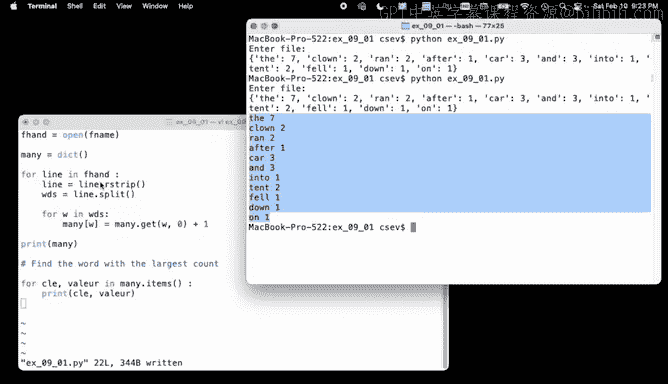

But we want to do a max loop。So we go， we'll just call largest。I could。 I could do this in French。

 too， but I my French is limited。Largest equals none。If。Largest。Is none。Or。Largest。Greater than。

V you value。Then， we grab that。Yeah。Ba you are。哎哎。My French is terrible。Okay。

 so we get this largest and at the end after all out is gone。I should be able to print， largest。

Let's put like， yay。Un largest。

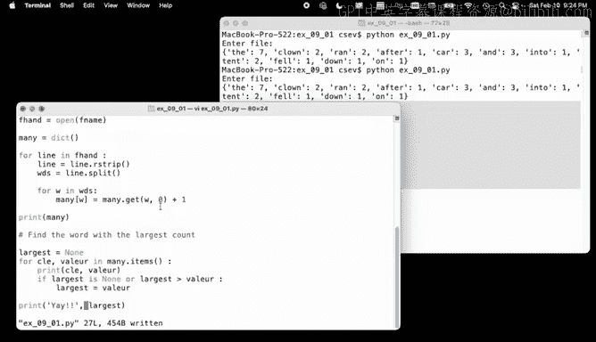

So this should loop through these and find the largest of the Vala。

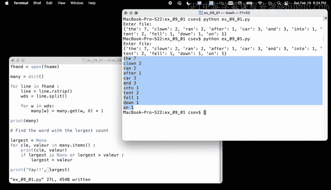

嗯。Which is going to be seven。

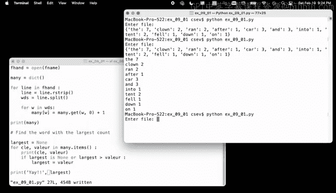

So you see at the end here， it says， yaea。But that's not what we want， oh wait。No。

 something is wrong with this code。Because I got， I got the one， I got the。Oh， I flipped this。

I need to say。As in my French， the weakness in French， there E。

You are if the value that we got is greater than the largest。

 this is why it's important to choose variable names。So let's run it again。

Every things it make sense to because of my French is so bad。And now we see seven。

But the key thing is we also want to know which word it was。

 so all the time we're going through these values in the loop。C， L E Clare is the word。

 So now all we need to do is。Create another variable called big word。Equals。We'll start with none。

And then we find anytime we find a larger one， we just say big word。Equals clear。

So we grab the key and stick it in big word， and then I can say big word。Comma， largest。

So let's run it。对。And so the largest word is the and the count that we had was 7。

 So I think I can get rid of some print statements here。 and I can get rid of the yea。

 And we're going to make this thing very， very。Not very loud at all or not very， oh。

 I got to get rid of something I' got to get rid of many up here。哎。So now let's run it。On Kduct text。

 the maximum largest word is the and there's seven of them， and now in a brief instant。

 I can just run it again on much bigger file。R O dot Txt and。

I use the word the 226 times I seem to use that a lot。

 of course people who write English tend to use that a lot。 So here we go， I mean。

 I'm going to show you the whole thing it's a pretty straightforward we use the get idiom that really saves you an if or even an if then else。

 and then we simply did a simple maximum loop so。

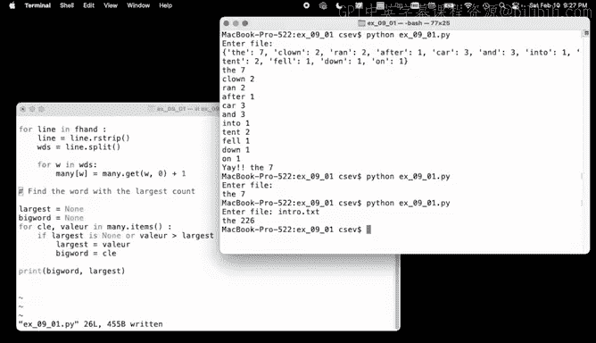

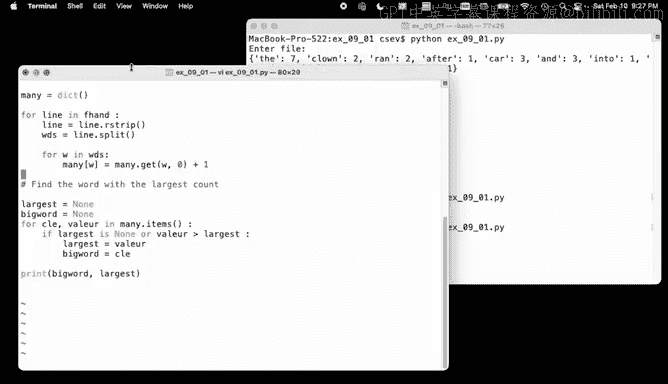

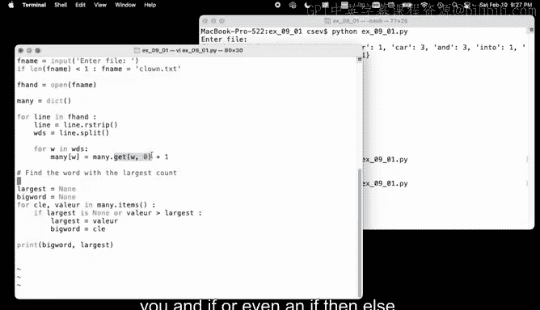

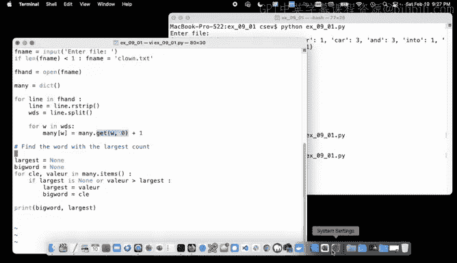

I hope that this was helpful to you and watched as we built a dictionary tool。

 we have a piece of software that used dictionaries so by seeing how I construct it。

 you can see it different way， cheers。