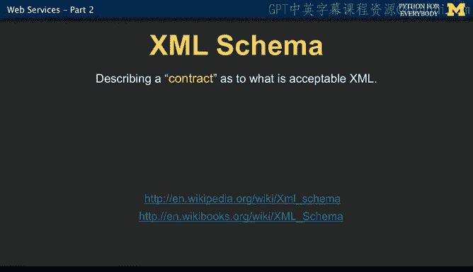

# 密歇根大学《给所有人的Python课》课程3：《使用Python访问Web数据》｜python-network-data｜ - P28：28_05_02_可扩展标记语言_XML.zh_en - GPT中英字幕课程资源 - BV1Hu4y1e7WS

So XML is what we call the extensible Markov language and basically XML any serialization format has some special characters and then some rules about how to form the serialized document basically from the internal structures and so the rules of XM and the reason that Xm became popular is it became popular about the time that HTML became popular or you could almost say that Xm influenced HTML but the notion of less thans and greater thans as the active of characters as the way to tag or otherwise mark the information and so that's how it works and so it works just like HTML。

Except and there's start tags and end tags and that sort of brackets a chunk of stuff and so people people is a tag in the person and person that's another tag and an ending tag and a name and slash name that's an ending tag and the way to think about this is there is a simple element。

 these are called elements or nodes。And we'll have a couple of ways of visualizing these coming up There's one kind of element that just has some text in between it and so that is the simplest bits it's called the simple element and then another kind of element like this person actually just has sort of child nodes associated with it so the simple elements are these and then the complex that once their person and people and so they're nested together and the indenting is just something I'm showing you to make it look pretty XML like doesn't really care what extra spaces you put in。

 but it certainly helps us as human beings to understand what's going on and so the primary purpose of XML is to share structured data it was a simplified subsetet of this SGl which kind of was the precursor to both XML and HTML STl was a little hard so you could almost think of Xml is like a simplified easy version of SGML。

And so here are sort of the basics of it it has a start tag and an end tagag。

 so that's what start tag and n tag are start tag ntag， start tag end tagag， start tag n tagag now。

 so that's what start tag and n tags are the n tags are the ones that have the slash There is textual content。

 there's the stuff between the tags。So there's just the text， what do we call the text nodes。

 and then there are attributes and attributes are always on the start tag。

 so the phone and the email， and they are key value pairs using double quotes as the you type equals double quote INTL。

And the key thing about Xm versus HTML is we get to make up the tags and HTML we think say things like H1 or a for the anchor tag or H1 for header level1 here based on however you're going to agree between the two applications exchanging data you can say the tag is person and slash person you still have to file the rules of there is a s tag at the end。

 so attributes and then you can also have a self- closingsing tag and that is you just include this slash less than at the end of the open tag and it's as if you have a closing tag of the same name with an empty text area and so that's what this is saying so that's a self- closinging tag。

Okay， like I said， the white space doesn't really matter so much。 We can pull these things up。

 We tend to indent them like any kind of programming environment to help our own reading。

 but in general， whitespace except in the middle of things like these text areas。

 the white space does matter， but sort of between here and here。

 the white space doesn't matter between here and here the white space doesn't matter know and so the white space these extra spaces that I use to to indent it。

 it doesn't really matter the only time matters is in between when you're in a text area。

 Here's some sample Xml just to give you some ideas here we have there's always one big outer tag of Xml。

 you have a start tag and an n tag and there's only one of those because it can't be sort of multiply defined。

 there's always the outer tag we see a series of attributes right so the attributes are key equals and then double quoted string key equals double quoted string and if you look at HTML。

 you'll see that this is exactly the same as HTML。 The difference is in HTML you're supposed to have a thing called Hf。

als quote blah blah blah quote right And so HTML is kind of like Xml that's more highly specified。

 Whereas this is just two programs agree on a format and they use it。

 So we have an outer tag that's a complex element。 and then we have like in that title you can have sort of things that are in order like this ingredient you see some attributes on there。

 and then you have a text block in the middle of here。

 So we'll see in a second how these things all work。 then a subtag。 it's like a tree。

 we'll see that in a second and a series of steps。 and so these can be an order they can be more than one of these things and we can create all kinds of structures that are really designed based on the needs of our working two applications that are trying to cooperate So tags at the beginning in the end attributes are keyvalue pairs on the start tag serialization and deialization is the act of taking from an internal structure in one programming environment sending it across a network Desialization is received。

Gettingcro across the network and transking back into an internal structure on the destination computer。

So there's a couple different ways that we can look at this。

 the most common one and the word nodes kind of comes from trees。

 each of these is like a node because it sort of comes together。

 it's a place of connection So we call this thing a node and so you can think of the outer document as the top node of the tree。

 it's kind of an upside down tree actually if this was a tree it would have a trunk and that must have stuff like this。

You know， squirrel sitting up here， right， so， but it's kind of upside down tree。

And so we have the top of the tree here， and then it has two child nodes。

 The B node and the C node are directly beneath the A node。 and then we model。

 as you'll see in a bit Y we model the text in between them as a child。

 So it's a child of the B node so that' the text is a text node。And it is a child of the B node。

 So the B node is all of this。 and then this is the child of the B node。

 And the C node has two children。 D and E and the D has a child with capital Y。

 and the E has a child of capital Y。 so these are the simple and complex elements。

 and then there's the text within the elements。 But like I said。

 we model the text as the child of the node， As you will soon see。Right now。

that's because we model attributes as a different children。

 So if we change this a little bit and we made this have a attribute， W equals 5。

 all of this is part of the B node and the B has the text area。

 There's only one of those and there could be many attributes， There could be lots of attributes。

 I just have W equals 5。 And so one of the children of the B node is that it's attribute child or the text child and there can be many of these attribute child because there could be lots of attributes。

 you know， a equals for， you know， B equals 19。quote there I was got to have double quotes。

 And so you could have many of these attributes and they're sort of children。

 But if you grab the node and you'll see when we start talking about the doing this in programming languages。

 we'll see why it's important to kind of understand what it means when you grab this versus when you grab that。

 Those aren't the same thing。 X is the text at the node B and B the node B is that text and attributes and everything all rolled it together。

Another way to think about these and a way to actually parse XML is through what we call paths and in a sense what you do is you just draw the tree and then you walk down the tree and so this X could be thought of as a piece of data that's at slash A s B so you start at the top go down to A go down to B what do you find there If we go down here and go from A to C D and find Y that's this one AD So this is like a path and you could think of this as like folders on your computer you know the A folder then there's two folders within A which are B and C。

 the children folders and then within C there's children folders D and E and so like this one here is A C E and then you say what's living there at AE the text that's living at ACE is Z。

And so that's another way to think about XML Now the thing we're going to talk about next is an important aspect where we're trying to decide between two applications if I'm producing data in your consuming data and you blow up。

 was it the data's fault or was it your fault and that's what XML schema does for us。

