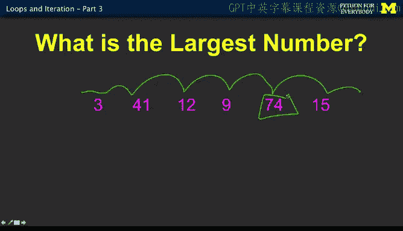
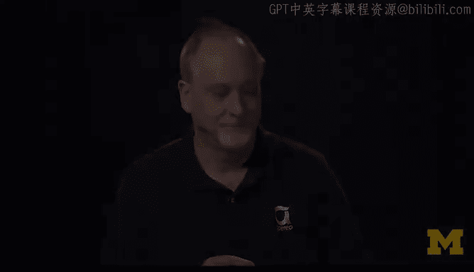

# 密歇根大学《给所有人的Python课》课程1：《编程入门指南（使用Python进行开发）》｜python｜ - P28：28_07_03_查找最大值.zh_en - GPT中英字幕课程资源 - BV1214y117Mk

So now we're going to talk about what we're trying to accomplish with a loop right we're trying to we know how they mechanically work。

 but what are we looking for， like what if we're looking for the largest value or checking to see if 42 is a member of a set or something or looking for the largest letter like the max function and so we're going to construct loops sort of with an idea of doing something to each value in in the set that we're iterating through and then coming up with some kind of result。

And the pattern that we're going to do is。We're going to write a for loop and actually in this next two segments I'm going to do the exact same for loop。

 but we're going to do something before the loop starts， set some variables to initial values。

 and then we're going to do something to every one of the values in our list and then not really we don't know what the largest value is while the loop is running。

And our goal is when the loop finally finishes that we have something， whether it's the maximum。

 the minimum， the average， the total， how many things there are， how many things match。

 And so this is。The iterations are getting us closer to knowing the answer。

 but they don't instantly know the answer， so we have to work towards the answer by setting something and then sort of checking it a bunch of times and then we sort of have absolute the truth comes out at the bottom and you'll see this in a second。

So here's the little loop that we're going to do。 and I'm going to do this over and over and over again。

 in these numbers， you're going to get tired of these numbers for some variable iteration variable in 9。

41，12，3，74，15。 we print out it before。 So we're going to do something before the loop。

 we're going to do something during the loop and after the loop right now。

 I'm just printing everything out。 So you kind of see how the loop K of works， okay。Okay。

 so here's a little problem。 I am going to show you a number of numbers and maybe it'll be a million or maybe it'll be6。

 I don't know， but you don't know how many I'm going to show you。

 and I want you to tell me when it's all said and done what the largest number is and it's not going to be too hard。

 but imagine that you had to do this for a million numbers as a human being that you were just sitting there and numbers going by and by and by and by how would your brain truly solve the problem。

 So here ready， here goes some numbers。So did you get it？Did you get the largest number？

It's not so much interesting about。What the largest number was， it wasn't that many numbers。

What was your brain doing to sort of crack that problem， to solve that problem。

 What was your brain doing， And what if you really had to do that for a million numbers。

 and they were not little tiny numbers either， They were sort of medium sized numbers。

 And you had to do a million of them。 What， What would be your technique other than running away。

 Because humans aren't good at this。But what be the precise technique that you use？

And so here are the numbers。 Now， actually， as a human， we love looking at these numbers like， oh，74。

😊，But then you ask， like， how did your mind exactly find them， right。

 The mind just go our minds go like， there're 74， right， We don't。

 Our mind doesn't look at them the way a computer looks at them。 It just kind of zooms in on 74。

 It just kind of。AndBut that's not how computer looks at them， the computer has to look at them as。3。

41，12，9，74，15。I conclude at the very end that 74 is the largest number， right， but it humans just。

74 so humans think about this differently。 and so we have to realize。

Purpose of that last little exercise was to think when we construct loops how computers are going to attack this kind of a problem。

 they attack it sequentially， they don't attack it magically the way we humans do。

And the way that you do it is you creep in your head， and you probably did it， some notion of whats。

 what is the largest number I've seen so far。Like a variable。 And wed start and say， oh， it's。

 I haven't seen any numbers so far。 So we'll stick negative one in there。

 And then you see 3 and you go like， well， okay， that's。

First number it's also the largest I've seen so far， so three is pretty good。

 If we stop now and I tell you that's the last number， the largest number is three。

 it's not the largest number until I tell you we're done。We see 41's like， whoa，3 is a bad number。

41 is even better。 It's way better。 We'll keep 41 is our so far so far so good。

 but we're not done yet。 we've got to keep going 12。 well， that 12 is no good because 41 is larger。

 We'll keep 41，99 is no good。 We're in really great shape。 It's 41， the largest。 No。

 but it is largest so far。 So we know that much。 Now we see 74。 but whoa， that's way better than 41。

 So keep track of that one。 And then we go like 15 looks like 74 is pretty good。

 And now we're all done。 And we see that it's 74。 So what happens is that at the end of the loop。

 When we know that we've some we kept the only thing we knew with the largest we saw so far。😊。

And when I tell you we're all done， then the largest we saw so far like just poof。

 it is the largest right because it's all that we're ever going to see So that's how you have to construct these loops in Python。

 So here is a bit of code that does this logical bit here okay。

And so I'm going to make a variable and remember variables can have underscores in it。

 I'm going to call this variable the largest so far。

 and I'm going to set it 10 negative 1 at the beginning。And before the loop starts， remember。

 I said there's stuff we do at the beginning of the loop and then stuff we do during the loop。

 and then our payoff is after the loop， after the loop。Okay， so before the loop。

 we set the largest we've seen so far， which we've seen nothing。

 so we say negative 1 then we print it out so before the loop largest is so far as negative  one。

Then we have an iteration variable， v nu is going to go through successfullyively 941， 12， 374。

 run this block of code。Five times oh six times once for each of those numbers。

 And we're going to ask if the number we're looking at in this first case。

9 is greater than the largest so far， then the largest so far is the number we just looked at because it's bigger than the one we saw before。

 So largest so far is the largest up to this point。And then we。

 then we can when we kind of grab it basically。 So then we print out for each iteration the largest so far。

 So the first time we get 9 and the largest we've seen so far is 9。

 because that's the first one we saw。 and it's the largest we've seen。 Then we go up。

We advanced to 41。41 is the nu。And then 9 is largest so far，41 is greater than it。

 So then we take the 41 and stick it in largest so far。 So the largest we've seen so far is 41。

 The one we just saw was 41。Go up again， now 12 is going to run。

And so we see 12 and the largest so far is still 41， and so we don't do anything。Go back up。

 run three。 We get three largest so far is 41。 Nothing needs to change。 Then we run again， we get 74。

74 runs。And that is new the new， the new champion， the new champion largest number。

 And then we go back up one more time，15。 in this code， we don't know how many we're going to do。

 We could do 5 or 6 or a million， but we don't care。

 We just keep the best we're doing is largest so far。 So we get 15。

 and the largest so far is still 74。 And now the for loops says you're done。 and we come out now。

Largest so far is actually the largest in the sequence of numbers， which is 74。

 So this is how that's a pretty messy slide。 This is basically how Python。

Can't go through a list and looking at the largest so far。 And then when we're done with the list。

 that is the largest。 So you get the idea。We set something up before， we do something to each value。

 and then at the end we kind of get the payoff of what we were looking for in the first place。

So up next， we're going to talk about more of these luidiumms and how to find the smallest and how to count things and how to do averages and sums and stuff like that。

