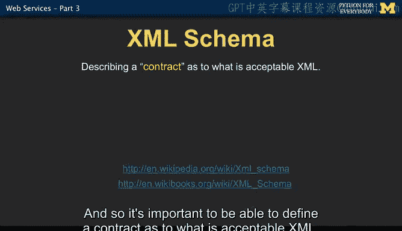
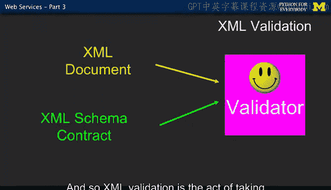
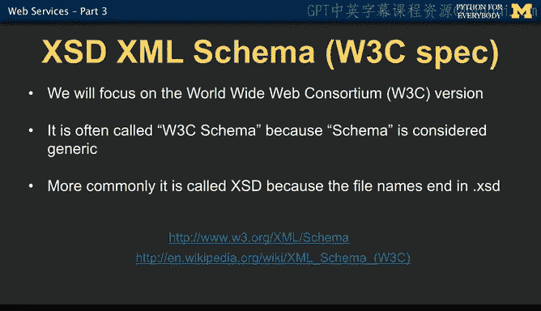
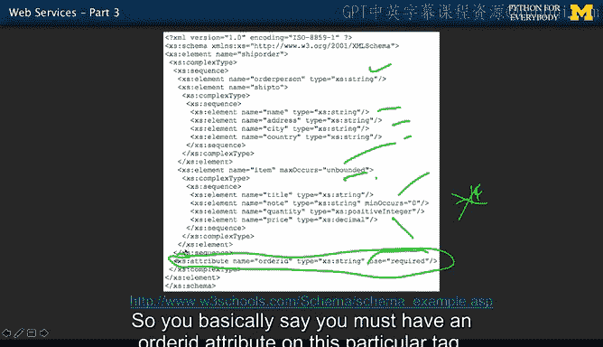

# 密歇根大学《给所有人的Python课》课程3：《使用Python访问Web数据》｜python-network-data｜ - P29：29_05_03_XML模式.zh_en - GPT中英字幕课程资源 - BV1Hu4y1e7WS

So we have two cooperating applications and they got to send data to one another and they have a disagreement as to whether or not the data is right One side might blow up or the other side might blow up and it's like whose fault is it and so it's important to be able to define a contract as to what is acceptable XMl that's really kind of outside of either application you can't say the Xml that works is the Xm the correct Xml is the one that causes my program not to blow up。

 that's not really the best way to define it so we have to define it kind of at the moment of data exchange and that's what Xm schema does it's a way to sort of establish outside of any program and then separately check so this side can say I sent good stuff and this side said I receive good stuff or I receive bad stuff so you can just look at a document and you can say yes。

 this validates or no it doesn't validate validation is not the act of transferring the data or even decsializing the data the validation is the act of verifying that the data。

Is in the right format。 It's a contract so if you're。

If you are working with something like your airline reservation system that's working with an airline system。

 I mean that's working with a hotel system， you might say， okay。

 and here's the schema and then just publish that separately and agree that's the schema。

 So if later the XML starts to change in bad ways that break one side or the other。

 they can know which side it was that started changing。

And so XML validation is the act of taking a document and a schema contract which itself is also an XML document and then sending to the validator。

 we're not going to spend a lot of time with this， but it's an important concept to sort of imagine and understand how contracts between cooperating applications have to be developed And so here's a bit of XML。

So some XML person taggged remember the outers only a single tag and then I've got three child tags。

 you know a last name age date born and then we have a contract and so like I said the contract itself is XML with a couple of weird looking tags and what the XML is is trying to say you know what kind of tag this is how much data you're supposed to put in it can you have any child tags underneath it all those kinds of things are the questions that are being asked by the contract and so this XS complex type and we said before。

 an element that can have children are called complex and the element that can't are simple and so this basically says the outer bit of this particular XML is expected to be a tag name person and that's what that's saying。

Then what it says is within that there's going to be a sequence of tags， excess colon sequence。

And then we basically say， oh， and there's going to be a tag called last name and it's going to be a string。

 and then there's going to be a tag that's age and it's going to be integer。

 and then there's going to be a tag called date born and that's going to be a date。

 And so we can sort of look at this and say outer one person next one in name age。 that's a number。

 that's good。 That's a string that's good。 that looks like a date。 that's good。 check， check， check。

 check， check。 This XmL matches that contract。 and that's the idea。

 Now I'm not by the time you actually have to make one of these。

 you'll go be read you'll have to read all kinds of stuff and figure all this out。

 So I just want you to get the sense that these things exist and they're not impossible to read。

And so there turns out， again， in the early 90s。There was a number of these schema languages that were out there and you'll run across them。

 I'm mostly talking about the one that kind of one or the one you're most likely these days to encounter called the XMl schema from the World wide Web consortium it's called XD and usually the file that you get you know if I just have a file and I send you that's Xml I have a suffix of dot XMl and if I send you a schema I tend you to send you a file that's dot XsD and so we kind of just call it XD and that's the one we're going to talk about and so a away we go that's the one there's other I just want you to know that there's other ones out there。

So like I said， you know you have complex elements， you have simple elements， you have a sequence。

 those are sort of the basics of the tags that you can put into excessD。

You can do further further things I just gave you the simplest kind of stuff and so for example。

 I can basically say， okay， this tag fullstering。I want there to be a thing called full name。

 there's a sequence。 So this is a sequence， and we see that this is a sequence。

 and I want this to be minacs equals 1 maxs equals1。

 That basically means there's got to be one and exactly one。1 and exactly one。 mins。

 if you have less than one， it's an error。 If you have more than one， it's an error。 This one here。

 this tag， this one can happen zero times up to 10。

 So that just means if there are somewhere between 0 and 10 of those tags at between full name and the end of person we are happy with this。

 And so that mimicocs max occurss is basically how many times these things must appear。 So again。

 this is just a little more sophisticated excessD We've already played with a couple of different kinds of data types。

 We've talked about string。 we've talked about date。

 We'll look at the date in a little more detail date time， decimbel and integer。

 So it sort of understands the difference between a floating point and integer。

 so you can you can render an opinion as to what you want in there。 string， of course。

 is just about anything。 And dates are kind of special。 the date format that they chose， of course。

 if you go from different countries。 the date is all kinds of different things。

 The date format that they've chosen mostly that's。

Heavily used on the internet is a date format that's year four digit year dash two digit month dash2 digit date and you know that's not how it is in America we do you know924。

2002 in America but and the web they basically said how about we pick and we didn't want to pick the one that was the most popular but pick something that computers would like and so this turns out by forcing it to be fixed like this。

 it sorts So if you were to sort this the year is the most significant。

 the month is second most significant and the day is the next most significant and you zero fill up to two digits for the month in  two digits for the day and so so January 1。

2001 is 20010101 and so it's the same length as know 20021231 and so you can just sort these and you it just sorts as strings they sort quite naturally。

Whereas lots of the formats that we use for dates in common use or in our own writing or on checks or whatever don't sort so well。

 So we did this for computer folks got picture that's coming up in a second and the other thing is as if it's a date time it's exactly the same date format and then it's the letter T and then hours。

 minutes and seconds and then a time zone dates and times in the web and on the Internet are very problematic because in the sort of real world where the sun comes up and sun comes down and it matters what time of day you know you kind of want it to be noon when it's light out we have time zones and then we have savings time and then certain places violate the rules and there are at different time then somebody that's right next door。

And so a thing that computers tend to do is they tend to ignore the time zone。

 I remember in the old days， computers would mess up when a daylight savings time happened and they don't anymore because they tend to think of all times inside the computer as universal time or Greenwich Me and that's how and that means it could even be the day different day。

 but then they offset it， you know and that's if you've ever traveled in your calendar sort of switches。

 that's because the time of your items。Is the same inside the calendar。

 But then when your local time switches， it just moves forward or back and it moves6 hours forward or three hours back or whatever。

 And so that's why we tend。 Now these time formats can have time zones in it。

 but it's not highly recommended。 And so we you'll tend to see these Z times， which are the UTC。

 And like I said， it is filled out 0 so that all the columns have to be filled out 4，2。

2 with the dashes。 And that means they're all have the same length and the letter T and then2 digit。

2 digit2 digits with the colons。 And then at the end of time zone。And like I said。

 we tend to do everything in absolute time。 Here are some more XDs。 Let's take a look at this one。

 This sum of the documents have this little Xml。 That's really an indication that it's an XMl document。

 And then we have the schema， which is the outer one， There's an address as the。

Outer tag and that tag goes all the way to here because these are just key value pairs。

 We have a recipient， which is a string recipient house。That's a string， I guess， street。

 which is a string。 And then we have。Post code。Co。What do we got here？Town。County， oh county。

 that's optional， Minacs zero， so you'll notice that there is no county here because that's Minacurs zero。

 there's no county。And then if we take a look at postcode。Postcode is a string。 So that's a string。

 And then we have country。 So country is an interesting one。 So this is all about country right here。

 So country is a string， but we're going to restrict it with this enumeration says it has to be one of these five strings。

 so it can't be just anything。 It has to be one of these five strings and this particular we can validate that this UK is indeed one of those valid strings。

 So this validates。 So this bit here validates everywhere we can check and validate that every one of the tags there meets the needs of this XMl schema。

Here's another schema that has a couple of other things X string。 we've got that string。

 we've done that string we've done Max occurs unbounded that says as many as you want and occurs 0。

 we know how to deal with that excess positive integer that just means you negative 14 is not allowed and then U sQs required that says this has to be there and you can talk about attributes as well。

 So you basically say you must have an order I attribute on this particular tag。 Okay。

 and so I'm not trying to teach you how to。

Me an excessD wizard， just the notion that there is this syntax that's used to establish a contract so that you can resolve disagreements between cooperating applications。

 so next we'll switch from schema back to XML and we'll look at how to parse XML and Python。

