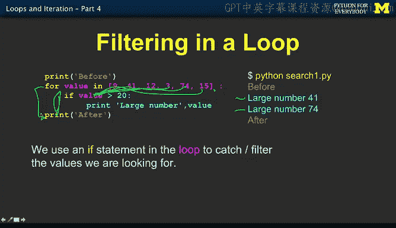

# 密歇根大学《给所有人的Python课》课程1：《编程入门指南（使用Python进行开发）》｜python｜ - P29：29_07_04_循环惯用法.zh_en - GPT中英字幕课程资源 - BV1214y117Mk

So now what we're going to do is we're going to keep working on this。

 We're going to do something in the loop or and do something before and something after。

 and we're going to accomplish different things。 So the first thing that we're going to accomplish is counting something。

 right。Counting the number of things that we are going to be looping through。 Now， in this case。

 it's kind of silly。 But just in general， these are called counters。

 And so let's just say that we had， you know， dot dot dot， dot， a whole bunch of these things。

 And we didn't exactly。 We can look at this and say there are six of them。 But that's not the point。

 The point is， if we have a loop。 And in the loop。 We want to keep track of how many we've seen。

 Well， you do this counting thing。 Okay， So the way it works is。You set a variable to zero。

 This is the top part。Normally， this would be called count。

 But I'm going to use a bad nonneumonic variable called zorc just so you don't get too used to it。

 So we， we so far， how many have we seen what we've seen 0。

 And then we're going to go it thing is going to be 9，41，12。

 So thing is going to be the iteration variable。 Each time through the loop。

 we're going to add one to zorc increment is another word for this。 Zorc Googles zorc plus 1。

 we print out the thing we're looking at， and we print out the current value for zorc。

 So the first time through 9。 And then that's the first thing we saw41， the second。 So you know。

 and each time this goes out by one。It doesn't really matter what these things are。

 But then we run this many times。 And when we're done。 and we say， okay， loop is all done。 right。

 there's the end of the block。 And when it's all said done， there were six things。 Now， again。

6 is kind of obvious。 We could just look at it and know that there are 6。

 But this is a way to keep track of the number of times that the loop is executed。

 you set it to 0 at the place， you add one to it， and then you print it out the end at the beginning。

 before it starts to set it to 0， add one each time through， and then print out the count at the end。

So， that's。Counting。The next thing we're going to do is total up a series of values。 So in this case。

 we're going to total them up makes a little more sense now。

 and we're going to have another variable zork。 I would probably call this total during the loop。

 it'll be the running total。 and at the end of the loop， it will be the total。And so。

Total equals 0 beforeve that's the running total of what we've seen。

 So now 9 comes out and 0 plus 9 is 9。 So， so the running total is 9。 and 9 was what we looked at。

 Then 41 comes in。 Then we take 9 plus 41。 running totals 50。 We read 41。 go back up 12 comes in。

50 plus 12 is 62， so we have that's our running total next time we get three。62 plus 3 is 65。

 So that's this line prints out。 Then we get 74。 So 65 plus 74，65 plus 74 is 139。

 So that's the running total。 We go and do the last one，15，139 plus 15 is 154。 we print that out。

 And now it goes back up。 but the for loop is done。 So out we come。 So at the end。

 when it's all done， this running total becomes the total。1und54。

 so we certainly when you print all this stuff out， right， you wouldn't print that out。

 but at the end， if you do this。 and so the difference between the count and the total is instead of adding one here。

 you add the thing you're running that you're totaling up。So that's how we compute totals。And。

 of course， we can do this with an average， right？ So now we're going to have a counter。

 which we set to 0， a running total， which we set to 0 in the variable sum。

 We're going to print out 0，0。 So the count in the total is 0。 We run through each time through。

 we add one。So it's going to be 1，2，3，4，5，6 each time through。

 Then we have the sum equals sum plus value。 So 9，50，62，65，139，54。 So this is the running total。

This is the count。Actually， that's the sum in this case， the sum variable。

 And then this is the this is the thing that we were reading in。

 And then we finally get done because there was only six things。 the for loop dumps us out。

 And then we got， oh， okay， how many do we get， We got 6。

 What was the total It was 154 and then divide sum by count that should be 25。0。Okay。

 and so we divide some by count and now we have calculated the average。

 actually this should be 154 divided by 6， I that's I think that should be 25。

6666 or something like that。Okay， so you get the idea and so you sum and so you can do more than one of these things in a particular loop。

Now， filtering is the idea that were we're looking for something that meets some criterion。

 So we're going to go through and look at all the things in the loop。

And we're trying to figure out if something is greater than 20。

 and we're going to declare that large number。 So this is how you put an if in the loop。

 And so sometimes this loop will do nothing。 Sometimes this loop will print out large number。

 And so values is gonna to be 9， and that's false。 So it doesn't do anything。 valuess 41。

 That's true。 So it prints out this。 valuesues 12， So it does nothing。 values 3。 It does nothing。

 values 74。 And so it prints this out。 values 15。 So that's false。 It's done。

 Now the four loop knows， oh， we're done。 go on to the next line。

Okay， so this is kind of a filtering pattern where， you know。

 we're going to do some if statement and conditionally run some code based on the value that we're looking at for now。

 So that's like searching for large numbers in our long list of numbers。

。Sometimes instead of printing something out in the middle of the loop， just like in functions。

 we don't often print in functions， We tend to prefer using return values。

 Sometimes we just want a variable that tells us whether something was found or not。

And so we're going to use a Boolean variable。 So boolean is another type of a variable。

 You got integer variables。 You got string variables， You've got floating point variables。

 Boolean is another kind of variable。 Boolean is the kind of variable that it either has the value true or false。

 That's it。 It can only have two。And so false is a constant in Python。

 and so we're going to say found。Found as a mnemonic variable。

 I use the word found for this all the time， but don't get stuck on it。

 It just happens to be variable with the value false。 So we printed out before it's false。

And now we're going to go through each of these values again。 And we're looking for three。

 And we want to know， did we find three or not， So we have 9。And it stays false。 We have 41。

 It stays false。We have 12 stays false。 Now we have three。 This all of a sudden clicks to true。

 And so then we change the the variable found， which is the same found here to be true。 So this time。

 when we come up through 3， we run this code， then we print this。And it's true。 Now， it's 74。

 This is false， but we've changed the variable for found。 so it doesn't change back to false。

So we run the rest of the loop。And when we're done， true。And so at some level。

If you didn't print all this stuff out。Before， after that means we found a three。

 There could be a million。Times that we ran this。 And all we know when we're done is there was a three in there。

 So that's what's saying Fo starts out false。 It loops and loops and loops and loops。

 And if it ever finds it， then found becomes true。 And then we can detect at the bottom loop。 Yes。

 we found it。 Yes， that happened。 no matter how many numbers we looked at， one of them at one point。

 at least one of them was a three。Now， if we were a little tricky。

 we would realize that we could put a break right here。Right there， because once it's true。

 it's not going to go back to fall so we could stop。

