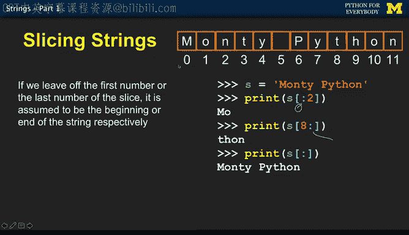

# 密歇根大学《给所有人的Python课》课程2：《Python数据结构课程（密歇根大学）》｜python-data｜ - P2：02_01_01_字符串.zh_en - GPT中英字幕课程资源 - BV1yP411a7TZ

Hello and welcome to Chapter 6。 Now we're going to talk about strings。

 This is really the last chapter that I'm just going to ask you to。

Please learn something without exactly knowing how to do it。 We're just。

 we're just sort of chopping food。 It's like you're gonna to be a chef eventually。

 but we're just chopping food。 So Chapter 6 is the last chapter that you just have to learn how to chop food。

 We're going to actually make a meal in Chapter 7。 Once we have a file。

 Then all of the things that we've learned how to do are going to come into play。

 So just trust me and listen for one more chapter。 So we literally have been using strings from the very first moment。

 because the first thing we did is print hello world。 And so， you know。

 this is a slide from a couple of lectures ago。😊，And so， you know， we take two strings。

 double quote single quotes。 We use the plus。 Remember it looks to the left， looks to the right。

 concatenateates。 Remember that doesn't put a space there。 Yeah。

 here's a here's a string that has digits。 And now we're going try to add one to it And it blows up。

 Yy， you know， it's hardly even you're not reading sad when you see traceback by now。 hopefully。

 you just like， oh， traceback's a normal thing。 I I'm trying to learn it。 type air。

 Can it concatenate strings an inch。 It's trying to tell you what is going on。And we're all good。

 we then take the string， we pass it into the int function， and then that comes back with 123。

 and we add that and it becomes 124。So it's all good， right， it's all good。

 And we've been doing that for a while。 Another thing we've been doing is reading data from input。

 the input function。Print out a prompt。 That's a prompt。

 we type something and then whatever that is comes back is the result of the function。

 and then it gets stuck into name。 And so if we print that， print of course is also a function。

 we pass name in we get out chuck。We even if we enter some numbers like 100 right that doesn't make Apple a integer。

 Apple is a string。 input gives us back a string。 input gives us back a string。

 so we can't subtract 10 from it， trace back again。

 but if we can divert it to an integer and then subtract 10， then we can get that 100-10 becomes 90。

 So we've been to manipulating strings and using internal functions and converting them to floats and doing this。

 that and the other thing as we have gone forward。 But now。

We're going to start tearing apart strings。 So the ultimate thing we're going to do is read through a bunch of data。

 tear that data apart， look at read line by line， and then look at each line and find things in the line。

 So we need to know that a line of characters， many characters， which turns into will be a string。

 a multi characteracter string， has indexable data within it。 So those string banana。

 and I didn't come up with banana。 Actually， the book that I use is based on a book by two people。

 Alan Downey and Jeff Elkner。 And one of those two came up with banana。

 I would never have come up with banana because I don't know how to spell banana。

 and I'm terrified of having a slide or the book with a mistyped banana because I just think somewhere in banana。

 there's supposed to be two ends。 But and I read this and it looks like a misspelling to me。

 but I'm pretty sure that it's right， but。That's neither here and there。 We have this string banana。

 which is six characters。 and we stick it in fruit。 And if we look in fruit。

 you can actually pull each character out。 We call this the index operator。

 and the square brackets are the index operator。 And I I pronounce this sub。 So that's fruit sub1。

 Now， as we look at the index， the first one is 0。 Now， that's counterintuitive。

 It goes right back to elevators that in Europe that have0 is the first floor。 right。

0 is the first floor。 So Python was invented in the Netherlands。 and they have that's Europe。

 And so that all the elevators are 0。 So the first thing is 0。 thats。😊，Actually。

 that's not the reason at all。 The reason has to do with performance in computer science。

 where zero is easier to add than subtracting one， but whatever。 Just remember the first thing。

 the second thing， the third thing， fourth thing is sub0。 So this is a six character string。

 but the last position is position 5。You'll get it。 It won't take you long。

 It'll seem natural pretty soon。 Right now， It seems unnatural。 So fruit sub 1。

 that means the character in position 1。 So a ends up in letter。 And so he indeed can verify that。

 This thing inside of the brackets can be an expression。

 It can be a variable can be anything you want。 There's a constant。 Here's an expression。 X is 3。

 X -1。 that becomes 2。 So fruit sub 2。Comes down here to x， and we see the n that comes out of that。

That's the index operator， we pronounce it as sub you know fruit sub x minus1 is how pronounced that last little bit。

And so。It wouldn't be Python if we didn't have a trace back and in this one I'm making a mistake and that mistake is I'm going beyond ABC。

 which is0，1 and 2， and so Zs sub 5。No， sorry， Python is angry at us。

Python is angry at us and so we get an index air index air string out of range， oh well， I mean。

 string index， well this is the string， that's the index that's the we're doing an index operator。

 a lookup operator or a sub operator so。That's just a thing you're not supposed to do。After a while。

 you kind of get used to the idea that Python is just going to trace back on you from time to time。

There is a number of functions we can pass a string into the lens function。

 and we can get the length， the length of this is six characters， it is indeed six characters。

 even though it's0 through5， it's still six characters。So the L is just another function。

 We talked about functions before functions take as input some parameter。

 So fruit is assigned into banana。 And then we're doing this。 Remember。

 we evaluate the right hand side here。 This fruit gets passed into L。

 So the string banana is passed into the L function。

 The L function does something in the middle of it。 and then。

The then returns us a6 with a return statement， and then that6 goes that's an integer 6 goes to x。

 So then we print it out and we get the6。 Okay， so then is a function。

 takes input parameter and away we go。And so inside of L， there is some code。That takes this。

 it's got a for looper who knows what's in here and it's got a return statement。

And then it returns the stuff， which then replaces this as the residual value in the expression。

 and then the assignment statement finishes， and then6 ends up in X and away we go。

 So there's lots of things that you can do with springs asking how long they are is one of the things that you can do with a string。

Now， we want to loop through a string。 Well， given that we can have this index operator sub。

 we can then generate a sequence of numbers 0，1，2，3，4，5。 And then we can look up all of the things。

 right， And so to do that you know， we've got fruit banana and then index。

 This is our iteration variable。 and we're going to construct a loop where we're going to add one。

 we're going to increment index by 1。 And then we're going to say while index is less than fruit。

 less than line of fruit。 and that's 6， not 5。 And this will give us the numbers 0 through 5。

 So this loop will run with index being 0 through 5。 So the first time through it's 0。

 the second time through it's a1 then a2。 And then we're going to take the sub0 letter。

The sub 0 letter and stick it in the string letter。 Sorry letter is a bad choice。Of a variable。

 this could be X。 as long as this were X。 It doesn't matter。

 It's just letter is a reasonably mneummonic variable unless you're trying to give a lecture。

 It's the letter is letter。 The letter gets assigned into letter。So if I just said x x。

 then I would say it looks up the letter at the position 0 and then puts that letter into the variable x。

 and then we print out the variable x。Sometimes new on it， but there you go。

So this' is going to run six times 0，1，2，3，4，5，6， and each time it's going to print out the index。

And the letter that happens to be in that string at the index。

 So now we've got a loop that goes through each of letters in a string。Now。

 that was the indeterminate loop。 We had to construct it。 We had to make our own iteration variable。

 et cetera， et cea， et cetera。 But a much more convenient way。

 unless you actually need to know the position， just if you want to go through all the letters in in a loop。

 a much more convenient thing to do is just use a4 a determinate loop， right。

 So we're going to use 4 and N。 and remember n is like you know。

 member of for all the letters in the set fruit。 But in this case。

 it's for the iteration variable letter taking on all the successive values of the characters of fruit。

 So letters is going to be B， then A then N， then A then N， then a。

 And that means it's going run this loop。6 times。 And each time through letter is going to be something different。

 And so just print this out。 And we didn't have to construct any of that index stuff or any of the fancy stuff。

 We just rock and roll our way right through that。 Here's those two loops that I just showed you。

Right here's the determinant loop with the four and the in， and it's nice and clean。

 and they produce it here we construct index， have a while loop， use L， add one to index。

 pull the letter out。 And so this line is the same as that line。

 And so this is kind of like five lines of code or four lines of code。

And this is like two lines of code。 And this might not seem like much。

 but there's so many places that you can make a mistake here。 You know。

 if this is like index plus2 or something， now， you do have more flexibility when you're constructing it this way。

 And sometimes you do have to construct it。 But if to do the exact same thing。

 these two things are doing the exact same thing。 And so it's always better to use a more succinct and direct way of describing your code rather than this more。

 this is like show it off how good you are with the whilelo but it's sort of unnecessary。

 So use the simplest bit of code that you can use to accomplish what you want。

 It's easier for you to write。 It's easier for you to debug。

 And it's easier for someone else to understand as they're reading your code。

So we can go back to the iteration chapter and think of all the things that we did。

 whether it was look for the largest， look for the smallest， see if something's there。

 What this is going to do is this is a simple loop that's going to go through and see how many a's are in a word。

 Now we happen to know by looking at it。 but it gives you this sense of iteration。

 So we take the you know letters is going to take on B and an A is going to run this code six times。

 And if the letter is an a， we do count equals count plus1， we set it to0 at the beginning。

 remember how these loops do something at the beginning。

 they do something in the middle and then they have kind of like the payoff at the very end。

 And so this just means every time the letters a， we're going add one to count。

 So this effectively is counting the number of A's in word banana and outcomes3 because there are three A's。

Now， if I misspelled it， there would be more ends and more A's but luckily on this slide。

 I think it's spelled correctly。Now I love I love this in and we're going to use this to do a lot of things when we deal with files。

 when we deal with list， this idea that in is kind of like this membership notion in algebra。

 not that you have to know algebra， but if you do know algebra。

 it's like 4 x such that it's a member of this set。 That's the concept of in。

 it's a very clean abstraction。 maybe you'll actually learn Python and then you'll go back and learn algebra and go like。

 oh yeah， this little member guy， that's kind of like an in statement， in statement in four。

 it's a very abstract concept that really says this is how we're supposed to just run this loop。

You know， run the slo six times。You know，1，2，3，4，5，6。 Do it。

 Take care of all of the small details for me， right， And this， again， for me。

 is the magic of the for loop is the Python for loop is the for itself。😊，The for loop。

Does a couple of things。It decides how long the loop's going to run， when the loop starts。

 when the loop stops， and it advances。The iteration variable automatically。 So it decides， am I done。

 Go get the next letter， run it， Am I done， No， go get the next letter， go get the next letter。

 go get the next letter， go get the next letter。 Oh， and now I'm done， and I'm gonna to quit， right。

 And so the four takes all of this， all that logic is in one statement。 And like I said。

 the less code that you have to write， the better off that you are。Now。

I showed you how to loop through strings， I want to show you ways that you don't have to loop through strings and so one of the things you do in strings is you basically want to grab a piece of the string。

And so this is what we call slicing， and we're going to use the same square bracket to do slicing。

 except that we're going to put an expression in that tells us how far to go。

So here we have a string0 through 11。 Remember， they started 0。 And so in here。

 instead of saying S sub 0， which would be the first character， we say E sub 0 colon 4。

 And so this gives us a range。 Now， the key thing here。Is the end is up to， but not including Okay。

 up to， but not including。 So when we say 0， start at 0 and go up to， but don't include 4。

 that says up to， but don't include 4。 So we don't include 4。 Now， that， again。

 may seem seem counterintuitive， kind of like 0 starting as counterintuitive。But in a bit。

 you'll see that there are times when it sort of makes sense to do up to， but not including。

 So for now， just remember， up to， but not including。 So if we go 6 to 7， well。

6 starts here and then up to， but not including。Doesn't include the7。

 So that's why we get a capital P and then。If we do6 through 20。Six。

 starting at six going up through， you'd think this would be a traceback。But it's not a traceback。

 It is okay。After a while， you're like， I'm a little disappointed in you。 Python。

 You're supposed to trace back every time I make a mistake。 Well。

 somebody decided it was O to reference beyond the end of a string and we'll forgive you。

 It's not going to get anything。 It's actually going to stop there。

 And that's why we get Python as the answer here。Now。

Given that the beginning and the end of the string are a very common thing。

 you want the first you want a prefix or a suffix off of this string。

 It's really common to either eliminate the first character。

 which means beginning of string or eliminate the second part of the range。

 which means the end of the string。 So this basically says0 up to， but not including2 not including2。

 So that's M O。 And this one says 8 through the end， which means thann。

And then you can eliminate them both。 And so it means the whole thing。Why you want to do this。

 I don't know。 I just say it's syntactically there just for completeness。So up next。

 we're going to continue learning how we can manipulate strings。

