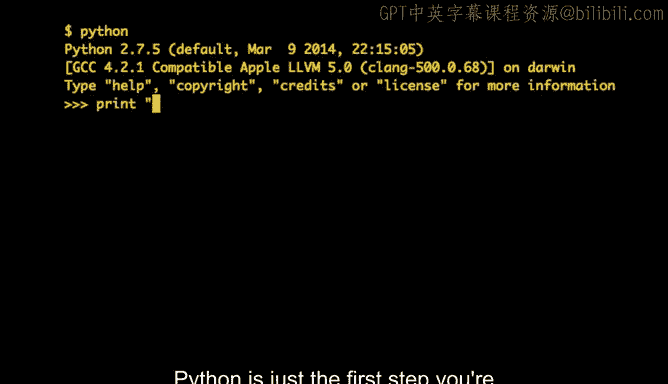
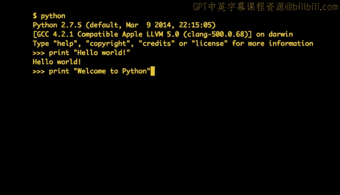
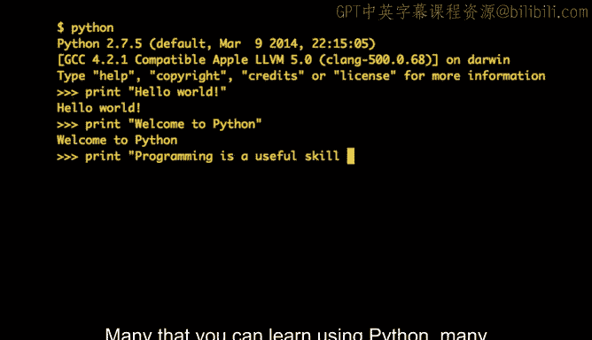

# 密歇根大学《给所有人的Python课》课程1：《编程入门指南（使用Python进行开发）》｜python｜ - P2：02_01_02_来自Python创始人吉多·范罗苏姆的欢迎.zh_en - GPT中英字幕课程资源 - BV1214y117Mk

🎼。🎼P。I'm Guido Van Rossam， I created the Python language。

 I have worked on Python for 25 years and I've worked with a large group of otherstters of course in the Python community。

 I'm very excited to see you all in this class。And I'm very proud that you're using my language to learn。

 iPhone is just the first step you're setting on the path to programming。😊。

There are many exciting things to learn in programming， many that you can learn using Python。

 many that you can learn using other things， and you won't be alone。

 There will be millions of people who have gone before you or who are learning Python at the same time as you。

 and you can help each other。

And you can learn together。🎼。