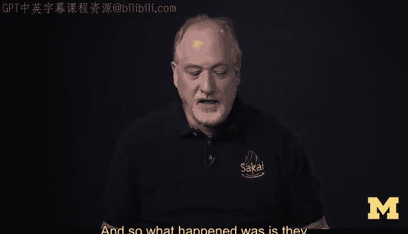
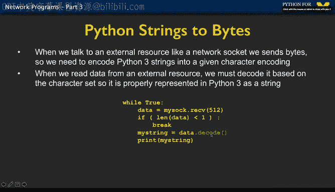
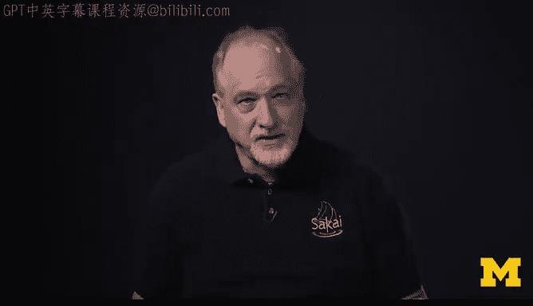
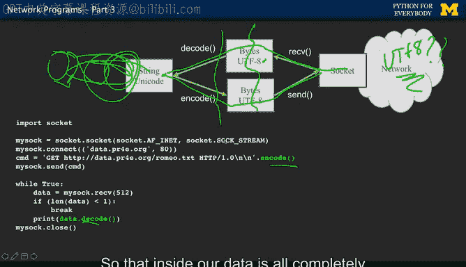
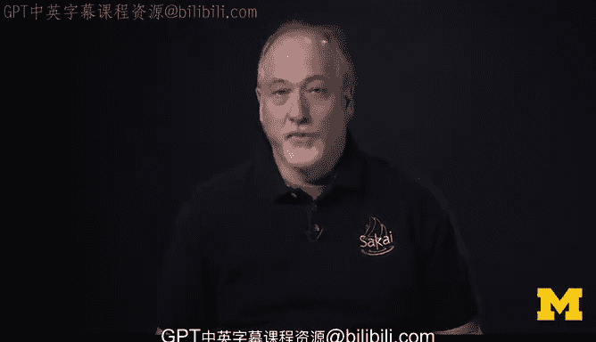

# 密歇根大学《给所有人的Python课》课程4：《使用数据库进行Python编程》｜python-databases｜ - P2：02_01_05_Unicode字符与字符串.zh_en - GPT中英字幕课程资源 - BV1PP411W7H1

So we started this entire course printing hellello world， and I just said， quote， hellello world。

 quote， and out comes hellello world。And。It'd be nice if that was super simple。And， you know。

 in 1970， it was simple because there was pretty much one character set。Even in 1970， when I started。

 we didn't even have lowercase characters， we just had uppercase characters and I'll tell you we were happy when we just had uppercase characters。

 you kids these days with your lowercase characters and numbers and slashes and stuff。So。

The problem that computers have is they have to come up with a way。

 I mean computers don't understand letters actually what computers understand is numbers and so we had to come up with a mapping between letters and numbers。

 and so we came up with a mapping and there's been many mappings historically the one that sort of is the most common mapping of the 1980s is this mapping called ASCI。

 the American standard code for information interchange and it says basically this number equals this letter so for example。

The number。For hello world， that for capital H， the number is 72。

 Somebody just decided that the capital H was going to be 72。 lowercase E。The number is 101。

And new line。Is 10。So if you were really and truly going to look at what was going on inside the computer。

 it's storing these as numbers， but the problem is is there are 128 of these， which means that。

You can't put every character into a0328。And so。In the early days。

 we just kind of dealt with whatever characters were possible， like I said， when I started。

 you could only do uppercase， you couldn't even do lowercase。

And so there is this function as long as you're dealing with simple values that you can say， hey。

 what is the actual value for the letter H， and it's called ord， which stands for ordinal。

 What's the ordinal， What is the number corresponding to H， and that's 72。

 What's the number corresponding to lowercase E， It's 101。

 and what's the number corresponding to new line， and that is a 10。

 Remember new line is a single character。This also kind of explains why the lowercase letters are all greater than the uppercase letters because they're ordinal for ASCI now there's so many character sites。

 but just for the default old school 128 characters that we could represent with ASCI。

 the uppercase letters had a lower ordinal than lowercase letters。Hi。Is less than Z， Z， Z。

 all lower case。 And that's because all lower case letters are less。I mean。

 all uppercase letters are less than all lowercase letters， actually， this could be AAA。

 that's what I should have said there。Okay， so don't worry about that。

 Just know that they are all numbers。 And in the early days， life was simple。

 We would store every character in a bitete of memory， otherwise known as 8 bits of memory。

 It's the same thing when you say I have a。Manyin gigabyte USB stick that's a。

16 gigabyte USB stick that means there are 16 billion bys of memory on there。

 which means we could put 16 million characters down here in the old days。

 so the problem is is in the old days we just had so few characters that we could put one character in a byte and so the ord function tells us the numeric value of a simple ASI character。

And so， like I said， if you take a look at this the。The E is 101。And H， capital H is。72。

And then the new line， which is here， the line feed， which is 10。

Now we could represent these in hexadecimal， which is base 16 or octo。

 which is base 8 or actual binary， which is what's really going on。

 which is nothing but zeros and ones， but these are just this is the binary for 100，00。

1010 and so these are just these three are just alternate versions of these numbers the numbers go up to 127 if you look at the binary you can see in this this is actually  seven bits of binary you can see that's all ones so it starts at all zeros goes on all ones and so it's like zeros and ones or what the computers always do and if you go all the way back to the hardware the little wires and stuff the wires are character are taking zeros and one so。

This is what we did。 In the 60s and 70s， we just said， whatever we're capable of squeezing in。

 We're just totally happy。 We're not going to have anything tricky。 And like I said， halfway。

 you know， early in my undergraduate career， I started to see lowercase letters。 I'm like， oh。

 that's really beautiful。 Lowcase letters。 Now， the real world is nothing like this。

 There are all kinds of characters。 And they had to come up with a scheme by which we could map these characters。

 And for a while， there were a whole bunch of incompatible ways to represent characters other than these ASI。

 also known as Latin character sets， also known as Arabic character sets。😊。

These other character sets just completely invented their own way of representing。

 And so you had these situations where， you know Japanese computers pretty much couldn't talk to American computers or European computers at all。

 I mean， the Japanese computers just had their own way of representing characters and the American computers had their own way of representing characters and they just couldn't talk。

 but they invented this thing called UniIcode and so UniIcode is this universal code for hundreds of millions of different characters and hundreds of different characters sets so that instead of saying。

 oh， sorry， you don't fit with your language from some South Sea Island。It's okay。

 we've got space in UniIcode for that and so UniIcode has lots and lots of character， not 128。

 lots and lots of characters。And so there was a time， like I said， in the 70s and the 80s。

 where everyone had something different and even like in the early 2000s as the Internet。

 what happened was as the internet came out。It became an important issue to have a way to exchange data and so we had to kind of say。

 oh， well， it's not sufficient for Japanese computers to talk to Japanese computers and American computers to talk to American computers。

 we want Japanese and American computers to exchange data。So they built these character sets。

 and so there is Unicode which is sort of this abstraction of all the different possible characters。

 and there are different ways of representing them inside of computers。

 And so there's a couple of simple things that you might think are good ideas that turn out to be not such good ideas。

 although they're used， so the first thing we did is these these UTF。

16 UTF 32 and UTF 8 are basically ways of representing a larger set of characters。

 Now the gigantic one is 32 bits， which is4 bys。 it's four times as much data for a single character。

 and so that's quite a lot of data。 so you're you're dividing the number of characters by four。

 So if this is 16 gigabytes it can only still it can only handle。4。

Billion characters or something divided by four， right，4 bytes per character。

And so that that's not so efficient and then some there's a compromiser like you have two bytes。

 but then you have to pick， this can do all the characters。

 this can do sort of lots of single lots of character sets。

Turs out that even though you might instinctively think that like UTF 32 is better than UTF 16 and UTF 8 is the worst。

 it turns out that UTF8 is the best。So UTF 8 basically says。It's either going to be 1，2，3。

 or four characters。 And there's little marks that tell it when to go from one to4。

 The nice thing about it is that UTF overlaps with ASI， right。

 And so if the only characters you're putting in are the original ASI or Latin 1 character set。

 then UTF 8 and ASI are literally the same thing。 and then use a special character that's not part of ASI to indicate flipping from one B characters to two B characters or three B characters or4 Bte。

 So it's a variable length。😊，And so you can automatically detect。

 you can just be reading through a string and say， whoa， I just saw this weird marker character。

 I must be in UTF8 and then if I'm in UTF8， then I can sort of expand this and find represent all those character sets and all those character。

Characters in those character sets。And so what happened was is they went through all these things。

 And as you can kind of see from this graph， the graph doesn't really say much other than the fact that UTF8 is awesome and getting awesomer and every other way of representing data is becoming less awesome。

 right， And this is 2012。 So that's a long time ago。 So this is like UTF 8 rocks。

 And that's really because as soon as these ideas came out。

 it was really clear that UTF8 is the best practice for incoding data moving between systems。

 And that's why we're talking about this right now。 Finally， with this network。

 we're doing sockets're moving data between systems。

 So your American computer might be talking to a computer in Japan and you got to know what character sets coming out。

 right， and you might be getting Japanese characters。

 even though everything I've shown you is non- Japanesepan characters our Asian characters or whatever right So UTF8 turns out to be the best practice。

 if you're moving a file between assist two systems or if you're moving network data between two systems。

 we recommend the world recommends UTF So。😊。

If you think about your computer inside your computer。

 the strings that are inside your Python like X equals hello world。

 we don't really care what their syntax is。 And if there's a file。

 usually the python running on the computer and the file have the same character set。

 they might be UTF8 inside Python， it might be UTF8 inside， but we don't care。

 you open a file and that's why we didn't have to talk about this when we're opening files even though you might someday encounter a file that's different than your normal character set。

 it's rare so files are inside the computer strings are inside the computer。

 but network connections are not inside the computer and when we get databases。

 we're going to see they're not inside the computer either。

And so this is also something that's changed from Python 2 to Python 3， it was actually a big deal。

 a big thing and most people think it's great， I actually think it's great。

 some people are grumpy about it， but I think those people just are people that fear change。

There were two kinds of strings in Python。 There were a normal old string and a unicode string。

 And so you could see that Python 2 would have be able to make a string constant and that's type string。

 and it would make a unicode constant by prefixing you before the quote。

 and that's a separate kind of thing。 And then you had to convert back and forth between Uniode and strings。

 What we've done in Python3 is this is a regular string and this is Uniode string。

 but you'll notice they're both strings。 So it means that inside of the world of Python。

 if we're pulling stuff in， you might have to convert it， but inside Python。

 everything is Unicodeode。 you don't have to worry about it， everything string is kind of the same。

 whether it has Asian characters or Latin characters or Spanish characters or French characters is just fine。

 So this simplifies this。 But then there's certain things that we' are going to have to be responsible for。

So the one kind of string that。That we sort of haven't used yet。

 but becomes important and it's present in both Python 2 and Python 3。

Remember how I said in the old days， a character and a byte were the same thing。

 And so there's always been a thing like a bitete string。

 and I do this by prefixing the B and that says this is a string of bytes that mean this character。

 And if you look at the byte string in Python 2 and then you look at a regular string in Python 2。

They're both type string。 The bytes are the same as string， and the unicode is different。 So。

 so these two are the same in Python 2 and and and these two are different in Python 2。

I'm not doing a very good picture of that， so the by string and the regular string are the same。

And the regular string and the Uniicode string are different。So what happened is in Python3。

 the regular string and the UniIode string are the same。And now the by string。

And the regular string are different。Okay so bytes turns out to be raw unencoded that might be UTF 8 might be UTF 16。

 it might be ASCI， we don't know what it is we don't know what its encoding is。

 so it turns out that this is the thing we have to manage we dealing with data from the outside so in Python3 all the strings internally are Unicode。

Not U TF 8， not UTF 16， not UTF 32。 And if you just open a file， it pretty much usually works。

 If you talk to a network now， we have to understand。 Now， the key thing is。

 is we have to decode this stuff。 We have to realize what is the character set of the stuff we're pulling in。

 Now， the beauty is， is because。99% or maybe 100% of the stuff you're ever going to run across just uses UTF8。

 it turns out to be relatively simple。So there's this little decocode operation。

 so if you look at this code right here， when we talk to an external resource。

 we get a byte array back like the socket gives us an array of bytes， which are characters。

 but they need to be decoded so we know if know if could be UTFA UTF 16 or ASCI。

So there is this function that's part of byte arrays。

 so data dodecode says figure this thing out and the nice thing is is you can tell it what character said it is。

 but by default， it assumes UTFA。

Or ASI， dynamically。Because ASI and UTF8 are up compatible with one another。

 So if it's like old data， you're probably getting ASCI if it's newer data。

 you're probably getting UTF8 and literally it's a law diminishing returns like it's one it's very rare that you get anything other than those two。

 So you just you almost never have to tell it what it is right So you just say decode it。 look at it。

 it might be asking might be UTF8。 but whatever it is by the time it's done with that， it's a string。

 it's all uncode inside of this。 So is this is bytes。And this is UniIcode。

So decode goes from bytes to Unicode。And you also can see when we're looking at the sending of the data。

 we're going to turn it into bytes， so in code takes this string and makes it into bytes。

So this is going to be bys。They're properly encoded in UTF 8。 Again， you could have put a thing here。

 UTF 8。But it just assumes U TF8 and this is all ASI so it actually doesn't do anything so but that's okay。

 And then we're sending the bytes out the command。 So we we have to send the stuff out。

 then we receive it。 we decode it when we send it， we encode it。

Out in this rural world is where the UTFA is here we just have Unicode。

And so before we do the send and before we receive。

 we have to encode and decode this stuff so that it works out and works out correctly。

 And so you can look at the documentation for both the encode and the decode。

 Decode is a method in the bytes class and it says you can see that the encoding we're telling it。

 You can say it's not UTF8。 Ask in UTF8 are in the same same thing。 The default is UTF8。

 which is probably all you're ever going to use， and the same thing is true。

 Strings can be encoded using UTF8 into a byte array。

 and then we send that byte array out to the outside world。

And it。It sounds more complex than it is。 So after all that。Think of it this way。On the way out。

 we have an internal string before we send it， we have to encode it。

 and then we send it getting stuff back。 We receive it。 It comes back as bytes。

 We happen to know it's UTF 8， or we're letting it automatically detect UTF 8 and decode it。

 And now we have a string。 And now internally inside of Python。 We can write files。

 We can do all kinds of stuff in and out of this stuff。 And a soda works all together。

 It's just that this is。UTF 8 question mark， question mark this is the outside world。

 and so you kind of have to look at your program and say， okay。

 when am I talking to the outside world， well in this case。

 it's when I'm talking to a socket right I'm talking to a socket so I have to know enough to encode and decode as I go in and out of socket。

 so it looks kind of weird when you all start and start seeing these encodes and des but they actually make sense they're sort of like this barrier between these outside world and our inside world so that inside our data is all completely consistent and we can mix strings from various sources without regard to the character set of those strings。

So now we're going to do is we're going to rewrite that program。It's a short program。

 but we're going to make it even shorter。

