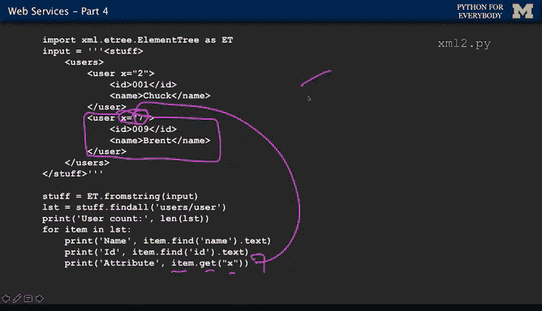

# 密歇根大学《给所有人的Python课》课程3：《使用Python访问Web数据》｜python-network-data｜ - P30：30_05_04_解析XML.zh_en - GPT中英字幕课程资源 - BV1Hu4y1e7WS

So now we're going to move into writing code in Python to deal with X M L。 Now。

 it's not too difficult because like most of the things we do in Python。

 the first thing we do is a really clever import statement that does most of the work for us。

 So this is importing a library X Ml do E tree element tree。

 And this E T then becomes that's an alias。 This syntax of as is like an alias。

 It ends up being a short form。 So we don't have to type this long thing。 Now。

 we're going normally we would be reading all of this data with the URL Lib and read and whatever。

 And then we parse it。 but just to make this simple on one screen， I've kept it simple。

 And so I have a string。 Now， this is a new syntax that you haven't seen before。

 Probably And that's the triple quoted string。 So a triple quoted string in Python is a potentially multilined string。

 And so that's the beginning of the string。 The string ends down here。

And the new lines that are here are part of the string。

OkaySo this is like this is as if we read this bit of stuff from here to here in from a file or in from the web。

 so this is just my way of emulating like a URL Lib and then a read so we can just look at it all on one screen。

Here's our XML and you see this pretty it's well formed XML。

 we got a beginning tag and ending tag being it's the same stuff that I've been doing。

So we have to parse it， and this is kind of like what we do with HTML in beautiful soup。

 We have to pull this string data and give ourselves an object back and then work with that object。

 and so we take this string data。We pass it into E。 fromstring and what fromstr says is。

Take this string and give us back basically a nice tree。 So of think back to those tree pictures。

 Give us back these trees and make sense of it。 It's still got the same thing like chalk and the phone number 303。

 All the stuff。 They're all in there。 right， All it just has kind of constructed this as a internal memory structure inside of Python。

 And that's what we get back from E T， which is this that goes into this tree variable right here。

 And so we got this。Tree of information that's properly parsed。 Now， this could blow up。

This could trace back。If it， if you have a syntax error like， you know。

 you didn't put this slash in or something， this would fail。

 say you've got bad HTML or bad Xm and so that that's kind of what you got to do。

 but when it's all said and done，IfIf this line of code succeeds。

 then you have good XML and you can make sense of it okay。

And so what we can do is we can say within that Xml data， go find me the tag name。 so that basically。

Is this。Tree dot find name。Finds me that。 So if you think of this in the little picture。

 there's the tag name name。And then remember the child。Tag was Chuck。And so the whole tag。Is this。

And then to get down and get just this chuck bit， we say dot Tx text。So this。Is this？

And it's also that。 So if you want to get the text that's in between the name tag and the end name tag。

 you say tree do find。Tag name and then doTXT， and that text is an attribute of this particular node。

 give me back that thing。If you want to get in an attribute， not the text， not the text node。

 you can say， okay， go find me the email， which is this， which is this。 So if you look at the email。

 it looks like this email。Is the node， and it has an attribute of hide。And what， yes。And there is。

There is no text， right， because this is a self closing text。 So this doesn't exist。

 So we say tree do find email。 That gets us this whole thing。

 And then we call the get method within it and say get hide。 And that says。

 go find me the attribute named hide within the tag email。 And so that then gives us back yes。

 So this whole expression T dot find email dot get hide gives us yes。

 And so that allows us to work our way down in through some Xml and pull stuff out of the Xml。

 And that's what we have to do when we're in a program。Okay。😊。

And so that's the syntax for parsing XML， and if you go online。

 you'll see lots and lots of examples of how to pull data out of XML when I'm writing code like this。

I tend to have to print out tree dot find email and I get a few things。

 so I tend to these expressions kind of get long as you're working your way down a tree of XML and then you find the thing and so don't expect that you necessarily can write this code perfect the first time you sort of write a little bit than add a little bit more than add a little bit more in that a little bit more and then finally。

 you know you see the thing that you want to get out of your tree of data。

So you can have either a tag， which is sort of a simple tag that has a child or you can have a tag that has multiple tags。

 and so we use a different way if there are multiple child tags。 So here we have again。

 the single the triple quoted technique where you know the bigger outer tag is stuff and then there is。

A user's tag below that。 And then there is a number。

 And so the I here is we have many dot dot dot dot dot， many users， user， user user。

 we have x equals 7， the I D， and each user has a little bit of data， et cetera， et cetera。

 et cetera。 And so now we want to be able to write code that's going to go through each of these user tags。

 And so we're going to use the find all method。 And again， we take all of the text。

 We pass it into from string。 And we get back an object， stuff。Is a tree。

Of information that's parsed and and gives us methods and attributes that we can use to go through the data。

 So that's what this does。 take it from the outside world to the inside world in Python。

 Now what we're going to do is we're going to say， oh， okay。

 we're going to call the find all method in there and we're going to search for the user tag。

 All of the user tags below users。 So that's what find all means says there's a bunch of these under users。

 there's user tags。 Find all of them and give them all to me。

 So what you basically get is these tags。Except in a list， right， So these tags are in a list。

 not just， not just the word chuck and Bt， but the whole tag， in a sense。

 it's a list that's itself little trees， right。That's a tree， That's a tree。

So this is a list of tags， which is little mini trees of information。And so this is a list。

It's not a list of strings。 It's a list of tags， but we can ask how long is it。

 So we'll print how many there are。 And then we can loop through them。 There's just a little list。

 right， So it's a list of two things。 It has a little tree here and come a little tree， little tree。

 So that's what we're going to do。 We're going to write a for loop to go through that。

 And we're going to have an item that's going to iterate through each of these things。

 I could call that tag for tag in the list of tags that would make sense。

 And so item is going to take on the successive values of this list。

 This for loop is going to run twice。 It's going to run once for this and once for that。

 And that's what's going on。 And list is。List is that data structure。So now when we come in here。

 we're going to have a little tag and so the user， the first user tag looks like this with a x equals 2 and then a child tag of ID and a child tag of name。

And the first one is going to be 0，0，1 and。Chuck。So item is going to point to this。

 so we can then do those same kind of things。 We can say within item。

 find the name tag so that grabs this bit out and then go grab me the text so that this bit prints out Chuck。

The same thing for go find the ID tag。Go find the ID tag and then go grab the text field so that's going to print out 001 and we can go get the item and then there is the attribute that's directly under it。

And then the loop runs again， and so it's now pointing at this bit right here， so item。

Is now pointing to that tag and it says go find the name tag and find the， so find me the name tag。

And then find me the text within the name tag and that prints out。 Then it runs this line。

 Go find me the IDd tag。Go find me the ID tag。Find the ID tag and then grab the text out of that so009 is going to print out there。

9， and then。From the original。The original tag， go find the X attribute。That's what item。

 get x is and so that's going to be seven so what we're going to get there so that's going to pull that out。

So so in those two examples I've shown you how you sort of dig through a tree or loop through a list of trees。

 so that was a list of trees tree。

T， those are the two basic things that you tend to do when you're parsing XML is either。

Cruise down a tree or get a list of trees and then cruise down those trees and sometimes you have lists within lists and trees within trees and it can be very complex but and your programs can get complex but sooner or later you get them working and this is why the schema is so important because once your code works and they change that structure your code tends to blow up badly and so you want to yellt to other person say like why did you change the XML and they're like。

 I didn't change the XMl and you're like wait here's the schema that proves that you change the XML。

So that kind of gets us through XML and there's a lot of challenges to XML XML is a very rich way to serialize data up next we're going to come up but talk about a more lightweight way to store data called JSON or JavaScript object notation。

