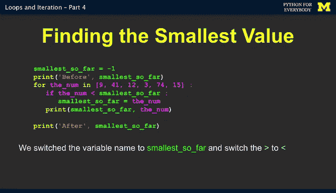

# 密歇根大学《给所有人的Python课》课程1：《编程入门指南（使用Python进行开发）》｜python｜ - P30：30_07_05_查找最小值.zh_en - GPT中英字幕课程资源 - BV1214y117Mk

So we've done a bunch of different things。 right， We found the largests。 We searched for value。

 We did some sums。 We did some averages， and now we're going to do the smallest value。

And so just before we do the smallest value， let's review what we did for the largest value。Okay。

 and so we have this variable called largest So far that we set the negative  one and then we print it out and starts being negative one。

And then we're going to go through this loop 9 and and the largest so far is 9。 And then we go 41。

 We like that one better。 Then we like 12。 We don't like that。 We like 3。 We don't like that，74。

 We keep that。 And then 15 doesn't make any difference。 And then it pops out。And we get 74。

 That is the largest， not the largest so far， but the largest you would get。So， the question is。

What we do to change this to make it search for the smallest value in the list。 Now， you can look。

Humans are good at this。 Like， hey， what's the smallest value。 It's 3。 Yeah， of course。

 you know that。No， I think like a computer。How are we going to find the smallest value in the list。

 What would we change here， What are some of the things you might change。Well。

 there's at least a couple things you would change， right？

So the first thing you would do is let's just change this from a greater than sign to a less than sign。

And let's just change the word， large to small。Is that gonna fix it。Take a second。

 If I change all word largest to the word smallest， and I change the greater than to a less than。

 Is that going to fix it， if I did that。What number is gonna come out here。Is it gonna be 3。

That going come out。

So like， if I did this。

Is that going to make it better？ Is it going to print three？Obviously， if I'm staring at you。

 probably it's not going to， this is a trick question， right， It was a trick question。

This is what happens when you run it。Xiao。Start out。Small so far is negative one。We come in with9。

Is 9 less than negative 1。 No， it is not。So we skip。

So the smallest we've seen so far is negative one。When we go back up， is 41， less the negative  one。

 No， it is not。 So we skip。 So the small so far is negative  one。12， no。

3 is not smaller than negative 1，74 is not smaller than negative  one。

15 is not smaller than negative 1。 So how we come。 And the smallest we've seen so far is negative 1。

No， it is mad。So the flau on our logic here。First off。

 the word smallest so far doesn't mean anything。 This could be Grp or Zap or X。

 So just changing the variable to save smallerest so far is highly misleading。Okay。😊，So。

At this point。Point right at the screen to the one place that is the fallacy。

 the mistake in this code。If you pointed right here， you're correct。Right。

 so baked into that when we were doing largest so far was that these were positive numbers。

And smallerest so far。You know， darting negative one。

 if their positive numbers will smallest so far is already smallest than the smallest possible number。

 So what number might we put there。To make this work better。Well。

Some of you might suggest that we would just say， oh， that'll be okay。 I'll make that be 100。

 It's going work fine， right， And so it'll 9 I' tick，41 ignore 12 will not work。3 will tick。

And it'll， and it'll work。 It'll work。 That's fine。 That would work if you made it 100。But then。

What if there was three digit numbers in here， how would that work？But like， oh。

 let's make it a thousand。Yeah， that's it， no no no no， let's make it a million。Or like more， right？

Oh， what what， what's a big enough number。As a matter of fact， that largest so far code that we did。

If there were negative numbers and they were all negative， this is not going to work so well， wait。

Laarrgest so far。 Yeah， yeah。 This is just not going to work very well because what if theyre all negative numbers。

 we just assume they were positive numbers and it worked just fine， didn't it， whoops， whoops， whos。

 whos， whos， whoops， okay。So just kind of a flaw。We were using this negative one。

There's a word for it。It's kind of like a flag value。It's not really the smallest number we've seen。

It's like an indicator that we haven't seen any numbers。And we can't really pick a number for this。

 frankly， either in the largest or the smallest is just not gonna work。

And so what are we going to do Okay so。This is what we do。We have yet another type of variable。

 rememberade Boolean true and false in a de floating point。 there's a variable called none type。None。

It only has one constant in it。 So Booles have true and false。 Integers have a whole bunch。

 and then floats have a whole bunch， and none types have one thing。 None。

 We think of it as the absence of a value， the lack of a value， okay。

And so what we're going to do instead is in our smallest variable that we're going to。

 we're going to say， you know what， before this loop starts。

The smallest number we've seen is nothing。 We've seen no numbers whatsoever。

 And that's going to be our marker to indicate that we've seen no numbers， okay。

This is kind of like the found code where we set found to be false。

 and then later we set found to be true。But we're going to use smallest equals None。

 None is a variable of value that we can distinctly detect different than numbers。 Okay。

 so we can say。Is the contents of smallest None， If smallest is none。Is is like it's。

 it's more powerful than double equal sign。Means is it exactly the same as。 And so if we are asking。

 is smallest none， that's only true if we've got a nun in there。 If we put 17 in。

 smallest does not none。So this is how it works。 You start with smallest equals， none。

And then in the code， we have a little bit more intelligence。If smallest is none。

 this means that it's the first time。If the smallest is none， smallest is value。

 So 9 is coming in here。And so if the smallest that you've seen so far is empty。

 we have seen nothing， then we'll grab the first one is the smallest one。

 So So our our 9 becomes the smallest one。 And so that's how we print out the smallest so far is 9。

 we just saw 9。Then we come up the second time through this loop。

This is going to always be false from now on， because smallest is a number and number is not none。

Okay， so we have this flag value that's none just for the first time through the loop。

 So that's false。 So it's going to run here。 L F value is less than the smallest。

 which is 41 is 41 less than 9。 in this case。 And the answer is， no， it is not。 So it stays 9。

 then 12，3 works。 So 3 causes this code to run。 So we grab it。 So three is it。

 Then we go through 74 and 15。 It runs two more times。 And then when we're all done。We get three。

 This is a flag value。That we're checking and through the loop。

 it'll only be small Smallest will only be none the first time through the loop。 But after that。

 we'll just ignore this little part。 This is another way to think about this as this is priming us。

This is getting started。Okay， and this technique is a good way to do the largest and the smallest to use this none and then have a little bit of code that triggers the first time to the loop to get your sort of loop carried variable set up。

Okay， so the is and is not operator。 They're both operators。 They're like。

 is and is not are like less than or less than or equal to or not equal to They don't hurt their operaans。

 and they return you a true or a false。 Okay， so is none and is not is also a logical operator。

 And there other times we use it。 You shouldn't use。Is when you should be using double equals。

 Usually you're using them for a true， false or none。 So that we don't overuse is because。

Is is a really， really strong equality。 So it's a stronger equality than double equals to。

 So the the double equals is mathematically equal to with potential conversion。

 but is is a stronger thing， but and is not as the opposite of is。Okay， so in this chapter。

 we've talked about some definite loops， some indefinite loops， break to get out of loops。

 continue to pop back up， continue works in for loops， as well as while loops， iteration variables。

 with while loops， you construct them yourself。 and in four loops， you for constructs them for you。

 and things like larger smallest counting average， et cetera， et cetera， et cetera。

 So you looked at some loop idioms where you do something at the beginning。

 do something in the middle。 And then you get to pay off。

At the end。

