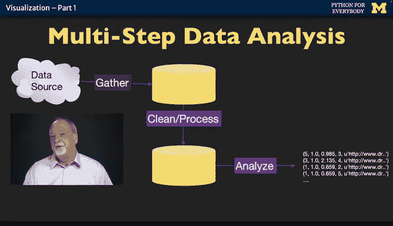
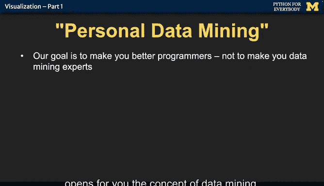

# 密歇根大学《给所有人的Python课》课程4：《使用数据库进行Python编程》｜python-databases｜ - P31：31_05_01_地理编码技术.zh_en - GPT中英字幕课程资源 - BV1PP411W7H1

So we're now going to start putting this all together。 I mean， we've been learning for a long time。

And we're going to actually now retrieve data from various sources， and we're going to visualize it。

 That's what we're going to do next in this。 I'm not trying to turn you into the world's greatest data visualizer。

😊，Because there's lots of different technologies that you're going to use。

 I'm just trying to give you some fun examples to show you what can be done。

So the next few things that we're going to do are all examples of what I'll call a multi step data analysis。

 and the key thing is， is there is like a database。We do things up to this point， where。You know。

 you just run some Python， it retrieves invade， does some parsing or whatever it does。

 and it throws it away， and then the program ends。The problem is。

 is what if you have to retrieve a million things from a rate limited API or what if your' quarter of the way through a million things and your network goes down or maybe your laptop goes to sleep。

RightAnd so you need a restable process。And in this。

 we find that it's a good idea to separate into two completely different processes。

 the sort of raw gathering and that is you're going to hit this data source。

 you're going to loop through it， and instead of trying to kind of clean up your data and figure out or parse it or whatever。

 you just start this really simple gathering process that writes to a local database on your computer or in the cloud somewhere。

 and it says， okay， which ones have I retrieved which ones haven't I retrieved Like if this is a spidering process。

 you might have a bunch of web pages and you retrieve some web pages then you look at them and find more links and then you retrieve those pages right。

 and so the idea is is that you have this restable gathering process。

That doesn't do a bunch of cleaning， et cea， it just gets the raw data from the internet into your computer。

Then what happens is you build a cleaning or parsing or who knows what it is that you're going to do with each of the things。

 whether it's a JSON data or a web page， everything that you've retrieved。

May need some cleanup or some checking， or you might even like make a thing where you say， look。

 this， this was bad。 And I want to redo this， and then restart the gather process。

 And it finds all the parts that it needs to regather in a way you go。

 So there's this cleaning phase。 Now， you this gather process。When you have a lot of data。

 that might take a day or two。But the cleaning and the processing phase that goes from one database to the other database。

 that might run in a few minutes， which is why you take the time because the gathering process is the process that talks to the internet that might get in trouble with rate limiting。

 they might get trouble， but the data that's already on your computer。

 you run a Python program and goes runs through it really， really fast。

And then you get the clean data， and then in another yet another process。

 you might do some analysis of this clean data， you might write some Python and do some dictionaries。

 some histograms， or you might even write some visualization code and so in the example I've got。

 you're taking the cleaned up data， and you're visualizing it and making a map out of it。

 you're even going to do this。

Now， like I said。This is not professional data mining。

 but I will say that you can impress your friends， show that you did a page rank algorithm or show that you did a geoda visualization。

 and I'm handing this all to you in zip files。 So mostly you just have to run the zip files and do impressive things and you can do some cool visualizations。

If you're going to get serious about it， like at a job。

 there are all kinds of really scalable data mining technologies that you use rather than writing your own。

 So some of this stuff about like gathering and giving the raw data in a database。

 there are tools that do that。 Okay， And so this is just scratching the surface。

 But we're going to do it all ourselves， which is really cool。 so that you。

 you kind of know how to do it。 And then when you go use a more sophisticated。

 more professional data mining technology。 Then you know what it's doing at least。 And so you' like。

 if it works or blows up or has a problem， you're like， oh。

 I know how to do I know how to do what this fancy tool is doing better than my code would have done。

 But you know how to do it。 So like I said。😊，This really is an exercise in software。

 not an exercise in the best practices of data mining or data mining experts。 But like I said。

 it's like the key that opens for you， the concept of data mining。

So the first thing we're going to go through is geocoding data I love geocoding data。

 like I said it you can put any address in and it puts it eventually it's a pin on the map and and that's kind of the assignment that I'm going to give you know。

 be careful when you're doing this assignment that you really put your pin on the map right。

 I mean these looks like it so you're supposed to find a place， put your own pin on the map。

 not just take my pin， not just take a screenshot， you're supposed to actually run it。

So what's going to do is we're going to use the proxy geoAP data。

And so that you don't get in trouble with rate limits。

 you're going to copy it into your local database that can be restarted and then you can visualize it in the browser。

 one of the nice things about the visual the two phasese process is you can pull in a couple hundred things and then you can play with the visualization。

 you don't have to wait till you pull all the things in okay and so you'll you'll use OpenStreetMap to visualize it。

So this is the code that you're going to run。 So again， we're taking that OpenStreet map data。

 We got an application called geoload。 py and when geoload。pyys takes a list of locations。

 and this is where you're going to modify it， it takes a list of locations to go and look up the geocoding so your assignment will be to add a single item to where dot data。

 then run geoload。 py， which will go get all the ones that are already in where dot data plus yours and that's going to build a database called geodata do sqL light。

And then and again， that first process that geo load do py is a restable process so you can hit control C or control Z depending on your operating system。

 and like it can be running it can blow up and then you'll start it back up and you'll notice it's smart enough to not do the same thing twice because it looks in geodata。

 SQite and says， oh already got that one and so it's an efficient restartable spidering like process in this case it's spidering an API versus spidering web pages。

And so。At any moment in time you can stop geoode and then run Gedump what GeDump is。

 it's kind of the parsing of the data that's in SQLite。

 and it both sort of prints it out so you can see what you've got in there。

 it prints out the locations that you looked up including the address and this is a list of universities basically。

 and the address of that university I think this might be the data from 2013。

 when I first started making this class a long time ago。

 So this is the 2013 data from a survey that we did about where students were coming from。So geodump。

Read Ser Geda to SQLite， and it dumps out the data。

And it's also parsing the data because if you recall the OpenStreet map is a pretty big thing。

 but what you're seeing there is you're seeing kind of a downsling of that data in on the printout。

 and it's also writing a fileware dot JS， and theware dot JS is a JavaScriptscript array basically that has all these positions。

 etc。Thats that is where dojs gets rewritten every time you write the application。

 and then if you just open where do HTMLtm and I give you all these things in openge。 zip， right。

 the Gelo geodumpware。jsware。 HTMLm。 And then when you open up where dot HTMLm， it reads where。

tjs and puts a bunch of pins。In the thing， including the pin that you added for the location that you added to where dot data。

And then， you know， there you are。 And you could， you could use this to visualize anything。

 You could just come up with your weird dot data， which is a bunch of geoloc。

 locations that you want geocoded。 So， so there you go。 And so this is a lot of fun。😊。

It's kind of the payoff for all the work， hard work that you've done。

 where you' got a real pretty picture when it's all said and done。So。To summarize。

We have explored lots of ways of accessing data from the web。

This is our first real kind of application that we're bringing it all together。

 but for the same set of skills of retrieving things like UL and parsing， JSON， HTML， etc ce。

 we've learned all that stuff and this is only the beginning and you can take this in a lot of different directions and it's a lot of fun。

