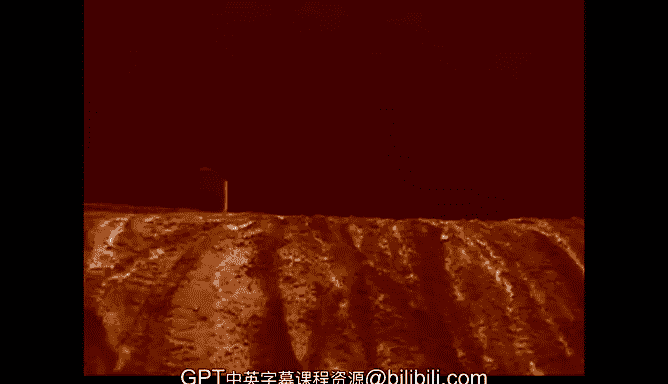

# 密歇根大学《给所有人的Python课》课程2：《Python数据结构课程（密歇根大学）》｜python-data｜ - P31：31_05_03_趣味-查克博士的摩托车越野赛.zh_en - GPT中英字幕课程资源 - BV1yP411a7TZ

This is vintage motocross。It's old people on old motorcycles and todays really muddy day so I'm going to probably fall down a couple times it's my PE 175 1978 so it's an old motorcycle here's a gray hair I'm old guy and。

All my goal is is to not fall down more than once last week my goal was to only not fall down at all。

 but today it's so sloppy I just want to fall down less than once I want to come in last place because I don't want anybody like spraying mud in my face and so the whole goal is to come in last place and let the other guys get as far ahead of me as possible so I don't get any mud on me。

看老们。The older must go first and the older bikes go second that means that someone might catch up to me and passs me I get much better all over。

他们。あ。もま。Last place I'm guessing no you are second to last he's last right behind you Oh excellent y see him pushing his bike。

So。That's the end of Dr。 Chuck goes wantcross racing， I didn't fall down。

 I don't think I came in last and now I just got to go get some of this mud off of his plate。

