# 密歇根大学《给所有人的Python课》课程3：《使用Python访问Web数据》｜python-network-data｜ - P31：31_05_05_实战示例_XML.zh_en - GPT中英字幕课程资源 - BV1Hu4y1e7WS

Hello and welcome to Python for everybody， I'm Charles Severance。

 I'm the author of the textbook and we're going to do a little bit of code if you want to get your hands on the code。

 go to the materials website， materialsial。phP。Actually materials。php and download the sample code。

The code that we're going to work on today is the XML code and we need to be able to talk XML to work with web services and so here's one of the examples from the book it's xm1。

pyy。And so later we'll be pulling XML and JSON from the web。

 but for now we're just going to put it in a triple coatd string， so data。

And we're going to use built in XML parser in Python called Element tree。

 and when we say import XML E tree elementement tree， as ET。

 this AS ET gives us basically a shortcut handle for it。And so the idea， this is a string。

 It has less sense in greater thans。 It looks like structured information。 And it is。

 But really at this point， it's only a string。 Now we have to call this E T from string to read this and give us back a tree object。

 And what it does is this might blow up。 This code might blow up right here。

 if there was a mistake in it。 Okay， and matter of fact， I can probably put a mistake in。

 Let's see if I can delete this and save it and run this code and we'll see that it will blow up。

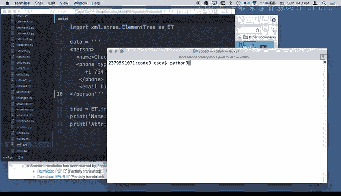

Right and so it blew up here in line eight， element tree blew up。

I mean it blew up in line 12 of the code， which is right here。

 this failed because the line 8 of the XML string was wrong。

 so let's put this that back in so now it's properly formed XML so this tree we get back I name it tree just because I always name it tree but you could name it X。

So the key is is tree dot find goes and looks for a tag named find and tree has no longer got less thans in greatervans in it。

 it is and turn these into objects within objects within objects。So a tree F name says。

 I would like to find the tag。Name， and that's what this bit is right here。

And then dot Tx dot text is going within that and grabbing that text， okay？And if we say treereefin。

e， then that's going to give us this。And then that's that object。

 And then dot get asks for the contents of the hide attribute， which is the string。 Yes， okay。

 And so if we run this。

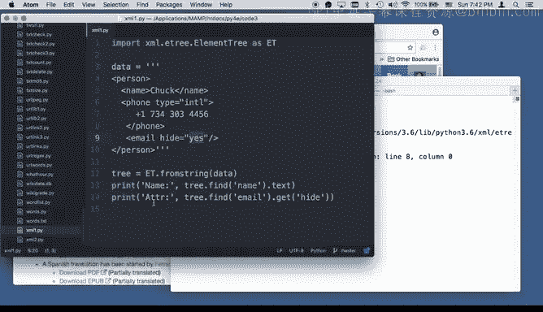

Now that it's fixed Python 3 xml1 dot py， it will pull in and get the at the name and the attribute。

 so it's pulled the chuck out and so you get this object and then you kind of dive into that object and so that's。

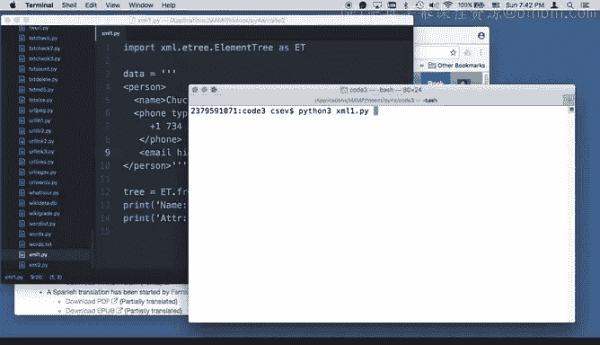

XML1。 py if you've got a tag， you can either get the text out of the tag or you can get an attribute out of the tag So now let's take a look at XmL2。

 py again， we import elementement3 and we have a tag and there's XMl's always got to have a single outer tag。

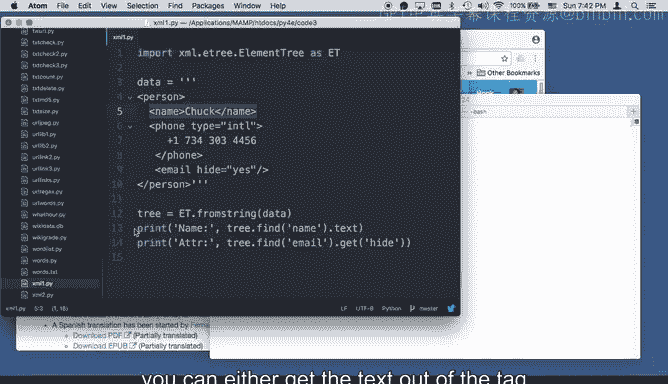

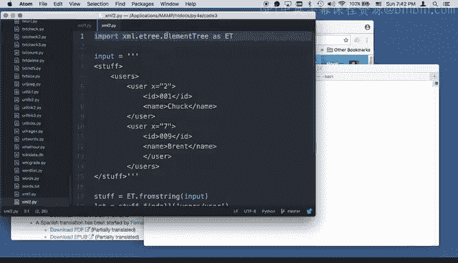

But this time， we're going to have an effect a list。Now let's line this up a little better。

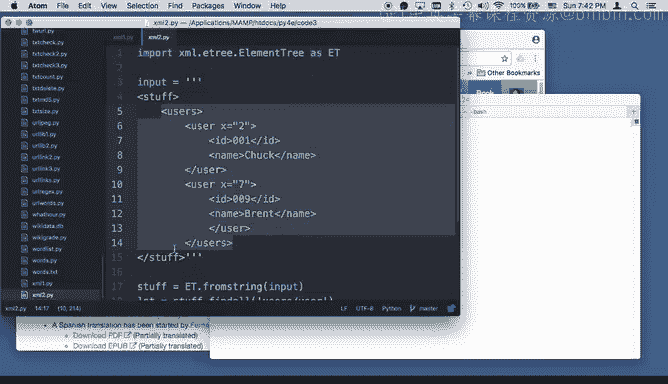

There we go， that looks a little prettier。

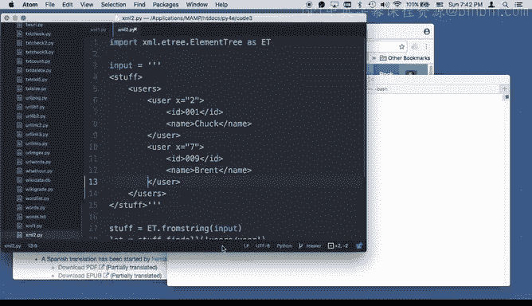

And so users， not the fact that it users doesn't mean anything。

 but we often come up with semantically meaningful names for these things。

Users is going to have as its children a list of user tags。

OkaySo the children under user user under user， and then this has each of these is a tag。

 so we want to parse this and this is a common thing we want to do。

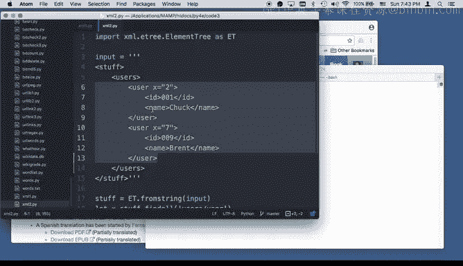

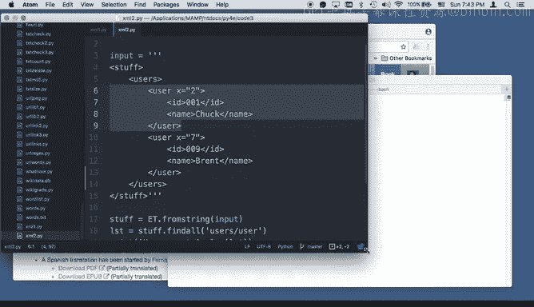

嗯。And so again the first thing we do is we read the string to just take this。

 it's a triple code string going from here to here。

 and then we're going to instead of doing find which gives us one tag。

 we're going to do find all the Use tag， the user tag that is a child of users。

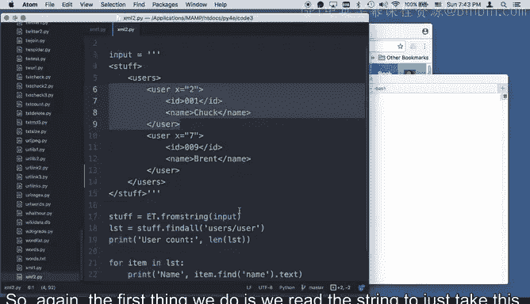

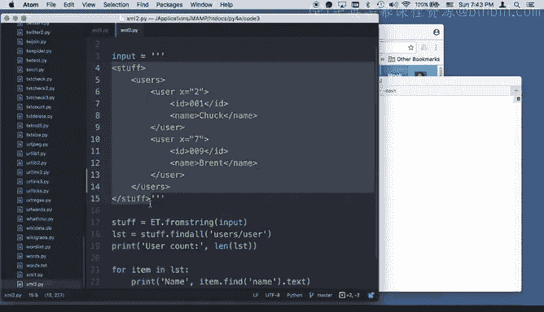

And we get back a Python list of the tags， not of the tag， but of the tag。 So there's a one tag。

 and there is another tag。 And so we can do then of that so we can see that we got two。

 And then we can write a for loop and this item is going to iterate through the tags that are the user tags that are children of users。

 So the first time item is going be this tag a tag。 remember。

 and then the second time is going to be this tag。 And so we can do things like find and and get just like we did with the an Xml1。

 So running this is not too exciting Python 3 Xml2 do Py。

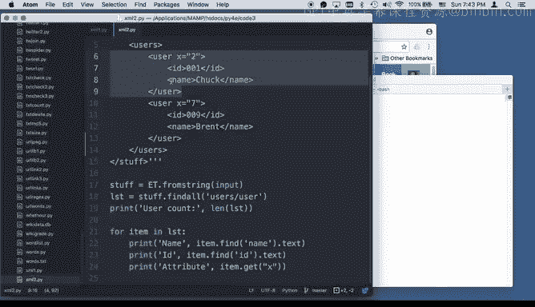

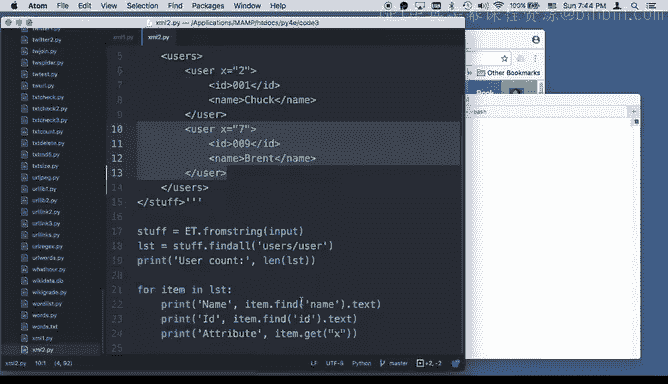

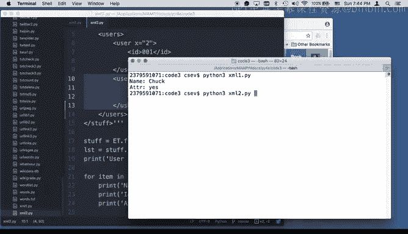

You see that there are two users that comes from this print right here。

 there are two users in there and the first one， if we go into name。

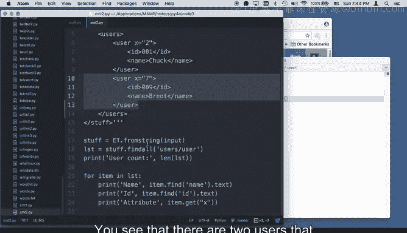

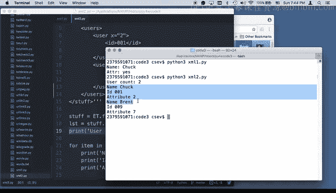

And we go find the text within the name tag within user。Then we get Chuck and we get the ID。

 which is 001， so we find the ID within that item and then we get the text and then we look and we grab the X attribute off of that and so we see Chuck。

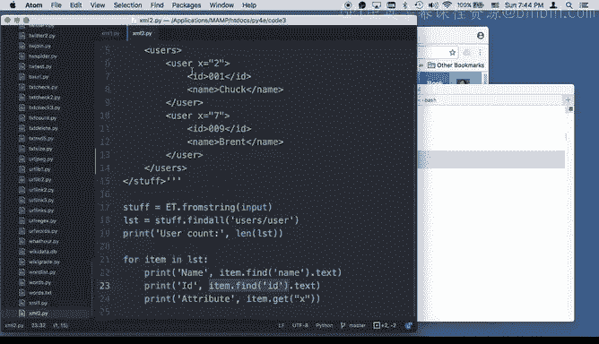

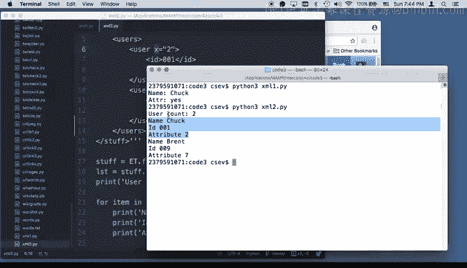

Chuck 0，0，1 and2 and then in the next tag we the for loopbe continues and we print that out Okay。

 and so that's just a basic run through of the XML from the chapter in the Python book， okay， thanks。

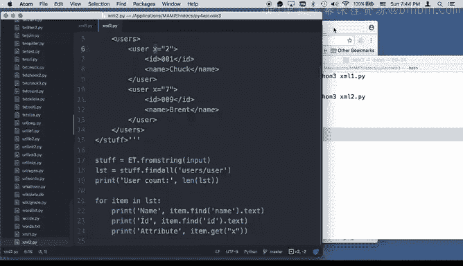

。