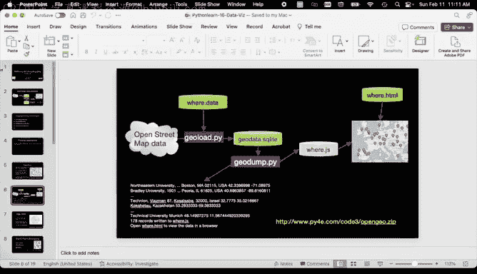
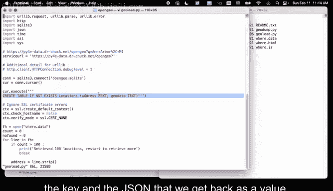
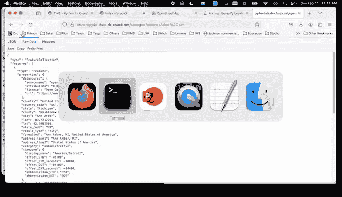
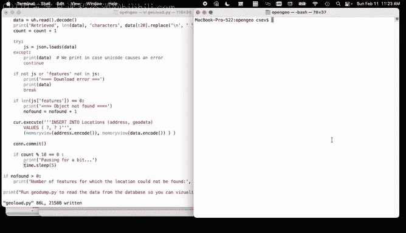
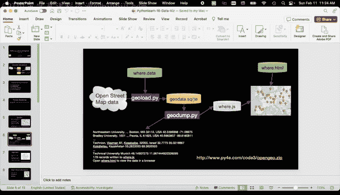
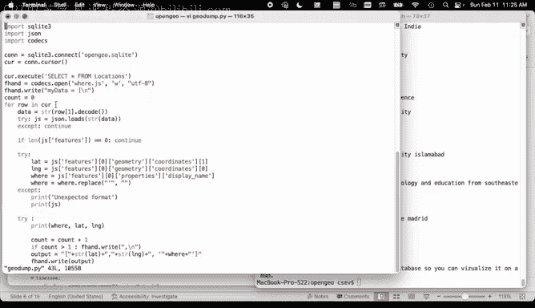

# 密歇根大学《给所有人的Python课》课程4：《使用数据库进行Python编程》｜python-databases｜ - P32：32_05_01_实战示例：地理数据处理.zh_en - GPT中英字幕课程资源 - BV1PP411W7H1

Hello。And welcome to Python for everybody and another code walkthrough。 So in this one。

 we are going to walk through a chapter 16 diagram。 let's take a look at it。

 So this is a situation where we are going to be talking to some openStreet map data。

Through an API through a proxy of that API and we're going to write a bit of code that's going to repeatedly pull this stuff down。

 Now these APIs are notoriously slow， expensive， difficult and sometimes even sort of unreliable if you hit a rate limit it starts blowing up on you So we want this to be a restartable process。

 So what we're going to do is write this code called geo load do Py and it is going to read a file that is the list of the locations we ultimately want to have and when you're doing your homework you got to edit this file。

But the idea is is that this geo load is going to read all the locations we want。

 and then it's starting to pull them down， and then it's going to simply insert the JSON into this geodata SQL light file and then if this part here is a restable process。

 the geoload is a restartable process and when we do it， we'll start it a couple of times。

And it's smart enough to know the things it already has and not start from the beginning over and over。

 that's why it's a reled process。And at any given point， we can。In a sense。

View and visualize the current contents of this database with geodump dot Py。

 So that reads the database， and it produces a little file called where dot Js。

 It also writes a little debug output。 And then that where dot Js is read into when you open a browser。

 This file where dot Hml opens in a browser。 and then it reads the where dot Js。

 And then it visualizes it。 And that's really cool。 So， you know， at some point。

 you're supposed to put your own location in We dot data and then show in the visualization that you were able to get your location。

 So without further ado。😊。

Let's go take a look at the code。 So the code you're going to need to use is openge dot zip。

 You download this open， you download wwwp for dot com slash code3 slash opengeo do zip。

 and then you open that into a folder and you will have a folder called。Open geo。

 So if I'm looking at my current folder of open geo， you can see that it's got to readme do text。

 a geo dumped do Pi， a geo load， a where dot data， where do HTML and where do Js。

 And so the where do HTML and where do Js are。Those are the visualization part of it and geo load is the spidering part of it。

 and geodump is the read the database Okay， so let's go ahead and start taking a look at geoload。 Py。

And so this is theable this is the restartable spider。

 and if you look it's going to be looking at a proxy of the geoAP。

 so we have OpenStreetMap right there's the OpensStreet map and we can search for things in OpensStreetMap do this kind of geocoding by hand and we're doing it every time we do a map search a geocoding is happening。

 we're talking to geoAP which in effect takes the free data， but then wraps an API around it。

And and so this， this is what the API we're going to get， but if you。If you're going to use it。

 you got to get an account。 So you got to sign up。 So what I've done to simplify things in this class is I've made a proxy for it。

 And this proxy does not require a key， but it has really， really fierce。APpiI rate limits。

 meaning that it slows down terribly if you use it more than what you should use it in this class。

 but that slowing down also is kind of fun because you are doing a restartable thing so so so you don't need a key to talk to this it's just for this class。

And so the protocol is pretty simple。 you have a query parameter which is the text location properly URL encoded spaces are encoded as pluses and commas our percent twos Okay so that's the kind of thing we got to do So if we take a quick look back at our code and we looked at this code in a previous we only retrieve one now we're building a restartable process using a database So we have this this prefix of the of it。

 Now this is database， so we're going to create or open an existing database and in this case we don't yet have a database。

Al let minus L。 there is no database。 You'll see the first time we read it。 start this。

 we're going to create this database and we're going to create a simple table now。The key thing is。

 is that all we're going to do is we're going to take the address that we looked up。

As the key and the Json that we get back as a value。 So in this case， Ann Arbor space。

 Ann Arbor Michigan is the key and this raw data， which looks prettier。 That is the value。

 That's what we're going to do。 because， again， this is the restable process。

 You want this restable process。

To be simple。And reable。

And then if we continue down in the code， we see the pattern having to do with let's。

I'll ignore certificate problems， having to do with the fact that there's not a lot of good certificates that are default and excluded in Python。

 And so it's simpler for now， you in production， you can figure this out a little bit better。

 but that just makes sure that our our URL Lib stuff works。 So just kind of Mary there you go。

It's unfortunate because when they fixed this thing about they didn't like the certificates。

 They had some problems。 They just took them all out。 So we went from， you know。

 a lot of good certificates and one， bad one to no good certificates， but。

And then everyone immediately went and ignored the certificates。The law of unintended consequences。

 so let's take a look at this file where do data so where do data the idea at some point is you want to know the locations。

 so this is just the input to our and this is just all the places and we can you know we can add to this。

Jerk。Pit， and。Arbor。Michigan。So that this is the list， the to do list in a sense， okay？

So we're going to， that's what we're going to do and I give you a starting point and you're supposed to in your work。

 add something to it。So we're going to read this weird dot data and that file had， I don't remember。

 2575， but you might have thousands of lines。And then we're going to read the whole file。And if we。

If we get。Past 100 of retrieved locations werere going to stop。

 And that's kind of to let our API settle down。 You'd change these numbers。

And then we're going to take the address from the line， which is just a text line。

And then we're going to check to see。If the address has already been retrieved。

And we're doing an encode in a memory view because of UTF8。

 and because the database is kind of outside of us。 there there you go。

 And then we're going to do is we're going to retrieve that record。

And if the address was already in the database at the beginning。

 it's not because the database is empty。 We're just going to continue and go zooming through this file。

Ignoring not retrieving the ones that we havent that we've already retrieved that are in our thing already。

 but if they aren't there， then we're going to create a URL。

And this is basically the pattern of we're going to create a dictionary and we're going to say Q equals Ann Arbor。

 Michigan， but that Ann Arbor， Michigan has to be properly URL encoded。

 And so that's what this URL Lib parse URL encode code does。 So that leaves that ends up with a URL。

That looks like this， it all gets concatenated together。

 but that encoding is something we don't have to write the code for thank heaven because even though it's easy to explain in a simple example。

 it's hard to do it right in all cases so that will just let the libraries do that。

So now we have URL， so we open that URL， this little context equals CTX is the trick we use to ignore the SSL errors。

 then we read it。But the stuff that comes back， of course， this here。

 if we were to look at the headers， Let's see， we could look at the headers。

 and you'd see that this is a UTF 8 application slash Json。 and so。

Python internally does not use UTF 8。 Python dot internally uses Unicode。 So Decode says。

 that stuff we just read UTF 8。Decode it into our internal format。Which is Unicode。 And there you go。

 And then I print out a debug statement， and I increment my count so that each run only does own no more than 100。

Then I try to parse it using Json。lodes， and then I have a couple of sanity checks to make sure that like I got real data。

You know if it's not if I didn't even get data， I should just complain about it and either break or continue and then I am going to insert it into the database。

 insert into locations， address geo your data。Encode the address and encode the data， and that's it。

 I'm going to commit it。And Im going to pause sleep five seconds， everyone。

 and that goes round and round and round and retrieves them。And then at the end of the loop。

It prints the number of features and sends a little message。 So let's just go ahead and run it。

 I mean， some of this code we talked about is very just adapted from a couple chapters ago。

 So let's type Python。Geoode。Dot P Y。 So now it's going to start reading where dot data and hitting the API。

 So you see there you go。 Now I'm going to hit control C。 So it did the first 10。Did the first 10。

 and then it hit this。 And I just hit control C to blow it up。So if we look in our database now。Yeah。

Let me start that。If we look at our database and we open a database。And we go into where am I？

I've got to find where I'm at， and you'll have to find where you're at。

I just happen to know my folder names， I'm actually working in the， you know the。

I'm working right in my main thing。There we are。 I found that file， so that file now exists。

And if I take a look at the data， I see I have one table， it's locations table。

 and I see the address Zop， and then I see the data itself。Here we go。 So that's all I did。

 I just went through the first 10。 And so they're already there。

 So now let's go run this thing again。And just started up。 Now。

 what it's going to do is it's going to read all the file， the whole file of where dot data。

 But you'll notice that it has the first 10 already done。 So it just like says， gott it。 Got it。

 Got it。So it went very rapidly through the first 10。And now let's grab the next 10。

And now it's grabbing the next 10。 And again， let's just say your network goes down。

 The whole thing blows up。 Well， let's take a look at the data。 So we've got 30 now。 Okay。

 and then you come back in the morning。 This might be like 3000 instead of 30。

 But come back in the morning like， oh， it blew up。 So what do you do， You start it up again。

 now now it goes， oh， I got all those。 Here's the next 10。Here's the next 10。Okay。So now。

Let's just blow this up。2。And。Let's briefly comment this amount so it gets done faster。

So now it's not going to sleep， he'll say pausing for a bit， but it's going to go where。

 So now it's retrieving。 We'll see how many he's got to go to 257。And again， this is good data。

 it's going through 257 of these things。I didn't make it do 25，000 or a million。

 but this pattern could work okay， and so。Oh， I wonder if。Oh， it went to 100。

 so I got to run it again because it had another limit， only 100。We'll get there。 Just keep loading。

 Just keep loading。 I want to get to my thing where I have to mine。

And there was an air and you could have gone and looked at what that error was。Okay。

 I still have to get it again， Go to run it。 I should have just changed the line。Okay。

 so actually hit this hit the you can see it' slow， it hit the rate limit。And okay。

 so let me put that sleep back in interestingly now if we run it， we've been through， well。

 let's go look at our database for a second。

Let's reload the database， and we see that there we go。 and the jerk pit's already in there。

 That's the 1 I added。 There's 273 in here。 Now， watch what happens when I run this again。

It's going to zoom it's already done because what it was doing there。

 let's take a look at the thing because what it was doing there is it was reading all of the things in where dot data and it was checking geodata SQL light they're already there So there was no need to go to the API。

 that's what I mean by a restartable process。You don't need to go back to the API。

 And so I can run this as many times as I want。 And it's instant basically because's only 250 things read from a database。

 which happens really fast。 Okay， and so， so in a sense， the way you can think about this is。

This first phase is kind of done。 we restarted it a couple times， we did this， we did that。

And now we want to work on this second phase when we run geo dumpump and all that's going to do。

 let's take a look at the code。 And so these two look very different。

 So Ge load worries about the fact that the API may blow up on you or it may be slower or you may run out of time。

This tool， Ge dump dot Py， it opens a database， and then it just reads all this stuff and it starts writing this file where dot Js file and a kind of funky weird thing。

 and it basically reads the first row， just reads the rows， and then it parses the Json。

 and then it checks to see if that features is there。

 which is the outer outer thing in the let's go back and look at。Let's go look here。Raw data。

 pretty print features is this outer thing it's an array of features。

 but we're just going to look at the zero width item and then we're going to look into side properties or let's look at it this way。

So we're going to go into features and that's an array。

 so we're going to go into the sub0ro and then we're going to go to in properties and then inside properties。

 we're going to grab the longitude， the latitude and whatever it else it is。

 so you can see these these little things where we're going to into the Json sub features sub0 because features is an array sub geometryometry sub coordinateinates。

 the first one and the second one the zero and the first is the latitude and laitude。

Longitude and latitude， okay？So。Let's go ahead and run that。

 we're going to print it and we're actually writing it into this where dojs file at the same time。

Yeah。And this is also going to be really fast。嗯。So that was super fast right because because it was only reading from the database and writing to where dot Js and then writing to and sort something wrong with this particular one。

 I'm not going to worry too much about that， but if I look at where dot Js。

It's just a JavaScript variable that is all of this data with longitude， latitude， and the name。

 and that's how you put pins on a map。And if you watch weird dot HTML， this is not an HTML class。

 I'm just giving you this。 It does a whole bunch of HTML to。Use Google。

Not not Google you you use open Ge to visualize this stuff Okay。

 so now all I'm going to do is I'm say open where do HTML。嗯。And there we go， so this is the map。

 so these are all of the retrieved locations and if I click on one of these things you kind of see this so I can find my location somewhere on here。

Okay， so I have one link in the University of Michigan is where the it decided the center of the University of Michigan is。

 I'm not sure I agree with that。 but hey， that's okay。 I guess it's open Street man。

 But the second one was the one that I put on。 And that is the Jamaican jerk pit。

 which is only one of my favorite restaurants in the whole world。 So there you go。

 the Jamaican jerk pit。 So my office is currently in this building right here。

 And I walk less than half a block to the Jamaican。🎼Zhipen。So that's basically a walkthrough。

Or our restable geocoding process and then visualization using P Street map。

 and I hope you found that useful cheers。🎼う。