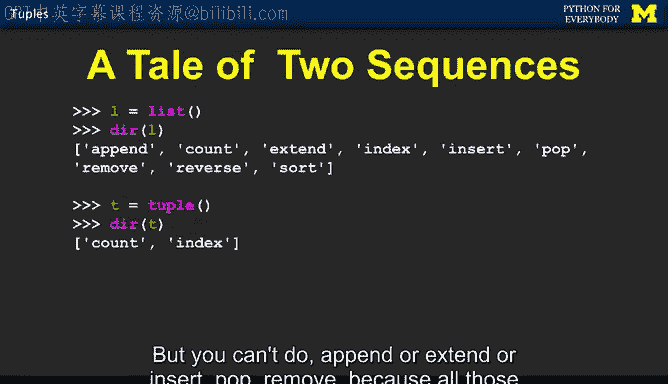
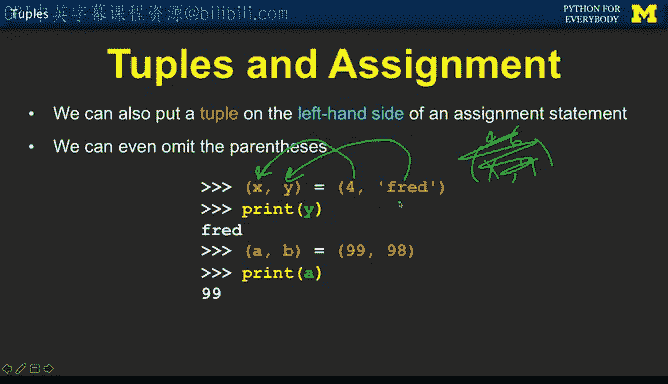
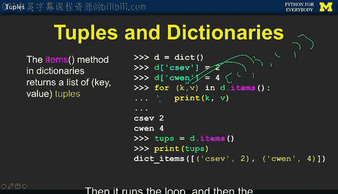
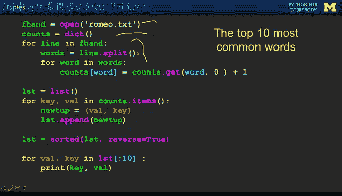
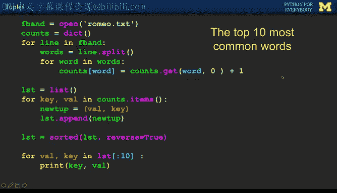
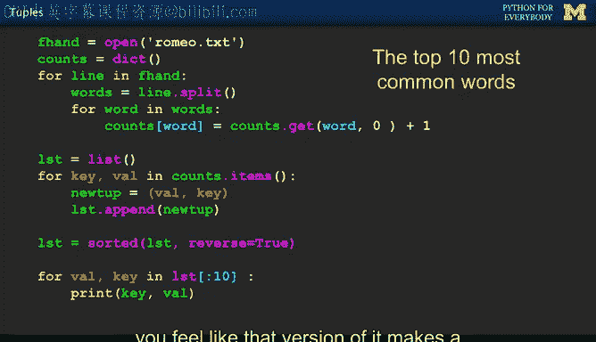
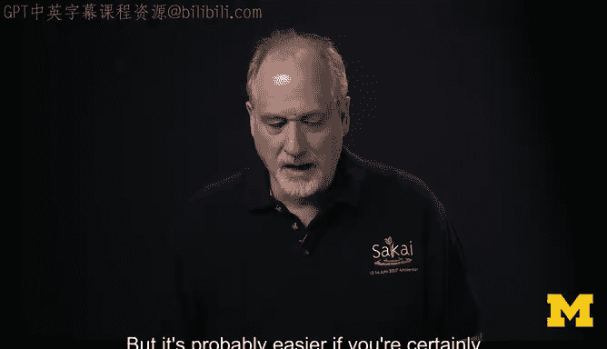
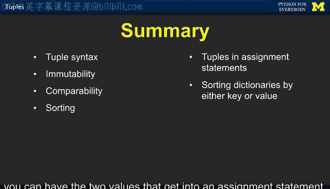

# 密歇根大学《给所有人的Python课》课程2：《Python数据结构课程（密歇根大学）》｜python-data｜ - P32：32_06_01_元组.zh_en - GPT中英字幕课程资源 - BV1yP411a7TZ

Welcome to Cha 10。 We're going to talk about tuples。 And in a way， you kind of already know tuples。

 Tuples are a limited version of lists。 And the sum total of this is that tuples are sort of a more efficient version of list that you can't modify。

 So they're really unmodfiable lists。 So here' is just the syntax of tuples。

 but it exactly looks like lists。 except we're going to use parentheses。 So here is a three tuple。

 The concept of tuple The word tuple comes from mathematics， two tuples， three tuples。

 A two tuple is a thing that has two things。 it's a way to call it。 So three tuples。

 It's a set of three things。 basically， So this is a three tuple with three strings in it。 Again。

 it looks exactly like a list except using parentheses。 We use the index operator X of two。

 We can use the constant syntax。 We assign these things in。 You know。

 and to print out just print it out like the constant syntax。 and it just has no square braces。

 but instead parentheses。 things like max use tuples。 it looks through a sequence of things。

 lists is a sequence。Tuples are a sequence， a string is a sequence， and so Max looks through them。

 and the for loop basically creates the narration variable and then bounces through the things that are in a tuple。

 and so in a way， these are the same。Right， that' same。Now， there are differences。

 the place where their differences are that tuples are not changeable， not they're immutable。

 And if you recall， strings are also not mutable。 And so if we take a look， if we have a list 9，8，7。

 and we we can change x of 2 to 6。 And then that changes the 7 to be a 6。 Ls are mutable。

 Here we have three character string ABC， And we want to do character 2 and turn that to a D with this assignment statement。

 And Python says no， we're not allowed to do that。 That is a traceback。

 And the same thing happens with a tuple where we want to do z sub 2 equals 0， And it says sorry。

You cannot change， so these are not mutable。 So the difference is lists are mutable and then strings and tuples are not mutable。

 but that's part of the efficiency of tuples is that they're not mutable and that law allows them to be stored more densely than lists and so。

There's a whole bunch of things that can't be done with tuples。

 You can't sort a tuple whatever order you put the tuple in when you created。 it stays in that。

 you can't append。 you can't extend it。 You can't flip it with reverse。 Lots of things don't work。

 And if you take a look at the directory output of lists and tuples。 You see， whoa， it's a subset。

 You can do count and index count looks up how many things match a particular value index as where is a particular value。

 but you can't do aend or extend or insert， pop removed because all those all those methods inside lists that tuples don't have are the ones that make changes to it。

 So it's prohibited， but it also allows Python to be more efficient。

 knowing that tuples are not going to be changed。 lists that has to actually allocate extra memory and stuff like that。

 to let them be changed。

So that's the point it doesn't have to build these structures to be changeable and so they're just more efficient and more performant than lists list don't。

 if you need a list use a list， but if you can get away with a tuple， we tend to use tuples。

 especially if we're going to make a variable for a brief moment and then throw that variable away。

Now。There's a couple of cool， interesting things that we can do with tuples。

 And one is you can put a tuple on a right hand side of an assignment statement。 Now。

 they both have to be variables in this case。 Now， that's very different than putting a tuple on the left hand side。

 If I put it on the left hand side of x and Y， it would be like， oh， x is 4 and y is 6。

 and that's a 4，6 tuple。 But if we put on the right hand side。

 it basically expects a tuple on the left hand， I mean， put it on the left hand side。

 it expects a tuple on the right hand side。 and then does a one to1 correspondence。

 So it's the same as saying x equals 4 and y equals both Fred， quote。

 And so that is sort of a simultaneous assignment statement。

 You could write this with x equals 4 Y equals。😊。

Fred。Right， that'd be okay。 but you can do this。 And we'll see in a second。 And， you know。

 just whatever the order is。 Now， this could be an expression or even a function that returns a tuple。

 and you can then assign it into two， two variables at the same time。 Now。

 if you do something like a comma B equals 9， it's going to blow up on that。 It's going to be。

 I'm unhappy about that， because it expects if there's a tuple on this side。

 there's got to be a tuple on that side。 And in this case， if I just put 9 over here。

 there is no tuple on that side。Now we've played with this actually already without even knowing it。

 And so the way this works is if you remember D items， the items gives you a list of tuples。

 So this dictionary has two things。 C7 maps to 2 and ch maps to4。 and so if we say D items。

 we say give me the tus right， And so the tuples come back。 So this is a list。

Of tuples。 Now， what happens is that is how the two variable， two iteration variable4 works。

 And these， this is a list of two tuples。And it's， you know。

And so what happens is is the first goes into the K and the second goes into the V。

 this is like an assignment statement for this first tuple， then it runs the loop。

 and then the second one gets put in the K in the V， then it runs the loop again。

 and so that's kind of how we construct these two iteration variable four loops using tuples because that turns out to be a tuple assignment each time through the four loop。

Now， an interesting thing that tuples can do is we can compare them。 Remember。

 we can compare strings。 And so the way tuples work is it does the comparison starting at the leftmost one and compares it。

 So if it's asking the question， is this less than well，0 is less than 5。 And at that point。

 it does not look beyond the 0 and the 5。 That's like the most significant。Element of the topple。

 like the most significant digit of a number。 If at 1，99 is less than 2，0，1。Because we just。

 if there's a one there and the two there， then the rest of these numbers really don't matter because that is the most significant digit。

And and so that's how this works。 It doesn't look at these。 On the other hand。

 if the first one matches and saying is it less than then it has to look at the second one。 It says。

 oh，1 is less than3。 It never looks at this one。 And it doesn't look at that one。

 But it gives us back true。 The same is true for strings。 It's doing string by string comparison。

 It compares these two。 And they're the same。 And so it has to look to Sally and Sam。

 and then looks at Sa， well， they're the same。 So S A。 And then at some point goes， oh。

 there's the L。 and that M。 And so the L is less than M。 And so that's why this entire thing。Is true。

 Joan Sally is less than Joan Sam。If， on the other hand， the first two don't match Jones Adams。

 then it never looks at the second piece whatsoever。

 doesnn't bother because the J is greater than the A So this thing becomes true。

So it's sort of within strings， it looks the first pair and then within that if they if they're not the same and then it goes to the second pair。

 third pair， whatever， and so it's pretty clever。 So that's one of the nice things about tus and we're going to use this in a moment to sort them。

And so you can think of tuples。As being sortable by their first item and where the first item matches。

 then it looks at the second item。 So if we go back to looking at the items， what comes out。

 But if we look at the dictionary items， D dot items， then we got a couple A 10， C 22， B1。 Now。

 what we can do is we can say， hey， we would like to make a sorted copy of this。

 And so we pass this in to the sorted function。 and we get back a sorted list。

 But it sorts it based on。The first thing， because in dictionaries， you can't have two keys。

 you can't have duplicate keys， you can have two A's or two B's， and so it sorts it based on that。

 if they matched， it would look at the second one but in this particular case because it's coming from a dictionary。

 these keys are going to be unique because the very fact of constructing the dictionary。

 you can't put the same key in more than once。 you can put the same value in more than once。

 but you can't put the same key in more than once。

And so sorted basically is this function that takes a sequence and it sort of works through the function and gives you back a list that is the sorted version of that。

And so we can write and compose this in a for loop as follows。

 So sorted D items would give us the items sort of unsorted。

 But if we say sorted and pass in D items， then we have a sequence that is。Sored by key order。

 And so K and V you're going to go through this dictionary in key order， not value order， key order。

 So this is a way to say， I want to loop through this dictionary。In key。Order。

And so that's what's going to come out。 so it's going to print out ABC。

 regardless of the order inside the dictionary， we sort it before we loop through it。

 and so that's how we're going to get this thing in key order， but not value order now。

We're going to quickly get to how do we sort by value？Okay， so that that's how we sort by key。

 that's really easy， but it takes a little bit more work to sort by value。

 but we're going to be using tuples， so here's how we do it。So if we think of these。

 we can get key value tuples and all we have to do is make value key tuples and if we make tuple where the value is first and the key is second。

 then we're okay。 So what we're going to do is we're going to create a four loop that's going to go through these items in not particularly any order in this case。

 we're not using sorted here。 So it's not any order So K and V are going to work their way through these key value pairs and what we're going to do is we're going to make a new tuple。

 but we're going to reverse the order of what we would get from items in that the value is going to be the first item or the zeroth item in the tuple and K is going to be the second item。

 So if we print this out。They're not particularly sorted at this point。

 but we have the values and the keys， value key， value key， right， value key value key。Now。

 what we can do is we can say， oh， this now is just a list。 It's a list of tuples。

 And if we tell it to be sorted。 then it's going to compare these things。 and then sort。

 And when those match， now the values there can be duplicates。 So if the duplicate。

 if there's a matching value。 then it will look to the key as the next thing to sort based on。

 And so we're going to call sort it again。 And we're going to pass in temp。

 which is our little list that we just made of two tuples flipped value key。

 And we're going to give an extra parameter。 say go backwards。 So sort from high to low。

 reverse equals true， that's what that does， you just add that as a parameter reverse equals true to sort it。

 And then we print this out。 So it's now 22，10，1。 So it's from big。Value to small。Okay。

 so that's how you get a sorted by value instead of by key。Okay。

 but we have to make a temporary list， so temp is a list because we have to append to it。

 but each of the things in the list is a tuple， so we end up with a list of tuple， tuple， tuple。Okay。

 so this again is data structures， you know we're trying to create shapes of data that help us solve our problem。

 so now let's actually solve a problem the 10 most common words in previous chapter we did the most common word。

 but now we want the 10 most common words， so here's how we do it。So we've done this before。

 we open a file， we make a dictionary， we loop through all the lines of the file。

 we split the words in the file， so we got， you know， file looks kind of like this。

Right， we loop through the lines of the file， and then for each line， we loop through the words。

 That's the outer loop and the inner loop。 And then we do this count get word0 plus  one。

 and that creates our little set of。You know， our histograms based on each word and the histograms get taller。

 and then now what we've got is we at the end here， right here。

 we've got the completed histogram in no particular order。

So now we're going to do is we are going to extract the data out of that dictionary。

 that histogram data out of the dictionary， and we are going to make a reverse tuple of the value keyword tuple instead of a key value so we do we just did on the previous slide we write a for loop and I'm doing a little bit differently here we're going through key value but then I'm going to make a tuple that's value key。

 put it in the variable new T this is a tuple assignment that's going in there and then I'm going to impend that to the list and so we end up with this list just like on the previous page a list of tuples in value key order now I'm like。

 okay let's sort that backwards。So this is the value key tuples。 go backwards。

 and then we reassigned this result assorted back into the list variable。 And so when this is done。

 it will be sorted from the highest value down to the lowest value。 And now we have to do two things。

 Look for the top 10。 and we have to flip them out when we're printing。

 So this list is now backwards。 it's v comma K value comma K。 And we're going to use list slicing。

 So we're saying start it the first one and go up to but not including1s that 0 through 9。

 which is the first 10。 and you'll notice that this v and key are flipped。

 And that's because in it values the first piece of that each tuple and key is the second piece of each tuple。

 And so it's going to go through successively value key value key value key value key value key。

 but it's only going to go through the first 10 because we have limited this with list slicing。

 And then we print it out in the order， we want to see it in the first place。

 So we we see kind of a flipping of the order between how。

Iterate through the data structure and then how we print this stuff out。

 and that gets us back to the key value， which is what we want。

And so that's quite a sophisticated thing， we're using dictionaries。

 we're using lists and we're using tuples and sorting， and that's a nice little piece of code。

 again I encourage you to understand every single line of this code。Z。

This next slide is not something I'm insisting that you understand。

 but some of you might find this kind of fascinating。So I can do effectively。This bottom part here。

 not the calculation， but this bottom part right there， I can do this all in one line of code。

That takes the dictionary and then ends up with the sorted tuples sorted by value order。

And this is it。 let you look at it for a second， It uses a part of Python called list comprehension。

And so the tricky bit here is this syntax in the middle。And this looks like a list and it is a list。

The difference is， instead of expressing the list with app pens or as a constant with commas。

 we're expressing the list as an expression。And I like to read this as right here just to say the word for all。

Create me tuples that are V comma K and you'll notice this order is I got value key V comma K tuples4。

 So this is like there's a little loop that happens here。

 it's going to stamp out a bunch of these little tuples， stamp， stamp， stamp， stamp， stamp， stamp。

 stamp。And it's going to stamp enough。To go all the way through for each KV that's in C items。

 So that's the key value in this dictionary， A 10， B1。

 C 22 that this is going to run three times is's going to make three tuples。

 but this list is going to have them flipped。So this little bit right here。

 this little bit in the brackets is the same as。

This bit right here。It is basically the same as doing that。 It's。

 except it's expressing it in in a more direct but slightly more complex way。

 And so this is a list that's computed on the fly。 It's a three tuple list flipped with values and keys。

 And then I pass this in。Right into sorted to the sorted function。

 so that's sorted function parentheses。And then I take what comes out of sorted。Os。

I take what it comes out assorted， which is this。And I pass that into print。

And I forgot to put reverse equals true on here。So it comes out but not reversed， it's value key。

 but not reversed， so you get the idea。And so if you're really， really interested in this。

 go read up a bit on list comprehension。 It's kind of an interesting and powerful way to make even more succinct Python。

 but I don't spend too much time talking about it， because if you see this version of it and you feel like that version of it makes a lot more sense to you。

 stick with it。 If this version makes a lot more sense to you， then use it。 I mean。

 once you get good at it， both of them sort of equally speak to you but but it's probably easier if you're certainly beginning to use more simpler primitives and here。

 once you're more sophisticated using sort of these more powerful primitives， okay。

So that's a quick run through tuples， we talked about how they're pretty much like lists。

 you can't change them， you can compare them， they're sortable。

 and you can have the two values that get into an assignment statement and we can now sort dictionaries by key and value by constructing a data structure。

 i。e。 a list of flip tuples and then sorting that and we use that to sort of sort it is there for us and if we can set the data up in a way that sort of does what we want。

 then we get the data that we want and we really taking advantage of data structures。

