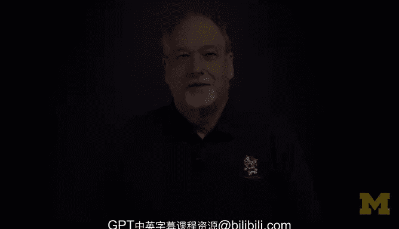

# 密歇根大学《给所有人的Python课》课程1：《编程入门指南（使用Python进行开发）》｜python｜ - P32：32_07_01_查克博士：下一步是什么.zh_en - GPT中英字幕课程资源 - BV1214y117Mk

。

Congratulations， you're halfway there。So I had to break this course into two courses。

 mostly because if I made this course like 14 or 15 weeks long。

 you'd drop out and then you'd be all bummed， so we have kind of this moment in the middle。Where。

 if you need to take a break。You're fine， it's like in a video game where you're going through and then you pass a point and then when you have a problem after that you come back to that point。

 this is one of those points right so you if you have problems going forward。

 you don't have to come all the way back and do this。

What we've covered so far is what we call control flow， right it's like。Programs do this。

 then they do this， then they have an if statement and then they have a little loop and they go round and round。

 and then they do this other thing and they read some stuff and they do some stuff。

The the the whole thing of that's a sequence。 It steps control flow what the program is going to do next。

 and then what's it going to do next and what's it going to do next。

 And so that's what taught we taught like assignments。

 we taught if statements and four statements and those kinds of things right so that's a very much we've learned how Python navigates through your program and finds its way through the various steps that you've asked it to do。

But that's only half of programming。What the next thing that you're going to learn is about variables and how。

You can put four in a variable and you can add two to it and then it becomes six but。

There's much more that variables can do， and it turns out that we call this data structures。

 that's what we computer scientists call this data structures。It turns out in your program。

 it may not think it may not seem like it， but we spend We can solve problems in a way far more easily with clever data structures than when with clever control flow。

 control flow is kind of obvious， and data structures are subtle。

 So by making clever data structures， your control flow is simplified。 If that makes any sense。

 Of course， you haven't done it yet。And so that's why data structures is important。

 So that's why you shouldn't stop now。 That's why you're halfway through。 But again。

 if you need to take a little time off， you can take a break， but come back and finish the next。

The next class data structures because that's the two pieces， algorithms。

 control flow and data structures are the two pieces of programming that give you the whole picture。

 so hope to see in the next class。