# 密歇根大学《给所有人的Python课》课程2：《Python数据结构课程（密歇根大学）》｜python-data｜ - P33：33_06_01_元组与排序练习题讲解.zh_en - GPT中英字幕课程资源 - BV1yP411a7TZ

Hello and welcome to yet another demonstration coding exercise。 This time， we're in Chapt 10。

 and we are going to talk about tuples。So if you watch the chapter nine exercise。

 I have in this folder that's in my desktop， P free。

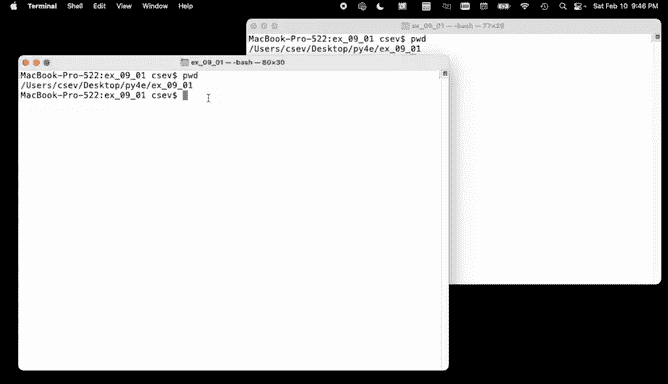

Exercise 0901， I'm just going to make a copy of this file。

I'm going to say copy。

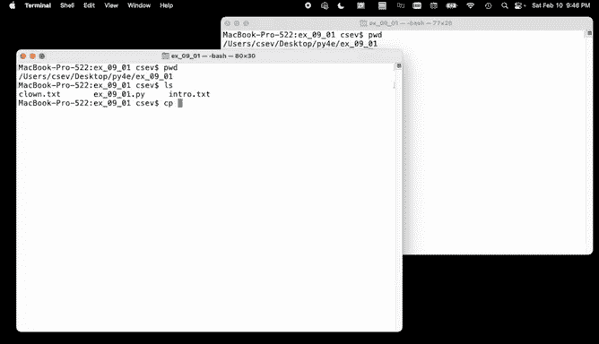

That exercise 1901。 Let's just call this one exercise 10 dot pY。

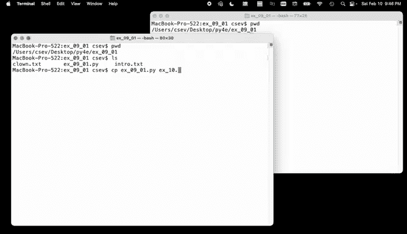

And so now I can just edit exercise 10。

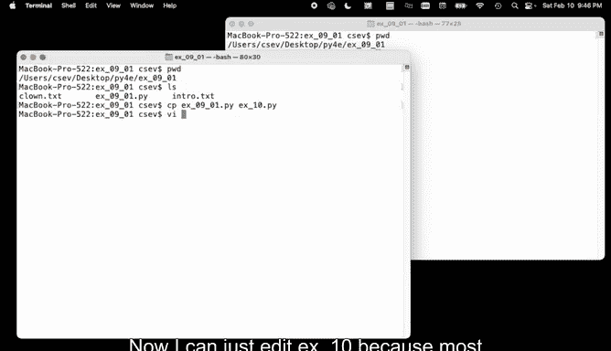

Because most of what we're going to do in this sorting exercise。

 because what we're going to do now is we're not looking for the single largest。

 We are going to look for the top five。 And we can do it many ways。

 but sorting is probably the quickest。 So knowledge is to run up just for my own sanity exercise 10 and thus 7。

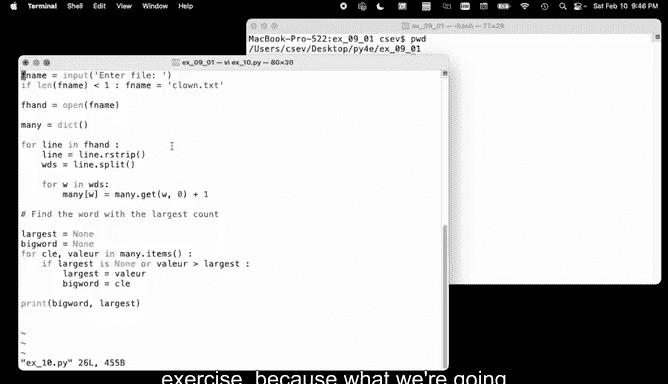

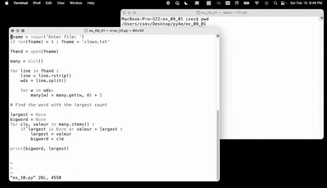

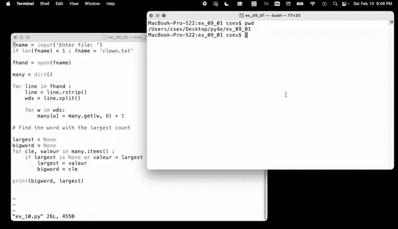

So。

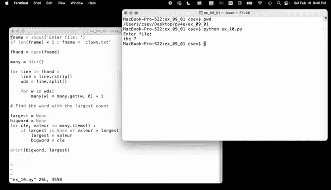

So now we're going to change。

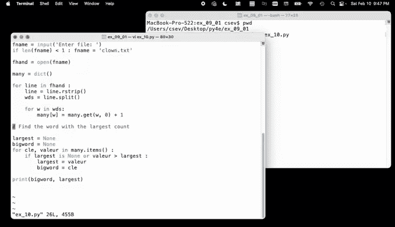

Find the。Top 10 words， a top， Let's just do top 5。 Top 5 words by frequency。

And。

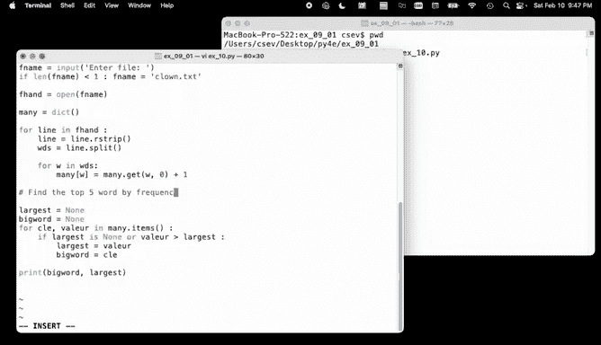

So let's do this。We talked about this function called sorted。

 which iterates through collections and shows you things that are sorted。

 So let's just start by saying print。

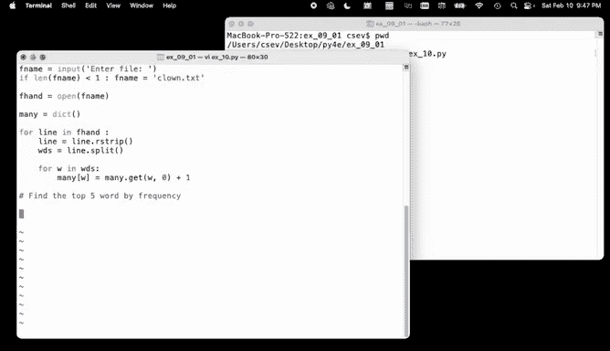

sortred。Manyally。

Let me start by I print。每ning。

And then I'll print a sorted version of many。 right， There we go。

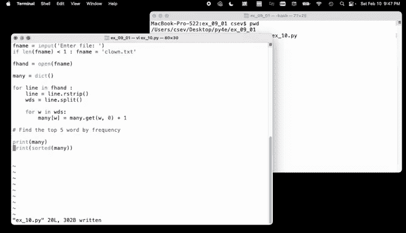

So let's go ahead and run。

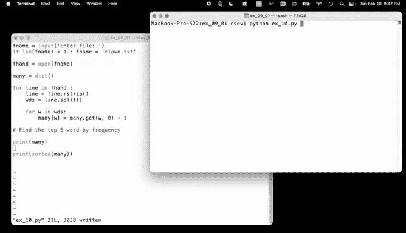

And just do clown。So the dictionary， key value pairs。

Is the dictionary？But the sortrdid。

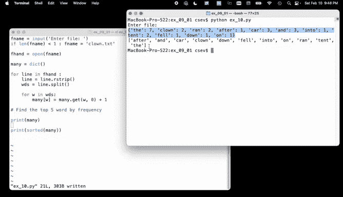

Only is sorting the keys。 So in a sense， when you pass a dictionary and distort sorted。

It gets a it gets a list of the keys。

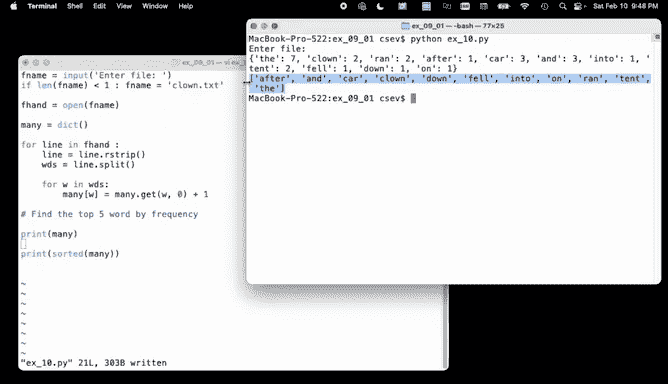

And it sorts those keys。 So these are indeed in alphabetical order， but they've lost their numbers。

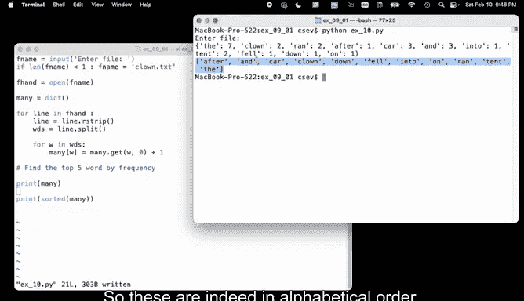

Right， and we actually don't really want them in alphabetic order。 We want them in key order。

 We want the top five of these numbers， but then we want to go back to the words。 Okay。

 so that recalls that if you just wrote a for loop and iterated。

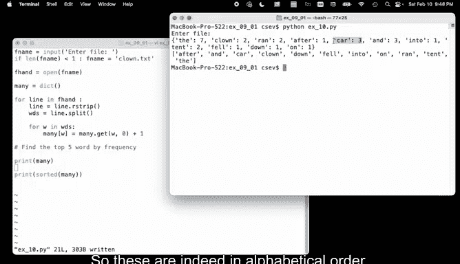

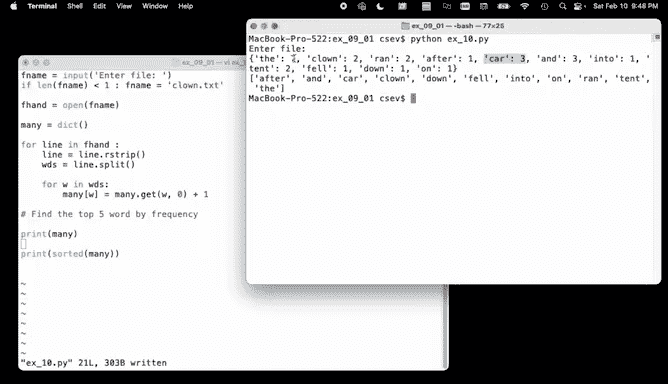

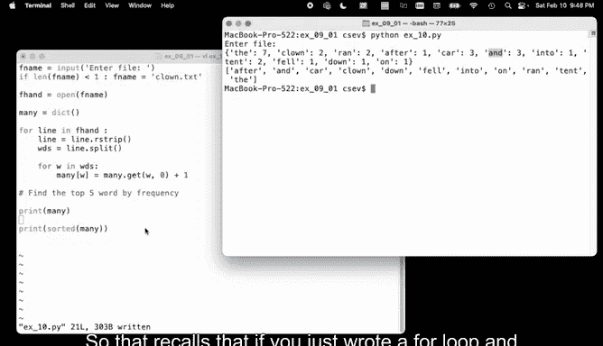

Through the dictionary you get you iterate through the keys and actually a lot of times that works okay。

So so that's not going to work Okay， so the thing we're going to want to do is we're going to want to basically create a something that we can sort that's going to sort by these numbers。

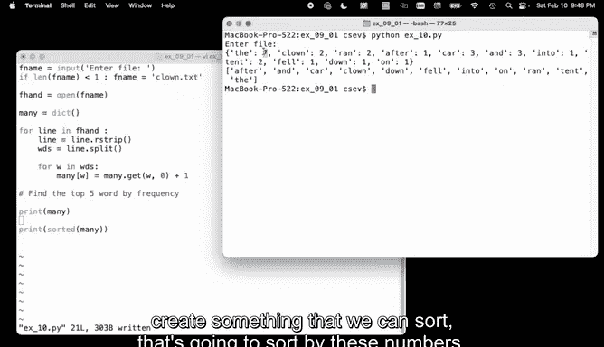

And so if we take a look at the items。We can iterate。Through a set of tuples， well let's do。

 let's just say many dot items here。And then we'll do a sorted on many dot items。

 and what that does is that gives us a list of tuples， which are key value pairs。

And now the topples are going to get sorted。 So let's just run it again。

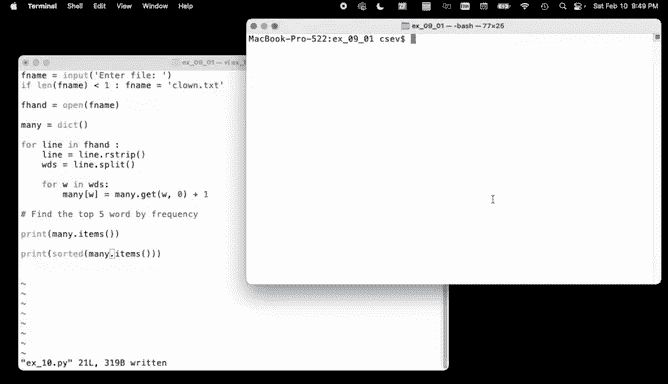

Oops。

10 dot pi。So if we look at this。

The items gives us back， not a list of keys， but a list of key value pairs in the form of a two tuple。

 So the， so this is this little parenthes the 7 is a two tuple。

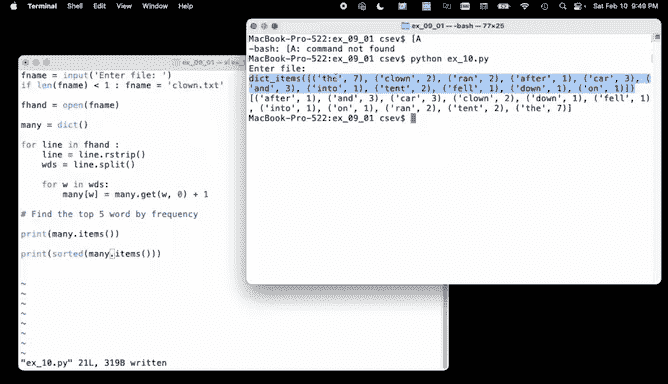

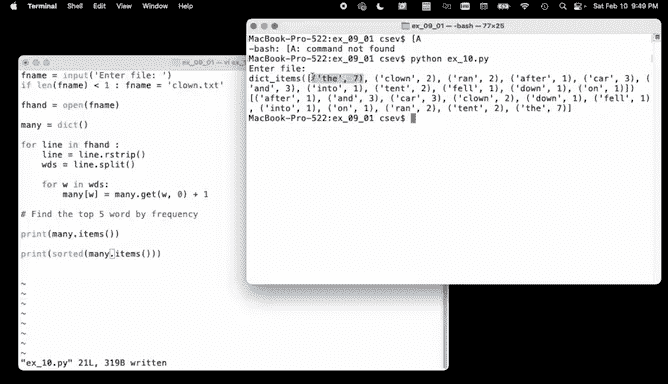

And items gives us all of the key value pairs in a pair of tuples。

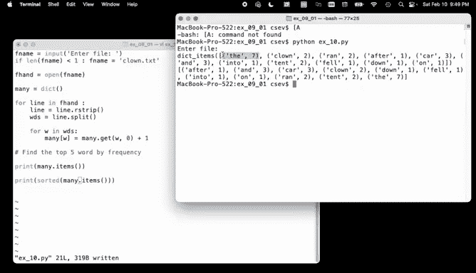

And now what's happened is when we say sorted。

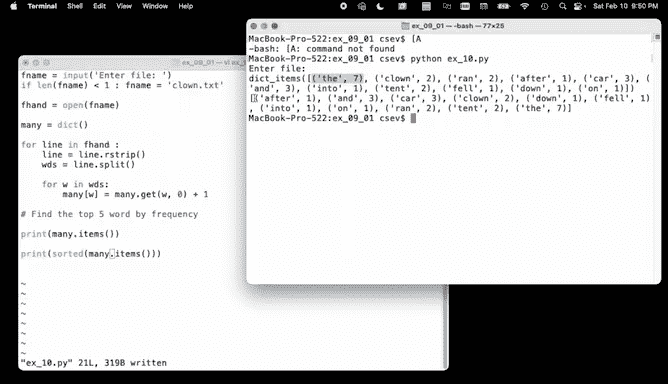

Well， they're in alphabetic order， clown。Tent the。 So the sorted works now。

 And we didn't lose the values。Except that it's sorting on the wrong thing。 It's sorting on the keys。

 not the values。

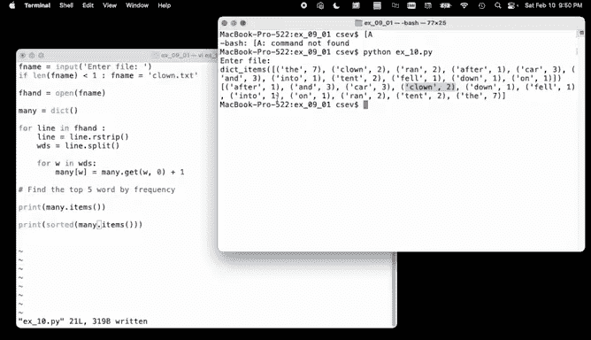

So。There's lots of ways to do this。 And this is not the quickest， but we're going to do it anyway。

 We're going to say for。

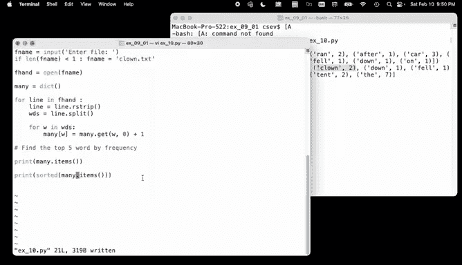

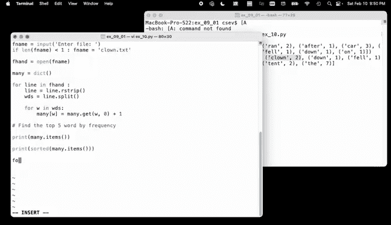

KK comma V in many dot items。

And then what we're going to do is we're going to make a new dictionary， called this temp。

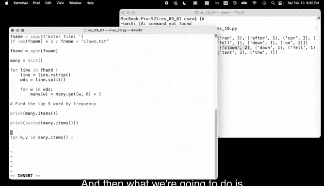

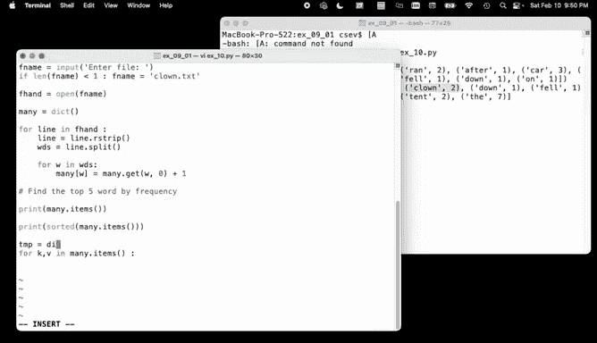

And what I'm doing is I'm going to make a new tuple equals parenthey V comma K。

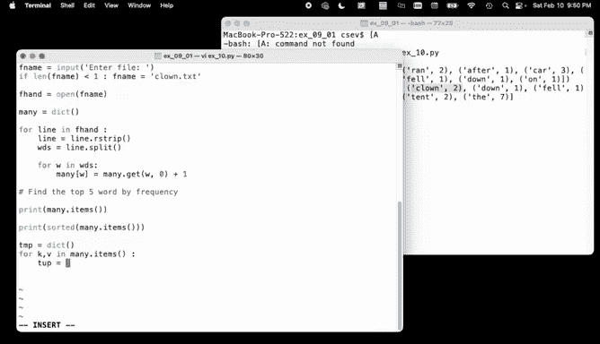

I'll print that。

So let's just print many dot items。

And then we're going to loop through it in dictionary order and then see make reverse tuples。

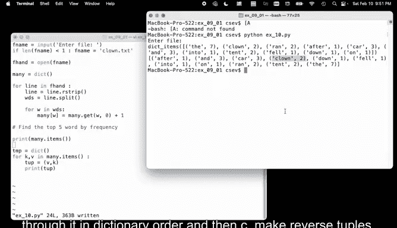

Okay， so now what we did is we loop through this， in a sense， items。 Yeah， many dot items。

 which is what we just printed out here。 We loop through this。 But then we're making a new tuple。

 which is simply reversed。 Now， when tuples are compared as as we talked about in the lecture。

 the first item in the tuple kind of takes precedence。 And then more there's ties like 1，1，1。

 Then the second one。 So these the ones that were tied that all have one。

 They will actually be sorted in alphabetical order on the second key。Okay。

And so now what I'm going to do is I'm also going to make new list oops。

Let make a new list。

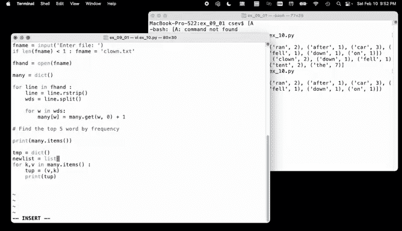

And then I am going to do new list， dot aend。

Cup。And then I'm going to print out new list。

So I'm going to print it。 And so all we're going to end up。

 it looked pretty much the same if I got it all right， of course。

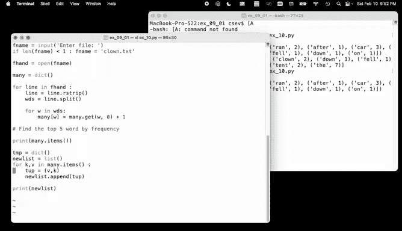

Yeah。So we've got the old list， which is the 7 clown 2 ran 2 after one。 And now we got the new list。

 that is 7 the2 clown。 It's exactly the same key value association。 But now。

 look what happens when I sort that。It can have sorted。

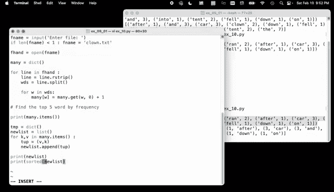

New list。 And because of the rules of lists and tuples and how tuples get compared。

 you're going to see that I have。Basically， sorted it。

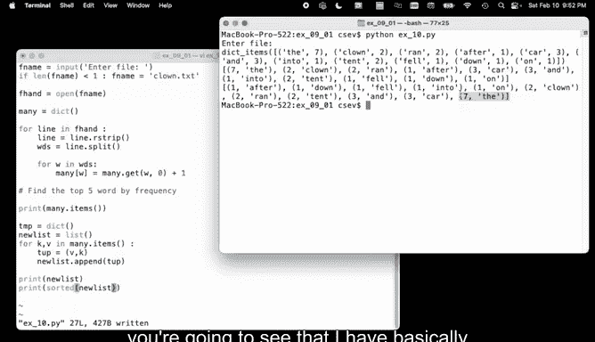

Based on the key value pair， one after all the ones came first。

And then the highest number is the sevens and then the threes。 And， and recall。

 when I said there was a tie with these comparing tuples， then they would be an alphabetic order。

 So that's why one after is before one down。 That's not just random。

 It literally is looking at the second piece of the tuple。 If the first one matches。

 And that's how it sorts。

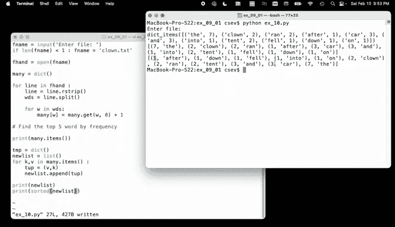

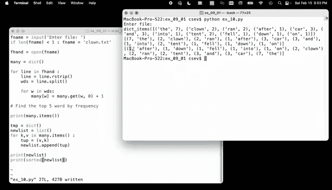

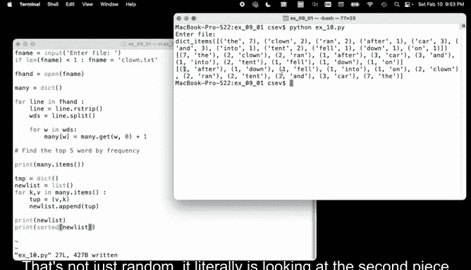

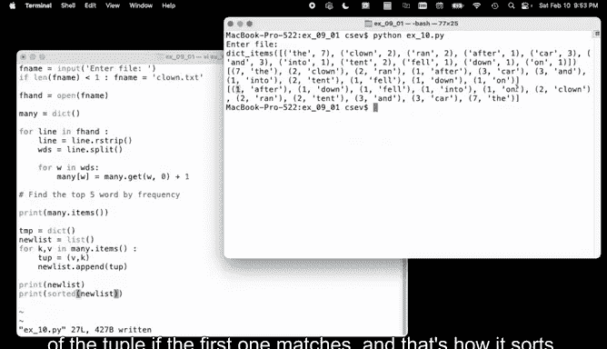

Now the problem is， is that I really am looking for the top five。

And so I could maybe print out the last five， But I could just say， hey， they're sorted。

 I would like you。

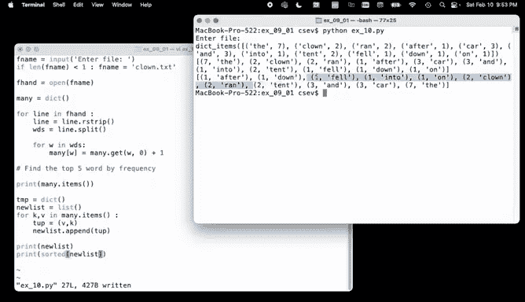

To go backwards。Reverse equals true。

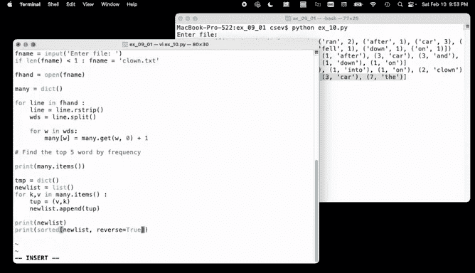

And now， if I run it again。

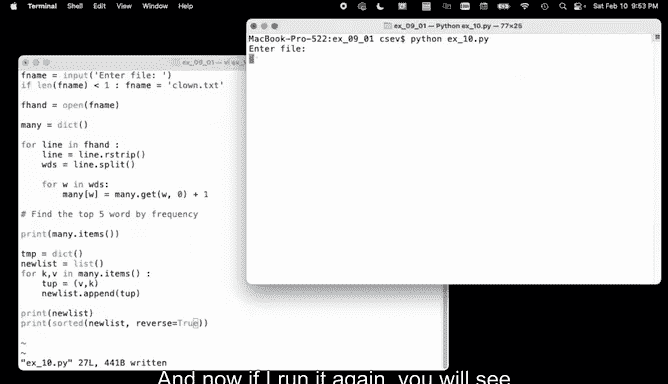

You will see that I told it to sort from high to low。And so7， the is first， three cars second。

3 and a second。

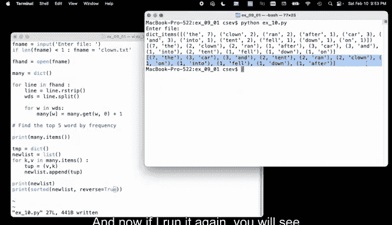

And you can kind of see the weird thing about the ties。

 which we're not going to worry too much about。 But three car comes before。

3 and because3 is3 and 3 are tied and car is reversed。

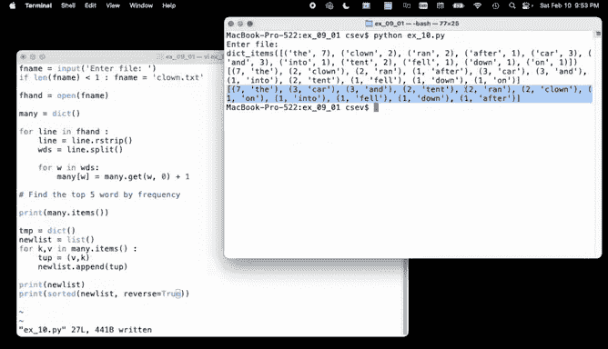

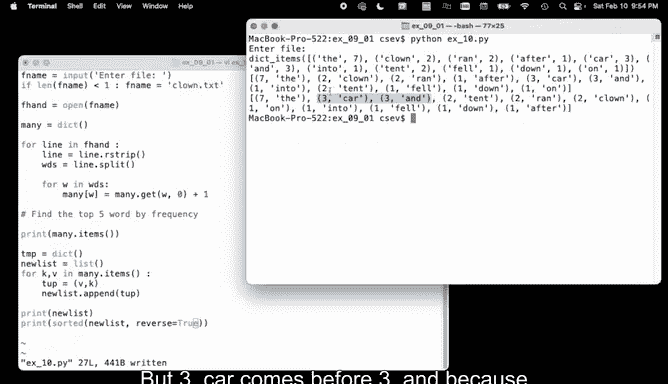

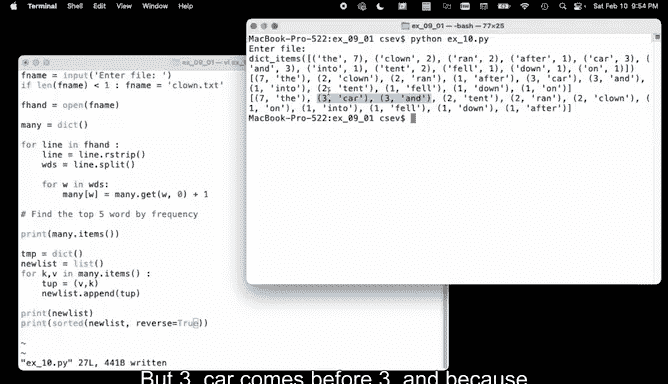

And we're not looking for the smallest。 We're looking for the largest。

 And that's why three car comes before，3 and。

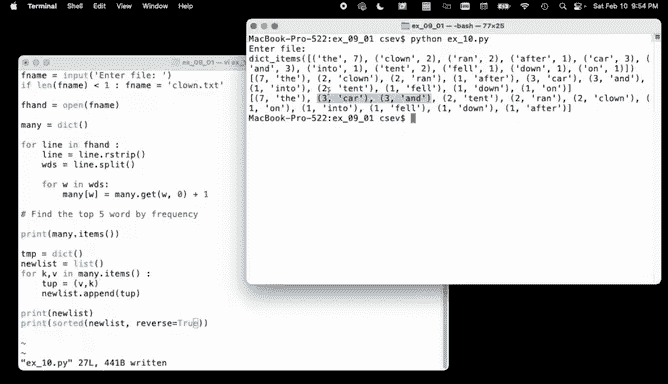

So now that is sorted。

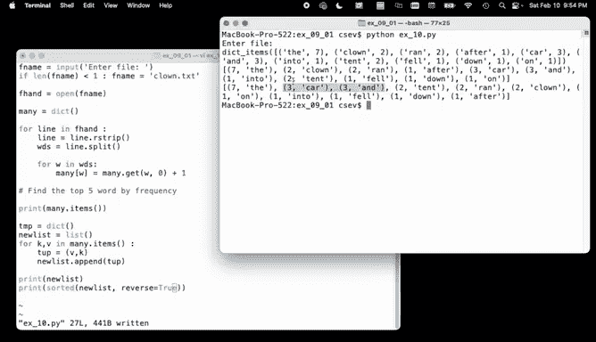

Okay， so， so now what I'm going to do is。

I'm going to not print new list anymore。

I'm not going to print many dot items。 I'm actually going to take and say cool equals。

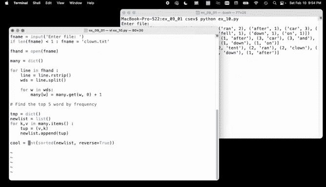

Sored new list， comema true。

U print cool oops。We'll just run it again really quick。

 So we sort of see that the only thing we got there in cool is the correctly sortded things that we want。

So now what I want to do is I want to write a loop through cool。

That prints out the first five of these two tus。

So I'm going to say。For。

Tち。V comm a K， because they're reversed。

In。

Cool。Starting at 0 up to， but not including 5， the first5。

And then， I'm going to say print。Print。K comma V。So since cool is a list of tuples。

The iteration is going to go through each tuple 7， the 3 car 3 and。

 And I've got V comma K in a very specific order Ca in those tuples。

 we're looping through the value first in the key a second。

And then all I have to do is print them out。 Oh， I made a typo there。

Itposed to be a colon。 I print them out in the flipped order。

But I'm seeing the first five sorted by value， and printed out。

Okay。😊。

Oh， I'm guessing I forgot to save my file again， Cause I'm like。

 I was expecting much more excitement than that。😊。

Yeah， so here we go。 So we're iterating through the first five items of this list。

They are the first five items at list。 And yes， there's clown2。

 And we we're not going to worry too much about that for now。

 But we're also flipping them at the same time。 And so that's the output that I really want。

 So I think at this point， I can delete this line and get the output that I tell me what you want what you really。

 really want。

I want my clown dot text， the five most common words， and their numbers。

And in a slide of hand magic trick。I can do the same thing for the intro of the book。

Cause once you get the code goingin。Python really don't。 Not， Does not care。How big the thing is。

So those 226，2s 204， a and away we go。 So not too bad。 a little bit to go through。

 just make sure you look at each line， And that's why I produce these videos where I put in one line in time。

 rather than you somehow look at this whole thing and and you think， oh， he says。

 give me the top five words and somehow your brain is to post just like whoosh this thing out。

Like an artificial intelligence。

🎼RightAnd so I am not like artificial intelligence。 I'm just plain old fashioned intelligence。

 And so I have to build these things one at a time， one piece at a time and。

I still build up one piece at a time， I might ask artificial intelligence for help on this one and take the solution。

 but I just don't trust their solution sometimes so but。Be that is a May。

 I hope this was helpful to you and helped you understand dictionaries， sorting and tus。

