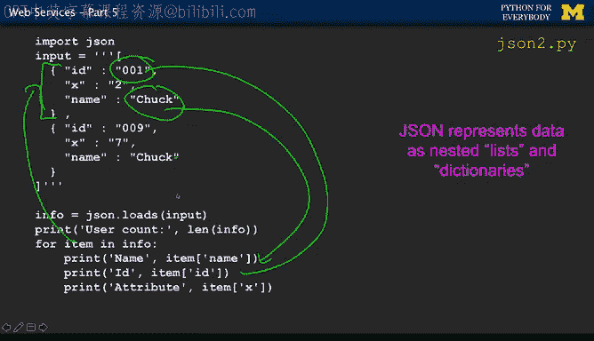

# 密歇根大学《给所有人的Python课》课程3：《使用Python访问Web数据》｜python-network-data｜ - P35：35_06_01_JavaScript对象表示法_JSON.zh_en - GPT中英字幕课程资源 - BV1Hu4y1e7WS

So now we're going to talk about a new serialization format， we've talked about XML。

 which is kind of complex and there's a simple one as JSON and it's increasingly popular to the point where it's entirely possible that you might go a whole career and not really run into XML XML is not necessarily bad。

 it's just very powerful and more powerful than we need in simple situations。

And so here's one of the videos that I'll show you。

 It's a video of a fellow named Douglas Crockford and he's credited with discovering JSON。

 JSON really is not a new format。 JSON was invented by the constant syntax。

 the literal notation for constants in JavaScript for both arrays variable constant values and objects and that's what it is。

 and so he makes it really clear that he just noticed that this could be a way for us to serialize data。

 So when I talked about serialization I talked about how we're not going to use the Python syntax。

 we're not going to use the JavaScript syntax， we're going to use Xml in the middle but what happens in JSON is we're not going to use the Python syntax。

 we're not going to use the JavaScript synyntax， but we are going to use the JavaScript syntax in the middle so JSON is。

Very native to JavaScript and interestingly because so many things are being built in browsers these days。

 JavaScript is becoming an increasingly interesting language。

 and so JSON's popularity is not driven so much because of JavaScript。

 but it certainly doesn't hurt to have JavaScript become increasingly increasingly popular and a JSON coming along with it。

So Douglass Crockford is an interesting fellow， he's got sort of a dry sense of humor and I encourage you to watch the interview that I did with Douglas Crckford as part of the dry sense of humor you can see two books here written from O'reilly。

 one is the JavaScript definitive guide and then there is another book that's almost a joke which is。

 I mean it's a very good book called JavaScript the Good parts and the thickness of the parts of JavaScript that are there that are not the good parts as Crockford would say。

 and so this is a Crockford book， and so this is just kind of Crockford'sry sense of humor that about what he thinks about JavaScript now。

Crockford would say， and I would agree that the good parts of JavaScript make it a really great programming language。

 you just have to be careful not to do the stuff that he considers the not such good parts of JavaScript。

And so Crockford basically established JSON as a standard was sort of by fiat。

 he didn't ask anybody's permission and he registered JsonN。

org and put a couple documents up that said this is what JSON is and it's kind of taken the world by storm。

 the last few years， like I say because of so much data is being moved between the browsers and backends and JSON is pretty much the serialization format that's being used there XML is still used in some situations。

And so here is the similar kind of problem that we solved， except we're going to use JSON now。

 and so just like in all of Python， we import something， we import the JSON library。

We're going to use the triple quoted string again and again we're not going to pull this data。

 normally you'd pull this data from the internet with URL lib or open into a file or whatever。

 and it starts with a curly brace we'll see another syntax where it starts with a square brace curly brace is like a dictionary right and it's kind of like a dictionary It's in jascript it's called an object。

 but it's very much like a Python dictionary and that we have key value pairs。

 there's a series of keys， a key followed by a colon， the keys are strings。

 the values are can be anything not just a string phone and now here we have a dictionary within a dictionary。

 So this is the phone keyword in the outer one phone email a name or in the outer one。

 and then there's a child dictionary here that starts from here to here and it has two things one is type in one is number and then this one has a child that has hide is yes and you could think of this as a tree as well if you really wanted to know we could have this outer thing which has a name。

A phonehone。And email。And under phone， we have。Type。And number。Sorry。

 I have to make these long and then we have hide。RightNow one of the things that's different between JSON is there's no start tag and there's no n tagag and there's no attributes and so I'm kind of cheating and making this attribute and moving it down and there's no text area so it's got some different things that are sort of different nature than XML。

 but it has some things that we absolutely love。And that is。

 so we have this blob of text that we got from somewhere， and we're going to pass it in。

 This load S stands for load from string， So use the JON Library method or function load S from the JsonN library。

And that does all the parsing and looks all these things up。 This might blow up。

 It might give you a trace back。If there's a syntax error like you forgot that quote or something like。

 so you get a trace back here。Or not， assuming it all works well。 and in this particular example。

 it's going to work well。 we get back an object that sort of represents internally all of this data。

 Now， the interesting thing is is the thing we get back is really a Python dictionary。

So this ends up being a type Python dictionary is if you built this Python dictionary with name。

 phone and email as keywords， and then the values are Chuck。And then another dictionary。

And another dictionary。Okay， and so info is a dictionary。So when we talk to this dictionary。

 we just use the bracket syntax sub name if we print that out。If we do info subname， it is this。

So there's no like， pull out the text thing， do a get， find it。

There is a dictionary and has got a key named name。 And that's what you get back。

If we are going to go find this hide， we go get info sube， which is a dictionary。

 which is then gives us back this thing right here， which is also a dictionary。

 and so then we say sub hideide within that and that pulls out。The yes to print it out。

 So this is one of the things that。Works really well with JSON is because its structure is more like the kinds of structures that we have of lists and dictionaries and every programming language has something that's roughly equivalent to a list and roughly equivalent to a dictionary。

 and so what happens is this JSON is not as rich a representation as XML。

 but because it's simple and it maps directly onto the internal structures that we have in all these languages。

It's a lot easier to use。 That's it's not as rich， but in its simplicity。

 it makes it so much easier to use。 And so if you just compare this to the previous XML example with the Gas and the dot text and like。

 what am I doing here， this is a lot more direct。 You look at it。

 You write this stuff and you're done with it。Here is an example of a list。

 so we've got lists and dictionaries and they can be nested in any way you want。

 so what we have here is our JSON starts here and ends here because it's a square bracket it's a list and so that is a list in this case it's two items and this is a dictionary。

And this is a dictionary。So we end up with dictionary and dictionary。

 we end up with a list of two dictionaries， and so when we take this and run it through load S。

 assuming there's no syntax errors， we get back a info is a list。It's not not an object。

 it's a list and we can say because it's a list， we can ask how many are there and that'll be there's going to be two things in there。

 and then we can write a for loop。We can write a for loop。

That has the stuff in here and the stuff in there。 The item is going to iterate through those two things。

 which is going to iterate through here。 And that's going to iterate to that。

 And so it's this is going to be a dictionary。 and this is going to be a dictionary。

 So this loop is going to run twice。 Lo's going to run twice once with this as item。

 which is a dictionary。 And the next time with that is item is a dictionary。

 And then inside the loop。So item points to this， and we say a item subname while item subname is just this chalk。

And then item subidd。Is 0。01， and then item sub x is 2。 And again， if you look back at the Xml。

 it does the same thing。

You see it's just a lot more complex， right？A lot more complex JSON is simpler。

 so the code we write to work with JSON is simpler and that's why a lot of people like it a lot of people would say you know what you should do is if you can use JSsonN you probably should use JSsonN but if they have something more complex you might want to use XML。

 but these days there's sort of a strong movement towards JSsonN and so that gives us a summary of how JSsonN works and now we're going to talk move up a little bit and talk about the service orient approach。

