# 密歇根大学《给所有人的Python课》课程3：《使用Python访问Web数据》｜python-network-data｜ - P36：36_06_02_实战示例_JSON.zh_en - GPT中英字幕课程资源 - BV1Hu4y1e7WS

Hello everybody， welcome to Python for everybody， we're playing with the Web Services chapter right now and if you want to get the materials for this course。

You can。Co herere and download the sample zip sample code do zip。

 I've got this all sitting already on my computer。 I also have the whole thing in Github if you want to get it out of Github。

 So the thing we're talking about now is we're talking about the JsonN 1。 Py example from the book。

 And so JSsonN is kind of like Xml except a lot simpler。 and that's why a lot of people like it。

 It's not that JsonN is always better， but JSson is better in a lot of situations that don't require the complexity of Xml。

 So we always we start to import JSson JSsonN is built into Python。

 but we have to ask to import it again， we're using a triple quoted string to put the JsonN in there。

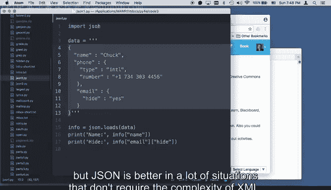

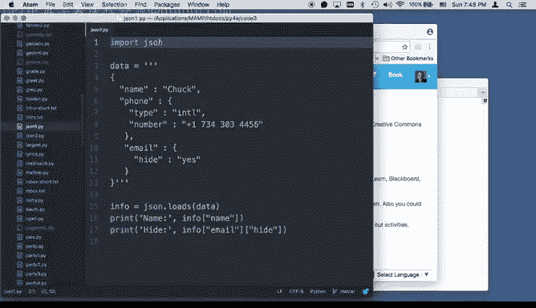

And JSO looks a lot like Python dictionaries， key value pairs， key value pairs， in this case。

 this is a key and the value itself is another dictionary， or in JSON terms an object。

 but again key value pairs within key value pairs within key value pairs and all these little cursor guys have to all these little curly brace guys have to line up properly。

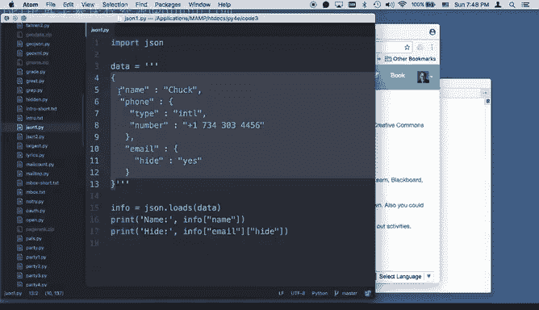

And so like all the time， this is a string which we normally would read and decode from the internet。

 but for now we're just going to have it in there， load JsonN。 load S says go to the JsonN library。

 pull out load string and parse this， which turns this。

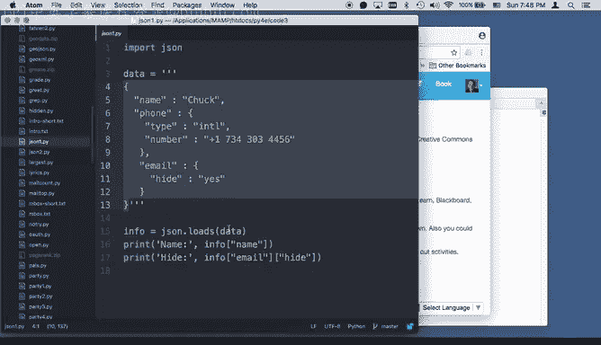

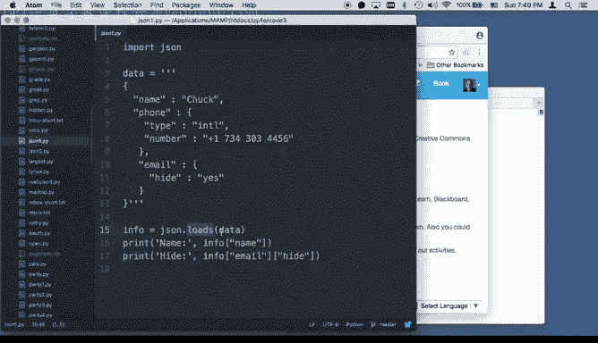

Set of curly braces， spaces， commas， perhaps syntax errors into a structured object。

 And if we had made a syntax error in here， then this would blow up。

 But if this doesn't make a syntax error， if this doesn't blow up。

 then we have a structured representation。 Now， the difference between Xml and Python。 Json。

 is that this turns into a Python dictionary with key value pairs。 Okay， and so once we have this。

 this is a dictionary。 And we can say info subname and that's the exact syntax that we would use to get the dictionary。

 and that's going to extract this value out of there。 And if we want to go in deeper。

 we can say info sube， and that's what info sub email is right there。 And then sub hideide。

 So that's like that's a dictionary within a dictionary。 So if we run this。

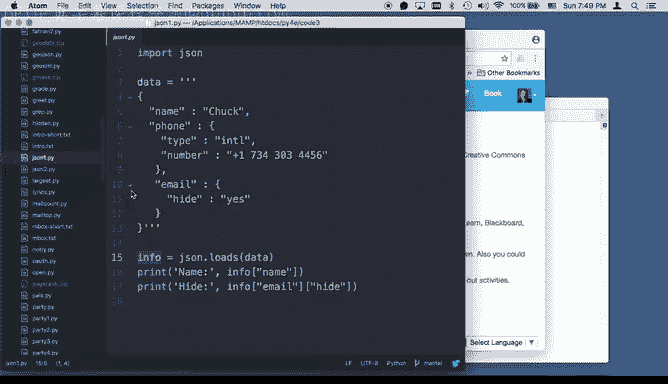

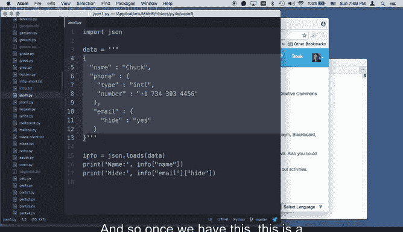

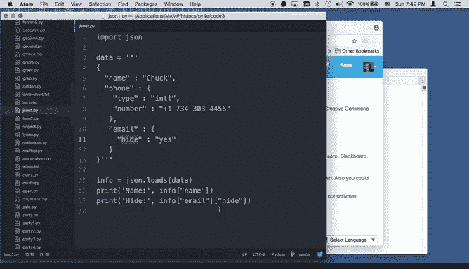

Python 3， Json。1 dot pY。 It digs in really fast。 And so this is why people tend to like Json is because you read the JSson。

 which is actually a syntax derived from JavaScriptscript。

 but it looks just like the syntax for a Python。 So it's moving an object that's moving an object。

 a JSson object that turns in directly into a Python dictionary with nested dictionaries。

 So now we're going to look at JSsonN2。

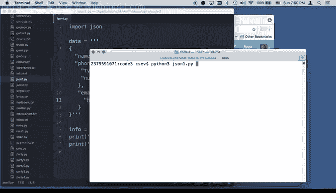

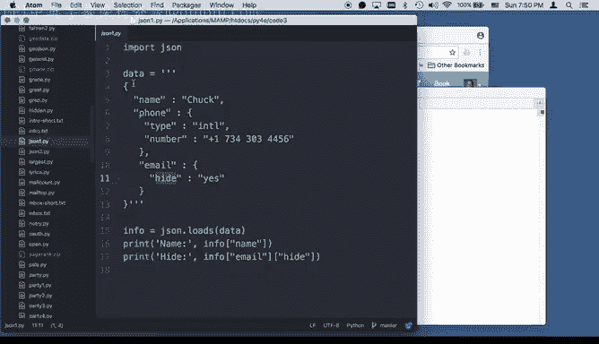

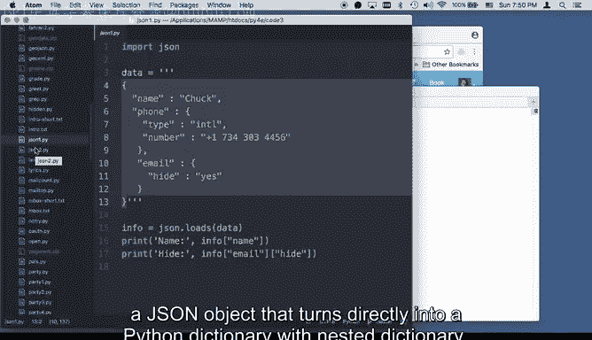

And so JSON 2， we're going to see a list。

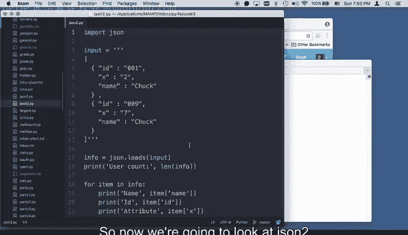

Are an array in Json terms， but it turns into a list in Python terms， so this is a list。

Of dictionaries， in JavaScript， that would be an array of objects。

 but in Python it's a list of dictionaries， so we'll just pretend that it's a list of dictionaries。

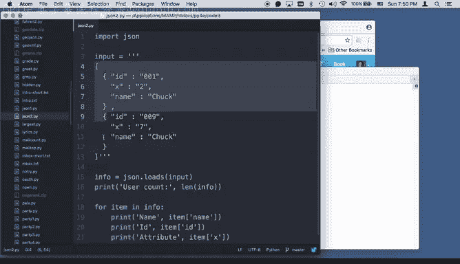

Again， we load the string parsing looking for syntax air。

 so let's just make a syntax error here and run Python Json 2。

 py and you'll see where it blows up It blows up at line 15 which is right here。

 It's like this low S blows up。 Now you could put a tricept around it to save it but we're not going to do that。

 And it even complains。 it says， look， we're expecting something here in line 11 and that's a line 11 of the Json which starts at line 4。

 And so I'll put my little square brace back in。 so it's not syntactically broken。

 So let's run it again and make sure that she runs and yes she does so。

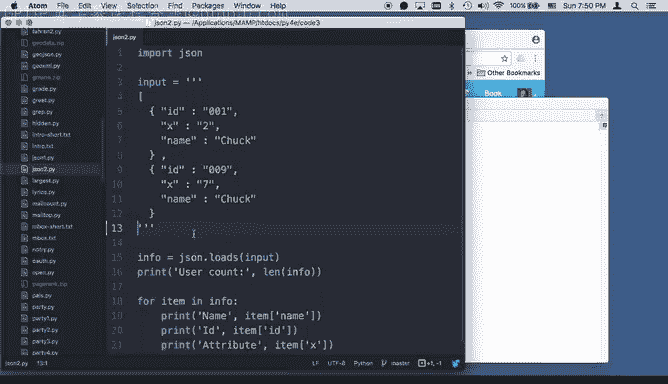

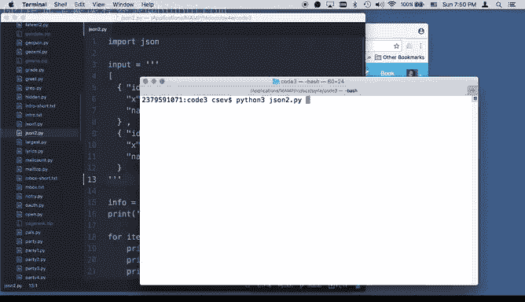

This parses it。And converts from the JsonN syntax into a Python in this case list。

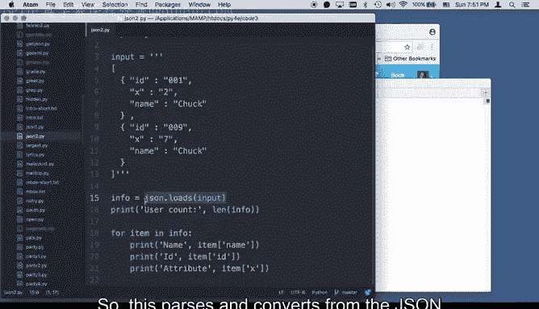

Because it's got square braces instead of curly braces。 The previous example had square braces。

 and we can then take a length of it。 and it's an array。 It's a list。

 And we see that there are two things in there。 And then we're going to iterate through in this item is going to iterate through these dictionaries。

 that dictionary followed by that dictionary。 So the first time it's item sub。

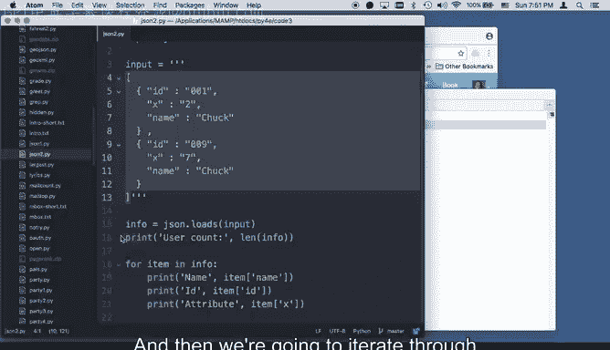

Name， which is this value right here， and then item sub Id， which is this value。

 So you can dig right into this， but you're using， you're not using get and you're not using the weird extra find or find all or anything。

You just are going at these structures directly， and so you can quickly extract this stuff out and we read through ID's name is Chuck。

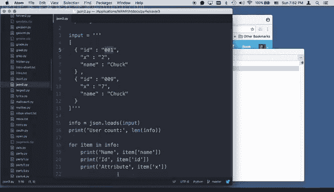

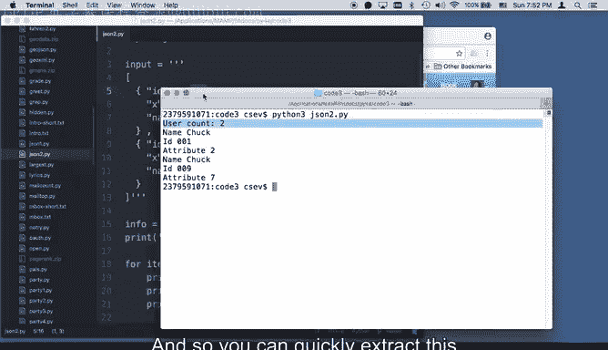

name is Chuck。there are no attributes， by the way， Xs to and and so we had to make x so if you look at the XML we had this concept of attributes on the outer tag these things are also not named we just have to know what we're looking for so JSON represents simple structures but it's all it's much simpler to you so I hope this has been useful to you and talk to you in a bit about some more JSON。

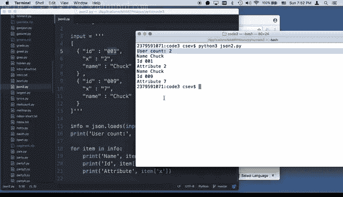