# 密歇根大学《给所有人的Python课》课程3：《使用Python访问Web数据》｜python-network-data｜ - P39：39_06_05_视频_面向服务的架构.zh_en - GPT中英字幕课程资源 - BV1Hu4y1e7WS

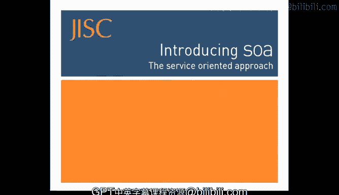

🎼The service oriented approach to linking software systems and applications is transforming the way many organizations share data。

 This approach improves existing methods of data sharing by providing a service layer between systems。

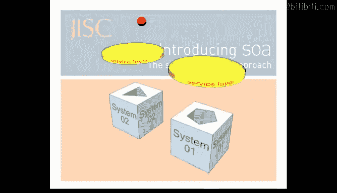

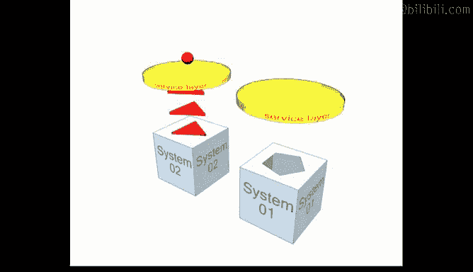

🎼Sharing data between applications is a well established principle that works on a simple level。

As systems expand， the solution that connects two software applications will often not work for a third。

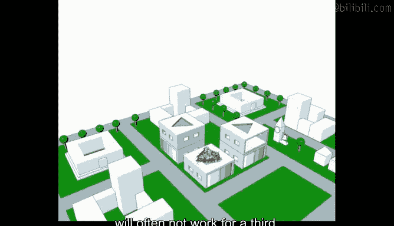

What began as a workable system then locks valuable data in a silo。

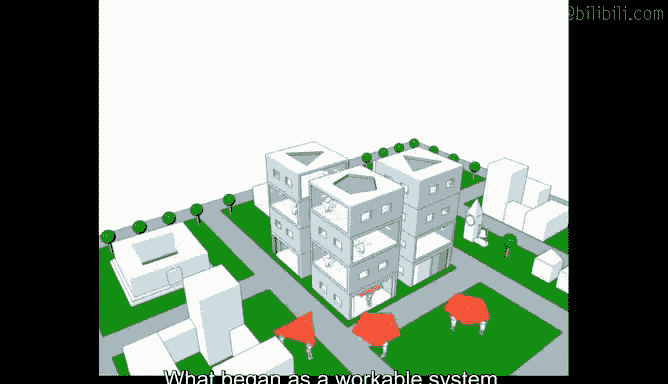

🎼Sharing the data is still possible， but requires adaptations and tweaks。

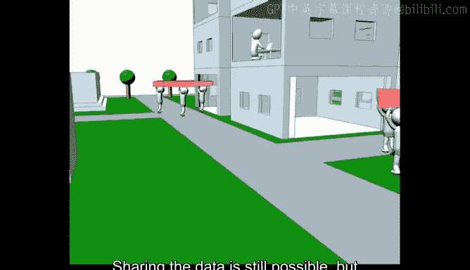

The process is laborious and time consuming， leading to bottlenecks and overload。

The reality of this world is unnecessary effort expended in duplication of data。

🎼By applying a service layer to the applications you wish to connect up。

 data is offered up in a common format for reuse elsewhere。

🎼The service oriented approach works with existing software systems and does not require you to remove the monolithic application。

🎼Replacement applications， reuse the links already made and can plug into the service layer without affecting other users of the data。

🎼New applications can be added to grow overall system architectures in the same way。

 The data in each application is offered up as a service which any other application can consume。

🎼When the service oriented approach is evolved into a system wide architecture。

 it allows connections and service sharing opportunities between organizations nationally and globally。

🎼Take monitoring of student progress， for example。Results are logged by a virtual learning environment。

 but how much of that data is shared with a management system that is tracking progression against funding。

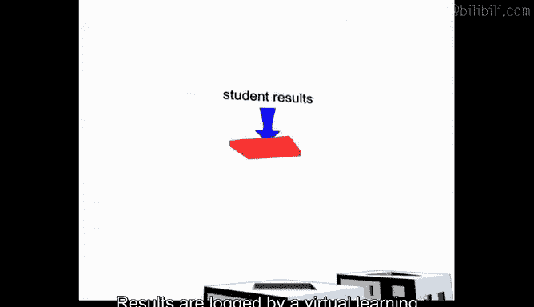

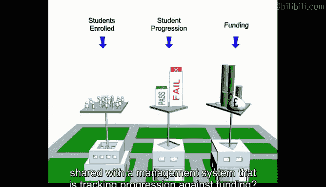

If the motivation and commitment of struggling students is not addressed and they decide to walk away。

 there is a direct impact on funding。

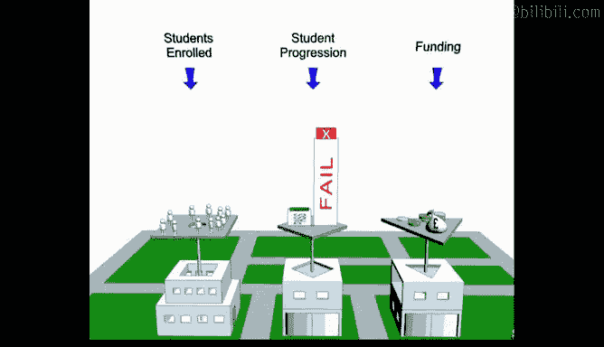

🎼If the data is freed up and shared across a system using a service oriented approach。

 it could contribute to retaining student motivation and thereby maximising income。

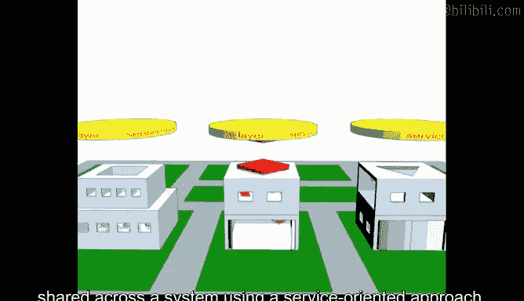

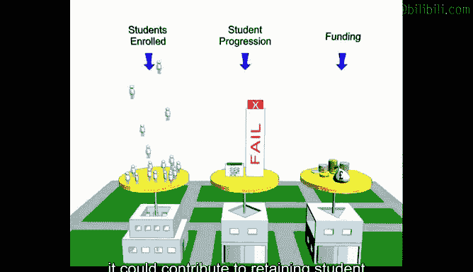

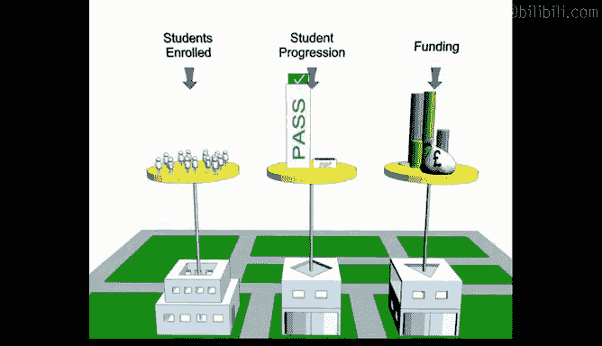

🎼And what if， across the education community， there was one standard and agreed way to describe a course。

 It would allow course information to be made available as a consumable service。

 both internally and externally。🎼This is the subject of a current project called exchanging course related information or X。

 C， R， I， encompassing course marketing， quality assurance， Enrment and reporting requirements。

 This service oriented approach enables aggregator organizations like UCcasS to gather the standard and agreed descriptions of courses from each provider。

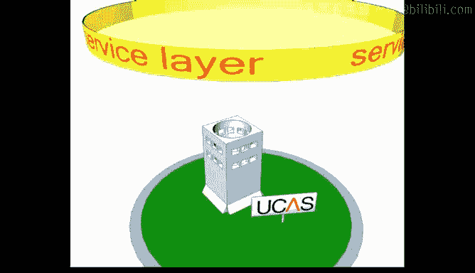

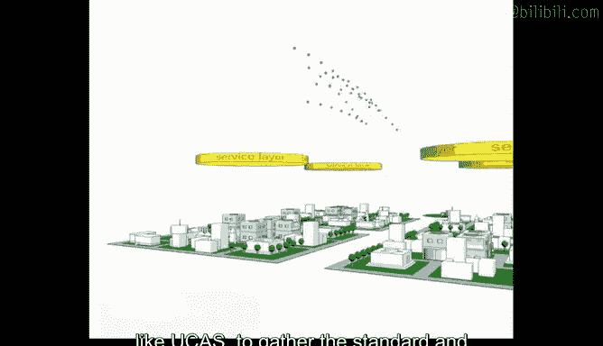

🎼Comprehensive details of approved enrolment opportunities are then returned to a prospective student for easy and accurate comparison。

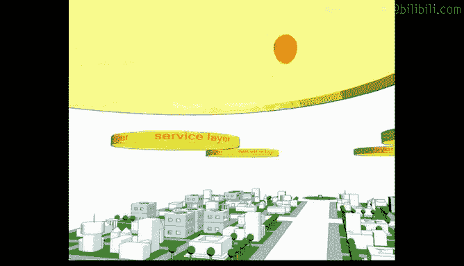

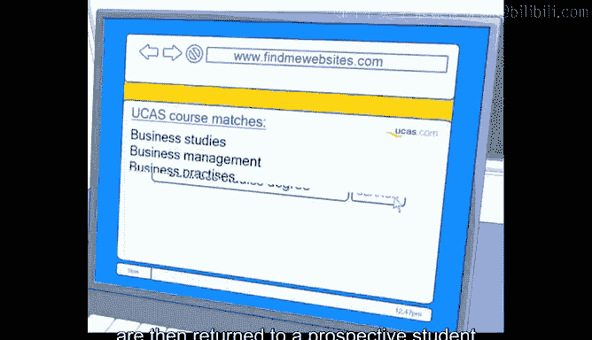

Amongst the research community， it is the same principle here。

 the service oriented approach is enabling researchers to work across institutions in virtual organizations。

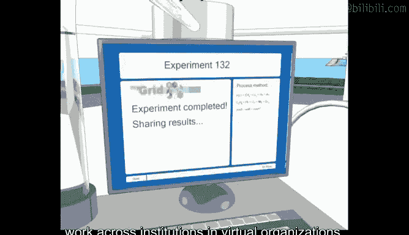

🎼Miggrid is a project that provides a shared toolkit for creating experiments by coordinating the information flow between distributed resources and services。

🎼Workflows and query specifications link together remote and local resources using web service protocols。

🎼Workflows created by Mi gridd represent the scientific process of the experiments they enact。

 making them a rich resource for scientists creating their own new experiments。

🎼The service lack to this data enables users to share。

 reuse and repurpose experiments within the migrant community。🎼。

🎼Many education and research services are already developing a service oriented approach。

 taking their lead from the business world and major software developers。

🎼It is in this context that the EFmework， a successful and expanding international initiative。

 works to make sense of the service oriented approach for the education and research community。

🎼The E frameworkramework website identifies and describes the service components needed。

🎼It provides the blueprints and reference examples for those in the community who want to gain a greater understanding and knowledge of how to implement a service oriented approach。

🎼The E frameworkra website is thus becoming a knowledge base that is developing a shared vocabulary and way of thinking for all in education and research。

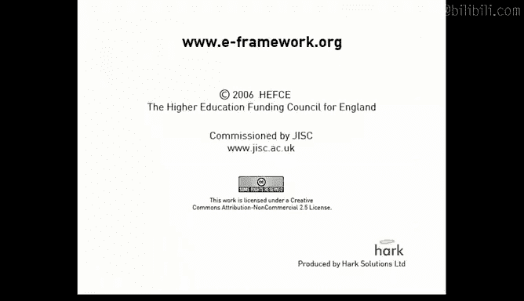