# 密歇根大学《给所有人的Python课》课程3：《使用Python访问Web数据》｜python-network-data｜ - P3：03_01_01_Windows_10_安装Python并编写程序.zh_en - GPT中英字幕课程资源 - BV1Hu4y1e7WS

Hello and welcome to Python for everybody Today we're going to install Python on a Windows system and install a simple text editor and run a simple program we are going to go to Python。

org and we're going to go into downloads。And we're going to download Python for Windows。

So now the download is completed， so we're going to do the installation now we need to be in the administrator and administrator account on this Windows to do this。

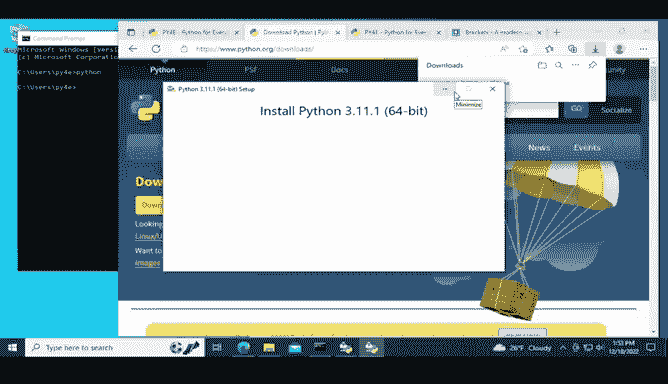

응。So we just finished the install and so I'm going to test to make sure that we've got her done。

 so I'm going to go into the command prompt and check to see your Pyths installed。

And we'll say pi minus minus version。Because Python would hook us back up to that app store。

 so now we have Python。IfWe type pi， we'll go in the interpreter， print hello world。

And then quit open print， close friend。 Okay， so we have Python installed， so that's good。

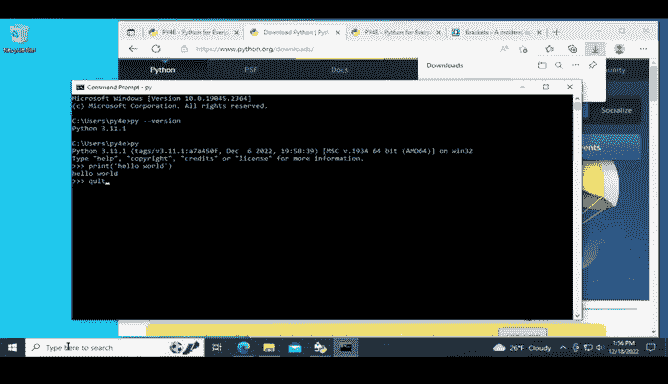

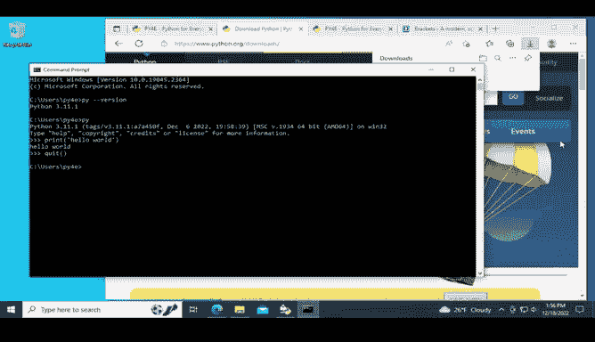

So we can close that。 Now we're going to go on to our text editors。

 We have a number of different editors。 You can use any editor that you like。 you shouldn't use word。

 you shouldn't use notepad。So we recommend the brackets if you have something like VS code installed and it's working for you great。

 keep on going so there's other ones that you can use， but we're going to focus on brackets。嗯。

So brackets is simple， it's open source， it runs on Mac， Windows and PC。

 so we're just going to download brackets here。Let's go ahead and install brackets。

We'll just take the typical。😔。

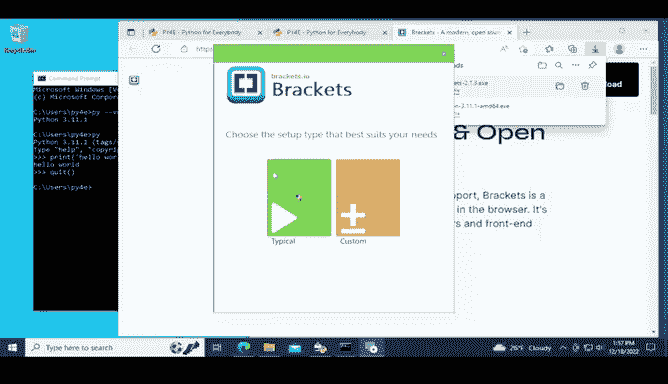

。

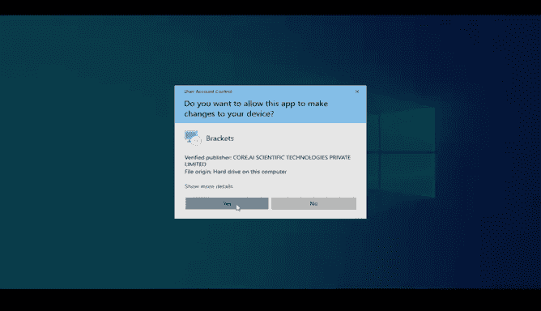

So we're done with that， so let's go ahead and finish。So let's just open brackets up。

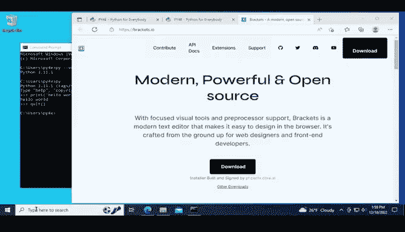

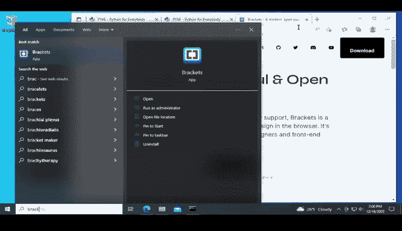

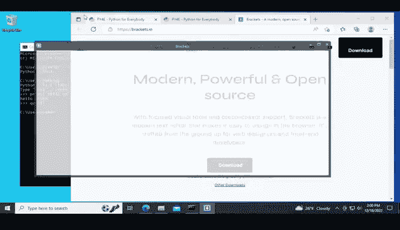

Let's go ahead and hide this。So there's brackets。So I'll just close all this stuff。Cls that。

So I'm going to create a file， file new。And I'm going to make this a Python file， print。Hello world。

 of course， the first program。And now I'm going to save the file， file， save。

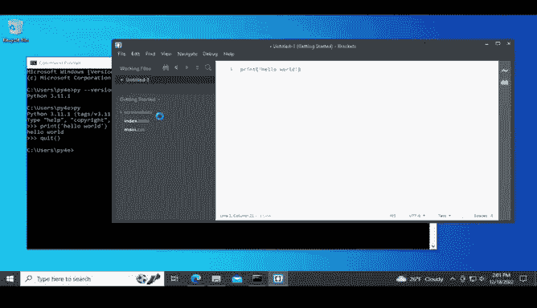

Now I'm going to go on to my desktop。And I'm going to create a new folder。

I'm going to call this folder Py4 E。

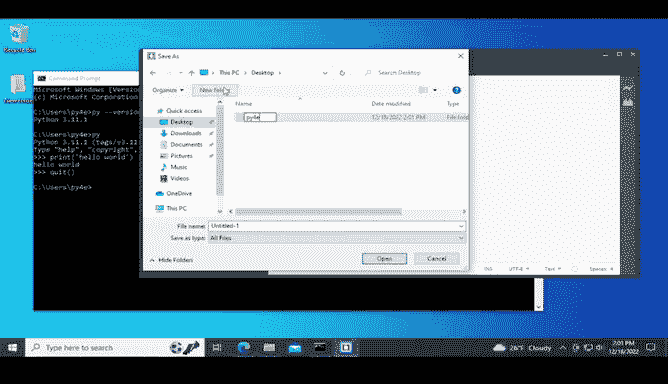

You'll notice it also shows up on my visual desktop as Py for E。

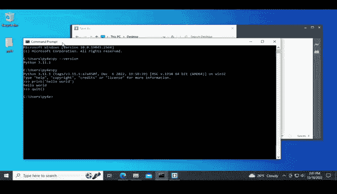

And then I'm going to go into that folder and name my file。Hello。py。

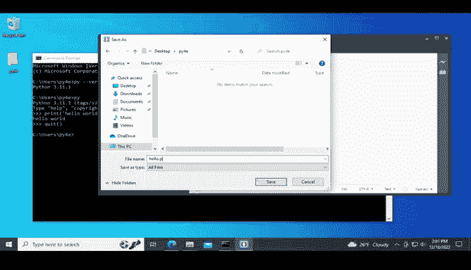

And now that I've called it hello do P Y with that suffix， it actually does a syntax highlighting。

 So that's kind of nice。 So if I， if I go and I take a look at。

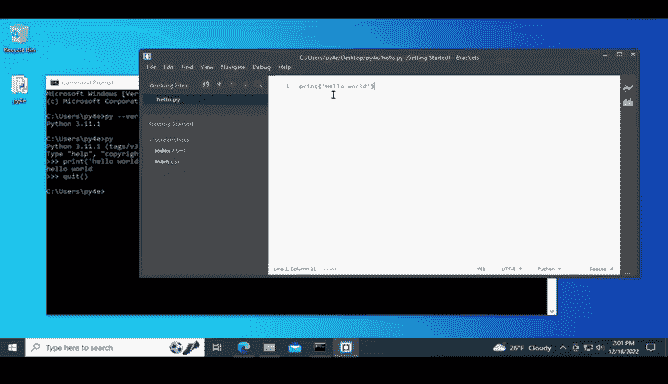

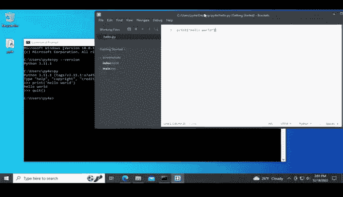

This folder。I will see that there is a file called Hello dot Py。

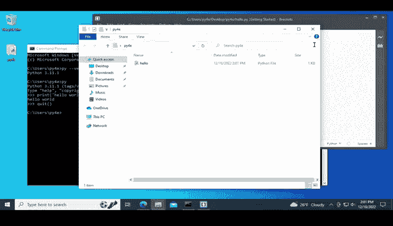

And if I'm here， in the command， you're in a working directory， so I'm on the Py free user。

 so I'm in the working director uses Py3E。If you're ever wondering where you're at and it's not showing the prompt。

 you could type C all by itself。

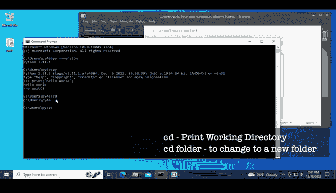

If I do a DR here， you will see that I've got a number of files。

 including a file called a folder called desktoptop。So I did CD DES tab to get to desktop。

 and then I do a Du here and you see that I've got one folder named Py3E。Yeah， okay。

 my account name is PY free， and my folder is PY free。 So sorry， if you're。

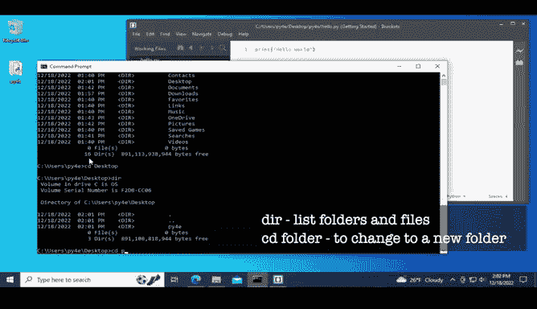

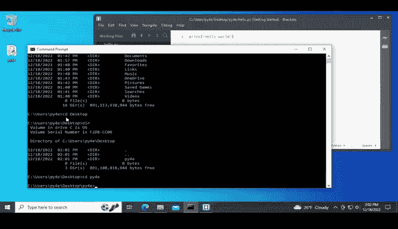

Confused by that。 so I can do a Du inside the Py free， but you see， I'm in the account Py free。

 itss desktop， and then the folder Py free， and Ive got to file hello do Py。

 so I can type here Pi hello dot Py。

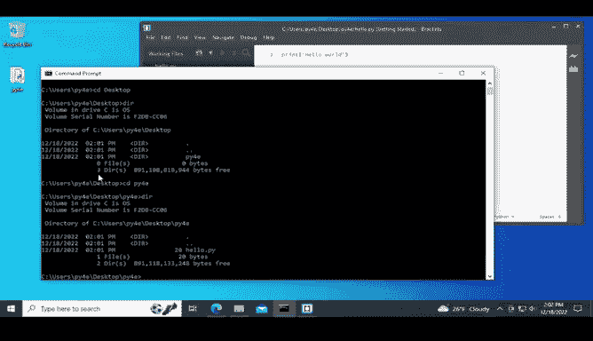

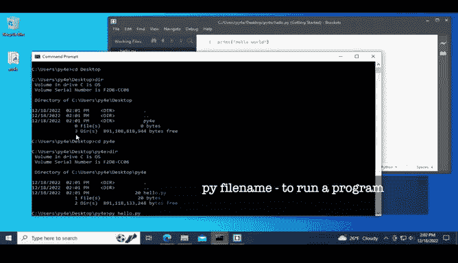

To run Python。And it will， and it will say hellello world。

And so that's pretty much just kind of getting started， like I said。

 you can use any editor that you like and we're just recommending that you start with brackets。

 So there we go。 I hope that you found this a quick and useful instruction on how to install Python how to install a simple editor in a form of brackets and then how to。

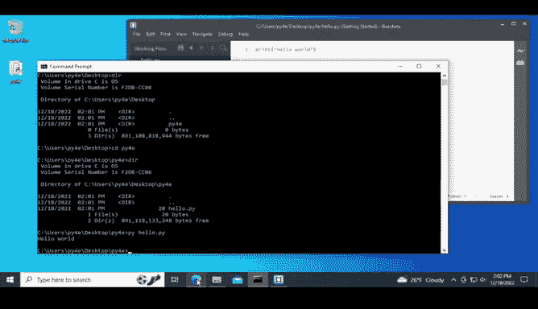

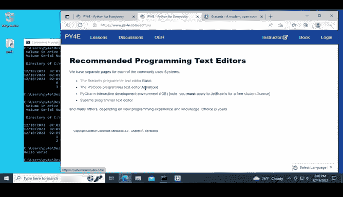

Run your first Python program。