# 密歇根大学《给所有人的Python课》课程4：《使用数据库进行Python编程》｜python-databases｜ - P3：03_01_01_Windows10系统安装Python与编写程序.zh_en - GPT中英字幕课程资源 - BV1PP411W7H1

Hello and welcome to my video that shows how to get started and install Python on Microsoft Windows okay。

 so it's not too hard we're going to both install Python 3 and we're going to install textex editor。

And so I'm just going to go into Google and I must install Python 3。

And my top link is downloading Python。And there is my link for downloading Python 3。5。

2 This version of my class uses Python 3， I have an earlier class that you may have seen that uses Python 2。

 but in this class we're going to do this now it might take you a while to download this I've actually already downloaded。

Now the other thing we need is a programmer text editor and you can really use any programmer text editor' we've used Noteepad plus in the past。

 we've used J edit in the past。 I like Adam。om。o mostly because it works the same on Windows and Mac and Linux but you can really lose use any text editor that you like just don't use word or text editor that comes with the operating system。

 you need a programmes editor that doesn't messed with weird characters or weird lines or strange formats。

 you must have a real programmer editor so I'm going I've already download this as well。

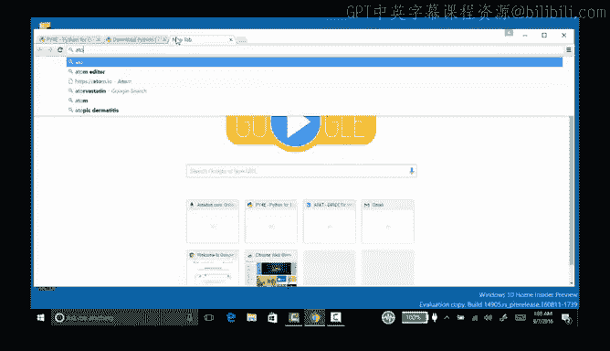

And so I won't waste the time waiting to download it。

 but let's go ahead and do the installation so these things。

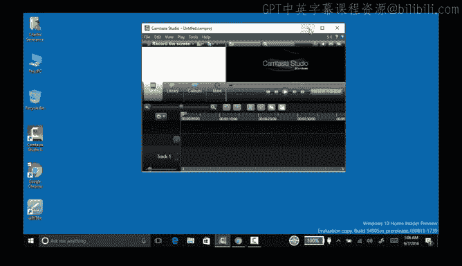

These things ended up in my。

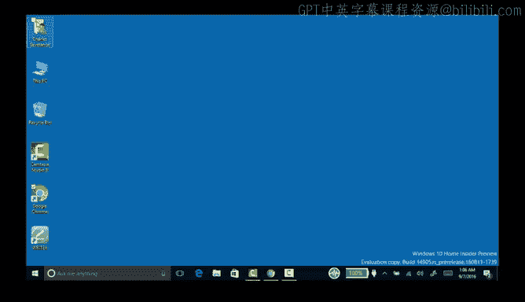

My downloads file。So I'll going to downloads。And I'll start installing Python 3。5。2。

Now it's going to ask me some things， add Python 3。

5 to the path Now that's a good idea install the launcher for all users， Im going to add that。

 maybe you will， maybe you won't do that It's going to tell me where it's going to install it。

🎼Install now。Of course， it's going to ask me for permission to do these things。

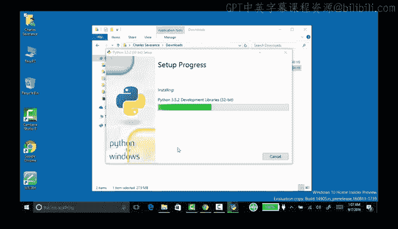

And now it's running through the installation。

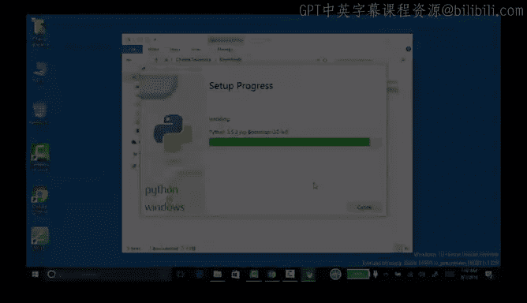

Okay， so there we go， you could maybe click on this online tutorial documentation。

 but we're just going to close this。And I'm going to start and run the Windows command line now。

You may have all kinds of fancy ways to run Python， but I like running the command line。

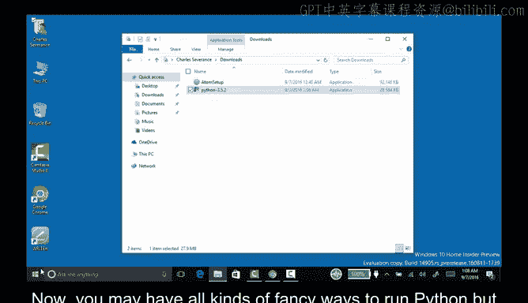

COMm。A， I like running the command line because。

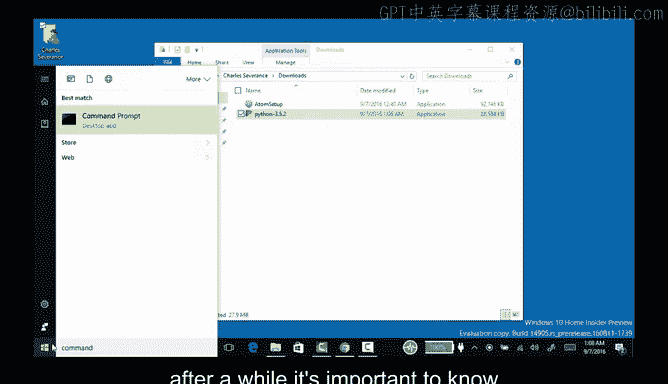

s after a while， it's important to know what folder things are being run in and so here's this command line and I should be able to type Python here。

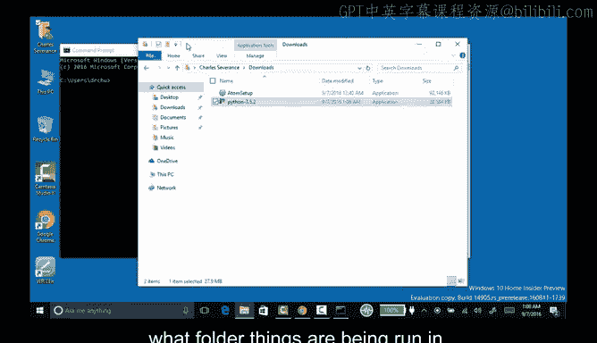

And so now I'm in Python 3。2， and this is the Chevron prompt here is the Python interpreter where it's asking for Python commands。

 and I can say print。Hello world， of course， this is what we tend to print。All the time。

I can make a mistake， I can say little blue。Right and it'll complain to me now to get out of this。

 I can either type control Z or quit in this case I'm going type control Z and I'm back to the prompt a couple of things I can do a to see what folders and files I have and that is like my desktop and then the CD command tells me where I'm at in the folder that means I'm in the user's directory doctor chat okay so I have now installed Python I ran the Python interpreter to verify it I said print hellello world okay and so now what I'm going to do is I'm going to actually install at。

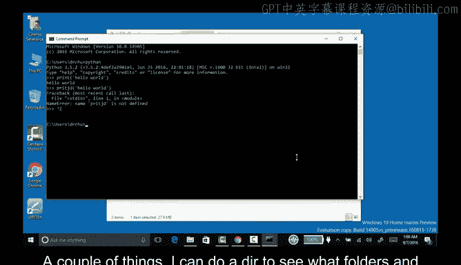

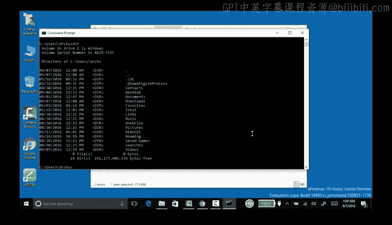

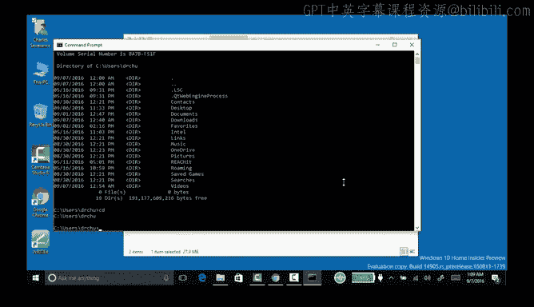

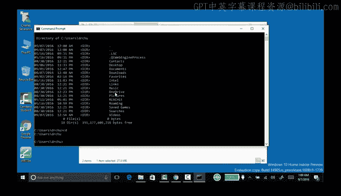

And I already had this downloaded， so let's go ahead and install Adam on my computer。

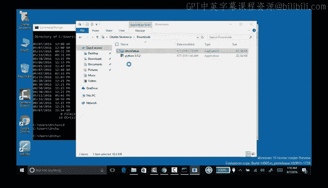

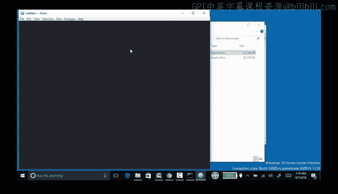

Okay， so Adam is now installed and it's kind of telling us what to do。 I'm going to actually just。

Close all these windows， close this window， close everything， and I'm going to create a file。

I am going to say， print。In this case。Let's see if I can make this。Bigger， I can make it bigger。

 So I'm a type print。Hello。From a file。Okay。And I'm going to save this。I'm going to say file。Save as。

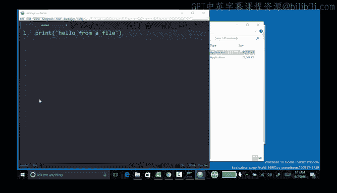

And what I'm going to do is I'm going to go to my desktop。And。

I'm going to make a folder on the desktop and I'm going to call this folder PY4E。

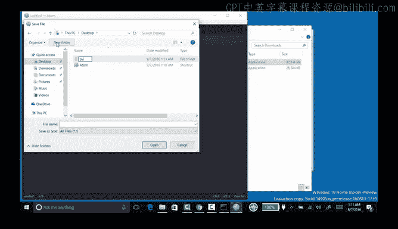

So I now have a folder on the desktop。Move this here， I move this here。Oops。

And I'm going to go into PY4E。And then I'm going to name this file first dot PY。

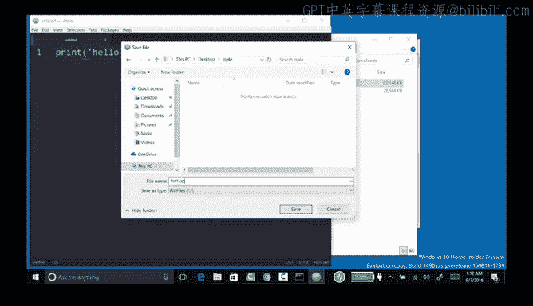

And you'll notice that when I save this。

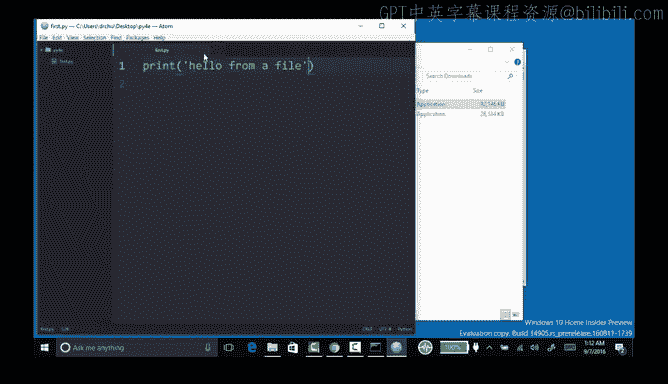

When I save this。It。

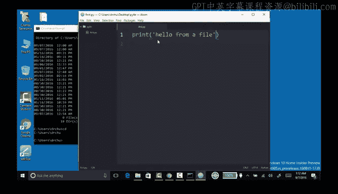

It syntax highlighted it， that's one of the nice things about a programmer editor。And so it says oh。

 it's got a suffix of dot py， so therefore it knows that it's supposed to look pretty with Python and make this one color make this another color The other thing that you'll notice is I now have a folder called PY4 E and if I am in this command line let me just start that up again。

 I'll show you how to start the command line again。

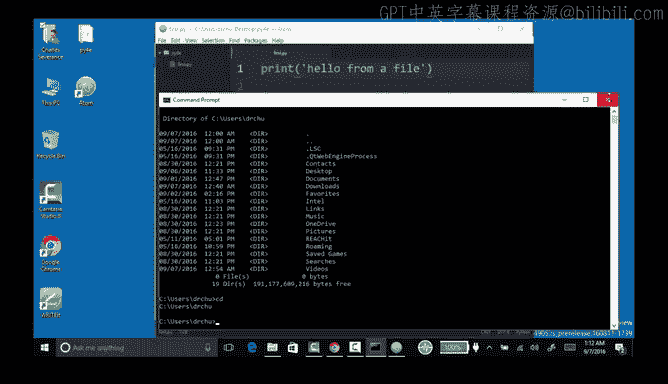

Command。

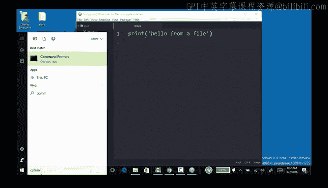

Now， if I do a D， I see the folders that I'm in and one of the folders that you can see here is the desktop folder。

 so I'm going to say CD desktop。

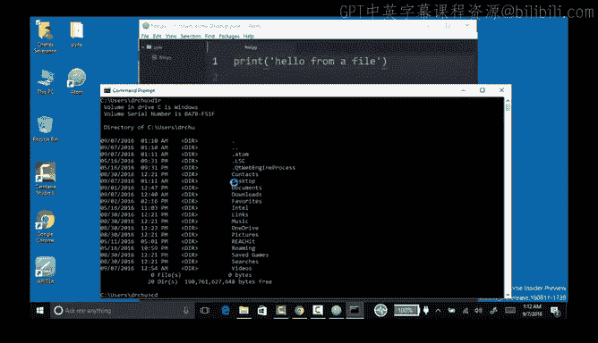

And then I'm going to typed the D command to see what folders are in the desktop。

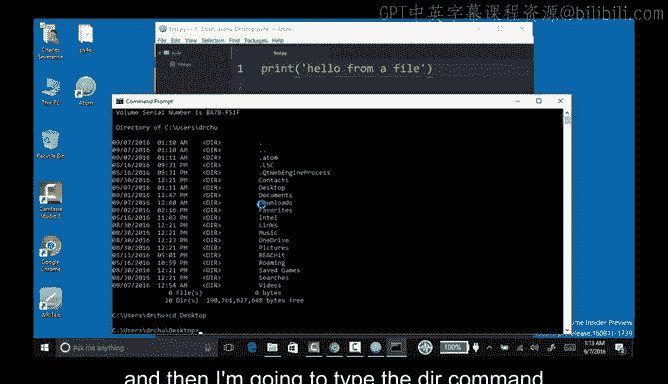

These folders。Are the same as these folders。 These things are kind of virtual folders。

 P Y for E is Py for E。 Now I can type Cd， which stands for change directory， P Y for E。

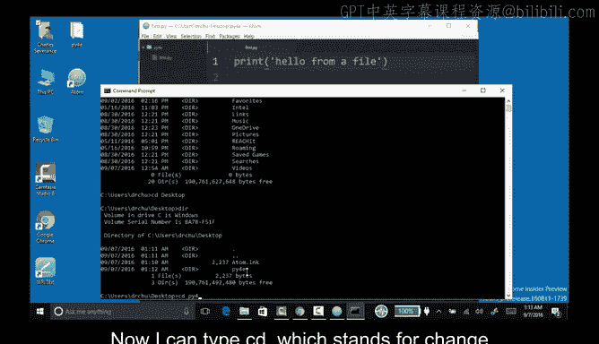

And I can do a Dur and I see first do Py， and that's the same as if I'm。

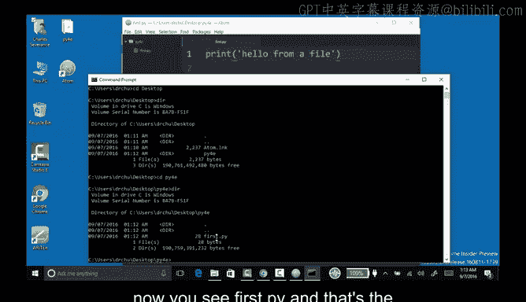

Tiving into this folder， here's this file first on PY Windows hides the suffix。

 which is somewhat annoying and frustrating， but that suffix is there。

 that file is there and so for me one of the things you got to figure out in Windows is how to make sure that you are in the same folder users。

 Dr。 Chuck desktop P4 E and that's the name in this file and here as well。

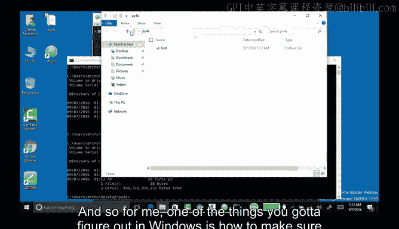

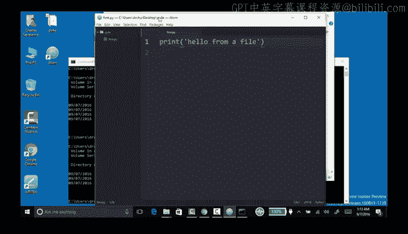

And now I'm going to run this program， I'm going to type Python。First， dot py。

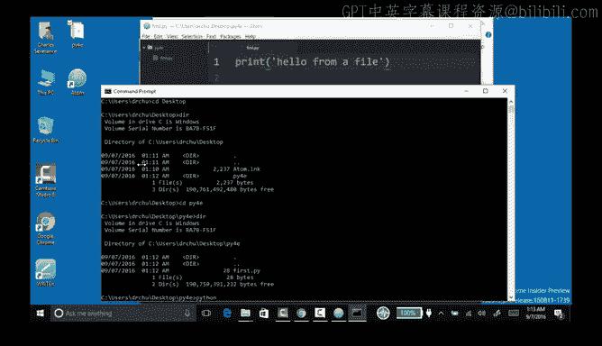

And you see that it ran the Python code。

another way you can do this。

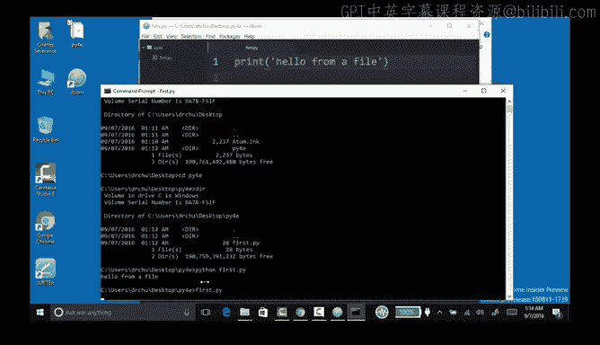

I you can type first dot py and that's because this file association has happened in Windows this doesn't work in Macintosh。

 this only works in Windows that all files with dot py are expected to be Python and it knows the Python interpreter where to run it okay and so I've got Python 3。

0 installed and that gets me started and so I。

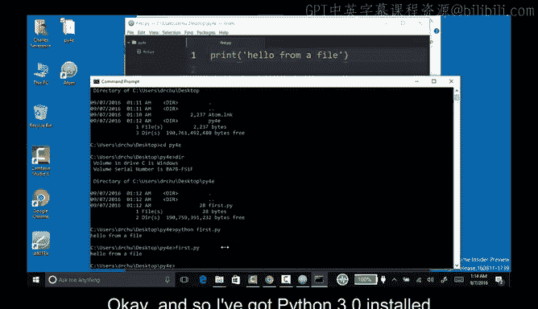

I hope that this little introduction about getting things started and writing your first Python program has been helpful to you。

