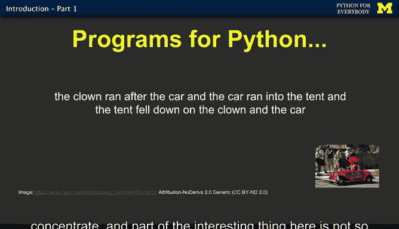

# 密歇根大学《给所有人的Python课》课程1：《编程入门指南（使用Python进行开发）》｜python｜ - P3：03_01_01_为什么编程.zh_en - GPT中英字幕课程资源 - BV1214y117Mk

Hello and welcome to Python for everybody。 My name is Charles Severance。 I am your instructor。

 We name this Python for everybody because we are dedicated to the notion that increasingly as our lives are surrounded by technology that we want you to become a maker of technology and not just a consumer of technology。

 You want to change your perspective from you know this side of technology。

 where you're looking at it to the other side where you're you're back here。

 you're like a creator of the technology and you can create things and it takes a long time and you may not want to be a professional programmer ever。

 you might just like read little bit of data， but we believe that everybody should know basically how to program and how to get things done inside of a computer just as much to just be a responsible participant and a modern increasingly technically oriented society。

Computers want to be helpful。 They， they are programmed。 They are designed。 The hardware is designed。

 We'll talk about hardware in the next segment， but it's designed and wired。

 And when you apply electricity to it， it basically has one question。 And that is。

 what do you want to do next。 And if you think about your phone and all the apps that you have on your phone Each app is like what to do next。

 what to do next。 So as a programmer， your job is to serve the user。

 The user has something they want to do， maybe they want to zing a bird towards a pig or maybe they need to analyze some data。

 or maybe they want to do something like talk to their phone。

 and you have to be a real advanced computer scientists。 And so as a user。

 we just have so many wonderful programmers who So put so much software that make these phones intelligent。

 The hardware itself is not all that intelligent and our job as programmers is to act as intermediaries between the hardware in the user to build something wonderful and beautiful。

 And so you can。I of imagine that。Your job as a programmer is to intermediate between the hardware and the end user and if you're a professional programmer and you're trying to sell your software。

 while you're trying to imagine what the world might want and you can imagine all these app stores。

 etc， and these are places that you can build software and exchange that software with other folks and help people out。

And like I said， we are trying to flip you from one side of this device to the other side of this device where you are the maker。

 and you can think of this as a tool to manage your calendar or drive your car and read a map or whatever。

 but when you look at it from the other side when you look at it from being a programmer。

 you use things like compilers and interpreters and programming languages and networks， etc。

 and we actually have tools that we are going to learn to use。

 Python is a tool that the programmers on the backside of this computer use to make new things for the front side of the computer。

Now。What's your motivation to become a programmer Well。

 the kind of gross motivation for professional programmers to build something for everyone else to use。

 Like I work on this open source software called Sakai。

 which millions of people use around the world teaching and learning It's very rewarding for me。

 I feel really good about that。 you might build a guestbook for a website。

 But that's generally not the first thing that you're going to do with your programming skills。

 you might get some data， you might be an accountant or you might be a lawyer or you might be a librarian and somebody's got some data and you can't get a report out of this data something you're really curious about Some says。

 could you knock out a little piece of Python code to count up the number of times that this happens on Saturday。

 but then it also happens again on Monday。 Tell us how many times that happens。

 And so you write you know40 lines of code and it comes out and tells us what that data is。

 and that's really useful。 the key difference between writing a program for someone else and writing a program kind of for yourself to consume or just。

Other people is the rigor。 You don't have to be such a professional just to write code that you can use yourself。

 if it works and it gets you the data you want， then you know， job done。

 if you want to become a professional programmer， then you gonna have to study how to be more precise and more engineering。

 but we're not going to worry about that in this beginning set of courses。

 we just want you to learn the mechanics and the language of programming。

 And so we kind of want to take you like I said， from being a user to being a programmer and as a programmer。

 we you think you start thinking of yourself as living inside the computer。

 So your consumer out here， you're clicking on buttons and stuff。 And so as a programmer。

 you're going to write code and that code is going to use data networks and CPUs and memory and then do something for the user。

 and so we're trying to change your perspective and sort of pull you into the computer。

But what are you doing in that computer， What's code， What's software， What's a program？ Well。

 a program is like a sequence of stored instructions。 And the idea is。

 is the computer itself at the lowest level in the hardware is just not that smart。

 but it has a lot of flexibility in if we give it the right instructions that can do amazing things。

 if we give it right instructions to listen to voice， digitize the voice and make sense of the voice。

 then you can write a program that can hear the computer doesn't hear the program here。

 The computer makes it so that it can run all the calculations that seems to make it here。

 but a human being or actually thousands of human beings made it possible so that you can talk to your phone And so you can think of at the far end of this when you're building something really brilliant like the ability for a computer to listen to you。

😊，You are taking you and your all your creativity and all the research that you've done。

 and you're building something really amazing and put it in the computer。

 But it is still a stored series of instructions that runs step by step。

 And someone figured out every single little step that has to happen。

 And so once we figured this out， we write the instructions carefully。

 And then we give it to somebody。 Here is a program that does voice recognition。 And。😊。

If you're interested in it， I say it's wonderfully created。 I as a professional programmer。

 I have loved my life， I have loved the kinds of things that I do that I build things for people and I make them happy and then I sort of feed off of that and then I build something else。

 but ultimately it's just a set of instructions。If you're like， what's in this set of instructions。

 well， here we go， here is a program for a human being。 Now， I may be showing my age a little bit。

 but this is a YouTube video hopefully is not talk taken down by copyright or whatever on this song called the Macarna。

And so the macarna is an algorithm or a series of steps that hopefully you。

 you know five years ago or many years ago， you'd go to the bar and you'd watch all these people doing these things。

 putting their hands up and putting their stuff around and wiggle wiggle wiggle and turn it around right and you sit in there you're like。

 okay， what's the sequence of instructions that they're doing as a matter of fact there's a looping thing？

As long as the music plays， you put your left hand out。 You put your right hand out。

 You flip your left hand， F your left hand， flip your right hand。 I forgot all about it。

 But here's something I want you to do。 I want you to look at this slide。

 and I'm going to be quiet for a minute。 I want you to look at this slide。

 Pause the video if necessary。 This， there are three bugs in this program。It looks right。

 but there are three bucks。 I'm going stop for a second。So hopefully you paused if you had to。

 but now I'm going to come back and I will show you what the bugs are。And here are the three bugs。

 Now， if you didn't find them， even if you look closely。

 you have learned something about human beings， and that is that we human beings operate in an air filled world。

 There's typographic errors， people say things incorrectly。

 and we as people just fix them as we're perceiving them as we understand them。

But even as you read this， you might not have seen these mistakes because your brain just fixed them because we。

 we just fix errors in our environment。 It's what we do。 Comps aren't like that。

 They're not like that。 Although voice recognition after a while。

 that software does learn how to filter out errors， But that was really hard to write。 Okay。

 computers do not understand how to filter out errors， but with enough instruction。

 you can kind of get them to filter out errors。 Okay。

 and that's why search engines kind of work there， It's sort of the soft intelligence。

 but it works really hard to build。 But when we start talking about writing programs。

 whether it's writing programs to do search engines or writing programs to do voice recognition。

Those programs have to be perfect。 They make the tiniest contextual typographical error。

 Those programs simply do not work。 And so here we go。

So here we say right ham to the back of the head， what， where was there ham in this。

 so you got this ham in your hand and you want hit in the back of your head。You may not notice this。

 but the computer is literally going to say that syntax error， I quit。Right。

 and so syntax error is the moment where the computer says to itself， I don't know what to do。

 And the same thing is true here。 I got to hit somebody。 What are you talking about。

 And so the computer is going to be completely lost by this。 You might look at this。

 and you might just fix it and compensate for it。 So that's sort of a little set of programming experience programs for people。

 So that's the that's the code that's right。So let's talk a little bit about programs in Python。

 like I said it's a set of instructions， so I'm going to put up some text here and I want you to count the number of each word in this text and then tell me what the most common word is and how many times this word occurs。

 here we go。Co。Just count， concentrate。Concentrate。Concentrate。Concentrate。

And part of the interesting thing here is not so much whether you can count those words or not。

 but how your mind is actually reacting to the problem that I just placed you in。

 You're probably like，oo， this is just not good。 I'm so good， I can drive a car。 I can play baseball。

 I can I can catch something I can sing a song and yet to be focused on counting these words seems really。

 really annoying。 It turns out this is one of those things。

 textext analysis is one of those things that computers is really computers are really good at and we humans are really bad at。

 So it's really great to delegate this problem to a computer。 If， you know。

 the language of the computer and you can talk to the computer。

 And so I don't expect you to look at this code。 We're going to spend many weeks looking at all of the basics of this thing。

 But this is a program。 This is a set of instructions。 It's got to like6 about 1112 lines of code。

 and in it， we have instructed the computer to read through a bunch of text count。😊。

The words and tell us what the most common word is。 And so if we run this program and we give it。

 you know， a file of words， it'll say the most common words is 2， and it there' 16。

 that clown text that I just ask you to the is the most common word。 And there are7 of those。 And so。

This is a this is basically an outline of a program that， I mean。

 it is a program that solves this problem that we will learn about so don't try to learn this right away up next。

 we're going to talk about the hardware architecture and what goes on inside the computer that you're going to make use of as you become a programmer。

