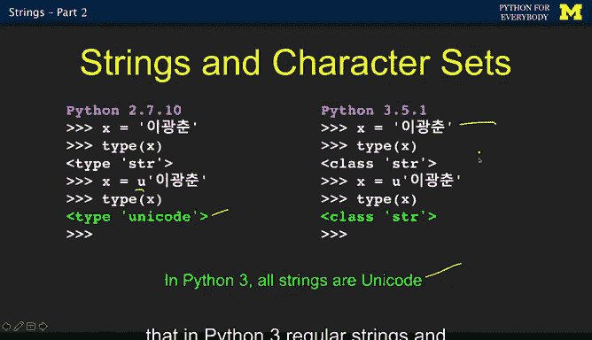

# 密歇根大学《给所有人的Python课》课程2：《Python数据结构课程（密歇根大学）》｜python-data｜ - P3：03_01_02_操作字符串.zh_en - GPT中英字幕课程资源 - BV1yP411a7TZ

So now we're going to do some more things with string because string manipulation is a lot of programs。

 numberumber manipulation is one kind of program and string manipulation is generally another thing that we do in programs。

 So let's just the plus we've been doing that where it sort of looks to the left。

 looks to the right con catnates。 remember there is no space in here。 If you save like print。

X comma Y。 The two things come out and there's a space in between them。

 but that's not what's going to happen here。 This plus says concatenate these two things。

 and it literally does it。 So if you want to put a space in between， you have to say， you know。

 a concatenated with a space concatenated with there。 And so we've explicitly put the space in。

 So string concatenation truly concatenates the strings together。

 If we added the space automatically， then you'd need a way to suppress that behavior。

 So you'd need some other operation that concatenated strings without a space。

 So we just say we got one way of doing it。 And if you want a space， put the space in there。The N。

 which is， I love so much in the for loop， is also usable as a logical operator。

 the expression is a little bit different。 And so instead of like， you know， in sort of variable in。

 it's like， this is asking a question。 And it's very much in a way， like， you know， double equals。

 which is a question or not equals， You know， these are leaving back giving us back true false or like less than or less than or equals or something like that。

 These are all questions。 Is this true， yes or no。 We use them in if statements。

And so here we make the variable fruit， and we ask the question， is the string an in fruit。

 And so in is an operator here， it's like double equals。

 But it it's really looking through and saying， is the letter in in fruit。 And the answer is yes。

 it is because there's that end there。 And so we get back a true。

Is M in the contents of the variable fruit。 And the answer is no， So we get back a false。

 And then it doesn't have to be a single character。 We can ask for a substr and says is。

Is Nan inside fruit and answer yes， there is。 And so we get a true back。 And so it's pretty smart。

 It can scan， and it finds whether or not these things are in there。

And we tend to build these things where we use them in if statements。 You know， if a is in fruit。

 then print found it。 So in this case。That's an expression that evaluates to true because a is in fruit。

 And so this code executes in the way you go。 This just little note。

 if you're using the interactive interpreter and you're using it。

 you actually have to throw a blank line here。 You don't need a blank line in real Python Like if you're writing in a file。

 But you know， if you type this and then you indent that， it works。 And then you hit enter here。

 Then it will actually run that whole block of code。 You have to give this blank line to convince it。

It's a situation where the interpreter， the Chevron prompt， is slightly different than a Python。

 the syntax， and a Python script。No， bigy， but I bet by now， you've probably figured that out。Okay。

 you can compare strings。 They make a lot of sense。 equal sign， you know， it just， you know。

 compares character for character less than and greater than have to do with the character set of your computer and the character set that Python is configured to use。

 So less than if if you recall， we did max and min and we learned that the uppercase letters are generally less than lowercase letters。

 right， So uppercase Z is less than lowercase A。 and that's going to happen if you do upper greater than or less than。

 Now， the thing that works， for example， that is， you know。

 consistent is if you have something like chuck。With uppercase C and Glen with uppercase G。Oops。

And lowercase， everything else。 it's going to sort right because because all the uppercase letters sort the right way and the lower case letters sort the right way。

 And but Chuck。And Glen。Chuck and Glen will sort the wrong way because the G is going to sort before the the C。

 but it's okay。 It makes some sense。 It's all consistent， but you can do this。

 but certainly doubled equal sign works just peachy fine。So。

Those are the sort of the basic operations we can do。

 but there's a whole bunch of additional capabilities that are part of what we call the string library。

 And it has do with the idea that strings are objects。

 and later we'll learn what objects are and learn a lot of stuff。 Just for now。

 objects are these kinds of variables that have capabilities that are kind of grafted onto or built into them。

 And so inside once we put a string in greet。 Python knows that's a string。

 If you use the type command， it would say， oh， class stir。

 that stir confer certain benefits and privileges。That strings are capable of doing that are different than what integers can do and different than what files can do and other kinds of types。

 right？And one of the things they can do is you can say greet dot lower。 Now。

 it's almost like saying youre like calling a function called lower。And passing greed into it。

But this is slightly different syntax。This is。Run a function lower that's part of the string object。

 the string class that is going to give us back a lower case copy。

 So what this functionally does is says make a copy of greet， but all lower case and return it to us。

 And then we're going to store that into zap。And so if we print this out。

 it's basically all lowercase and if we take a look at what's in greet。

 we see the greet is unchanged because this was make a copy。That's lowercase， a lowercase copy。

And so it doesn't change the original。 And even even a constant isn't a legit object。

 And we have it a lower method inside of this。 So this just prints high there dot lower。

 which gives us high there。 all lower case。 So we're good。 Okay。

 and so even constants have this sort of built in capability。 When we get there， we're going to call。

 you can look this up。 Look at O object。Method。Method。

 this thing is a method and or you can look ahead in an upcoming chapter and figure out what methods are。

 or you can just look on the internet figure out what methods are。

 and we will cover this in much greater detail when we get there。 This is foreshadowing。

 Now these are the Dr and the type are things we've done before。

 And so the type says it's a type stir。Class is an object oriented term that basically says this is。

Thing that's of the category string。And now Dur says what are strings capable of。

 And there's actually a bunch of things。 I don't show them all。 but these are a bunch of methods。In。

The class。Stir。This is a light version of an Oborian lecture。And these are just things you can do。

 So stuff。Dot blah， blah， blah parenthesy。 Okay， replace our find our step。 They're all here。

 There's a whole bunch of them。 And this Dur is not the best documentation for these things。

 but Python， of course， has wonderful online documentation that explains it。

 So they tell you what the parameters are。 And it stirs whatever variable like， you know， X or Y。

 you know， and Y dot replace blah， bh， old new Y dot R just for justification or split and we'll play with lots of these things。

 So we'll take a look at some of the more common things that we do with a string library。😊。

Capitalize， which is takes a string like， you know， ABC and makes the first letter ABC。

 or you could even have ABC is input and then output makes ABC capitalize whenever it's done。

 the first letter is capitalized。 That's what capitalized does。 Why you want to do that。

 Whatever It's already built in。 you could write a for loop to do that， but it's already built in。

 So we'll take a look at some of these things。One of the most common things that we do is use the find operator and it's kind of like in except instead of returning true false。

 it returns where it found it So the in says is the NA inside banana。

Or find says where inside the banana is an A so。We say fruit dot find。 It's a method within strings。

 And we pass in N。 And then Python goes looking through here and says， oh， there's an N right there。

 starting in position 2。 Now， it doesn't say there is a bunch of em。

 Later we'll figure out how if you really want to find a bunch of them using than called regular expressions。

 more foreshadowing。 But you find the first one。 and it comes back within number 2。

 So the position is where the N is positioned within。The banana is position 2。

 but that's actually the third letter。 So don't forget that。

 If you look for something that's not there。 Er no Z， you get back negative one。

 So that's our little indicator。 Our flag that basically says， did not find it， okay。

So that's the find operation。We already have played with the uppercase in the lower case。

 There is an upper that is effectively shouting。 Remember that greet doesn't change。

 There's a lower that goes all to lowercase。 Sometimes I tend to use these。

 when I don't exactly know and I want to do an if test to say。

 if here's a string and here's a string and I want to ignore the case， I say if the string to lower。

 if the string lower is equal to the other string lower， then I know that they're both lower。

 that they match ignoring case。 search and replace。

So this is an example where we have a you know hello Bob is in this variable。

 and we're going to call the replace method inside of the greet variable and give it two parameters in this case we're going to give an old and a new so that says go find all the bobs and replace them with Janes。

It doesn't hurt G。 Greek doesn't change， it gives us back a copy， and in that copy。

 all those characters replace so that what's in endster is Ho Jane。

We can replace all the O's with X's。 so that goes here and replaces that and replaces that。

 of course， greets unchanged， but then we get a copy of it with the O's replaced with X and put that in N stir。

 And so that's where we get hello Bob with X's instead of O's。

And it just shows that this is a sort of multi replace that goes through and finds all of the O's and replaces them。

 and there was only one bob， but it would have found if there was more than one bob。

 it would have fixed all the bobs and changed them to chains。

White space is something that we see the best way to think of white space is it's like spaces。

 but there are other things that qualify as white space， like new lines or tabs。

 there's other characters that you'll find in strings。

 especially if you start reading them from files， and so there's sort of crafty bits。

 the way that I think a white space is like here's something printed out and is's like ABC。D， EF。

 well， there's something here。And you can't see it。 It's like a clear letter。That's a white space is。

 If this were a white piece of paper， it would be white space。 It might be a tab。

 might be a bunch of spaces， whatever it's white space。 That's what white space means。

 It affects mostly spaces， but there are a few other characters that do it。

 So here we have a string that's got spaces at the beginning and end and strip pulls off the characters from both the beginning in the end。

 It it doesn't hurt the original variable， it just gives us back a copy with nothing there。

 and we can strip from the right side if we want， and then we can strip from the left side。

 And so that's a way of you know otherwise， you'd be right in loops to get rid of the white space like。

 oh， what if there are four characters or you know four characters in the beginning。

 I'm gonna to throw them away three characters in， throw them away。 be writing four loop。

 do this other thing can catate these things together。 It's like， no。

 why didn't they write a library for it。 Yes， they did。 They did。 They wrote a library for it。

 And so we're in good shape。 So again， these libraries are you got you got to use them。

 Otherwise you'd be writing crazy loops。 We can ask。

It's a real common problem to be scanning through a file and want to know only the lines that start with a prefix。

 and there is a built in method called Start with。Line dot starts with。

 This takes a parameter what prefix we're looking for。 And in this case。

 we get true back because it does start with please， Does it start with lowercase P。

 And then we get back a false because no it doesn't start with a lowercase P。 So it is a true false。

 We tend to use that in the if do starts with。Colon do something to the line and that way we skip a bunch of lines except the ones that start with the previx that we're looking for。

Now。Let's put some of this together， some find and some slicing。

 So slicing is the word for using that colon operator。 So let's take a look。

 So here is a big long string。 And you're going to see a lot of these in the later chapters of the book。

 We're obsessed with email messages in this class。 And so here is the first line of a bunch of email messages。

 The formatted of the word is the word from。Space， then an email address。

 which includes a name and an at sign， which is the organization， a space and then a date and time。

 which it was sent。 This is actually a real email message from a real person。

 That Stephen right there。 If you're ever in Cape Town， stop by U T。 He。He's there。

 That's where he's at。 I've been to U T。 And I said， hi to Stephen。

 People who've taken this course actually know Stephen， That's crazy， right。

 People who've taken this course are from South Africa， and they know Stephen。

 and they walked up and said， hey， Stephen， you're in Doctor Chuck's lecture， asked Stephen。

 you are in Doctor Chuck's lecture。 Okay， but that's not the point。 We're learning Python。Okay。

 so what I'm interested in is I want to extract this little bit from here to here。

 I want to go one character after the at sign up to， but not including the next space。

 So we're going to take a couple of steps。 First， we're going to say， okay， let's find the at sign。

 Where is that。Python goes and says oh， that's in position 21。

 so it returns 20 back 21 back in there。 and so we get 21。 That's the start。

 the character after that is where we want to start。

 Now the next thing I want to do is I want to say where is the next space after this Well it turns out and find you can put up a second parameter in and say that's where to start So this is starting here and looking for a space。

And says， oh， I just found you a space starting at the at sign。 So down comes 31 into here。

 We have basically 21 to 31。Which kind of boundary that gives us the boundary。 Now。

 here's the fun part。 We want to slice this out。 So slicing is like，oo chop oh chopa。

 So we're going to go one beyond the at。 So that's going to give us the little U at position plus1。

Through。Space position， but it's not really a space position。 It's up to。

 but not including the space position。 Laconis that came now， right， So we up to。

 but not including the space position。 We get exactly what we want， not extra stuff。

 And we get back The piece that we were trying to pull out。

 So you'll see how we sort of put these things together。 I must have written this same code。

20000 times in the last 30 years of search for something。 search for the start of something。

 Search for the end of something。 pullll the thing out。 Search for the start of something。

 Search for the end of something。 pull the thing out。

 And we'll find that there are actually better ways to do this。

 But this is kind of low level sort of doing it the hard way in Python。

So this is just a little bit we're talking about Python3。

 but some of you may have to work in Python2 from time to time and so one of the real advantages of Python 3 is that all the strings internally are what are called Unicode which means that they can represent a wide range of character sets in Python2 strings sometimes have to go through conversions there are two kinds of things and so in Python 2 there were regular strings and Unicode strings and so you'd indicate a Unicode string by adding this u prefix and these were different and sometimes you when you read these from files that wrote those to files you'd have to kind of go through some conversion and it was a little bit weird but the interesting thing is is that in Python 3 regular strings and Unicode strings are all just strings so every string inside Python3 is capable of representing all character sets and that's kind of cool。

 there will still be some explicit conversion will have to do。

But the conversion in Python3 we start talking to databases and reading data often networks。

 there will be conversions we'll have to do， but those conversions will actually make far more sense than the way you had to do it in Python2 So if you took my class in Python 2 and you're like here use this buffer thing and you say why should I use the buffer thing and like because if you don't use the buffer thing it won't work at least in Python3 we have a sense of external data coming from outside your computer needs to be dealt with in a certain way and it's quite predictable So Python3 does a really much better job on character sets than Python2 it's possible in Python2 but it wasn't as easy。

That's a quick run through strings。 we talked about the types and searching and looping。

 there's a lot to it。 we still haven't done anything useful and that's what we're going to do in the next chapter。

