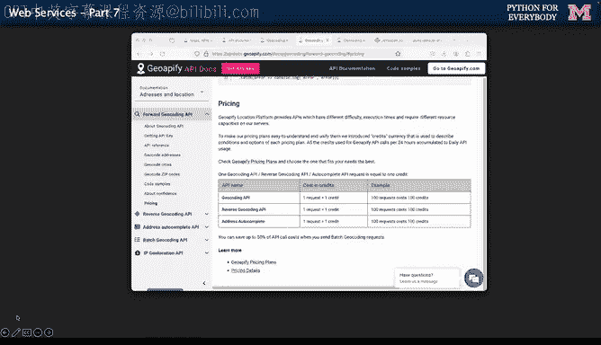
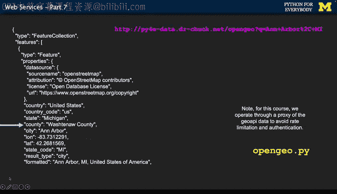

# 密歇根大学《给所有人的Python课》课程3：《使用Python访问Web数据》｜python-network-data｜ - P40：40_06_06_使用应用程序编程接口.zh_en - GPT中英字幕课程资源 - BV1Hu4y1e7WS

So now we're going to stop talking about application program interfaces or APIs in a generic context。

 and we're going to get real。 So there are lots and lots of APIs and there organizations that put up APIs。

 they sell access to the APIs APIs are a very， very valuable commodity。 And so。

 you know often you need an account to access an API。

 So we're going to use a kind of an open source open content。

 open database Opentreetmap and so opentreetm is kind of like the free and open version of Google Maps that's maintained by people all around the world。

 it's the concept of open。But even for OpenStreet mapap data， even though the data is free。

You need an account to access this particular API because we don't want to put up our own API。

 we could grab the data and update the data to run our own server too much work。

So but you can talk to this API in your applications， but there's a free level of requests。

 you got to make an account， and then you get a free level of requests。

 and then you can also pay above that rate of usage。 But for this class。

 you're not going to have to spend any money and I'll show you that how Ive how I've made that trick happen at the end。

 So this is called geo APIpi P。 and this is a location platform。 And if you look closely， it's just。

Geocoding of various things you can the example we're going to do is we're going to take a text address like Ann Arbor。

 Michigan， and we're going to look at where it's at。And then that's called geocoding。

 which is you're looking things up。 It's a common thing to do。

 I did it when I first built this class。 I had some data。

 you would enter it into a Google form where your city was。 And I just put it on a map。

 It was beautiful。 I mean， it's so fun to put stuff on a map。

 And so that's called address lookup and and that's called the geocoding API。

 There's a reverse geocoding API where you say like here is a location what's there。

 And there's a whole bunch of things right And so this is an API， very valuable API。😊。

And so the one we're going to play with is the forward geocoding API， like I said。

 it takes an address and it looks that address up and finds where it is in the world from the biggest thing that comes out is GPS coordinates right and so then you can we'll see later we'll make a map we'll put the stuff on a map。

 etcter for now we're just going to talk to this API in Python。

And so basically the idea here is they've got a playground and you can use this for free and you can use this as much as you like。

 basically where I've typed in an address and I had it looked up and so it shows you the data and it shows you the other stuff and so this is a playground and you can just play with this it's a lot of fun。

Now this is the pricing that basically tells you how many and this could change by the time you're looking at it。

 you know they get tired of free pricing and they want to change the numbers or whatever。

 but we're not going to actually have you in this class talk to this API directly。

 you're not even going to have to get an account， but you do need an API key and it's really easy to get one and all they really want in this particular thing for this API key。

If you're just using it at the free level， they still want to know who you are because they're going to track your usage。

 So if you don't have an account， they can't track your usage。 And so you have an account。

 they're tracking your usage。 And if you're doing whatever more than 100 per day。

 then they'll shut you off。 And so it's a way to keep the free thing free by having an account。

And again， I'm not going to ask you to do this， and the reason is is I've built a system that specifically makes it so that you don't have to talk to GeAP P and so I have built a proxy server and you'll see in the code it's called Ppheree data。

 and so what I've done is I've created an account on GeAP。

And I've encoded my account inside the server Ppheree data。 So when you make a request。

 you talk to my server without a password， and then I talk to Ge API with a password。

 Now I have a rate limit myself。but what I've done is I use this thing called Cloudflare。

 which is what's called edge caching， so no matter where in the world。If you ask for the same data。

 once you've asked for it once， Cloudflare keeps a copy of it。

And it keeps a copy in servers that are scattered all around the world。

 So your code is really talking to Cloudflare and when when Cloudflare has a cache miss。

 Cloudflare talks to P for E data， P for E data has an extensive cache and when P4E data has a cache miss。

 it goes to GeAP。 So the bottom line is is that I make it so that you can do things really fast with no account and rarely do I actually ever talk to GeAP。

 the only time I do talk to GeAPpi is you know when you're asking for something that hasn't been asked for before。

And then if you do that， I have my own rate limits and so at some point it'll just shut you down or slow you down or to tell you it takes what one of the things that it does when I have a cash miss in P free data。

Is I make it really slow？So don't worry most of the time when you're running your applications。

 you are talking and you're getting data that's already been cached on Cloudflare。

 which is free infinitely， infinite bandwidth for free， which is kind of amazing。

 The point is is sometimes with APIs， I'm jumping through a bunch of hoops and I wrote a bunch of software just to avoid you hitting rate limits on the geo API data。

 Okay， so。You can just type this URL into the browser， H TTP， probably HtDPS P free data Chucknet。

 and this Q equals that's a query parameter。 And so if you type that。

 you get this data and this data。Tells you where Ann Arbor is。 And so it's Json。

 We've talked about Json。 and the outer thing， the outer curly brace is an object。

 And then we have features， which is an array of features。 And generally。

 the sub 0 feature is the one that's interesting。 And so if we go into features sub 0。

And then we go into the lawn and L O N and L A。 We see the longitude and latitude of Ann Arbor。

 Michigan， and we see other things。 So， so maybe if you mistyped Ann Arbor， Michigan， it might。

 you know if， if I like had an An with an E at the end of it， it might say， well。

 you really meant Ann Arbor， Michigan。 And then you can see like that formatted， says， oh。

 that's the real place you're getting in case you might have made a typographical error。

 And it tells you a county it's in what country it's in， et cetera， et cetera。

 So that's just you and a browser。

Now。You and Python can do the same thing as we've been talking all along with like requests。

 and so I have this service URL。And that's the service URL with a little question mark that says it's a query parameter and I'm going to ask for a location。

 Anover， Michigan， you can see that's what I typed in and it's a for loop so you can type over and over and over again and then it cleans up the data and it creates the Q parameter Q equals address and then it adds with URL encoding that's where little percents happen。

 there' you get these percents like percent 2C， that is URL encoding for a comma and a space okay。

And so that's the rules of URLs URL encoding， then it retrieves it。

And then it reads the data with a decode。 and if you recall。

 the read gets you the raw data and the decode says， I mean this to be UTF8。

 and then then the data internally is just a Python string。

 And I have a print statement that prints out how much data we got and the first 20 characters of said data。

And you can see that in the output as well。 And then I do a Json parse with Json load S。

 And that data is just a string。 And then the Json is basically。Dictionaries a dictionary on a list。

 et cetera， et cetera。 and that goes back to that in the previous slide。

 it shows all of that data in curly braces and square braces。And so then this next line。

 La equals JS sub features sub zero， sub properties， sub La。

That's basically working through a hierarchical set of dictionaries and lists。

And whenever I'm writing code like this， it takes me a little while， so I'll print out JS。

 and then I'll print out JS sub features and then I'll print out JS of features of sub zero。

And then like I might say， I might mistakenly add la after0 and it'll be like that's not there。

 And I'm like， oh wait， I got to do properties subla。 So this is a little tricky to get working。

 And if you， if you have to do it yourself， you have to kind of have the JsonN on one screen and type in the Python over and over and over again。

 And eventually you figure out， okay， that's the magic string to extract a latitude out of this particular return value from this particular API。

 And so I also print out the location， you know， I go into that formatted field and again。😊。

Writing these last four lines of code takes a little bit of effort， but it's not all that bad。

So in summary， in this whole chapter we've talked about service ored architecture。

 how we break applications into parts and distribute them across the network。

 the API is like a contract， we've got web services that are various ways we have sort of XML and soap and rest which isR in JSON or pretty much the modern way of doing things soap and XML are a nonmodern way。

 I just include it because。Someday you're going to have to talk to XML and you might say。

 why isn't it rest， And like we talked about before， there's reasons to use XML。

 XML has certain advantages， and we've talked about two serialization formats， XML and JO。Cheers。

