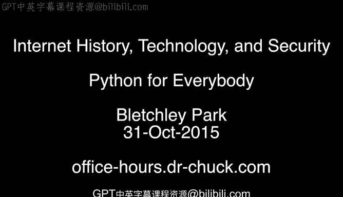
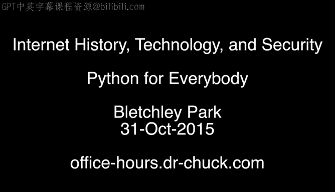

# 密歇根大学《给所有人的Python课》课程3：《使用Python访问Web数据》｜python-network-data｜ - P44：44_06_03_特别课程重聚_布莱切利园.zh_en - GPT中英字幕课程资源 - BV1Hu4y1e7WS

Well hello we are at Bletchley Park where computer science。

 Internet history technology and all of computation started here at Bletchley Park and we've had a very special record setting office hours and I want you to meet your fellow students okay so here we go so howdy state your name and hi I'm Steve well also but you should say that you're somebody special you're not just Steve well I'm one of the mentors for the Python course all of them so welcome Steve it's an honor to have worked with you all these years right and Steve。

Steve。Steve is the one that does all the hard work I get all the credit and people like Steve and other mentors。

 they actually do the hard work so thank you Steve thank you so much well thanks for inviting me down with your help it was brilliant Yeah so say hi the rest class hi hi I'm Bonoir originally from France I live here in London'm very happy to be here。

And M you Dr Chuck， I'm happy to meet you I've done the internet history class I really loved it I'm really keen to do the next one on the Pis on there Co and don't worry it's a very wide angle so I'm not really taking a picture of your nose I'm Craig I'm doing the Python web data and see you online。

😊，Did you get in trouble when that guy come talk to you really you're okay though they're going let you come back I'm Steve I've done the Python first Python course and I've got to be doing some of the others soon and I found it really really useful in getting my way into the language whichs really helpful thanks。

Hi I'm Jenny and I'm a software developer and I use the Python for everybody course to teach a programming class at an international school in Chiang Mai Thailand and it's good to be here at Bley Park England you know that the books translated into Chinese right does that work in Thailand not so well Okay so I guess I'm not that cool so Okay？

😊，Hello， I'm Ano from Charless。I work in my university as an aduino instructor and because of the Python class。

 I forgot the syntax of Arduino that was embarrassing in my job mean processing。I mean。

You don't use processing anymore， use Python instead of processing。Now I use the Arduino。

 I'm supposed to do debugging at the university。They held the swimminglon everywhere。

 and then I forgot it in the Python。Well welcome， did you travel from Paris？Yeah。

You came from like Paris to here。I guess it is from Eurostar。

 it's not like coming from Australia right， I guess it's not someone beats me no no no。

 I'm not saying no no， I'm saying you're right， Eurostar Paris is than we Paris is closer than we think。

Kevin， I've only come from London， but it's been really good to hear how Co Sarahs put together and how you make the course and thank you Well thanks for coming。

Hi， I'm J I'm Su are from China China your students yeah we are working in the UK at the moment Okay。

 so it's nice to meet you here at Bley Park and Python Court is great cool。Hello， I' Jannis。

 I used to work with Python for a long time， but it's the first time that I'm taking a course just to see the language properly。

 Thank you。 Hello I'm Mi。 I use your courses to refresh my computer science knowledge。 Yes。

 I' learning Python with you I've been come to Bchley Park at least five times like you I'm you're a fan like me。

 I would have loved to have worked here during the world。' been so exciting。 Yeah， you know。

 three courses of people here were women。 Yeah， very impressed。

 He don't have the most interesting jobs of them， but we' exactly exactly。

Hi I'm Patrick I did the Internet history course and it's a very exciting day for me today because when I did that course I said I wanted to go to Bletchney Park and I'm here today and I also said I wanted to come to one of Dr。

 Chuck's office hours so I got to do two at once today which is quite brilliant Yeah one of my ideas is that this is our class reunion Yeah that was kind of I was thinking hey we have a class reunion Hi I'm David I've taken your poython courses on you into history course loving welcomee glad you're here。

Hi， I'm Paul and I've done the Python courses and they're great， thank you。

Hi I'm Hugh from Cambridge and I've done your Python courses and I'm currently doing the web one very excited to be here with you and it's great to try and teach kids so I'm actually learning it because my son's doing Python for his exam so hope I can help him right you're like you're like only like a couple of blocks away from Raspberry P headquarters right there in Cambridge and they're doing Python stuff there too as well big time Yeah I like to get that all connected somehow I think of a cunning plan yeah。

Hi， I'm Roger， I've done the Python Verybody course and I've just started the web one and I'm really looking forward to getting right through it cool。

Hi， I'm Dos。I come originally from Poland， I live here in the UK。

 I just started my journey with the Pyton， I should say thank you very much for everything you're doing this。

Really， really good stuff。 And so here's the question。

 Do you know the history of Bletchley Park and three Polish cryptographers Oh very falls Well。

 but everybody whose's historians here have done a really good job of making that clear。

 which brings me to the next question you're going come office hours。

I a of there I well I we' I go many places， soll maybe we'll figure that out one more thing Okay。

 hello to my wife and two daughters。There you go。Hi I'm Maddie I live just north of London I took the first Python course so I could keep up with my little boy who was learning it at school basically Great lovely to meet you well lovely to meet you。

😊，Hello there my name is Andrew， I'm a pensioner just doing the Python course for interest and I'm hoping to combine that with。

Little projects I've got with the Raspberry Pi， but I think the the Python course is a gripping course。

Well， you're very young for a pensioner indeed。F too far the my 70s。Hello， hi'm Madam。

 I'm king with my family and I've just started to learn a python。I black to was in my， biology。对对。

Work and later I would like to teach my daughter programming Yeah， at some point。

 that'll become normal。 Yes just on next generation of cold breakers exactly important to bring them to the ground zero ground zero ground zero it all and and in the future it will be so much better。

 were we break this ground and it'll stay broken。Deitely。i I'm Alice。 I live in Bristol。

 I did Bristol。 That's far away。 That's that way。 It's a couple of。

 I did the Python course a few months ago and I'm gonna do your new one that you've come the great course3 course3 looking forward to seeing you course3。

 they're good I tried some ones from Co and I have to cut that maybe I won't that part out。

 I'm it's nice in real Finally I'm an analyst I hope to be able to use your work learningy and to my work。

 I'll follow you to Capstone I pretty great Well hopefully I'll figure out the capstone by the time we get the capstone。

 I'm David I'm fromki Liverpool。 is a learning I'm interested in doing the Python to bring my program to I'm a learning technologist myself。

😊，Hello， hi， I'm Cynthia。 Yeah， and I'm taking your Python course， which is excellent。

 I highly recommend it for anyone who wants to learn programming。

 And I'm on a career break right now， raising。😊，I didnt in Tacho。Hello。

And it's been great for maintaining intellectual sanity。

That is a use case that's very important actually。But your career has something to do with like nuclear reactors or stealth aircraft to bit mass spectrometry。

 Oh mass spectrometry， whatever I knew was complex without the computational。

tro Well mass spectrome is a needle and hayst problem and if it weren't for the programming we couldn't make any sense of that data and I never knew how to do that before and I hope when I go back I'll actually know what I'm doing great great。

That's a great way to do a career break。Hi， my name is offpen。 I'm from London。

 and I've done the Internet and history technology course。

 and I'm looking forward to doing the python。 Great， great。 Do you want beyond Are you hiding。

 It's just my wife Okay， okay， you're the photographer。 Okay， so so we'll get a wide shot of you all。

 give yourself a large round of applause for like your awesomeness an initiative and and。😊。

So there we have it， the first perhaps of many class reunions here at Bletchley Park。

 so see on the net。

