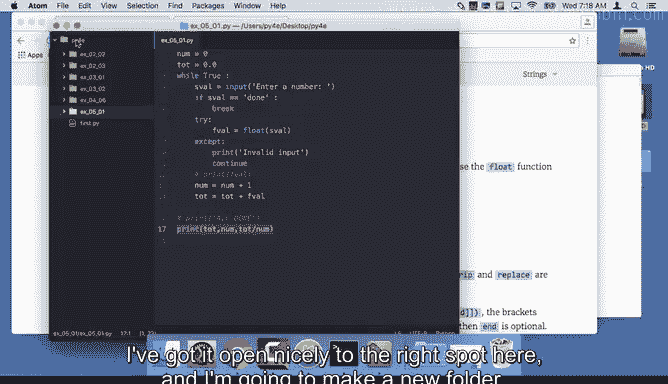
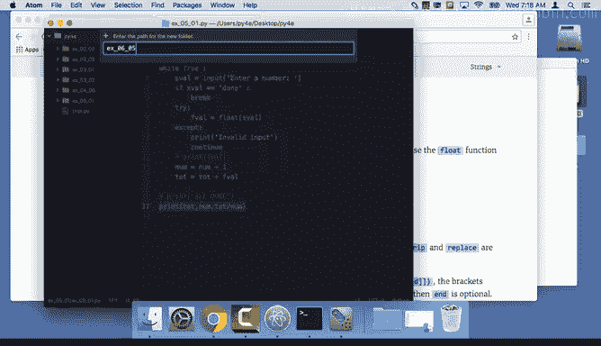
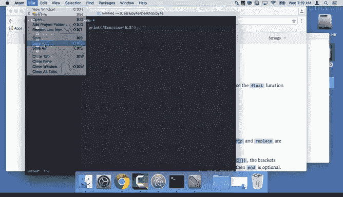
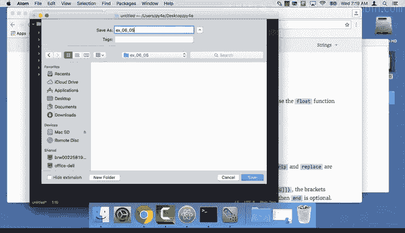
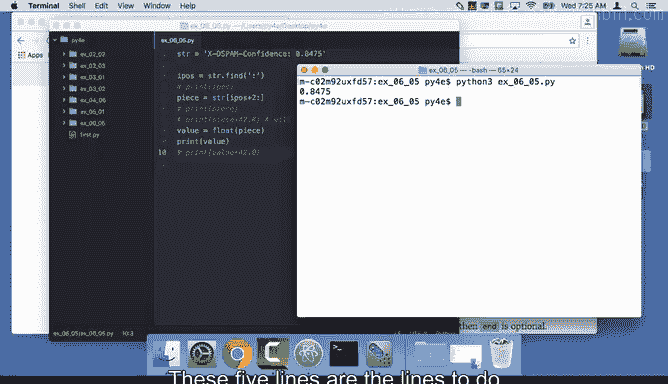
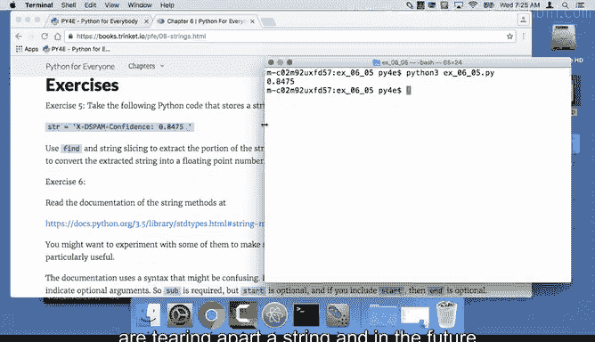

# 密歇根大学《给所有人的Python课》课程2：《Python数据结构课程（密歇根大学）》｜python-data｜ - P4：04_01_01_字符串练习题讲解.zh_en - GPT中英字幕课程资源 - BV1yP411a7TZ

Hello and welcome to Python for everybody。 My name is Charles Severance and I'm the author of the book and the teacher of this class。

 in this particular session， we are going to do exercise 6。5 from the textbook。

 it's an exercise in parsing text strings。And so the basic idea is is we're going to see strings of various kinds in various lengths and we're going to want to extract pieces of them okay and so the idea is to somehow get this part out and then convert it to a floating point number。

 this is a proxy for later things where we're actually reading files or reading stuff off the internet。

 but parsing strings is an important thing for us to do。

And so let's take a look at a couple of different ways to do this。So let's go ahead and get started。

 let's go bring up our atom and I've got it open nicely to the right spot here and I'm going to make a new folder。

 hopefully by now you're finding Adam EX 0605 Adam or whatever your programr editors is sort of a powerful a powerful tool。

 I'll close this one。

File， new file， a powerful tool that lets you sort of save a lot of keystrokes， et cetera， et cetera。

 print。Exercise。6。5 just for yuck。Yeah。嗯。izeAnd then save as， and again， until I save it。

 it's not going to have the pretty colors。

Im want to save it in。6，05。EX0605。pyy。

And now it has the pretty colors and here I am now I've been doing these and so now I'm actually already in a directory。

 so let me show you how to do relative directory so I'm in this path right here and I can use both in Windows and in Mac and in Linux I can use the command CD dot dot that sort of thinks of the one before the one that came before and so now I'm up one directory。

And if I do an LS， I will see that this new EX0605 that I just created in this directory from Adam is already there。

 CD EX0605。In the next chapter we'll be talking about files and this is where you really need to know this concept of folders and files so LS。

And I'm going to run Python 3， EX 0605。Dot py。There we go， Ex 6。5。So we're sort of in the right spot。

 we've got this going and we've got this going pretty soon we'll be putting stuff in these directories that need to be there and you'll see how all that'll work in a second well in the next chapter where we've got to know all this stuff。

Okay， so we'll just grab this first line here and paste that in。Print， stir。So。Let's run it。

And there we go。Actually， there's supposed to be a space right there。

 so I don't know why this space didn't get copied and pasted from my copy and paste。

 so I'm going to put that space in。There's supposed to be a space right there。I think， but。We'll see。

So the key thing is if you look at the lectures from this section。

 you can like look for things and you look for a pattern and so what Im going to do is I am going to look for a pattern that says。

 find me a colon。And I'm going to say。Where is thereicco。Equals stir dot find。

And then print out iPos。So I' going to say， where in this string is there a colon that's going to give me the position and offset of that。

So that says that the colon is in position 18。 now it's not always going to be 18。

 sometimes these strings will be a little bit different， okay。

So the next thing I can do is I can say a small piece of this string is do stir and then starting from that position I pose through the end of the string。

And then we're going to print that up， print out the piece。And when I'm doing string parsing。

 tearing strings apart， I tend to have a lot of situations where I print over and over and over again。

So now let's see if that piece is the right piece and the answer is it doesn't quite look right because see I've got that colon there and that's because it says start 18。

 position 18 wherever that is and then keep on going and so I need to do i pose plus one so let's see I'll just sort of advance past this little colon character and get into that space okay。

So let's run it， so now I've got space 08475。And。Now I can just see value equals float of peace because peace is a string。

It's a string， and then I'm going to say print。Value。To see if I got the value right。

And let's remember that there's a space here， this might mess up float。

 I don't think it's going to mess up float because floatat's trying to find a floating point number and it kind of。

 but let's just see if it works。Let's just see if it works。Okay。

 so the key is there is it's in position， the colon is in position 18。

 the string we pulled out is blank 08475， and the floating point number is 0。8475。

 So we sort of solve this。 Now I can clean this up a little bit by making that plus2。

 So let's just I'll just change that to plus 2 and you'll see how that changes what I'm doing。

And so now this this here is the string that one there is the string。

 this is the actual floating point number， they they're the same thing other than the fact that it's a floating point number and you can add something to it so I could do something like print。

 you know。Value plus 42。0 and that would。That would actually work， right， so 42 point。 and if I did。

Print。Peace。Plus 42。0。That。Will blow up right because piece is a string and 42 is a float and says can't float。

 can't convert float object to string implicitly okay and so other than sort of taking out this extra stuff。

just。Commenting on a whole bunch of stuff here。So I take out all those print statements these five lines are the lines to do this particular assignment where we are tearing apart a string and in the future the source this is just so that we can play with strings but later we'll be taking this data from all over the place Finally we're going to start opening some files and then later in the course we're going to be doing opening data from databases we'll be opening data from the internet and so there's all kind of sources of data where we get these strings。

 but for now we're in chapter 6 and we're only focused on strings so I hope you found this useful and coming up soon will'll be opening files。

