# 密歇根大学《给所有人的Python课》课程4：《使用数据库进行Python编程》｜python-databases｜ - P4：04_01_02_Windows系统截屏操作.zh_en - GPT中英字幕课程资源 - BV1PP411W7H1

Hello and I'd like to talk to you about how to use the s Snipping tool to do a screen capture。

 there are other ways to do this， but the easiest way is the built-in screen tool and I'm doing this on Windows 8。

 the Snipping tool exists on earlier versions of Windows as well and so the gestures in the UI might look a little different but it's about the same you find the Snipping tool so I'm going to hit the Windows icon and I'm going to type the SN and it brings up the s Snipping tool。

 and so here I go and it's giving me this option to say Snipping tool and I'd like to say I'm going to do a new Windows SNip。

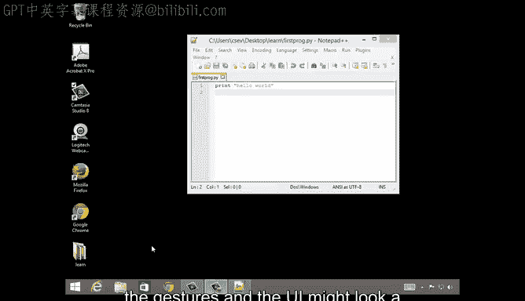

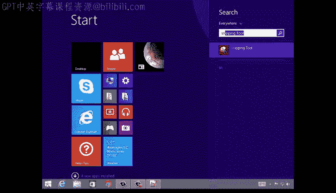

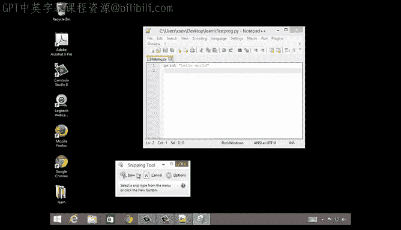

And now it's kind of grained out the screen and following me around with this little red line。

 and I click on this， and it is made a copy of of that window Now' this is snipping tool is just the snipping tool。

 that window still exists。

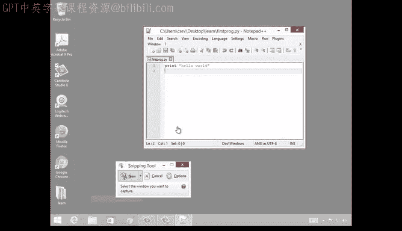

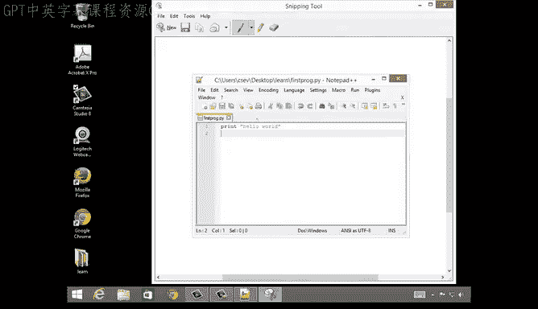

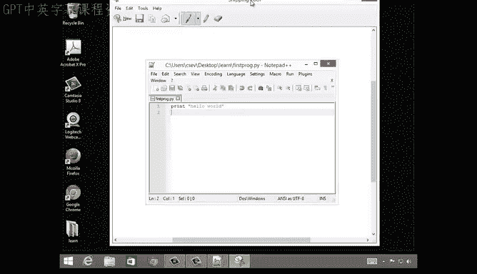

But this is now， Bill I didn't want to do that。This is now just a drawing tool that's。

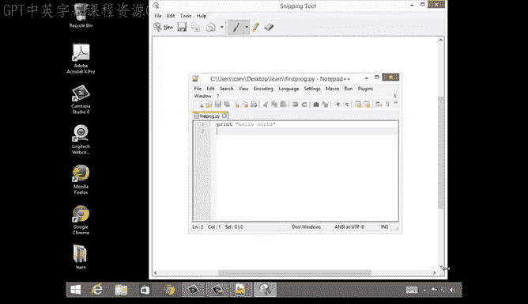

And so so here you are。 we could save this。 but the other thing you can do。

 and this is in the more recent snipping tools is you can make changes。 So let's say， for example。

 you didn't want to show your name and your name was in this path。

 And so I will just go and scribble my name out like with this little scribbling tool pretty sweet So I scribbled my name out。

 I just happen to have my name in it。 So I didn't I just didn't want to put it in。

 So now I'm going do file。Save as and of course find somewhere I'm going to put this on my desktop and I'm going to call itNotpa do PG Now you don't have to put the suffix of dot PNG or JPEG but it's good if you're moving files between systems to put these suffixes on you know Windows would know this was a P&G file。

 but dot PNG is a way to nicely tell other systems when you're moving it around it's a PG file or if you send it as an email or whatever。

So I save it， I'm saving it on my desktop。And there we go。 So it's it's hiding the dot PNG。

 but I can look to make sure the PNng is really there。 and so there it is， it's a dot PNG。

 And so there's a file and a away we go Okay， so there's the ninipping tool if I close this window and I click on notepad you will see that。

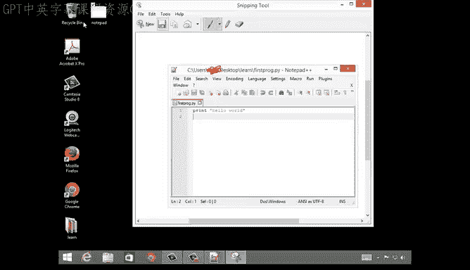

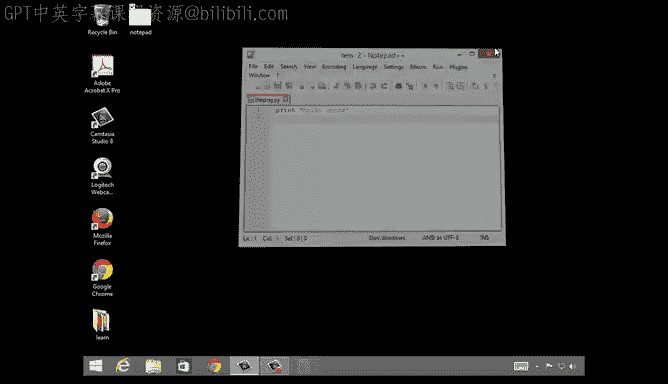

It's got the little scribbling thing， thank you for that Okay， so there you go。

 that's how to do a real simple snipping tool。

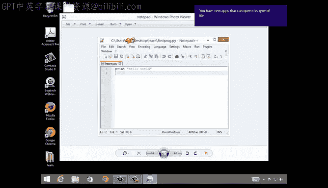

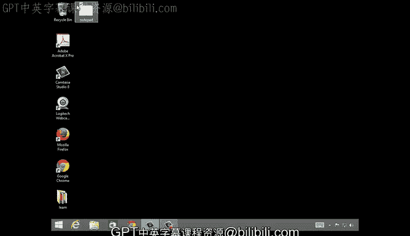