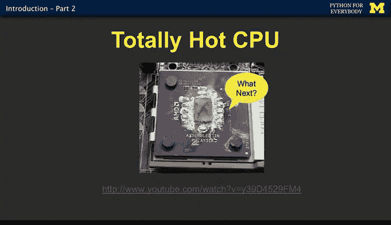

# 密歇根大学《给所有人的Python课》课程1：《编程入门指南（使用Python进行开发）》｜python｜ - P4：04_01_02_硬件概述.zh_en - GPT中英字幕课程资源 - BV1214y117Mk

Welcome back。 Now we're going to talk a little bit about hardware architecture。

 You might ask yourself sort of why all these terms and words and central processing unit。

What I want from this section is I just want to define a few terms so that I can use them in the rest of the course。

 That's really it。 I want you to have some sense of the basic block diagram of things。 Now。

 in the old days， I'm going to show you three generations of hardware。 I'm going to show you。

Really old hardware from the 60 and 70s。 I'm going to show you sort of medium old hardware from the 90s。

And early 200s。 And then I'm going to show you sort of super brand new hardware that's sort of this is a raspberry pie。

 And it's the kind of highly integrated hardware that goes into things like the cell phone。

 So I'll kind of going back and forth between three complete generations of hardware。

But the picture in the concepts that I want you to understand is these are these terms。

 central processing unit， main memory， secondary memory and input output devices。

 So we'll start with input output devices。 they're the way that this computer access to the outside world。

 So things like。The mouse。Keyboard， output devices， screens。

 And that's sort of how the humans in the outside world interact。 Soft， the main inside the computer。

 we have the central processing unit and the main memory， and then the secondary memory。

 And so it's probably easier for me to take the the not neither the oldest nor the newest to give you a sense of what's going on here。

 And so if you had a desktop。 And maybe you still have one of these junky old desktops at home。

 They're the ones that are big and they make noise when they start up， they have in them。

 a number of different parts。 And the closest thing that a computer has to intelligence is this central processing unit。

 CPU is what we call them。And if you look at the backside of this CPU， it is actually a circuit。

 It's a highly sophisticated circuit with millions of transistors on it。

 And you probably heard that millions of transistors， it runs。

 maybe 3 billion instructions per second。 What does that mean， Well。

 that means that an instruction is a set of electrical pulses。

 maybe 32 little wires or 64 little wires and at 3 billion times a second。

 This is programmed to ask what's next， And it pulls what's next in these little electric wires。

 Well， where does it get the answer to what's next。

 It gets the answer to what's next out of the memory。 And so your program when you write a program。

Let me draw this When you write a program， you create a file on the secondary member。

 like a Python file。 And then at some point that is loaded into the main memory translated。

 and then your program is here。 And then when the CPU says what next。

 your program feeds its first instruction。 And then when that's done。

 the CPU says what's next and feeds a second instruction。 Third instruction。 Four instruction。

 It's called the Fe execute cycle。 And these two parts。

 the CPU and the main memory are what participate。 And the main memory is where you kind of live somewherewhere in there。

 a little tiny version of yourself is in there， answering the questions that this is asking。

NowYou might say how smart is this。 it's not really， very smart at all。

 It's a really fast hand calculator with lots of storage is the best way to think about it。

 And going back to the 60s and the 70s， this is a piece of hardware from a computer that was the size of a room with probably 20 refrigerators all with modules that make this up。

 And in here， while you probably can't see it， you've got resistors。

 transistors and capacitors and then wires， the wires are all printed on this printed circuit board。

 otherwise known as PCB。 And so the closest thing this has to intelligence are these transistors and at the simplest what they can do is they can sort of make really simple。

 yes， no decisions。 And then they also can be used if you hook them together the right way to store a little bit of information。

 And so when we say there are millions of transistors packed into this little tiny square right here。

It's kind of pretty。 I mean， if you look at it， it's sort of it has like a looks almost like a jewel。

 It's so pretty And each one of those is a real tiny。Photo imprinted transistor。

 And so there are millions of this。 And so the difference between 1960 and today is this part gets smaller and smaller and smaller to the point where literally thousands of these things are all squeezed into that little square。

And。Coming back to sort of。The mid grade1。 So this one here is the motherboard。

 This part here is the motherboard， because it's the mother of all boards。

 and it connects everything together。 all these components plug in。

 And that's how they're connected together。 And there's a whole bunch of wires that go back and forth on this。

 And so this is how the your program， in a sense， is transported from the memory to the CPU。

 And so this motherboard connects them。 Another thing that's connected to the motherboard is secondary storage。

 Now， the reason we have to have secondary memory or secondary storage is this is designed to be really fast。

 The main memory is super fast。 And what happens is。😊，When the computer turns off。

 your program is erased from here。 And so I said， I originally said that you write your program and you put a file in here。

 a Py file。 And this is the same place that your word files are and your powerPos are。

 And then the P Y file is kind of loaded and translated into the main memory。

 And then when the computer shuts off， all this data goes away。 Second memory is permanent。

 This does not get shut off。 And so in the old days。

This old day stuff we used to store on our our programs and our files on a hard drive。

 And you may even have a computer at home where there's actual physical spinning platter of magnetic media and a little head that goes in and out to read and write the data。

 And so it actually records magnetically， when you put a file in， it records it。

 And then when the powers off the magnetic recording stays here。

 And so these these things physical disk drives。Are kind of going becoming extinct because all the data is in little USB sticks like this。

 And that's a perfectly good version of secondary memory。 But at least for us。

 we can look at these beautiful antique mechanical gadgets that we used to store data magnetically when the power goes off。

 Now， this one here is a pretty broken。😊，And it's pretty in bad shape。

 So it's probably not really storing much of anything。 So in the summary of this picture。

 the thing I really want you to get out of this picture is a series of definitions。

 The central processing unit is very simple， It's the closest thing computers have to brains。

 but wants to answer the question what to do next but we have to feed through memory， the answers。

 which is your programs。 and then we have input devices， output devices the main memory。

 and then the larger permanent storage in the secondary memory。

So where you live inside of a computer is basically in the main memory。 When you write a program。

 you type it in the computer you outside the computer are typing on your keyboard and you're typing Python commands into a file。

 like if X less than3 print， right？ And then that gets loaded into the main memory。 And so you。

 this is a creative version of yourself。 It's your instructions that are going to be run。

 and that program ends up in the main memory。 and then it's run。

 So this is sort of where you live inside the computer that's think of it that way。

 you're living in main memory when your program is actually executing。 Now。

 it turns out that the instructions that this main this central processor uses are a series of zeros and ones。

 And when I said like 32 zeros and ones or 64 zeros and ones。

 simultaneously are fed into this for each of the instructions。

 we use a language called machine language。 And I would love someday to teach you machine language。

 but we don't have time right now。 and that's more moving towards。😊。

being a computer scientist when you start learning machine language。

 but basically we don't have to worry about that too much。

 we write Python and we write in Python and then something effectively translates it into machine language and then machine language is the thing that runs and runs and runs and runs and so someday you might take a look for that but that's more of a computer science thing and the software that does this translation which is either called a compiler or an interpreter we could talk more about that when you become more of a computer scientist but for now we're going to worry about how to write this code and the rest of this sort of is going to fall by the wayside as we go forward so I got a couple of videos here。

This this one video， hopefully the YouTube URL is still good if not。

 we'll try to find another way to get you linked to a good copy of it， but it basically these。

 as I said。

There are there are millions of transistors in one of these things。

 and there's a lot of electricity going through these things。

 And when your computer heats up on your lap， it's this little part here that's working really hard。

 doing things 3 billion times a second。 So someone has made a video， not a very good video。

 but it's from a long time ago where you take the cooling part off and you watch what happens to these CPUus when when they're doing all this work 3 billion times a second using all this electricity and they're not properly cooled。

 Another cool video that we have is a video of hard drives。 and how they actually spin in reality。

 this one is totally messed up because I've been be on it for years and playing with it。

 using it all my classes for years。 So it's in really bad shape。

 But this video shows you how that works and how it actually spins in reality and you'll hear noises that if you had a desktop have or had a desktop computer you'll kind of recognize the noise。

 and then you'll have an idea of what's going on inside that computer as that secondary storage is moving around。

 And like I said， secondary storage is becoming less and less。😊。

Relevan as we move to solid state storage like the kind of storage that's in a USB state。So up next。

 we're going to talk about how we write that Python。 I talked a little bit about the hardware now。

 and now we're going to get started writing some Python。

