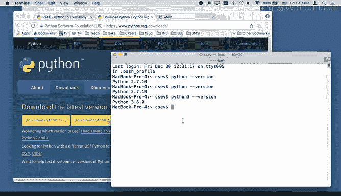
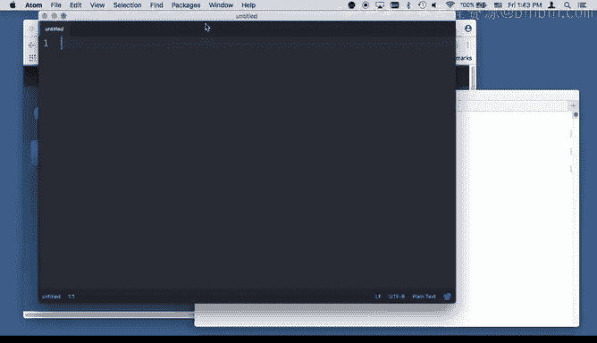
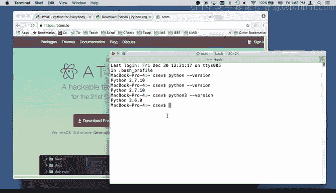
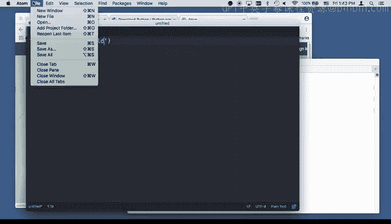
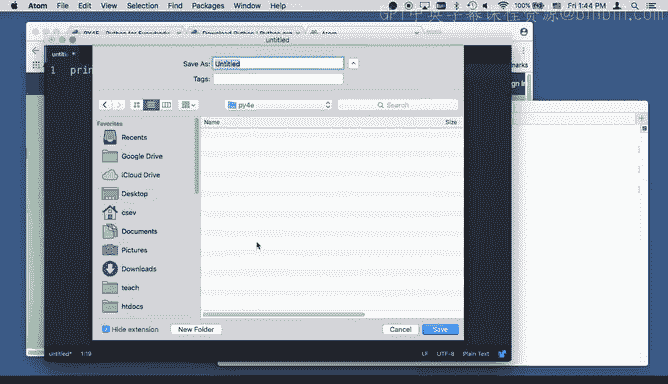
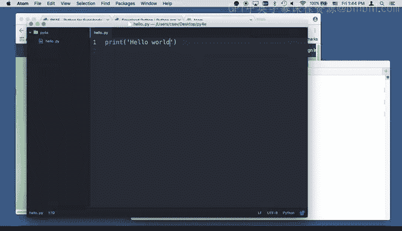
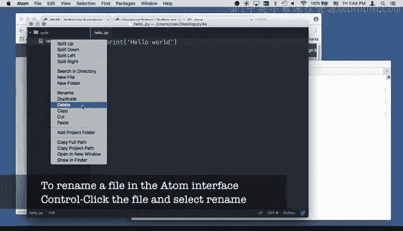
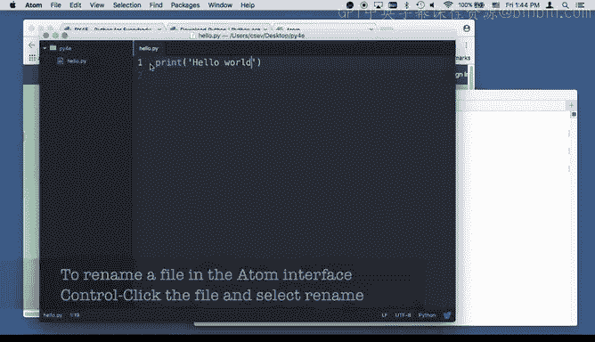
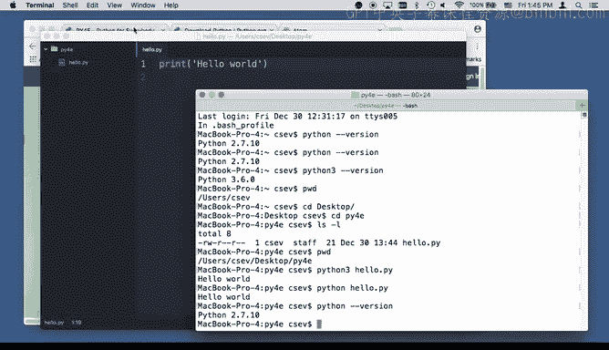

# 密歇根大学《给所有人的Python课》课程4：《使用数据库进行Python编程》｜python-databases｜ - P5：05_01_03_Macintosh系统使用Python与编写程序.zh_en - GPT中英字幕课程资源 - BV1PP411W7H1

This video， we're going to actually download and install Python3 from Python。org on a Macintosh。

If you your Macintosh for years has wonderfully come with Python 2。

 so if I type Python minus minus version。Then。I type that I see that I only' got Python 2。

0 what we want to do is in addition installed Python 3 one of these days。

Mtosh might upgrade their distributed version of Python 3。

 but there's so many things inside Mac that depend on Python2。

 I'm going to expect that it will always be named Python3， which is what we're going to call it。

In a second so Harry I' am at the Python。org downloads and I'm going to download Python3。

 you click here and I've actually got it sitting here in downloads already because I always do that and so so I'm going to install this。

There is the installer。Im going to say continue， continue， continue， of course I agree。

 I read all that really fast and now I'm going to install it。Okay。

So now that means if I run a terminal。So this of course it start run terminal。

 so Python2 is still there。But Python 3 is also now involved there。

 so we should have Python 3 installed， so we installed Python 3。

6 and so there we go and that's all it takes to install Python 3 on the Macintosh so let's write our first little Python program I'm going to I like Adam。

And so I've got this Adam editor， it's Adam。o。

Here Adam。 I download and install the at editor。 I like it because Adam works the same on both Windows Mac and Linux and it has syntax highlighting and so I really like things like that。

 So I'm going to make myself a simple Python program。

Hello world， like we always do。 Now you'll notice that it's not syntax highlighting yet。

 but I'm going to do a file， save goopy gazing。File， save as。

And I'm going to go into my desktop， and I want to make a folder called Py4 E。

I most call this call is hello dopyY。

Oh， crud。I got to rename it。

Rename it。I ended up with two dots。 Hello dot P Y。 There we are。 And so now I'm here。

 and I'm in my home folder， I go into my desktop， and I can go into that new folder。

 I made Python for everybody， and I can see the files。 Now， you， there are ways to run this。

 and I really don't。 I really want you to learn the terminal。

So that you really know what you're doing and so here we are。

 we are in the folder that has the Python and then all we do to run it is we say Python 3 hello do py and there we go and of course this is Python 3 because I'm using parentheses there so instead of double quotes but Python 2 is still there and of course if you just run Python hello do py it'll be a syntax error。

Or not， must be they added something。Yeah。Because Python is still version。Still Persian two。

 but apparently they allowed print in the latest version of Python 2 so so away we go。Okay， so again。

 thanks for watching， I hope this was helpful to you to get Python 3 installed on your Macintosh。

。