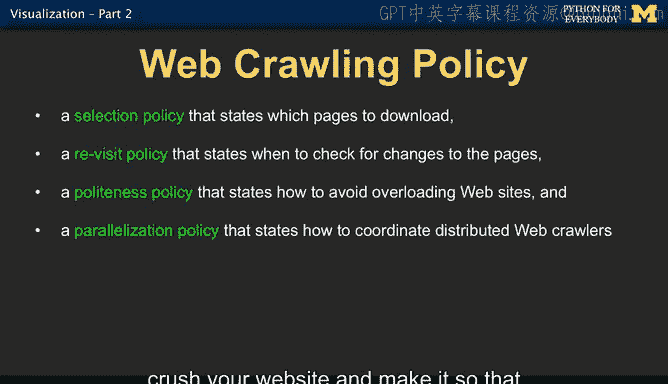

# 密歇根大学《给所有人的Python课》课程5：《毕业项目：使用Python检索、处理和可视化数据》｜python-data-visualization｜ - P5：05_02_01_PageRank算法概述.zh_en - GPT中英字幕课程资源 - BV1Eh4y1U7aE

So now we're going to write a set of applications and the code there is their page rank。

 zip that's a simple web page crawler and then a simple pet web page indexer and then we're going to visualize the resulting network。

 using a visualization tool called D3。 Js So in a search engine there are three basic things that we do first we have a process that's usually done sort of when the computers or bored。

 they crawl the web by retrieving a page pulling out all the links。

 having a list an input queue of links， going through those links one at a time。

 marking off the ones we've got， picking the next one and on and on and on。

 And so it says frontend process spidering or crawling And then once you have the data。

 you do what's called index building where you try to look at the links between the pages to get a sense of what are the most centrally located and what are the most respected pages where respect is defined as who points to whom and then we actually look through。

In this case， we won't really search it， we'll visualize the index when we're done。

And so a web crawler is a program that browses the web in some automated manner。

 the idea is that Google and other search engines， including the one that you're going to run don't actually want the web。

 they want a copy of the web and then they can do data mining within their own copy of the web it's just so much more efficient than having to go out and look at the web and just copy it all so the crawler just slowly but surely sorts crawls and gets as good a copy of the web as it can。

And like I said， its goal is to retrieve a page， pull out all the links， add the links to the queue。

 and then just pull the next one off and do it again and again and again。

 and then save all the text of those pages into storage in our case it'll be a database in Google's place。

 It's literally thousands or hundreds of thousands of servers。

 but for us we just do this in a database Now web crawling is a bit of a science。

 we're going to be really simple。 we're just going to try to get to the point we've crawled every page that we can find once that's what this application is going to do。

 but in the real world you have to pick and choose how often which pages are more valuable So in real search engines。

 they tend to revisit pages more often if they consider those pages more valuable but they also don't want to revisit them too often because Google could crush your website and make it so that your users can't use their website because Google is hitting you so hard。

There's also in the world of web crawling this file called robots。txt。

 and it's a simple website that tells that search engines when they see a domain or URL for the first time。

 they download this and it informs them where to look and where not to look and so you can like take a look at Pythonforever。

com and look at the robots。txt and see what my website is telling all the spiders where to go look and where the good stuff is at。

So at some point you build this， you have your own storage and it's time to build an index。

 So the the idea is is to figure out what pages are better than other pages and certainly you start by looking at all the words in the pages。

Python， word splits， etc cetera， etc cetera。 But the other thing we're gonna to do is look at the links between them and use those links as a way to a value。

 And so here's the process that we're going to run there's going to be a couple of different things and the code for all of this is sitting here in page rank zip the way it works is that actually only just spiders a single web page you can spider Dr Chuck co or you can actually spider Wikipedia。

 it's kind of interesting but it takes you a little longer before the links start to sort of go back to one another on Wikipedia。

 but Wikipedia is not a bad place to start if you want to run something long because at least Wikipedia doesn't get mad at you for using it too much。

 And so there's always all these sort of data mining things these crawling have this thing where it grabs basically a list of the So we end up with a list of URLs。

 Some of the URLls have data some do not and it looks for the know randomly looks for one of the unretririeve URLs goes and grabs that URL parses it。

And then puts the data in for that URL， but then also reads through to see if there's more links。

 So in this database， there are a few pages that are retrieved and lots of pages yet to retrieve。

 Then it goes back says， oh， let's randomly pick another unrettriveed file。

 go get that one pull that in， put the text for that one in but then look at all the links and add those links to our our list and you can if you watch this even if you do like one or two documents at a time。

 you'll might like， whoa， there was a lot of links then you grab another page there's 20 links or 60 links or 100 links And so。

You're not Google。 So you don't have the whole Internet。

 what you find is as you touch any part of the Internet。

 the number of links kind of explodes and you end up with so many links to that you haven't retrieved。

 But if you're Google after you know a year。 and you've seen it all once。 then your data more dense。

 And so that's why we stay with in this program we stay with one website。

 So we eventually kind of get some of those links filled in and have more than one set of pointers and the other thing in here is we keep track of which pages point to which pages little arrows and so these each page then gets a number inside this database like primary key and we can keep track of which pages。

 and we're going to use these inbound and outbound links。

To compute the page rank and that is the more inbound links you have from sites that have good a good number of inbound links。

 the better we like that site。 so that's a better site And so the page rank algorithm is a thing that sort of reads through this data and then writes the data and it takes a number of times through all of the data to get this page rank values to converge and so these are numbers that converge toward the goodness of each page and so you can run this as many times as you want。

 this runs really quickly this runs really slow because it's got to talk to the network and pull these things back。

 talk to the network and that's why we can restart this。

The page rank is all just talking to data inside that database， and it's super fast。

 And then if you want to reset these to the initial value， the page rank algorithm。

 you can reset that， and that just sort of sets them all to the initial value。 I think of one。

 they're also a one， a goodness of  one。 and then some of these end up with goodnesses of 5 and 0。

01 you know。And so the more you run this， the more this data converges。

 so these data items tend to converge after a while。

 the first few times they jump around a bunch and then later they jump around less and less。

And then at any point in time， when as you run this ranking application。

 you can pull the data out and dump it to kind of look at the page rank values of you know for this particular page has a page rank value of one these are it's dumping out this one has this one has probably just run the SP reset because they all have the same page rank after you've run it。

 you'll see when you run SP dump， you'll see that these numbers start to change and this stuff is all in the Readme file。

 it's sitting here in the zip file you undo that。 so the SP dump just reads the stuff and prints it out and then SPJson also reads through all the stuff that's in here and then takes the best the some 20 or so links with the best page rank and dumps them into jascript file and then there is some HTML and D3 js which is a visualization that produces this pretty picture and the bigger little dots or the ones with a better page rank and you can grab this and move all the stuff around and its。

Nice and fun and exciting。 And so we， we visualize， right。 So again， we have a。

A multistep process where it's a slow restable process。

 then a sort of fast data analysis cleanup process。

 and then a final output process that pulls stuff out of there。

 So it's it's another one of these multistep data mining processes。

 And the last thing that we're going to talk about is visualizing mail data。

 We're going to go from the embox short to embox to embox super giganttomatic。

 That's what we're going to do next。