# 密歇根大学《给所有人的Python课》课程4：《使用数据库进行Python编程》｜python-databases｜ - P6：06_01_04_Macintosh系统截屏操作.zh_en - GPT中英字幕课程资源 - BV1PP411W7H1

Hello and welcome to the podcast on taking screen shots on the Macintosh。

 nicely Macintosh has a very simple tool built in。 We go into Macintosh hard drives。

 we go to applications， and then we search down for preview。P P P preview preview right here。

 So preview， and I'll close this now。 So we've got preview preview the application that that was originally built to view Pdfs on the Macintosh。

 but it also has a whole series of screen capture capabilities。

 and I like to keep preview in my dock all the time。 So I come down here on the preview icon。And oh。

 it's already in my doc。 if I said， remove from doc， and then I would say。Keep in dock。

 It was already there。 As soon as I start preview， I always keep it in the dock。

 put all the things I need to use all the time in the dock。And so let's take a screenshot。

 I'll just sort of start a J edit program。And I'll say， take me。As a screenshot。

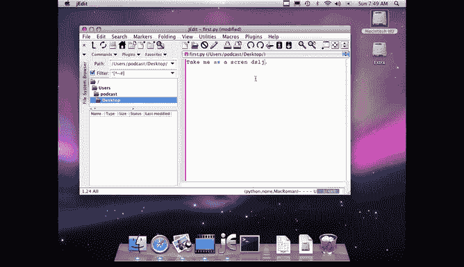

Whateverever。Doesn't matter。 Just， this is the window that I want to take a picture of。

 this window right here。

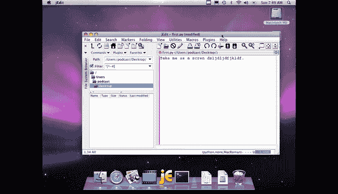

So I go to preview。And I say file， is and most logical place。

 You can either grab a rectangular selection in which you'll be allowed to draw with your cursor or a window or the whole screen when timed。

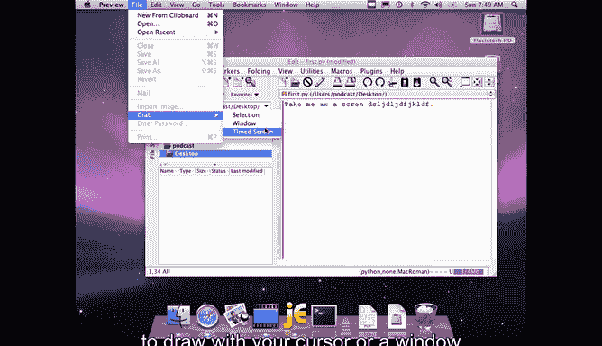

90% of the time what you really want to do is take a window， you say grab window， it tells you， oh。

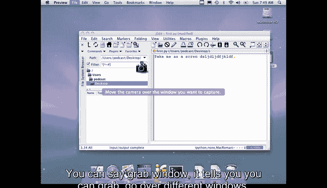

You know you can grab go over different windows。 I can click here。 I can click there and click there。

 And I just want to captureap this window。 So click， I go like that。 Now here's a little weird。

 This is now an image。 Okay， and so you can't click on this stuff。 Okay， that's that。

 So what you need to do。 I'm going to close the original real window。 Now， this is my J edit。

 I'm going to command Q to give rid a J edit。 And I do not want to save that file。

 So now I'm in preview。 See I'm in in preview here。 And so I've got this is as an image Now。

 the one thing it does is it always saves it to your desktop。

 which gets to be sort of painful as after a while。

 It gives them these long names called snapapshot that has the date and it stores it in this format called Tip。

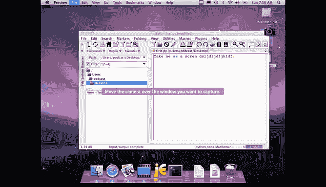

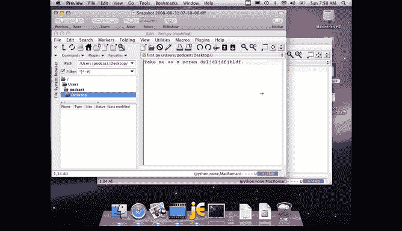

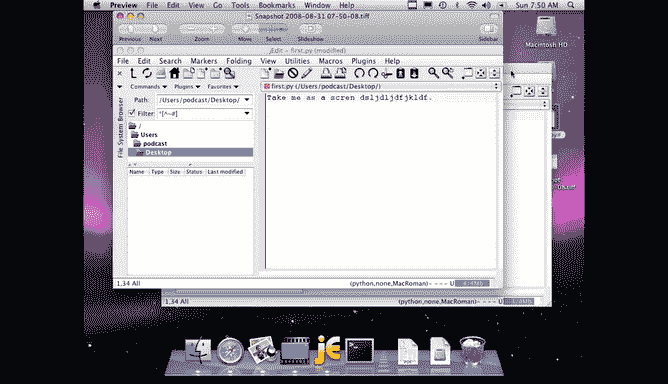

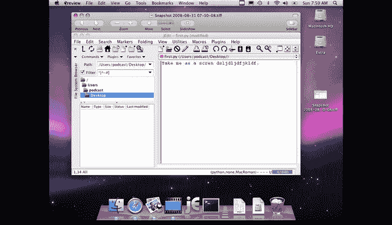

So I prefer to switch it to a you know non apple format， so I want to do a save as。

 and I'm going to say this， save this as a JpeG。And I give it a better name， called first。imageage。

And it'll be a JPEC， and I'm going to store it right on my desktop。So now here we have first image。

 okay， and I can click on that and take a look at it。 I'll close this， click on it。

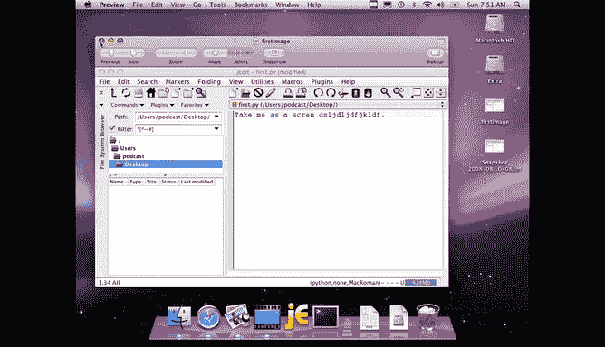

Interestingly， it just comes back up in preview。 So that's pretty much it。

 This would be the file that you would upload if your job was to do this。

 I'll show you a couple other tricks that I like to make my images a little bit better。

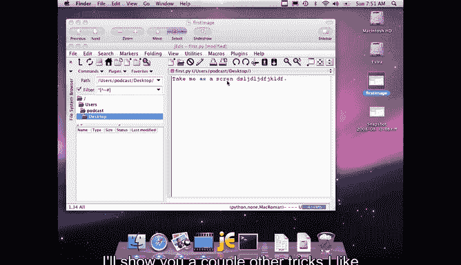

prereview has a simple tool for cropping and the way you crop something is you say。

You draw a rectangle here。

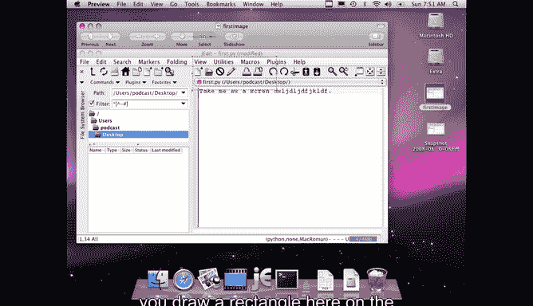

On image。And then you say tools。Crap。And I've gotten rid of all the rest of that image。

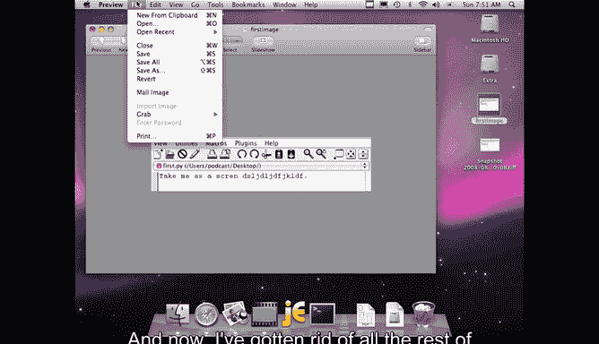

Except that， which I want。And I'll say， save this as。

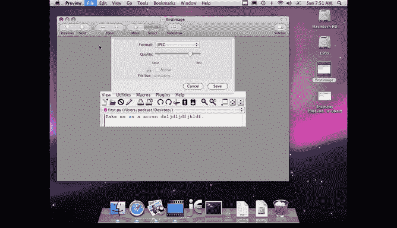

It's a jetit， and I want to save it as JPg， tiny。I'll save it is tiny。

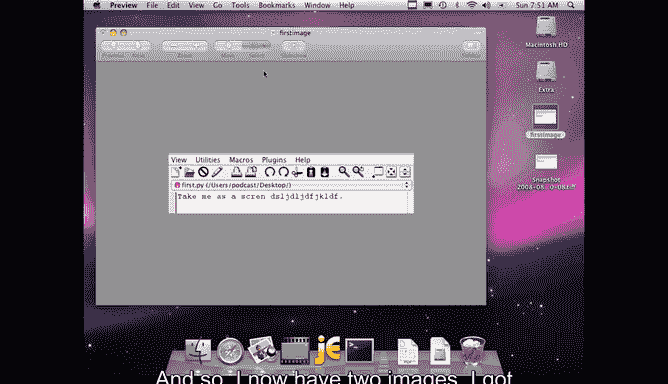

And so I now have two images， I got that first image and I got this tiny image and there it is。

I'll use command W to quickly close it。I really like I mean Apple W to quickly close it and so the one thing is is you just after a while。

 these snapshots fill up on your desk and so just keep cleaning them off。

And if you were uploading to。To hand in a screenshot or whatever this would be the file that you upload。

 So that's pretty much all there is use the preview command to take screenshot with the grab。

 and typically its grab window。 Okay， thanks。