# 密歇根大学《给所有人的Python课》课程5：《毕业项目：使用Python检索、处理和可视化数据》｜python-data-visualization｜ - P6：06_02_02_实例演练-PageRank网络爬取.zh_en - GPT中英字幕课程资源 - BV1Eh4y1U7aE

🎼Yeah。Hello and welcome to Python for everybody， we're doing a bit of code walkthrough and if you want to you can get to the sample code and download it all so that you can walk through the code yourself。

What we're walking through today is the page rank code and so the page rank code。

 let me get the picture of the page rank code up here。

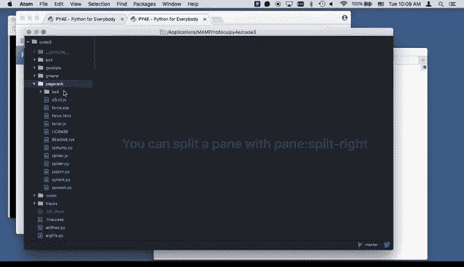

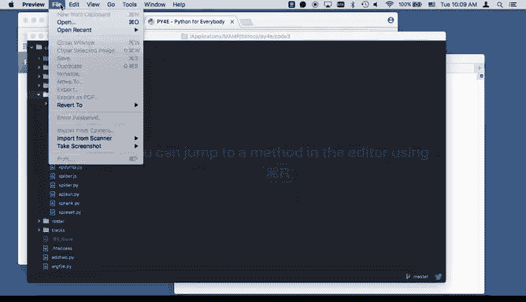

Here's the picture of the page rank code。

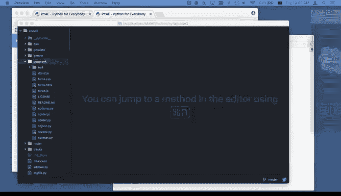

And so the page rank code is a has four chunks of code that are going five chunks of code that are going to run The first one we're going to look at is the spidering code and then we'll do a separate look at these other guys later so the first one we'll look at as spidering and again it's sort of the same pattern of we've got some stuff on the web in this case web pages we're going we're going to have a database thats sort of just captures the stuff it's not really trying to be particular intelligent but it is going to parse these with beautiful soup and add things to the database okay。

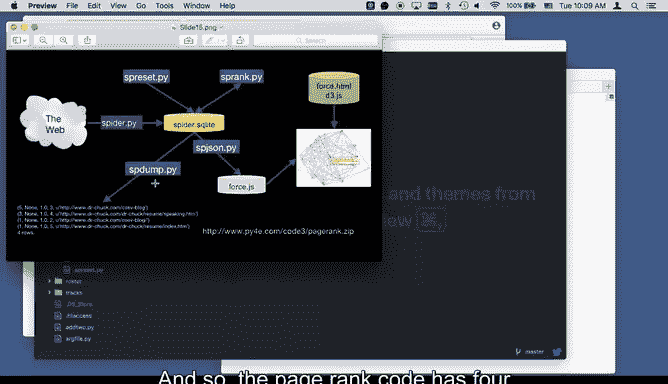

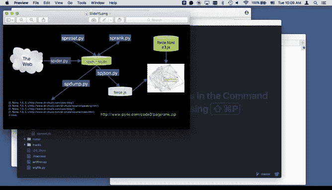

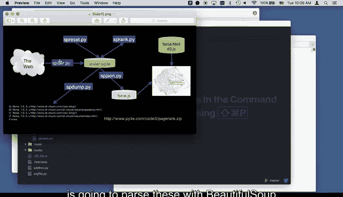

And so then we'll talk about how we run the page rank algorithm and then how we visualize the page rank algorithm in a bit。

 Now， the first thing to notice is that。

I've got to put I put the beautiful soup code in right here okay so this is you can get this from the BS4。

 zip file， there might be a readme but there's a readme somewhere。

 but you got to get used beautiful soup， you got to put this B4 zip or you have to install beautiful soup for your stuff so I provide this BS4。

t zip as a quick and dirty way if you can't install something for all of the Python users on your system。

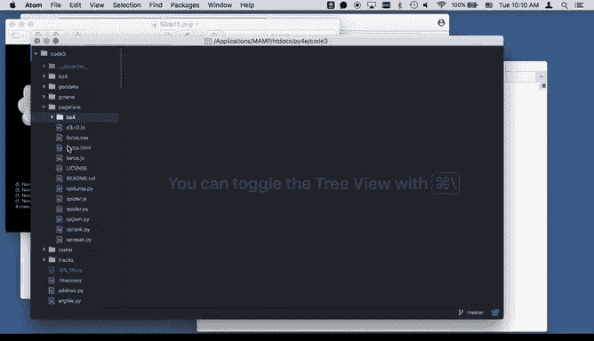

So that's what it's supposed to look like you're supposed to have it unzipped right here in these files and I don't know what damit。

pyy means that came from beautiful soup。If you look it's in their source codes， so I didn't。

 I'm not swearing， it's beautiful so people are swearing， I'm sorry I apologize。Okay。

 so the code we're going to play with the most is in this first one is called Sp。

pyy and you know we're going to do databases， we're going to read URLs and we're going to parse them with beautiful suit。

Okay and so what we're going to do is we're going to make a file again this will make spider。

sqL light and if you were here we are in page rank an else minus L spider。

sql light is not there so it's going to create the database we do create table if not exist we're going have an integer primary key because we're going to do foreign keys here we're going have a URL and you're gonna to the URL which is unique the HTML which is unique whether we got an error and then for the second half when we start doing page rank we're gonna to have old rank and new rank because the way page rank works is it takes the old rank computes the new rank and then replaces the new rank with the old rank and then does it over and over again and then we're going to have a many to many table which points really back so I call this from ID and to ID we did this with some of the Twitter stuff and then this webs is just in case I have more than one web but that really doesn't make much difference。

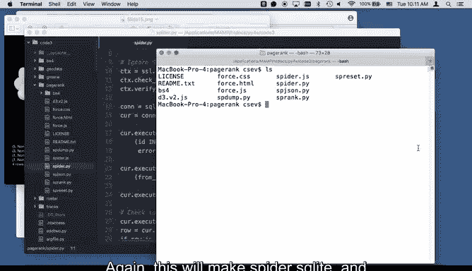

Okay， so。What we're going to do is。We're going to select ID URL from pages where HTML is null。

 this is our indicator that a page has not yet been retrieved。And air is null ordered by random。

 And so this is our way。 this long bit of stuff。 and this not all this SQL is completely standard。

 but this order by random is really quite nice and SQL light limit ones is just randomly pick。诶。

Record in this database where this true is true and then pick it randomly。

And then we're going to fetch a row and if that row is none。Right。We're going to ask for a new web。

 a starting URL， and this is going to fire things up and we're going to insert this new URL。

 otherwise we're going to restart we have a row to start with。

 and otherwise we're going to sort of prime this by inserting the URL we start with。

Insert into it if you enter it just goes to Drchuck。com， which is a fine place to start。

And then what we do is what this does is its Page ranknk because it use this webs table to limit the links。

 it only does links to the sites that you tell it to do links and probably the best for your page rank is to stick with one site。

 otherwise you will just never find the same site again if you let this wander the web aimlessly。

 and so I generally run with one web which web this should be probably called web sites。

And I pull in all the data and I read this in and I just make myself a list of the URL。

 the legit URLs and you'll see how we use that and the webs is how many。

 what are the legit places we're going to go because we're going to。Go through a loop。

Ask for how many pages？And we're going to look for a null page again。

 we're using that random order by random limit one， and then we're going to have a。We're gonna。

Grab one， we're going to get the from ID， which is the page we're linking from and then the URL。

Otherwise there's no one retrieved and so the from ID is when we start adding links。

To our page links we got to know the page we started with and that's the primary key we'll see how that primary key is set in a second so otherwise we have none and we're going to print this from ID the from ID and the URL that we're working with just to make sure we're going to wipe out all of the links because it's unretrievd。

 we're going to wipe out from the links， the links is the connection table that connects from pages back to pages and so we're going to wipe out so we're going go grab this URL。

We're going to read it。We're not decoding it because we're using beautiful soup， which cant。

We're using beautiful soup which compensates for the UTF8 and so we can ask this is the HTML error code and we checked 200 is a good error and if we get a bad error。

 we're going to say this error on page， we're going to set that error。

 we're going to update pages that way we don't retrieve it ever again。

 we basically check to see if the content type。Is text HTML remember an HtP you get the content type we only want to retrieve we only want to look for the links on HTML pages and so we wipe that guy out if we get a Jpeg or something like that we're not gonna to retreat JpeEG and then we commit and continue so these are kind of like oh those are pages we didn't want to mess with and then we print out how many characters we got and parse it。

we do this whole thing in a try accept block because a lot of things can go wrong here。

 it's a bit of a long tricecept block keyboard interrupt。

 that's what happens if I hit control C at my keyboard or control Z on Windows some other exception probably means beautiful suit blew up or something else blew up and so we indicate with the error equals negative one for that URL so we don't retrieve it again。

At this point， at line 103。We have got the HTML for that URL and so we're going to insert it in and we're going to set the page rank to one so the way page rank works is it gives all the pages some normal value and then then it alters that we'll see that in a bit so it sets it in with one we're going insert insert or ignore that's just in case this pages is already at the pages is not there but and then we're going to do an update and that's kind of doing the same thing twice just sort of doubly making sure if it's already there or ignore will cause this to do nothing and the update will cause us to retain it and then we commit it so that if we do selects later we get that information now this code is similar remember we use beautiful soup to pull out all the anchor tags we have a for loop we pull out the Hf。

And you'll see this code's a little more complex than some of the earlier stuff because it has to deal with the real nastiness or imperfection of the web。

 and so we're going to use URL parse， which is actually part of the URL Lib code and that's going to break the URL into pieces。

 come back。We use URL parse。We have the scheme which is HTP or HTPS if it's SAs relative references。

 this is Sa's relative references by taking the current URL and hooking it up。

URL join knows about slashes and all those other things we check to see if there's a anchor。

 the pound sign at the end of a URL and we throw everything past， including the anchor away。

If we have a JPEG or a PNG or a GF， we you're gonna to skipet。

 we don't want to bother with that these we're looking through links now we're looking at all the links and if we have a slash at the end we're going to chop off the slash by saying minus one and so this is just kind of nasty chopage and throwing away the URLs that we're going through a page and we have a bunch that we don't like or we have to clean them up or whatever。

And now， and we've made him absolute by doing this。 It's an absolute URL。

 This is just you write this slowly， but surely when your code blows up and you start it over and start it over and start over。

Um check then what we do is we check to see through all the webs。

 remember those are the URLs that we're willing to stay with and usually it's just one。

If this would link off the sites of the sites we're interested in， we're going to skip it。

 we are not interested in links that leave the site， so this is like link that left the site skip it。

 but now we finally here at page line 132 we are ready to put this into pages URL in the HTML and it's all it's all good right and。

that one's going to be null right there because we haven't retrieved the HTML。

This is null because this is a page we're going to retrieve， we're giving a page rank of one。

 and we're giving it no HTML and that way it'll be retrieved and then we commit that。Okay。

And then we want to get the ID so we could have done this with one way or another。

 but we're going to do a select to say， hey， what was the ID that either was already there or was just created and we grabbed that with a fetch one。

And say retrieve to ID and now we're going to put a link in insert or ignore into links from ID2 ID。

 which is the ID， the primary key of the page that we're going through and looking for links to ID is the link that we just created and a away we run so it's going to go and go and go and go if you let's go look at the create create statement up here。

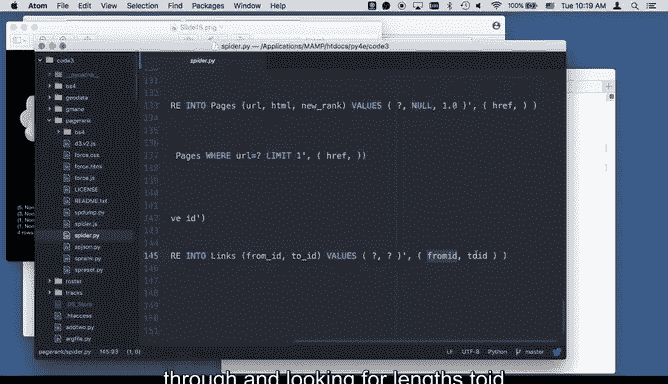

From ID and ID right there。So let's run it。Python3， oops。Python 3。Spider。Python。

So it's fresh and so it wants a URL with which to start。

 and I'll just start with my favorite website。W doctor Chuck dot com Now this。

 this basically this first one you put in， it's going to stay on this website for a while。 Okay。

 so I'll hit enter and let's just grab like。Let's grab one page just for yucks。Okay。

 so it grabbed that and it printed out that it got。85， 45 characters and it printed out that it got。

嗯。6 length。 So if I go to。This。

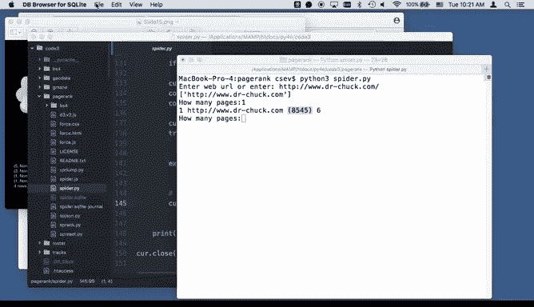

And。Open database。And I go to。Code 3。And I go to Page rank and I look at this。Oh。

Let me get out so it closes so here so notice this SQite journal that means it's not done closing。

 so I'm going to get out of this by pressing enter and so you'll notice now that that journal file went away otherwise we would not be getting the final data there we go。

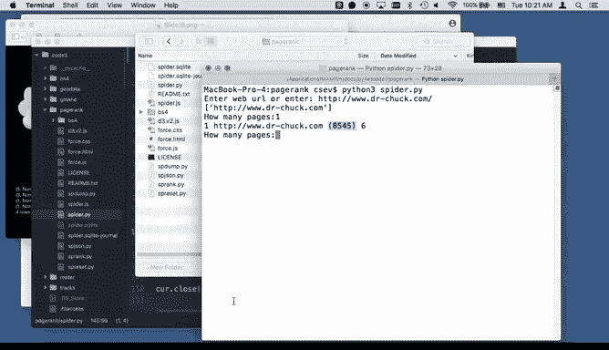

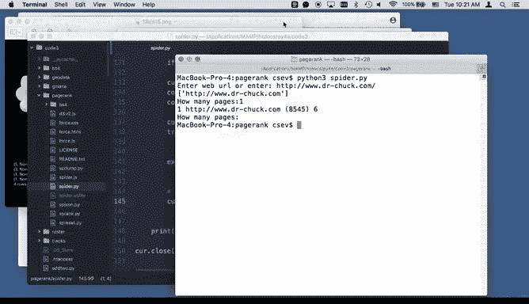

Okay， so webs， let's take a look at the data。Webs。Has just one URL。

 That's the URLs that we're allowing ourselves to look at。

 You can put more than one in here if you want， but most people will just leave this at one pages。

So we got this first one and we retrieved this and this is the HTML of it and we found six other URLs in there that are Drchuck。

com URLs right there was lots of other URLs in there， but there were only five other ones。

That we found okay and so and what we'll find is if we go to links。

 we'll see that page one links to two links to three。

 links to four links to five links to6 because the links is just a many to many table。

 so page one points to page two， page one points to page two， page one to three。

 page one to5 okay so that's what happens when we have the first page so let's retrieve one more page。

Now its we could have started a new crawl， but we're going it's going to stay on Dr。chuck。

com and I'll just ask for one more page。

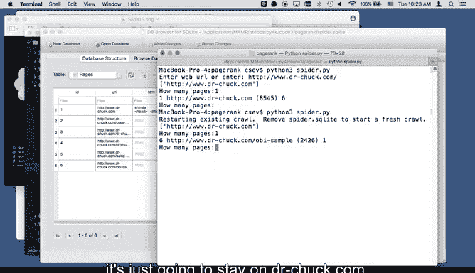

And so now it went and grabbed it randomly picked among these null guys。

 and I'm going to hit enter to close it， and then I'll refresh this。And oh。

 so it looks like we retrieved OBI sample and we didn't get any new links and so the links page。

 no we didn't get any new links， so that page， whatever that was， OBI sample had no external links。

 so let's do another one。Ao。One more page。So that one had 15 links， so let's take a look now。

So now we have 15 pages It picked this one to do， right， And now it added 15 more pages。

 And then if you look at links， you will see that。Page 4。

 which is one that just retrieved links back to page one。

 And now we're seeing this is where the page rank is going to be cool four links to one。

 four links to。Theres whatever way we go， right？1 goes to 4，4 goes to 1。

 I should have probably put a unique mis constraint on that。 It's not supposed to。

ThatDuplicated that。

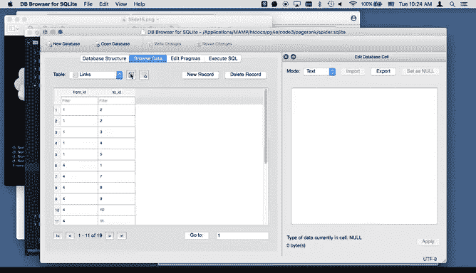

Okay。So let's run this a bunch of times now， so let's run， let's just run it a0 times。For00 pages。

They'll take a minute。So you'll see it's like freaking out on certain pages and not parsing them。

 you know， it's fun its way into my blog。It's finding like 27 links。

 this table is growing wildly at this point。It's going to take us a while before we get to the hundred。

 it's kind of slow Now， the interesting thing is。I can hit control C at any point in time。2。Right。

 and so that blew up。 but it's okay because the data is still there。 And so if we go back to pages。

 for example， and we refresh our data， we see we got a ton of stuff。

 And this will restart and all the things。 So if we search this that I sorted that by H M。

 You see that there's lots of files that we've got。 And it's never going to retrieve those again。

 because those have Hm。 So then I can run this thing again。And start it up。 And when I say control C。

 your computer might go down， your network might go down。

 there's all kinds of all kinds of things that might happen。

 And you just pick up where it leaves off。 It just picks up where it leaves off。

 And that's what's nice about this。Okay。So that's pretty much how this works。

We we've got this part running， we're seeing it flow into spider SQL light。

 we're seeing that we can start this and replace this and so what I'll do is I will come back in the next video and show you how all these things work together and then how we actually do the page rank。

So thanks again for listening and see you in the next video。

