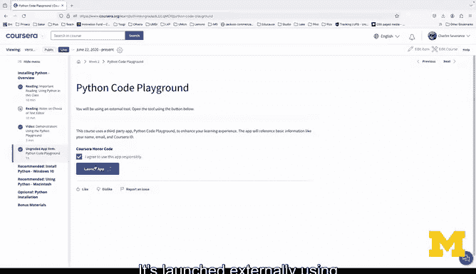
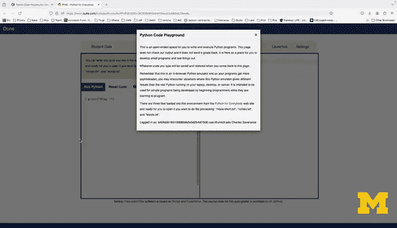
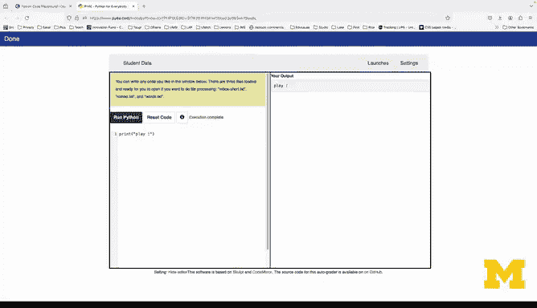

# 密歇根大学《给所有人的Python课》课程1：《编程入门指南（使用Python进行开发）》｜python｜ - P6：06_02_03_演示：使用Python游乐场.zh_en - GPT中英字幕课程资源 - BV1214y117Mk

So welcome to this week。 Last week， we talked about like the theory of programming and computer science in the macarina and all that kind of stuff。

 And that's cool。 But now we're going to start writing programming the writing programs using Python。

😊，And one of the things we're trying to encourage you to do is install Python and run it because sooner or later you are going to have to do that。

 right， you're going to have to install it and run it。 we've got a bunch of videos。

 but in courses one in courses two， you don't actually have to do that。

 Now we know that some people are using iPads or Chromebooks or something else and you can install Python and maybe you're a school that can't install Python。

So it's great that you can write Python programs。Using software we've provided in the browser。

 and we have this Python playground。 And so as you go through the course。

 you'll find assignments that you have to do。 But what this is is this is an ungraded assignment。

 Python code playground。 And so it's launched externally using a technology called learning tools interoperability。

 So it's going to pop this open in a new tab。 So you need that it you see that it's in a new tab right。

 And it's the Python the Python playground。 Now this is kind of like the autograder except it has no expectations。

 And you can write any code that you want。 Okay， And so let me hit the reset code button。

 And you can always go back to the default code。 and this is the code that's there for you。

 And if I want to run it， I can just say， go ahead and run this code。

And so the code runs and the outputs over here。 So it actually ran the Python and the code came out over here。

 Now， this is a file。 This is like chapter 7。 It's even from course 2。

 So the default code here is probably not what you want to play with。

 You can play with something like print。Play。Exclamation point。 and run that。

 And so it runs the code。 And then your output comes here。 Now， there are three files。

 which is later， Chaer 7 and later that you can use。

 these are the sample files that we use throughout a lot of these assignments in the book。

 and a away you go。 And so you can do whatever you want here， It's not being graded。

 there's no grade being sent back to Coursera。 And so a way you go。

 And if you're writing Python on your laptop or your computer。

 you're way better to just learn how to do Python there。

 and then paste the code into the auto graders later。 But if you have no access whatsoever。

 that's why we give you the Python playground。 Now， the other thing that's cool about this。

 is that this view student code allows our teaching staff to take a look at your code。

 And so we don't allow you to paste code into the forums。

 So what you can do is you can ask for help in the forums and the teaching staff can go in and。😊。

View the student code， type in your name or email and then find the code that you last put in so you can put something in here and get some help on it。

 The teaching assistant can see your entire code， they can run your code。

 they can do all kinds of things and so it's a great way to communicate with a teaching assistant。

 you sort of leave your code in the playground， you ask the teaching assistant and then they go take a look at your code and and give you some answers when you're all done。

 you you simply press done。

And we're back to week2， but like I said， I really would personally prefer that you build the skills in running Python on your laptop as quick as possible。

 but if that's not practical for you， then that's why we have the Python playground here in courses one and2。

