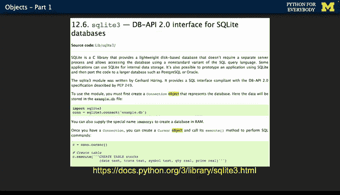
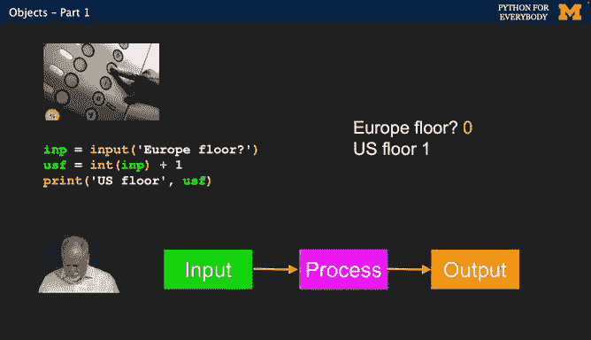
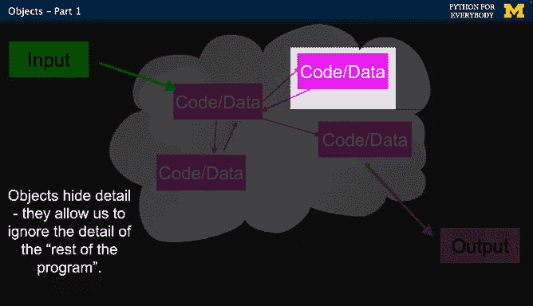
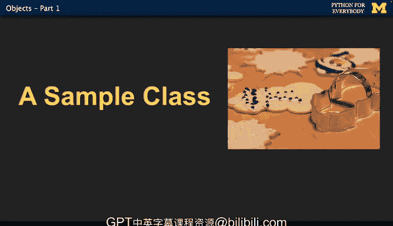

# 密歇根大学《给所有人的Python课》课程4：《使用数据库进行Python编程》｜python-databases｜ - P7：07_01_01_面向对象定义与术语.zh_en - GPT中英字幕课程资源 - BV1PP411W7H1

Hello， welcome to the chapter on Python Ob。This chapter is， in a sense。

 a little different than like chapters 1 through 10。In that。Learning object or your programming。

For me is like a lifetime。And I'm not going to in this next lecture。

Teach you everything that I ever want to teach you about object render programming。 It is， it's， it'。

 it's so beautiful and so deep and so complex。 So what this is really about。😊。

Is getting you used to hearing the words that we use to talk about object on your programming and getting you to kind of freak out less about these words。

 And over time and over multiple courses， these words will grow in terms of meaning。 I just。

 I don't think I can in this one set of lectures just like。

 put all the meaning to it because you just can't。And so you can relax a little bit。

And you can kind of enjoy this lecture。 We're going to talk about some syntax。

And so there's call going to be some Python code， but what I'm saying is this is sort of something that you're supposed to absorb rather than like really get because the really getting is a much longer process。

So the first thing that we'll notice is if you look at any documentation。

The word object is already been in there， right？ So this is like some list documentation， right。

And it says， here are some methods of list object， a list data type has some methods。Well。

 what's this word object and what's this word method， not to some degree。

You don't have to know what this means because you say list。 aend。

 I've showed you code that uses list。 of pen all along。What's this dot？Well。

 the dot is the syntax that says here is an object or a class， and then a thing within it。

 that's what the dot is。 So the append is inside the list object or the list class。

And so now we're just going to add something to the。Terminology of this， right。

 we syntax is easy and you can sort it on stack overflow， copy paste or whatever， right， but。

Now we're going to learn about the terms and what these terms mean。Again。

 you keep looking at the documentation， the word object and when you do databases。

 the connection object。 Well， the key thing is if you got an object。

 you should expect that there are things like attributes and methods inside that object。

 And so you know， call its execute method， the method to perform and again。

 this the first thing I want you to do is be ablell read this documentation。

 And when you see the word object and you see the word method and you see the word attribute you don't gohu。

So let's start to talk about object orientation because one of the things about object orientation is a concept we call sort of abstraction。

 and that is there's stuff that's inside something to kind of the implementation。

 and then there's the outside world。 So let's start talking about programs。

 And so if you think of this program as it were， as an object of a boundary of what's inside of it and what's outside of it。

 The inside is some three lines of code that we've seen before， where we read a variable， we add one。

 we convert it to an inte， we add one to it and we print that out。

And that you could think of as like a gadget that you bought the floor converter gadget。

 and you just talk to it and say，What is the United States floor if the European floor is three？

And it goes far， right。 So that's a gadget。 The inside of it is this logic。

And the outside of it is what we give it and what we get back from it。

And so you wouldn't need to know if you had this floor conversion gadget。

 you wouldn't know it Python。 didn't it doesn't matter， right。

 It could be using artificial intelligence for all， you know。

 but it doesn't matter because we have this abstract object that does something for us。And again。

 this one of course， is super simple。

So if then we start looking not just from the program， but within a program。

 a program is made up of many cooperating objects。 and this whole notion of there's the inside and the outside。

 that happens over and over again， like a series of onions and it works its way all the way down。

 And when you have three strings in your program， you have like three little islands， of capability。

 and each of the strings has some data in it。 It has some methods， et cetera， et cetera。

 And so you can think of。What you've been doing as you write programs is you are orchestrating。

Multiple objects， you're taking something out of one object， putting it in another one。

 or you're putting an object inside of another object like a dictionary or list。 You're like。

 here's a string。 and I'm going to put it in a list。 Well。

 the string is an object and the list is an object。 So you're the orchestrator of all these。

 So your program is like lots of objects working together in ways that you are constructing and objects interact with each other all the time under your control。

So what is an object I keeps saying this word？It's a bit of self contained， again。

 there's an outside and an inside that's a self contained bit of data inside of the inside。

 there's code in it and there's data in it。A key aspect of object or programming is in orders for you to not have to look at the complexity of what a string object is really doing。

 and if you were to go on Gitthub and look at source code to Python and look at the string object。

Is probably 2500 lines of code。 How hard is it to make a string。 The answer is for us in Python。

 it's really easy。 But under the covers， the work to make a string work is 2500 lines of code。

 or probably even more。the idea is， is that object programming says。

 let's make a thing that's easy to use and not be forced to understand what's going on inside。

 So someone can be an expert。 And they're in the Python world， there probably is。

10 people who are expert in what's inside the string object。

 And we don't care because we have a nice interface between us and them so we can ignore unneeded detail。

 and like I said。We have been using objects all along stringing objects。 integers are objects。

 They're not。 They're just objects。 They're objects and dictionary objects list objects。

 Some are tiny， but， and some are big， some are collections。Someum are simple scalar things。

We've used them all along。So if we kind of look at that program。Send some data to it。

That data goes into a string object。And then we might use a dictionary。

 and we might produce another object， and we might print that string out。

 And so you can see the code that you're doing， even though you' writing Python。

 your orchestrating objects。 And then each of those objects has a bit of code。 and a bit of data。

 And that's on the inside， right， you know， you get to sort of not worry so much about that。

 but the person who's writing the string class or the dictionary class worries a lot about the code in the data that's inside each object。

 And so but it goes both ways。 the person who's writing the string or dictionary class。

 it can ignore what your program is doing because they've got。

 they're looking outward from sort of this little bubble。 they're looking outward and they're like。

 okay， I'm going to let you do this。 I'm going to let you do an uppercase。

 I'm gonna to let you reverse the string。 And I got to write all that code。 But look。

 I don't care how you do that。 You can reverse if you want。 I don't care if you do reverse or not。

 So the object creators。Are giving capabilities to us that we then use。

 but we don't have to look at what they're doing， and they don't have to look at what we're doing。

 right， so we can not care about how difficult the string object was to implement， right。

And so， again， it has to do with like。Creating boundaries and not having detail pass across those boundaries and having well defined rules。

 we call them interfaces， well defined rules for what the string object is supposed to do。

So over the years。In Python， the string object has gotten better and better， faster。

 better with memory， more efficient。 Someone you know。

 did a Ph D thesis on how to do strings better in Python。

And then they put it in a Python and Naco didn't change at all because we don't care what's going on inside that thing because of how object or programming isolates things and that allows them to be beautiful and complex。

 rich， powerful。And then， easy to use。So。Here's some definitions。A class。Is the actual code that。

Defines how an object is going to behave， but it's not the object itself。

So you could think of it in my little picture of a cookie and a cookie cutter。The class。

The cookie cutter is not a cookie。But you can use the cookie cutter to make lots of cookies。

And so the cookies are objects or instances we use these two names depending on sort of what book people read or whatever or it might be in who everyone says class and then they might say。

 oh， I made a real cookie that's a cookie object or a cookie instance， so it's a particular instance。

 I like instance， but most everybody just calls some objects。Then within that。

 there is every class defines a set of fields and attributes， and then methods or messages。

 And again， this is， two kind of cultural terminologies that are equivalent。 So the method is。

 I either call some code inside the class， or I send a message to the class。

 which activates some code inside the class， which。

It's the same thing or I'm like I want to pull something out of the class just some data out。

 like how long is this thing or you know， is it is it active yet？

That's like a field or an attribute and again， don't be concerned about the fact that you hear this terminology two different ways。

To class and object are probably the hardest parts to understand。 And so the class。

Defins the abstract characteristics of a thing。 It's not the thing itself。 It's the pattern。

 or the template。It's like when this thing is created， it's going to have these attributes。

 these fields， these properties， these methods， you might say it's like a blueprint。

 but it's not a building， right， So that's that's a class。An instance is when you make one。

 you sort of use the template， and then you construct a thing out of cookie dough or perhaps out of wood。

 You know， I'm going to Here's a blueprint for a building。

 And I bring a bunch of wood and pound it together according to the blueprint。

 And now I have an instance of a building。 And literally。

If you have a blueprint for a building and you go next door and you want to build the same building。

 you just bring more wood and make another building， right？

And so the instance or object is the thing that actually stores the data。

 It's the thing that you interact with。 You generally don't interact with the class。

 except at the moment that an instance is created from the class and you interact with that。

 the class is defining all the behaviors。 So the code we write when we write this and you'll see this in a bit。

 we write the class。Then we make objects and use the objects， but really the code is in the class。

I told it's going to take you a while to get all this right。

 it's it's simple and beautiful once you get it。A method is in the class。

 but it's also in then then each instance or object。 The method is， you know。

 telling it to do something like string。Uppercase， string， reverse， do something， right。

 It's like a verb， right？ And so the method and message are often used interchangeably。 Like I said。

 the method is like I'm gonna call， I like method more than message in this case。

 because I think of it as if I write my class， I put code in the class。

 And then I then I activate the method， which calls that code。

 And so I like method better than message， the object running a puris like message better because it's like the message focuses on the interaction。

 So a string object sends a message to the dictionary object。

 And that's kind of the picture with all the arrows。 So I get why they like message。 But for me。

 I just kind of want to see the code and think of the code。 So for me， I'm more of a。

That line of code calls that line of code， and that's a method。 So that's why I like method better。

You can use the built in capability in Python called Dr。 So if you've been talking about type。

 like what kind of thing is this， or it's a string thing or it's a floating thing or an integer thing or a list or a dictionary。

 That's just the class that was used to construct that thing。 See see， the word class there， right？

 It's a stir class。 It's a float class。 It's an int class。 It's a list class。 It's a diict class。

 right。But then you want to say， well， what are the methods and attributes。

 And there is a function called D， and you can pass an instance， which is like X or even a class in。

 And it says these are the capabilities， I mean， it's a kind of a pretty weak way to read the documentation when you read the documentation。

 But I sometimes use it Like what is there two L's in that or1 L， you know。

 is it my problem is I go back and forth between languages like is it L strip or L trim because some of the languages。

 you know， the concept of strip is trim。 And so I'm sitting in Python。

 and I'm like string dot trim is like， no， you're not in you're not in。That's PhP， I think see。

 I can't use too many languages， but and so I I'm not saying the D is a good way to look at documentation。

 but it does tell you that Python itself is kind of self aware of the nature of objects and classes and methods and so it you know it's。

ItIt was valuable for me to look at this and say，Python knows all this stuff。 It remembers it。

 And so when you make a variable， it remembers where that variable's methods came from。So up next。

 we're going to actually， instead of just talking about classes in the abstract， hey。

 classes and abstraction， we're going to build our own class。

