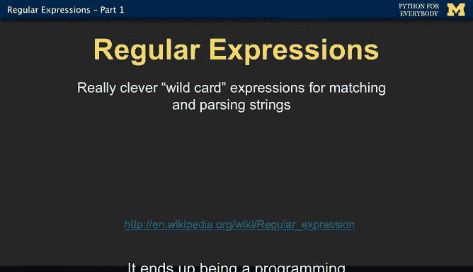
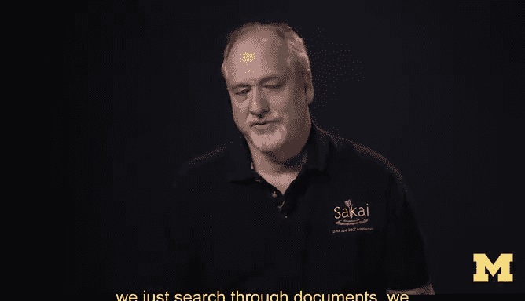
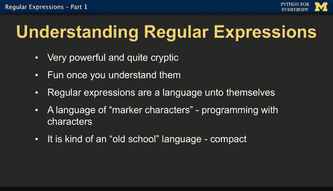
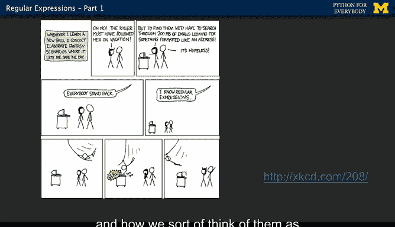
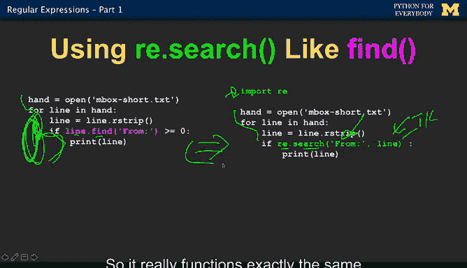
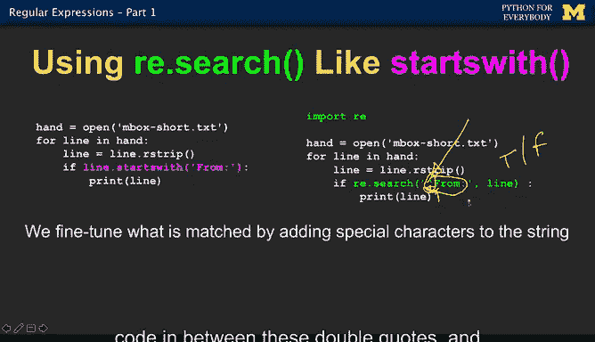
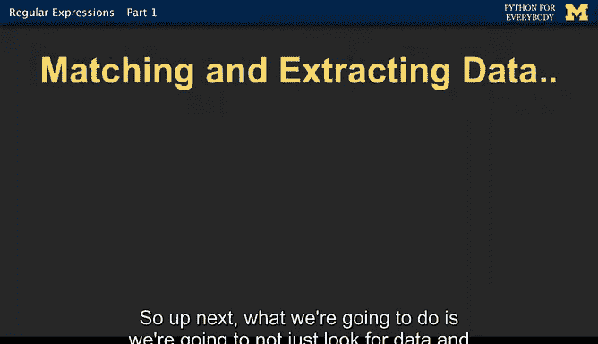

# 密歇根大学《给所有人的Python课》课程3：《使用Python访问Web数据》｜python-network-data｜ - P7：07_02_01_正则表达式.zh_en - GPT中英字幕课程资源 - BV1Hu4y1e7WS

So welcome Chapter 11。 Chapt 11 is kind of a fun chapter because you don't really need to know regular expressions。

 And so if you just want to skip ahead or maybe do the assignment or whatever。

 but this is kind of fun。 Regular expressions are a neat little thing。

They're a real old concept， they're kind of an ancient notion and having to do with the study of languages。

 not really exactly computer programming languages。

 but languages and grammars and what is in a language and what is not in a language and a regular expression is a form of a language and meaning it's a way to say that a set of strings match or don't match a regular expression。

And and from the 1960s to today， lots of operating systems have used regular expressions as a more intelligent form of search。

 So it's like look for this expression， but it's not just like hello。

 it's like H followed by one letter followed by LL followed by a vowel or something like that。

 And so that's the idea of a regular expression is that instead of just giving characters。

 you have sort of it's almost like a little miniature wild card programming expression that's kind of cool。

 it ends up being a programming language， but it's not like an iteration programming language it's a programming language that's like match。

 match match match， question mark question mark question mark， It's really it's kind of fun。

So if you think about， you know your search through stuff all the time。

 we just search through documents， we search through emails， we search through things。

 it just is a really， really smart way to look through lots of text。

And they're powerful and cryptic。 it's kind of fun once you know how to use them because they're very。

 very powerful。 and you can add a little character here and do these things and。😊。

If you had to do something the same way with the sophistication of regular expressions。

 you'd have to write quite a bit of code and so there's a way to reduce your code。

 but they also are not something that people are natural it's not as easy to learn as say an if statement but it's old and it's kind of fun and here's an XKCD cartoon about you know just how completely totally awesome regular expressions are and how we sort of think of them as somehow mysterious and powerful and that those who know regular expressions are somehow special。

So。I have this regular expression。 quick guide。 The key to regular expressions is that instead of programming with lines。

 you programming actually with characters。 And so the carrot character isn't just a carrot in regular expressions。

 it means beginning of line dollar sign means the end of line。 dot means any character。

 Now this is a very， very cryptic and arcane language。

 bracketrack means the beginning of a set of characters。

 parentheses means start extracting Other parentheses means stop extracting。

 So these are all like a programming language。 It's a programming language for string matching。

 That's why it gave you this handout， you can go grab that。

 you can print it out anytime you want to look at it， you save yourself。

 There's actually a lot more stuff。 And if you look at the Python documentation。

 it'll tell you turns out that lots of things have regular expressions in them， lots of languages。

 Java jascript。 and guess overlap， and most of them are kind of the same。 But every in a while。

 there'll be some feature that's a little bit weird and different。

So inside Pythons regular expressions are sort of not built into the base language like strings or lists or dictionaries。

 and so we have to import at the beginning with the import statement that says pullll in the regular expression library for this program and there's a couple things we're going to play with one is RA search which is the search capability from the regular Express library and that tells you yes or no。

 did it work and it's like a really smart find and then find all is like extraction it's way more powerful than slicing。

 but it is the idea of finding the beginning and end of a bit of stuff and pulling that out。

So we'll talk about both of these things。So I'll start by showing you some code and showing you sort of before after and so this is just showing you how you use the search capability from a regular expression like a find operation So this again is our little thing we're reading through and we're saying if this line do find from is greater than equal to zero so this is the position and if it's greater than equal to zero then we're going to print it So we're searching you know some of the lines we're going to skip。

 some of the lines we're going to print， most lines we're going to skip and then we're going to print once in a while same kind of thing。

Everything here is the same except because we're using regular expressions。

 we have to import the regular expression library， we open the file we're going to loop through and that if we're going to do is say re dot search now this is kind of the object orient pattern where we take a variable name dot method。

 here we have library name dot function。And then we have to pass in the line that we're searching within。

 and then the string that we're searching for。 and then this returns a true or a false。

 whether or not this match happened。 Now this is a very simple regular expression。

 and I carefully have not used any of the special characters for regular expressions。

 so it really functions exactly the same as fine。 and it just this gets us started。

 I would probably not use regular expressions for something this simple， but as you'll see。

 we can do a lot more powerful things with regular expression than we can with the string library。

So we can also use search like the starts with function。

 and so that time we're using find and now we're going to use starts with and so we say， oh。

 is this prefix does a match of prefix because that's what starts with does is for strings。

And so this in the code is pretty straightforward， where know how this works。

 if it starts with from we're going to print it， otherwise we're going to skip it。

To do that with regular expressions， it's a little different。

 we look inside strings for a different function that does a different thing for us， right。

 But in regular expressions， what we do is we tweak the matching string。

 So the only thing we do to indicate that we want this search to match the beginning of the line is we add a special character。

 We had this carrot character。 And that carrot character is not really a carrot。

 What it says is I want the F to be the first character。 the line。

 So carrot F means F at the beginning of the line。 And so that's a way of matching。

 not from anywhere in the line。 And so this returns a true。

 If the from is at the beginning of the line and a false。😊。

If there is no from at the beginning of line from can be somewhere else in line。

 you'll still get a false right and so that's the trick to regular expressions as we begin to write code in between these double quotes and this stuff gets increasingly complex and then we achieve that what we want to do by more and more complex things and so we are going to change these wild card expressions。

So just as an example， here's another one that may want to represent a bunch of things and we're introducing the dot character and the dot is any character。

 It is any character star。In wildcard like a Dure Stardo star， that means any character。

 but star means zero or more times， zero or more。0 or。More。0 more times。

 So that basically says if we， if we translate this little regular expression with English is I'm looking for lines that have an X at the beginning。

 capital X followed by any number of characters， followed by a colon。

 So colon is not a special character。 X is not a special character， but cart is a special character。

 dot and star R there。 If you go back to that little cheat sheet。 That's what those things do。

 And so the kinds of things that this is gonna match。 The kinds of lines is lines that start with X。

 followed by some number of characters followed by a colon。 X。

 followed by some number of characters followed by a colon。😊，Lines that don't match this。

 and so this is quite a powerful little thing because it matches all of those。

 it's not like saying starts with X。It's like x followed by some number of characters followed by a colon。

 true or false， and it would skip lines or give you false on lines that did not meet that， right？

And so that's the idea that character matches the star of the line。

 the dot is any character and star means as many times as you like。

Now you may want to narrow this down just a little bit right and so starting with the X that might not be good enough and so we might not want to include。

 for example， this line right here because it we really want these to be not spaces right so this X dash plane is behind schedule This doesn't really look like what we intended for it to look like this is a mail header that starts with x dash sit X dash something x dash this but the X plane behind schedule is not actually a match now it will match because technically it starts with an x has any number of characters and it has a colon but we want to be a little more precise。

And so we fine tune it。And so we say， I want matches that start with an X， followed by a dash。

 follow by， and this is a special character， any non whiteh space character plus is lice asterisk。

 but it's one or more times。 So that's greater than or equal to one time。

 So greater than this bit here says greater than or equal to。

One non blank character followed by a colon。 So this starts with X dash。

Greater than equal to one nonblan character。 followedll by a colon。 That's a true。

 This one is X dash。 followedll by greater than one nonb character。 blankks don't count。

 And then that one's a true。 This one is starts with X dash followed by one and war O， no colon。

 because it has to match the whole thing。 So it's like taking this is like a template and applying it to this line。

 This is a blank character， which violates this rule of must be nonb characters up to the colon。

 that's And so it's really searching for a colon because colon is also required。

 So this does not meet the requirements。Because of these blanks。 And so that gives us a false。

 And so all I'm saying here is you can kind of。Add a little more detail and hit on lines that that you're sure that you want to hit on。

 So up next， what we're going to do is we're going to not just look for data and give us true falses whether we found it。

 but we're actually going to start pulling pieces out， extracting data。 and so that's what's up next。

