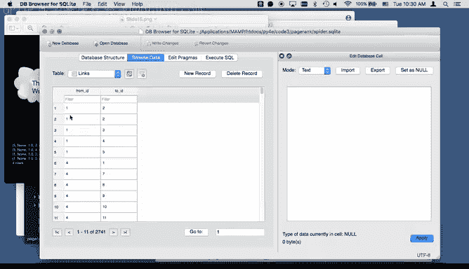
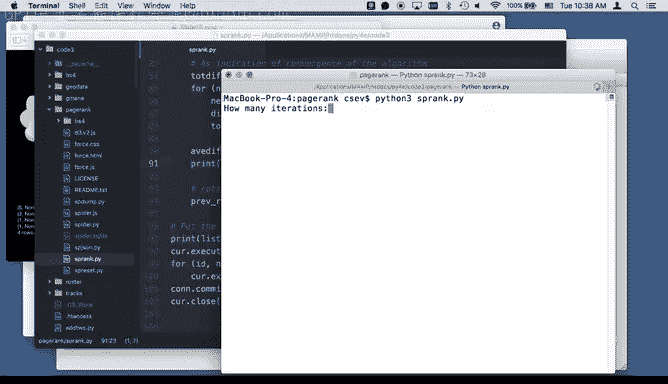
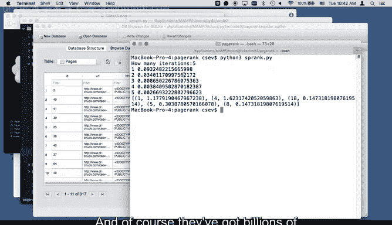
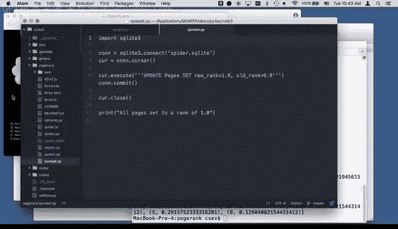
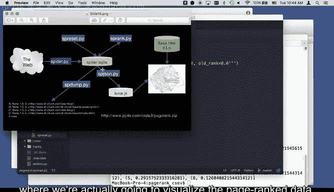

# 密歇根大学《给所有人的Python课》课程5：《毕业项目：使用Python检索、处理和可视化数据》｜python-data-visualization｜ - P7：07_02_03_实例演练-PageRank计算.zh_en - GPT中英字幕课程资源 - BV1Eh4y1U7aE

Hello and welcome to Python for everybody， we're doing some sample code。

 you can get a hold of the sample code zip if you want to follow along and so we're picking up in the middle here where we are running simple spider that's retrieving data and putting it into running this spider。

 PY file and it's cruising around and doing things and the beauty of any of these spider processes is I can stop anytime and just hit control C。

And and so we take a look at the spider。sql like file and retrieve it。

 and it looks like we got 302 pages， I don't know how many we got retrieved。70， okay， there we go。

YouGo about。Hundred。Oh wait， looking for the wrong thing， no， no， no， no， no。哦。

Now we got about 107 pages， so what we're going to do now with 107 pages is we are going to run the page rank algorithm。

So let's take a look at that code， So the idea of page rank。Um。

We're going to run this page rank algorithm。 The S reset just resets the page rank and S rank runs as many iterations of page rank。

 So the basic idea is that if you are to look at the links here。嗯。You know。

 we think of page 1 pointing to page 2 gives some of page 1's love to page 2。

 page  page page 4 has some value that it gives to page 1。

 go on and page 2 has gives love to page 46 over and over and over again。 And so， But the problem is。

 is that how good is page 1 and how much positive。Karma， does it give to page 2。

And so what happens is is we， we， we start by giving every page。

A rank of one。 we say， like everybody starts out equal。

 But then what we do is we divide up in one iteration of the page rank algorithm。

 We divide up the goodness of a page across its outbound links， and then。

Accumulate that and that becomes the next rank so let's take a look at the code for the page rank algorithm。

So this is pretty simple。 it only imports SQLI3 because it's really doing everything in the database。

 right， it's going to be updating these columns right here in the database。And so。

So we're going to do some things here to speed this up， this rank runs。

 if you're thinking of Google this rank runs slowly and is going to run continuously to keep updating these things。

 So the first thing I do is I read in all of the from IDs from the links。

 select distinct throws out any duplicates。And and so I have all the the from IDs。

 which are the all the pages that have links to other pages because all the pages are in pages。

 but in links to be have a from ID， you have to also have a two ID。Okay。

And so we're also going to look at the pages that receive page rank and we're kind of precaching this stuff。

And so we're going to do a select distinct of from ID and2 ID and loop through that group of things and not going we're making a links list here and so we're saying if the from ID is the same as the two ID we're not interested if the from ID is not already in my from IDs that I've got I'm going to skip it if the two ID is not in the from ID meaning that this is a two ID that's not also we're not I don' we don't want links that point off to nowhere or point to pages that we haven't retrieved yet and that's what this is saying so this is really going to give us it's a filter on the from IDs and the two IDs from the links table so that it only are the links that point to another page we've already retrieved。

And then we are going to keep track of the entire superet of the two IDs， the destination IDs。

And I'm just putting these all in list so that I don't have to get the database so hard。Okay。

 so this is getting what's called the strongly connected component， meaning that any of these I。

 there is a path from every I to every other I eventually。

 So that's called the strongly connected component in graph theory。

Then what we're going to do is we're going to grab the we're going to select new rank from pages。

Where。For all the from IDs， right？And so we're going to have a dictionary that's based on the ID。

 the primary key， that's what node is equals the rank and so if we look at our database。

 that means that for the the part of the strongly connected component in links。

 we're going to grab this number and stick it into a dictionary based on the primary key of this。

Based on the primary key， this number right here， so we're going to have a dictionary that's this map to that again。

 we want to do this as fast as possible now we're going only doing one iteration at the beginning so we'll ask how many times you want to run it。

Okay， and so we just take make an integer of that， we check to see if there's any values in there。

 if there are no values， we are bad and now we're going to go I equals one to range many。

 this is going to be one to one so it might run however many times。

And then what it's going to do is it's going to compute the new page ranks and。

And so what it's really going to do is it's going to take the page rank， the previous ranks。

And loop through them。This isThe previous ranks is the mapping of primary key to old page rank， okay？

And for each node。We're going to have total equals total plus old rank。

 and then we're going to set the next ranks to be zero。Okay。

And then what we're going to do is figure out the number of outbound links for each page rank item。

So node and old rank in the list of the previous ranks。These are the ideas we're going to give it to。

For this particular node， we're going to have the outbound links and we're going to go through the links。

And not linked to itself， although we made sure that doesn't happen， we make sure that this。

 but then we're going to make a list called give Is， which are the IDs that node。

Is going to share its goodness。And now what we're going to do is we're going to say how much goodness are we going to flow outbound based on our previous rank of this particular node and the number of outbound links we have。

 So that's how many。Time， that's how much we're going to give in our outbound links。

And then what we're doing is all the IDs we're giving it to we started with the next ranks being zero for these folks these are the receiving end and we're going to add the amount of page rank to each one so whatever this is so we'll go through。

All of the links give out fractional bits of our current goodness and it's accumulated in each one and so eventually all the incoming links will have been have granted each new link value okay。

Now I'm just going to run through and calculate the new total。this evaporation。

 the idea is that you can you can' it has to do with the page rank algorithm that you there are dysfunctional shapes in which page rank can be trapped and this evaporation is taking a fraction away from everyone and giving it back to everybody else。

 and so we add this evaporative factor。And then we're going to。

Do some computations just to show some stuff， and that is we're calculating the difference。

The average difference between the page ranks and you'll see this when I start running it。

 and that is telling us this is going to tell us the stability of the page rank。

 So from one iteration to the next， the more it changes the least stable it is and you'll see in a sec that these things stabilize。

And then and we'd say what's the average difference in the page ranks per node。

 which is what this is。 And that's what we're going to print。

 And now we're going to take the new ranks and make them the old ranks and then。Run loop again。

 so I'm not actually updating the database each time through the page rank iteration。

 but then at the very end I am going to do the update for all of these things and update all of the rankings sort to with a new rank so I'm doing an in memoryory calculation so that this runs this loop here runs screamingly fast。

 even if I want to do like this loop 10 times or a thousand times。

 it's really all just in memoryory data structures。Okay。

 so it's probably easier just for me to show you this it'll be very。The code runs quite simply。

Python。Three spra。Rnk。Got PY， and so I'm only going to run it for one iteration。

 and that means that it's going to loop here。

Is just going to run one time and so it's going to start with。The page ranks。

The new rank of one and it's going to just run one iteration and put the rank there okay and then update this as well。

 so let's go ahead and run that once for one iteration。Okay。

 and so it ran one iteration and the average change between the previous rank and the new rank is one。

 so there it's actually quite crazy， so I'm going refresh here and you'll see that the old rank was one and the new rank。

Is went way down， way down， way down， way down， down a little bit， down， down some up a whole bunch。

Down， down， up。 So you see that they went down and up。 Now。

 the sum of all of these numbers is going to be the same， right， because all it did it was like。

Floated out and recalculated it。And so that's what happens with page rank and so whatll happen is if I run one more page rank iteration。

 this number will these numbers will be used to compute the new new rank and then these will be calculated to the old rank and so you'll see that these will get they will change again。

 so I'll just run it one more time。So I'm going to run one iteration。And then I'll to hit refresh。

 so you see all these numbers got copied over， but now there's a new rank that's computed based on。

These guys。 and so they're getting this one went up。 This was 0。13。 That's gone up a little bit。

 This one's gone up some more。 This one's gone up。 This one went down， right。

 So this one went down from 6 to 8， and you can see that the difference is now the average difference between this number and this number across all of them went from 1 point something to 0。

41。 And you'll see that with these very few pages， as page rank convers converges really quickly。

 okay。So let's run it again， and I'll just run 10 and you will watch how this converges。Okay。

 so there you go， it converges so and and you're seeing now after like 12 iterations that the difference between the old rank and the new rank。

Well， that's because it's that old rank， I'll run one more iteration so that you can see。

So this old rank is less than， you know，0。005。 And so now you can see that these numbers are sort of stabilizing。

 This is the average that 005 number is the average difference between these two things。

 Now if we're going to pretend to be Google for a moment， we can say Python3 Sp。Dot pY so in。

So let's just do 10 more pages。 Now what's going to happen here is these new pages are going to have page ranks of one。

 okay。So let's get out， so if I do a refresh now and I look at new rank。

So there's these guys that have high rank what you'll see I hope if we yeah okay。

 so you see new pages right， these are the new ones that we just retrieved。

 I don't know if they're linked or not and they all got one。

 So some some old pages are way up 14 some pages if we go downwards are way down right so these are like useless pages they you know they point to somewhere but nobody points to them that's what happens with these page ranks Okay so what happens is the new records get this 0。

1 and so if I run the ranking code again。And I run， let's just run five iterations。

 you'll see that the average delta goes up just briefly as it sort of assimilates these new pages。

 and then it goes right back down again。 And so that's what's happening with Google it's sort of running the spider to get more pages then running the page rank which gets disturbed a little bit but then it reconverges very rapidly and of course they've got billions of pages and we've got hundreds of pages。

 but you get the idea。

Okay and so I can run I can run its pagege rank like100 times and after a while it just sort of hardly is changing so that's 2。

7 to the negative 10 power So now you know let me run it one more time to update the stuff and if I refresh this you're going to see look at the look at how stable these numbers are 149435915。

6，7， the difference is there in the seventh one。 So that's why this whole page rank is really cool。

 It seems like it's really chaotic when it first starts out and a away you go。😊，Okay， so。

That was just this SP rank right SP rank and SP reset， we can look at that code。

 I won't bother running it。 It just sets the old rank to one。 that's it。

 that's as much code as you've got it just starts it and let's it rerun。

 so I'm going stop now and I'm going to start a new video where you talk about this phase here where we're actually going to visualize the page ranked data。

🎼。