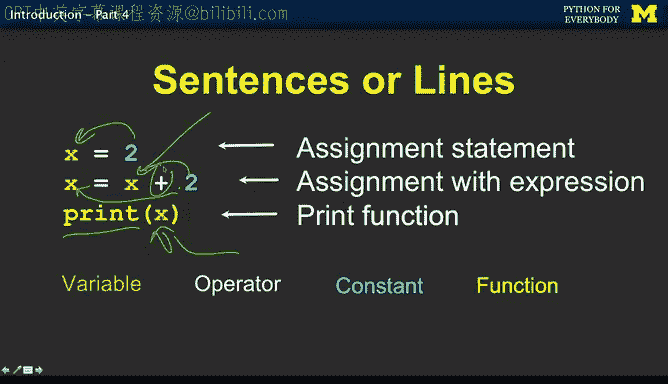
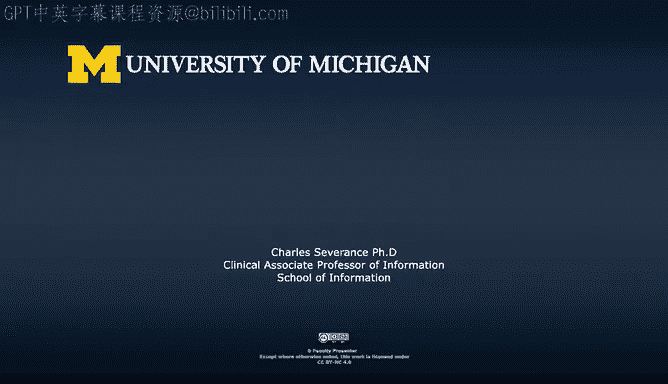

# 密歇根大学《给所有人的Python课》课程1：《编程入门指南（使用Python进行开发）》｜python｜ - P7：07_03_01_Python基本要素.zh_en - GPT中英字幕课程资源 - BV1214y117Mk

So I back。 Now， we're going to start learning about the Python language。

 And if you can think of this as talking to Python itself。

 and it turns out that there is a way on most computers。

 whether it's a Windows computer and command line or Macintosh or Linux box to get Python started and if you just run Python it will take interactively commands that you can type and you have to type Python at this。

 Chevron prompt is what we call it。 but this also sort of fits in the what next。 So Python is like。

 okay， I'm here， I can handle any Python statement you can send me。

 I'm ready to do whatever it is that you want to do。 I don't know what to do。

 I need you to tell me what to do。 And so you can type a series of statements in Python。

 And so the first statement that you might type as an assignment statement X equals1。

And so what is going on here。 Now， this， this assignment statement is something that often confuses people when they move from math to programming。

 An equal sign sort of has a direction to it。 It's an arrow。 It really is saying， dearar Python。

 you've got a lot of memory。You got a lot of memory。

Take a little tiny piece of that memory and remember it and name it X。 I might use that。

 I'm going to use that later and stick a one in it。

 So this is sort of like stick one in a spare place in memory and name it X。 print X says。

 go take whatever that spare bit of memory was。 and bring it back out and tell me what I put in it。

 Now， it's kind of redundant。 But usually you're doing something more complex than this。

 put something in memory， and then take it back out。 That's the first thing。 Now。

 what this is doing is this is an expression。 And that says take whatevers in X， which is a1。

 and then add one to it， which becomes2， and then stick it back in X。 So that adds one to X。

 and then we print that out， and it's a two。 and then we quit。 Now， if you type wrong things here。

 you're going to get syntax errors。 And Python is just going tell you， you know， syntax error。

 syntax error， syntax error。 and a away you go。 But this is us talking to Python。😊。

So what do we say to Python？You can almost think of this as like writing an essay where you start And if you think back。

 you started learning an alphabet and then use that alphabet to produce words and then use the words to produce sentences。

 And then you combine sentences to make paragraphs， which then make a story。

 And we're going to do the same kind of thing。 This is the program that we're ultimately going to write。

 And don't worry about understanding what this story does。 We'll talk about this later。

 we're going to come back to this many times throughout the course。

 This is a Python story about how to count words in a file in Python。 Okay。

 This solves that problem that I asked you to solve a little while back of what the most common word was and how many there are。

 And we'll come back to this。 several times in this course。So if we start at vocabulary。

 the first thing we have in every programming language is what's called reserved words。Now。

 what do we mean by reserved words， Well， these are words that if we use these words。

 we must use them to mean the thing that Python expects them to mean。

Another way to put that is we can't use them elsewhere。 We can't make up a variable named import。

 We can't make a variable named As because if Python sees at。

 it means something very specific to Python if it sees if it means something if it sees4 or pass or while Whereswhile。

 there'swhile， these mean things。 the best way to think about this is Python is kind of like a dog。

 And if you're talking to a dog and you say， hey， dog， do you like， you know。

 Beethoven or boch better。 the dog is hearing is like blah， blah， blah， blah， blah， blah。

 doesn't care anything。 And then you say， hey， hey they' spot。

 what do you think of the weather today。 do do you really like you know。

 sunsets or do you like rain better。 And the dog is like blah， blah， blah， blah， blah， blah。

 And then you say something like。Do you think it's time to go for a walk。 And the dog goes like。

 walk， Got it。 And the dog has been listening to you all along。 Most of his， blah， blah， blah， blah。

 blah。 But walk is a reserved word for a dog。 Okay， food treat those are reserved words for dogs。

 Most of stuff， you can say anything you want to a dog and they're very good listeners， right？

 But when you say reserved word for dog and you say walk and you don't deliver than that dog's onlyt buggy for a while。

 So you can think of that as Python。 when Python sees global or from or for， it's like， whoa。

 that's a word that means a lot to Python。 So you better use it the way Python expects you to use it。

Sentences are lines。 And so when we write a program。

 we're writing a text file and we put a line and another line and another line。

 Each one of these is like a separate line， and we've got to get them right， and then we construct。

A paragraph out of a series of lines。 And so in this particular example。

 we have another assignment statement that's sticking the number two into the variable x。

Retrevieving that two back in， adding two to it and sticking that sum back into X。

 print is a function。 And there is a parameter X， And that's going to cause4 to be printed out。

 So we're using operators， This plus is what's called an operator。

 The equal sign is what's called an operator。 This print is actually a function。

 This is a parameter being passed into the function。

 So there's a whole series of different kind of syntaxes that we use to produce the lines that we have to produce。

Now we start combining these paragraph lines into paragraphs and make some sense。

 And so that interactive Python where you're talking with the three Chevron prompt。

 that's fun and it's fun to get started and type X equals and x equals equals1 and whatever but don't do too much I see students all the time they try to write whole programs in that and it gets a little frustrating because you have to type it perfectly from beginning to end It's much more common to type something in a file once we get maybe beyond three lines of Python。

 we tend to just use the programming text editor like atom or something and we put them all in a file and then we tell Python start at the beginning this file and then read through the file we call this a script or a Python program and in Python we tend to call that file do py and some text editors like the atom text editor which is one of those that I recommend when you have a file that ends in do py it syntax highlights it and gives you colors and makes things pretty and helps you understand and sometimes even leads you towards。

Syntax errors and mistakes that you have， and so scripts are stored sets of instruction in text files that you can then hand a Python to run them。

 and I have a whole bunch of videos that sort of get you to yaning Python。

 getting in Python installed， doing something interactively and then writing a script and then running from the script。

