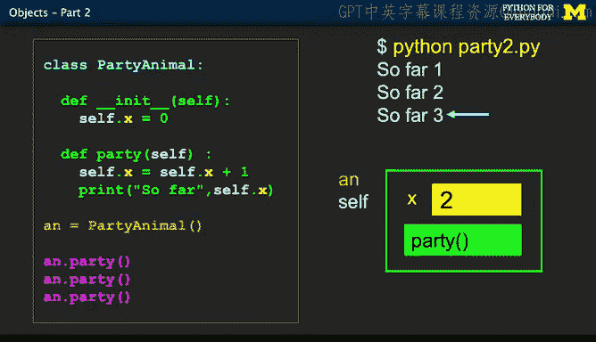
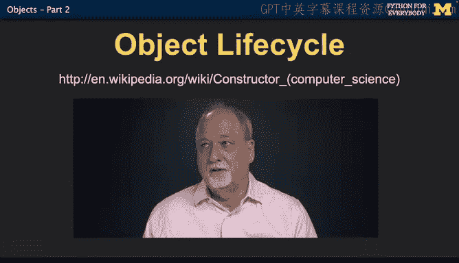

# 密歇根大学《给所有人的Python课》课程4：《使用数据库进行Python编程》｜python-databases｜ - P8：08_01_02_首个类与对象.zh_en - GPT中英字幕课程资源 - BV1PP411W7H1

So enough of me talking about definitions， too many words， let's get to writing some codes。

 so let's write our first class。So here we go。And like everything。

 I make these things small so that I can make them big on the screen and they don't do anything particularly useful so don't。

Feel too bad about like， why is this doing this？Because really， you're just talking about syntax。

 So the first thing to notice is there is another reserved word， So deaf makes functions。

 class makes classes。 Now remember， classeses are templates。 classeses are not the thing。

So you say class， then you have the name of the class that you're creating。

 much like you'd have the name of a function。 and then colon。

 And then there is a whole chunk of indented stuff。 Those two des are both methods。

 So des methods are basically functions inside of or scoped to class。 So the first。

Function is what we call it's a especially named function and。Double underscore。

That starts and ends the function name is a way that Python knows that this has special meaning。

 It also is a way that。You're not supposed to do these unless Python has told you to do it。

 So Python tells you。Create a double underscore in knit double underscore method with a parameter of self。

 And that's what Python is going to call when you are created。 So that's especially named。Method。

 self。Is the actual instance？So class is a template to make an instance。

 So what's going on is in the A N equals party animal open friend close friend。 That's the act of。

Building an instance of party animal and then giving back to you in the variable A N。

But then as side effect of building it。Python is going to call the constructor method to double underscore and knit double underscore and is basically letting you do things in there to set things up。

 And so we're going to have an attribute in this case， X self dot x equals 0。

 We're going to do that both defines an instance variable or an instance attribute of x and sets it to 0。

 So when we're done there。Whatever this class is， whatever the object is has been。

Constructed and initialized。Whatever it is we want。 Now， again， I'm keeping this simple。

 We got one variable in this， one attribute in this， and it's x， and it's set to 0。

And then we have another method， and you'll notice that every one of these methods takes self as parameter。

 Okay， and so self is the particular instance。 we'll get to multiple instances much later so。

And so if you call the party method。We take the X value within this and add one to it。

 and then put a print statement in。 It's just Python code， so you can put print statements in here。

 Both， most methods don't do printing， but we're doing it just so we can see what's going on。

And so at that point we deindent。To sort of the zero indent position。

 And now we're in kind of the main code。 And we say an equals party animal。 And that says， hey。

 Python， there's a class of type party animal that we just created。Construct it。

 initialize it and give it back to us so that constructing happens。 then our in， it gets called。

 and then it's all set。And then we say andO party， which means we've got an object now。

 we've got an instance of class party animal， and we call the party method inside of it。

Now the thing you'll notice is inside the parentheses of A unDt party。Is nothing。

But inside the deaf party， there is self。Takes a little getting used to。

But you can see that the Aon dot party syntax。Is equivalent to the clunkkiier syntax， but perhaps。

Easier to understand party animal， which is the class dot party。

 which says there's code inside of party animal named party。

 And we're going to pass the instance in the A N variable。

 which is that instance as its first parameter。 So when party gets called inside of the instance。

 we pass in the instance。 so in that moment， A N and self are pointing to the same thing。

And we'll get to multiple instances later。 But you get the idea that。We define the class。

With a method to initialize it， and a method will call for whatever purpose。

 they both take self as a parameter。X is the only attribute that we have。

 and then A equals party animal constructs it。And then AndO party calls the party method。

And we do that three times， so let's kind of see。How this runs。So if we're running this， right。

 we get it started。 And so as it kind of goes down through class party animal。

We don't see any output。So even though it's at that line where it says n equals party animal。

 open print， close print。That print statement did not run。

And that's not that different than when we create a function， if the function has a print in it。

It doesn't run the print until we call the function。

 So the first the top two third of this is defining something but not running the code。Okay， so。

 you know， in the middle。Before we say AN equals party animal。

 all we have done is kind of created this party animal template with no output， no real execution。

 It's just recorded kind of the store and reuse pattern。Then we get down to AN equals party animal。

And then it constructs using the party animal template to construct some data。And in this case。

 the initializer creates the X instance variable。And sets it to 0。

 And the whole class has a party method in it。 So now at the end of that line。

 A N points to an object， an instance of an object。 I mean。

 instance of a class or an object with X and party in it。 And then we go down the next lines。

 And we say A N dot party。 Well， what does that do， Well， that adds。To self dot x and you know。

 x is changing and when you're in the party method。Self in that parameter to the party method is。

An alias of A N。 And that's how you get to the instance。

 So self dot x is the same as A N dot x and x is the attribute of the。Instance， so it， you know。

 it goes one， two， three， so we call it three times and eventually it has it prints out three of them。

So now that we've created this class， we've kind of like extended Python when we create a class。

 no different than when we create a function。 We kind of like extended。

 we've stored a new thing that we invented。 It's really a Python capability that we've built。

 It didn't run code。 It just is a capability。😊，And so now we're going to play a little bit with the Dr command。

 And if you recall the D command lists capabilities， it really kind of listing methods。

 but it also can list attributes as well。 So remember that the ones that are have underscores。

 those are for Python and underscore is saying don't play with this stuff unless you've been told to。

 the underscore underscore and knit is something you've been told to do。

 So you put that in your class。 but do not like try to mess with you know your own underscore underscore add or underscore。

 underscore Diteium or whatever。 But the rest of the operations are the operations that we can perform。

 And so again， the double underscore is Python signals says don't call this don't is leave this alone。

 And so the Dur is is basically telling us what capabilities are in list。So now。

Let's use Dr because we made a thing。You know， party animal and list are both。Templates。

 and then we can make an instance and we can ask questions about it， right？

 So now we're going to do is we're going to define a party animal in the top。

 and then an A N equals party animal is going to create an instance of the class and call the initialization method and give it back to us in A N and start doing anything with it。

 We're going to like， okay， what kind of a thing is it Well。😊。

It's class main underscore and main party animal， which is it was defined in the file underscore main。

 which is our main program。And then you do a di。And you see all kinds of things are in there。

 including party， which is a method and X， which is an attribute。 So， again， this goes back to。

Python is self aware。 I mean， it knows what a party animal is。 You've extended Python。

 and you're like， what kind of thing is this， And it knows what kind of thing it is because it's got a template in there。

 And it's just， it's just reading the template and telling you。What's in that template？

And then you can like say， okay， what's the type of anOt X， that's an integer and then you say， well。

 what is an AndOt party and it's like that's a method。It just seems to know all this stuff。About。

 about your， your object， just like it knows about lists and other things。 So you're like。

You're in the system。 You're jacking into the system。 You're creating classes。 Now。

 Python has a bunch of classes。 You're creating your own class。 And then the trick， of course。

 is how you're going to use that。And again， taking a look at the Dr with a string。

 you see that someone else wrote all this code， not you。

 and then these are all the things that you can do to a string。Up next。

 we're going to talk about object lifecycl and we really have been talking about object lifecycl all along the double underscore knit thing。

 that's object lifecycl， that's the construction and initialization phase。

 but there's a little bit more to object lifecycl and we'll talk about that in the next section。

