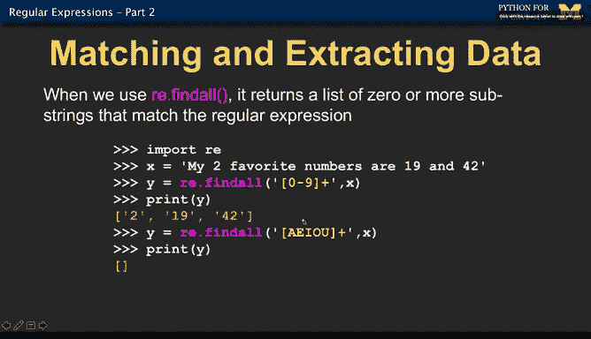
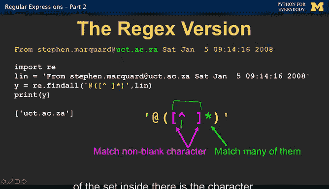

# 密歇根大学《给所有人的Python课》课程3：《使用Python访问Web数据》｜python-network-data｜ - P8：08_02_02_数据提取.zh_en - GPT中英字幕课程资源 - BV1Hu4y1e7WS

So now we're going to talk about extracting data。 and up to now。

 we've just been playing with the search， which gives us back a truer false。

 depending on whether it matches or not。 but now we're going to actually pull stuff out。

 And so we're going to start by looking at a different regular expression， a new regular expression。

 the square bracket， the square bracket is kind of weird in that it is one character。

 So that is describing in between the square brackets。

 what we mean by a single character and we can have a range in here。

 we can have a list of things like AEIO would be vowels，0 through9 is digits。

 So bracket 09 bracket is a single digit。 but then we have a plus to it and that says one or more digits。

 Now if we put a star that zero more digits， which is kind of silly but one or more digits。

And now we're going to use a function called find doll。

 a function in the regular expression library called find doll。

 and so what we're saying here is this is the string we're looking through x。

 and we're looking for the pattern， you， one or more digits。And so then it's going to look and say。

 oh， let me see one or more digits。 Oh， that looks good。 I like that one。 let's keep looking。

 that's good。 And let's keep looking。 and that's good。 And so its it it may find 0。 It may find one。

 or it may find more than one。 And so what it does is it it runs all the way through the text that you've asked it to look for。

 checkinging to see when this matches。 And it gives us back a list of the matches。😊。

So it extracts out the pieces。 So this is kind of like a split and a for loop and checking to see if it's a number and a whole bunch of stuff all rolled into one in one little program and because find all find out if it gives us nothing will give us an empty list。

 but in this case it's given us three strings now they're not numbers。There this is the string 2。

 this is the string 1，9， and that's the string 42， but that's what we get back。

 We get back a list from find all of all the possible matches， okay。

Pretty powerful。Okay， and so， you know， it returns zero or more things we can， you know。

 in this case， we asked for one or more digits。 In this case， I'm saying one or more。

So that's a single character。 It's an uppercase of vowal， A E I O U。

 all uppercase plus means greater than one or greater than equal to1。

 So there's got to be at least one。 And you say， are there any uppercase of vowels in here。 no， no。

 no， no， no， no， no。 so it doesn't find it。 So I get back nothing。 So it has to give me a list。

 Find all of the substrs that match that regular expression and give them back to me。

 There were none。 So you have an empty list。 So you do have to check to see how many things you got back because you might get one。

 You might get 0， You'll get I get 25 things back from a particular regular expression when you give it a line。

Now。🤧嗯。As you're thinking about this， you think of the regular expression。

 it's almost like a stamp or it's going stamp stamp stamp， can I， is this piece work。

 is this piece work， does this piece match， does this piece match？And the problem is。

 is there is this notion in the matching called greedy matching。And unless you say otherwise。

The regular expression library attempts to give you the largest possible version of the string that you're matching。

And so here we have the first characters in F。Any character one or more times。

 And then a start with a colon。 And if this is， if this is the text that we're looking at。

 you could say， oh， yeah， there's the beginning F。 and there's a characters， and there's a colon。

 We're done。The problem is， is that it doesn't stop there。 It's like， oh， wait a sec。

 technically this also matches。 So what do we get back。

 Do we get back the from or do we get back the whole thing。

And greedy matching says you're going to get back the larger thing。 And that's exactly what you get。

 And so all else being equal， you got to be careful when you construct these things。 Now。

 I could have put nonb in there， but I'm doing this to make the point to say that in a sense。

 this is pushing。 That's the greediness is that this wants to be as big as it possibly can be and then still match the entire expression。

 So if you're thinking stamping this expression on that string。

 you can stamp it on the small thing or you can stamp it on the big thing， it says。

 I'll take the big thing。Now， you can override this， but basically。

 you can think of this kind of these wild cards as very pushy， very pushy outwards， greedy。

 as large a possible string。 And that's what we mean by greedy。

 Both the asterisk and the plus push outwards as far， as push as wide as they can。But。

Just like everything in regular expression。 So you can fix that with another character。

 So now we have a three character sequence。 And we to the plus or the asterisk。

 we can add a question mark。 So this says。Any character one or more times。 But don't be greedy。

 So now it looks at it and says， okay， I've got a beginning F， and I can stop here。

 or I can stop here。 but I am not greedy。 So the not greedy prefers the shortest。

 The greedy prefers the longest。 The not greedy prefers the shortest。 And so this is what we get。

 And， and again， when you're writing code using regular expressions。

 It's really important in your test your code so that you see kind of weird anomalies like this like。

 whoa， why did I get that， what's going on。 Why not that？ And then you run it。 And you raise， oh。

 yeah， it's greedy matching， it pushed really hard。 Usually doesn't take too long to figure that out。

 But you do have to sometimes check it。 And so sometimes you got to like do something like add this question mark。

 Don't be greedy。 Okay， So just a fascinating thing。 You're coding。 That's like an if statement。

The question mark is like an if statement， hey。Do the shortest one。

 and you communicate that in a single letter。 That's why they're kind of fun。

 They're like a whole programming language in characters。Okay， so。

Here we have we're looking for the email address。 the common one of the things we' trying to do is take those from lines and tear them apart。

 right？ And so what we say is， hey， let's go find everything that matches a nonblan character。

 one or more nonb characters followed by at sign followed by or more nonb characters。 so yeah。

 this is nonb character。 Oh， but there's no at sign。 This is nonb character。 Oh， yeah。

 there is an at sign in followed by some nonb characters。 So that's a yes match。

 And then none of these other sets of nonb characters match that right。Right， and so that comes out。

 And so there you go。 and we get out exactly what you would expect。

 We get the nonb characters followed by an ant sign followed by some more nonb characters。

 and I've got them pluses to make them be one or more backslash S。Is a nonb character。

 If you go back to the cheat sheet。 that was part of the nonb character。 Okay。

 and you can think of this as also greedy， meaning they're kind of pushing。

 So so this technically D at U would be a one or more nonb characters followed by an sign。

 followed by one or more nonb characters。 But with greediness， it pushes outward。

 And so it goes as far as it can。 And this one， you do want to be greedy。 So you get this。

 If you made this non greedy， you would get D at you。

 So that also kind of helps you understand how greediness and non greedy wants。Now。

We can adjust how find all works by using parentheses， but this is not really using parentheses here。

 so we'll do that next， and so we can fine tune the string extraction。

And have more that we're matching than we're extracting。

 And so if we look at this particular example where we add carrot from space and then。

Some one or more nonb characters followed by an ant sign， one or more nonbt characters。

This match this， right？ So it's a from followed by a space followed by one or more nonbin characters。

 followed by an net sign， followed by one or more nonb characters。

 and it's like this part here is a match。But we don't actually want to get back the whole thing。

 And so we can add parentheses。 So what I'm doing is I'm saying the start extracting after the space。

 So after this from space is part of the match。 but the extracted part starts here。

 And then the extracted part ends here。 So that says this is the part that I want extracted。

 even though I demand this to match。 So I'm demanding I'm extracting less than what I'm matching。

 I'm using the matching to be very precise to the lines I want。

 and then I'm using the parentheses that I add to pull out what I want。

 And so here I get back exactly the email address。 even though now I'm already in this one thing。

 making sure it's from lines that have a prefix of from space。

 So I've got lines with prefix of from space。 Ex the second thing。 And now it's not just anything。

 but it's got to be from space。 and then immediately， nonbake characters followed by net sign。

 followed by nonbl characters。So again， this is really。Fine tuning。Okay。

 so let's take a look at this thing that we' were doing a long time ago。

 but without regular expressions。 And so the idea is we want to pull this little bit out， right。

 And here's the old one。 we find the at position which is position 21。 and so that gives us 21。

 we start at that position。 So we look up and we say when's the next space and we get 31 and that comes into here。

 And so we say we we want to do a string slice from one beyond the at position up to but not including the space。

 Remember up to but not including and that prints us out this little piece。

 but we can do a similar kind of thing with regular expressions。

 And we've seen this with dual split right， So this is the fine way of pulling that out dual split is we split it into words。

With spaces。Then we grabbed the second one， we split that by at signs。

 and then we grabbed the second piece of that。 so we take the second word。

 we split that second word by at sign， and then we take the second piece， second piece。

 and then we get this。 so we were able to do that with four lines， a little more elegant。

But if we do regular expressions。We can say， hey， go find me on at sign。

Followed by some number of nonb characters， and I don't want to extract the at sign right。

 See where I put the parenthesesis。 I want to start extracting after the at sign and up to that rest of those nonb characters。

 So that says Boof， I've got what I want。 So it's a way to say in a little expression right。

Match an non blanklan character。 That's with the bracket So's that's another syntax。

 And that is this is a single character， but if the first letter of the thing of the set inside there is the carrot。

 that means not。

Everything but。So that means everything but a space。 That's non blank。

 So that's everything but a space asterisk。 There's other ways to do that。

 But that's what this is saying。 That's a single non blank character zero more times。

 but that's what I want to extract。 And again， Out comes this little bit。And。We can fine tune this。

By saying。I want to start with from in the line。 I want a space。

 that I want any number of characters up to an at。 and then I want to begin extracting all the nonbl characters and then end extracting。

 And so this is just sort of it's really kind of adding this bit to it。 this fine tuning that's also。

 in a way， could be used to filter the line。 So if you， if you didn't have a from line。

 you would get nothing back and you're not finding email addresses in the middle of text。

 you're just finding email addresses on lines that start with from space。

 And so you just sort of build these things up， you tell the regular expression what you want back and you get back a list。

 And like I said， you got to check to see if the list is empty because that is your way of knowing that it didn't match anything。

And so here's a little bit of code that sort of uses regular expressions to both pick lines and extract data。

 and so this is similar to one of the assignments where you're going to look for lines that have a form like this。

 they say x dashD spam confidence， colon， space， and then a floating point number。

So we're going to run through this， we'll open the data， we'll read through the lines。

 we're going to strip the data， and now we're going to use find all to look for lines that start with D spam。

 X dash D spam dash confidence， colon， quite a bit of stuff。

 it's got to match every character followed by a blank。Then start extracting。

Take0 through9 and period because we're looking for floating point numbers。

 so we want to get the period。Brackt one or more times。

And that's what we're interested in Now here's the part where you kind of have to check。

If we are looking for a line that we're looking for here。

 there is going to be exactly one successful extraction。

 if you don't have the prefix or don't have the number， then you're going to get zero extractions。

 and so what I'm basically saying is this stuff is a list， a list of the matches。

If that length is not one， meaning it's bad if it's two。Because that means there's， you know。

There's more floating point numbers out here that。 How did that happen， Do we know or。

 or who knows what？ It's unlikely that this is going to match more than one。

 So we're not going to do that。 It's one floating point number is what we got on the line。

 Then we're in good shape。Otherwise， we're going to skip that line。

 And so this is in both a filtering like an if blah， blah。

 blah continue or if not starts with continue。 And if it finds it。

 it's also parsse the line and done the split and pulled all those things out。

 And so that's how with regular expressions， you can make programs more succinct。 And when you。

 when you see someone else's regular expression， it might take you a little while。

To figure out what the heck this is doing。Right and you have to read it。

 but the nice thing is is it's not a bunch of lines and so it's a way to make your program shorter。

 don't overuse it， put a few comments in， you know Po sign blah， blah， blah， pound sign blah， blah。

 blah， this is looking for a line that's of this particular syntax and blah， blah blah， blah， blah。

 blah， you know some kind of comment that help help your reader out。

 but once you get used to them and you will start to see them。

 they're often used for data validation for searching and extracting。

Now we've got all these characters， weird little characters， dollar signs， carrots， etc。

 and sometimes we actually want to match those characters。

 and so we have one more special character and it's the backslash and the backslash just can be prefixed on otherwise active character so dollar sign has meaning but slash dollar sign means it's a really a dollar sign。

 So if I'm looking for things strings that start with the dollar sign have a numbers and dots and the nonb characters that says give me the strings that start with dollar sign。

1 or more numbers and or dots。 And so that then matches this bit right here and pulls it out。

 So escape characters。 when you really want one of those characters like a bracket or an asterisk or a plus or a dot。

So。That's a quick zoom through regular expressions。 they're fun。 They're fascinating。

 They lead to elegant code when used appropriately。 I would suggest you don't overuse them。

 but there are some times that they just are the right thing to do。

 And so dont don't use them don't try to confuse your reader of your code because the reader of your code might be you in the future but they're really interesting and powerful and you price see code that uses them so。

Thanks a lot。