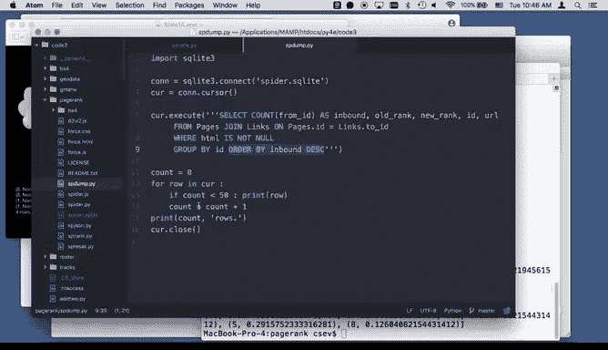
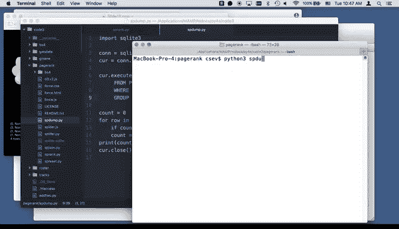
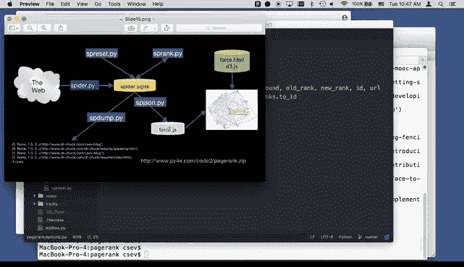
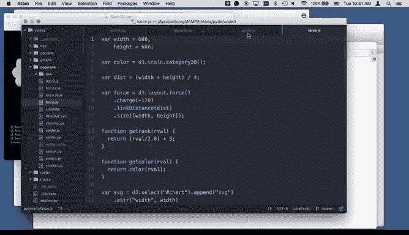
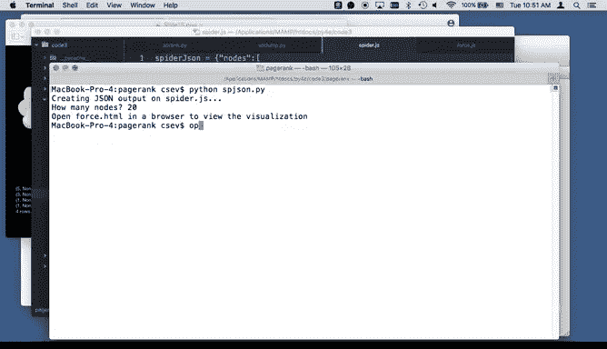
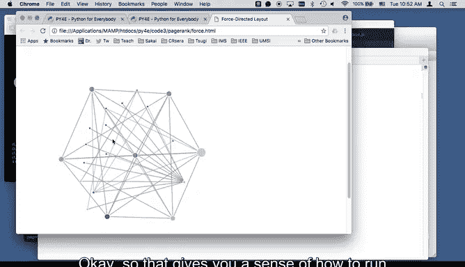

# 密歇根大学《给所有人的Python课》课程5：《毕业项目：使用Python检索、处理和可视化数据》｜python-data-visualization｜ - P8：08_02_04_实例演练-PageRank可视化.zh_en - GPT中英字幕课程资源 - BV1Eh4y1U7aE

🎼。🎼Hello and welcome to Python for everybody。 We're doing some code walkthroughs。

 If you want to follow along， we've got a sample code zip that you can download and take a look at all the code And what we are in the middle of is we're in the middle of the page rank code and we just got done running the page rank and so we have spidered the code We've run page rank a bunch of times。

 SP reset allows us to restart the page rank algorithm if we want。

 but we're not going to play with that。 we're just going to play with SP dumpump and SJ Sun and do the visualization which is the fun part So I'll go into SP dump。

So this is a simple code because it's really just running a SQL query and then printing stuff out right so we connect to our database。

 create a cursor and then just do a select count and we're going to we're going to just show the number of links we're going to order by the number of inbound links descending so we see the most linked things and we'll see the top 50 that so this is just a sample you'll tend to write little helpers like this that make your life easier just to show you the kinds of things that you want SP do Py and like you just kind of test to make sure that's like oh this looks right to me you know and so here is the number of inbound links so that's my blog that has the most inbound links followed by my uncategorized whatever that is and these are the number of inbound links。

Within my own blog somehow， I don't know， because this is not looking at the whole。

whole internet at all so so there we go so that's SP dump pretty straightforward and now we're going to go through the visual visualization process and so this is going to look at all that data and produce some file a JavaScript files going to write a JavaScript file that will then be fed into my visualization using D3。

And S Json。Is going to do a big long join it joins the links with the thing and where HTML is not null and error is not null you know order by the number of inbound links so we're looking at the things that have the highest number of inbound links we're going to read all this stuff we're going to read through all those rows and pull out the page rank for each one。

 we are looking for the highest and lowest rank because these numbers can vary quite widely they go all the way from you 0。

000 to 20 or 30。And so。And so it asks how many do you want to do so it only does the top like 20 or something and you'll see why we need that in the visualization and and so this is just checking and so we're going to write out a file we'll see what the format of this is it's just a little it's just a JavaScript file and we're going to write out we're basically normalizing the rank we're subtracting the minimum rank and because we're going to turn this into line weight。

 the thickness of the line and so we're dividing by you know we're normalizing the rank to be the thickness of the line and the size of the。

The size of the ball you'll see all this and so this is really just writing some jascript with the little strings and stuff like that and then we're going to finish the JavaScript and then we're going to write all the links out so these are the balls that you'll see and this is showing what this is drawing all the lines and this is again normalizing things for thickness and printing these things out now I don't want to go through this in tremendous detail。

 but so i'll do Python。SPjson。pyy。Let's do the top 20 nodes。

And if I take a look at this file， Sp。js， you can see that it's some objects that basically put the page rank in。

 which idea it is and that's a way for me to be able to link back and forth weight is how big the little circle is and then I have the links and I only asked for the top 20 right and then this is the the thickness of the line where the line starts where the line ends okay so this is red。

By this HTML file。And。It's going to read。Somewhere， this force Js file and my own spider。

js code this is some javascript I mean， no the force Js is the visualization code and this is D3 the visualization library so this I'm using this D3。

 js which is a really great visualization library and this is just drawing the circles and making the circles colors and making the circles bigger and smaller and then connecting all the lines in between it So this is just there this data feeds that thing and so when we're all done you simply say open。

 you don't have to do anything open force。 HTML。

And so this all this beautiful ja stuff is like， oh wow。

 that's really cool because you can move these things around whoa you can see the circles are bigger if you hover over it for a while。

 it shows you the big ones you know you can see these things and it's kind of cool。

 So I gave you all this4。s and4。 HTMLtm and so that kind of visualizes the page rank and you could you know use this to visualize quite a bit of stuff I you know it'll take you a while to pull down enough data from a real website but after you pull down 4 or500 pages if you have some time and then the visualization is quite interesting。

 but you can see why we had to pull down several hundred pages just to get this much page rank information。

Okay， so that。That gives you a sense of how to run the page rank code in Python for everybody。

 so thanks for listening。

