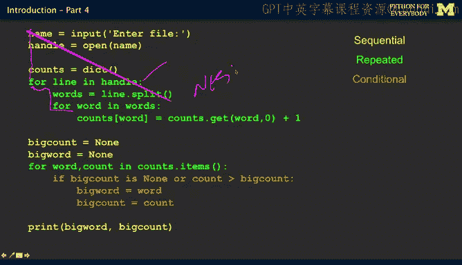
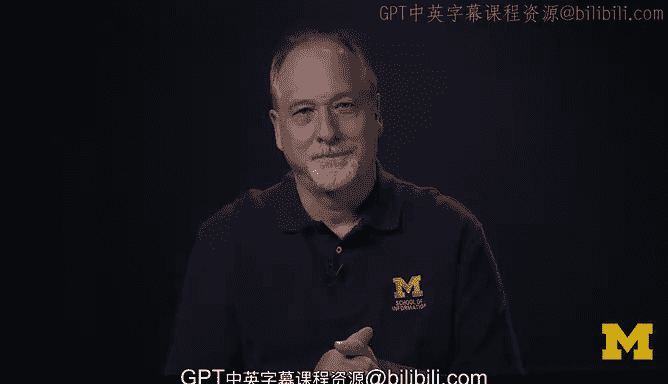

# 密歇根大学《给所有人的Python课》课程1：《编程入门指南（使用Python进行开发）》｜python｜ - P8：08_03_02_编写代码段落.zh_en - GPT中英字幕课程资源 - BV1214y117Mk

So like I said， you can do interactive in Python or you can run a script。

 and script is much more common after about the first 15 minutes。

 you pretty much do everything with a script。So what do you put in that script。 Well。

 it's a series of steps。 Now， there are a couple of basic patterns that we use， and we。

 we compose them。 The most basic pattern is what's called sequential。 We do one thing。

 Then we do the next thing， Then we do the next thing conditional is sort of intelligent where you're doing something and then may or may not be doing something do。

 do， do something， something， something， maybe not， maybe， and you have this if。If this is true。

 do this statement。 If it's false， do some other statement。 Those are called conditional steps。

 and we'll show youhannasack how those look。 And then the real power of computers come when we tell to do something over and over and over again。

 a million times if necessary。 And that's when we have a series of steps that need to be repeated。

 And then the fourth pattern is the store and retreat pattern， which we will visit in Chapter 4。

So this is an example of a four line Python program that has four basic steps Python as if you type these four lines into a file and then told Python to execute them。

 Python will stick two in the variable X， then it'll print that out， our output will be this。

 it'll add two to it and then print it out again and it'll be four。You can。

 This over here is called a flow chart。 I don't really make you write flow charts in the old days。

 They made us write flow charts。 I'm not sure that's all that valuable。

 I'm trying to show you is the sequence of things。 It runs this， does something。

 Then it moves on to the next one， does this， then it moves on to the next one， does this。

 Then it moves on to the next one， Me that when you're done with a statement where are you going to go。

 Well， in this case， it's the simplest of all possible things。

 where we're just going from one thing to the next thing。Now。

 it gets a little more interesting when we do conditional steps and the thing that makes conditional happen is this if。

Right， the if statement is a reserved word。 Okay， And so you'll see it starts the beginning。

 and the if has embedded in it。 a question that leads to a true or a false sends in a colon。

 And then there's an indented block。And what happens is this is the conditional statement。

 Print smaller is the conditional statement， meaning that if x is less than 10 evaluates to true。

 then it's going to execute。 Otherwise it's going to be skipped。 So it can either execute it。

 and continue or can skip right over it。 And so it's probably easiest to show this on this diagram where you start with x equals 5。

 then you hit the if statement。 And the if statement is asking a question。 If the question is true。

 you go down one road。 And if if it's false， you go down the other road。 In this case， x is 5。

 So this is true。 And so we go down this path and print out smaller。 And then we rejoin。

And the next thing we encounter is another if statement is x greater than 20。 Well， in that case。

 it's no because it's not because x is 5。 So we're asking the question。 We're not changing X。

 We're just asking a question about X。So we skip right over this。

 So the way this code ultimately runs is it comes in， runs this， sequentially comes to here。

 conditionally does run this line of code， and then skips completely over it。

 So it's is this code never ran。 And that's a super simple example。

 So it the output is smaller and then fny。 and it's a super simple one。

 And what you'll find is we compose these things to make more complex program。

 So conditional is the second of the three patterns we're going to see。 Now。

 the most exciting pattern is the repeat。 and looks a little more busy because we can do more stuff with it。

 So the basic idea is there are a couple of different looping keywords， reserved words。

 the while and the four。 The while loop basically says it functions kind of like an if statement and that there's a question in it。

 doesn't hurt n and doesn't get changed by this。 It just looks at n and asks the question is in greater than  zero。

 If it is true， it runs this code。😊，So just like an if。 So up to here， it looks like an if。

 if n is true and greater than 0 is true。 it runs this code。 Now， this is a little sequential bit。

 when you're done with this， what do you do， Oh， we just fall on to the next one。

 And you'll notice that this is indented at the same level as the print statement。

 And that's how we have repeating or even if's with more than one statement in it。

And then when it deenddents， that's the end of the loop。 And what happens is it runs this。

 And it runs that。 But then what does it do。 Well， it's at the end of the loop。

 So it actually goes back up to the top of the loop。 So it goes back up to the while statement。

 and we actually printed n out， which was 5。 And then n became 4。

 And then it reevalus this question is 4 greater than 0。 Yes， it is。 So it prints 4 out。

 and then subtracts 1。 It becomes 3。 Now as 3 greater than 0。 Yes， it is。 Yes， it is。

 And so it goes 4，3，2，1。 Then it comes through and it prints 1， and then it subtracts 1 from it。

 So it becomes 0。 now it comes up and asks this question。 is 0 greater than 0。

 because n has become 0， by the successive iterations through this loop。

 So n becomes is not greater than 0。 So this becomes the switches from a true to a false。 And false。

 It leaves。 goes out and exits the loop。 So over here。Because5，4，3，2，1， and then out she comes。 Okay。

 and as soon as this becomes false， then this loop exits。

 And so that's the way we tell the program that， you know。

 we tell the computer that we want it to keep going until something has happened。

 Some we've achieved something。 Who knows what it is we're doing。 None of these。

 None of these programs make any sense， particularly， which is sort of learning baby steps， okay。

So loops have this notion of iteration variables to make sure that they are not infinite loops。

 and this variable N is carefully constructed to start and be checked and then be changed each time through the loop。

 And that's how we make sure this loop only runs five times and not forever。

 because you can construct what we call infinite loops that run forever， but。It's not too practical。

 you just run out a battery or whatever after a while。

 so you generally construct loops to finish so that they have to check to make sure that they're finished。

Okay。😊，So if we take a look back at that story， we see that in that story。

 That is how you count the most common word in a file and print what the word is and how many there are。

 you find that there's some sequential code。 And in Python。

 the way you can tell that a sequential code is when it's not being indented。 It just goes。

 it goes down， down， down， down， down。 Now， the4 is another of the reserved words that e looped。

 So this has a colon。 and it says that's an indented block。

 and there turns out to be a four within a4。 This is called nesting。 We'll get to that。

And then this loop ends and it runs for a while， and then there's more sequential stuff。 There is a4。

 which is repeated code。 and then there's an if nested within that4。 That's conditional code。

 This will run for a while。 and then it comes out and does some sequential code。

 So there is in this sequential code repeated code and conditional code。

 So the three of the four basic patterns of programming we see in this file。

And so if you look at this from an outlineing perspective， this is sort of our story。

 These are the paragraphs of our story。 This top bit here says。

 read the name of a file from the user and open that file so we can read it。

This second paragraph says， oh， as we read through the file。

 create a histogram that maps the number of words to the frequency of the words。

 And each time you see a word， update the histogram so that we have a running total of all of the words using a thing that we'll learn later。

 like in chapter 10 or 9 called dictionaries。And that's cool， it's cool， but don't worry about it。

 don't worry about it， don't worry about it now， So this is making a histogram。

Then once we have the histogram， we've read all the words。

 then we read through the histogram to find the largest。

 and then we print out the largest word in the largest count。

 And so this is a little short story with some sentences and paragraphs and alphabet and reserved words and vocabulary and all that stuff。

And we。Kind of learning how to do it。Don't try to get this all right now。😡，We're going touch on this。

 We got a whole chapter on variables and a whole chapter unconditional， whole chapter on loops。

 right， I just am trying to give you this big picture so that when we get there。

 you can start putting those things together。 And like I said， it's a little confusing。 General。

 it really starts to clear up in chapterpt 6 and Chapt 7。

 And so just understand that we learn little bits and little pieces。

 And then it gets better toward the end。 So。Thanks for listening。

 Chapter 1 was really tried to get you an overview of the kind of stuff that we're going to learn throughout the course and lay down a little bit of vocabulary so I can talk about things like microprocesors and Ram and memory and stuff like that so that you。

So I can communicate， say， hey， we're going to do this thing that's going to do something with the CPU。

 And so that so you can use that。 So hope you find this value and see in the next chapter。

